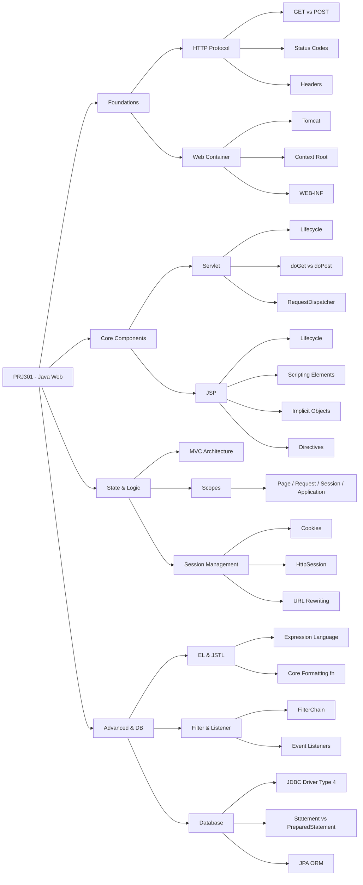
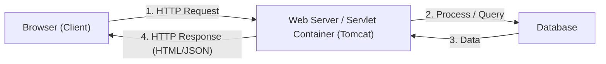
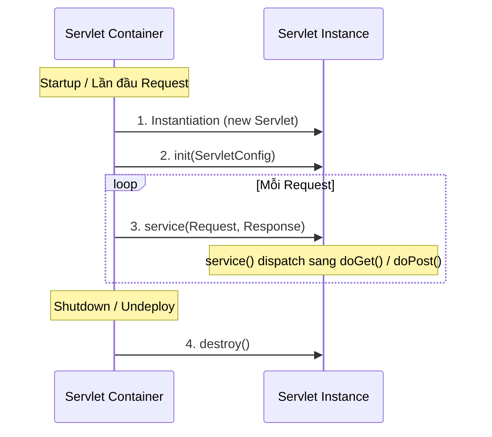
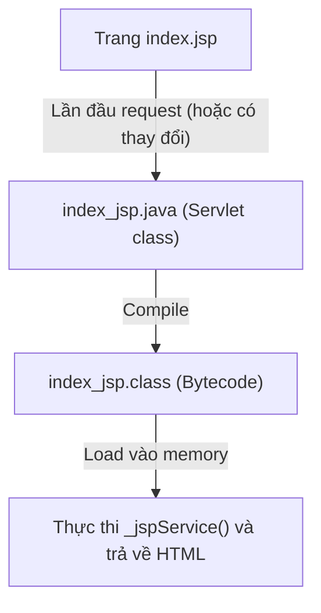
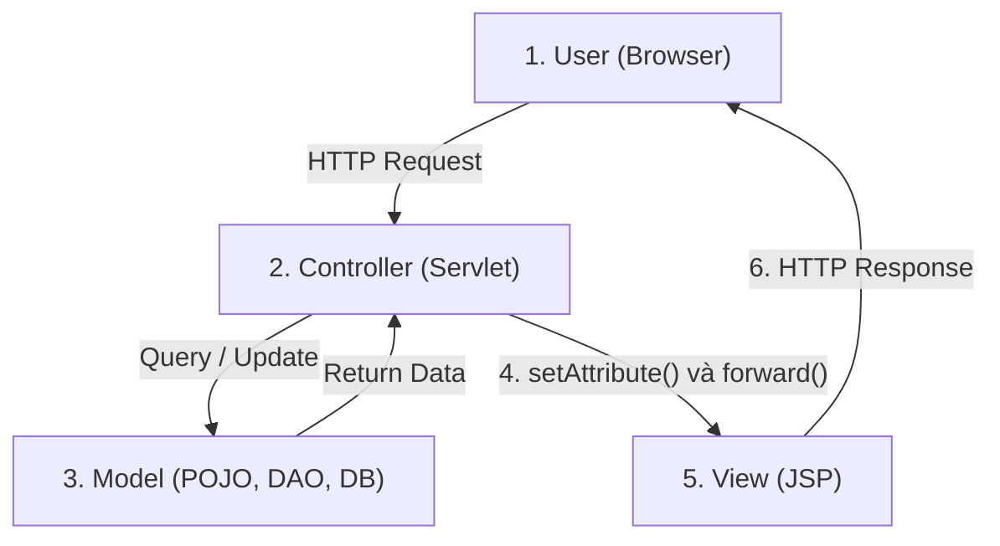
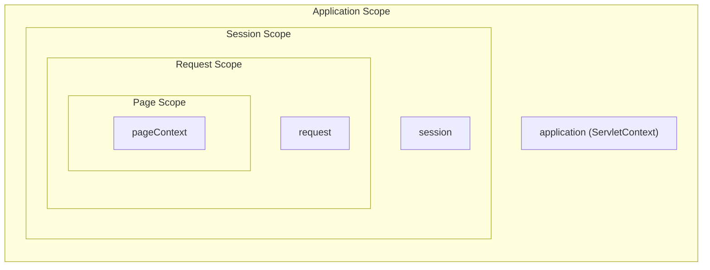
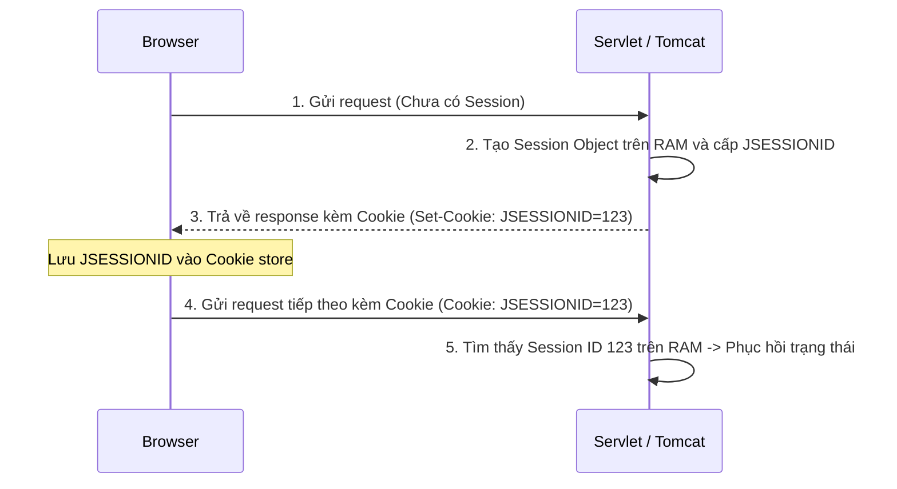

# 📚 CẨM NANG ÔN THI LÝ THUYẾT TOÀN DIỆN: PRJ301 (JAVA WEB APPLICATION DEVELOPMENT)

Tài liệu này được biên soạn nhằm phục vụ ôn tập kỳ thi cuối kỳ (Final Exam) môn PRJ301 tại FPT University. Nội dung được tổng hợp từ Slide FLM, Slide Giáo trình (Teacher), Sessions for AI và giáo trình chuẩn *Professional Java for Web Applications*. Mọi giải thích bằng **tiếng Việt**, giữ nguyên các thuật ngữ chuyên ngành bằng **tiếng English**.

---

## 🗺️ BẢN ĐỒ TƯ DUY KIẾN THỨC MÔN HỌC



---

## 📌 MỤC LỤC

1. [Chương 1: Nền tảng Web & Giao thức HTTP](#chương-1-nền-tảng-web--giao-thức-http)
2. [Chương 2: Servlet Core & Lifecycle](#chương-2-servlet-core--lifecycle)
3. [Chương 3: JavaServer Pages (JSP) & Scripting Elements](#chương-3-javaserver-pages-jsp--scripting-elements)
4. [Chương 4: Kiến trúc MVC & Chia sẻ Dữ liệu (Scopes)](#chương-4-kiến-trúc-mvc--chia-sẻ-dữ-liệu-scopes)
5. [Chương 5: Expression Language (EL) & JSTL](#chương-5-expression-language-el--jstl)
6. [Chương 6: Kết nối Database - JDBC & JPA](#chương-6-kết-nối-database---jdbc--jpa)
7. [Chương 7: Quản lý Phiên - Session Management](#chương-7-quản-lý-phiên---session-management)
8. [Chương 8: Servlet Filter & Event Listener](#chương-8-servlet-filter--event-listener)
9. [Chương 9: 15 Bẫy Thi Kinh Điển (Tránh mất điểm oan)](#chương-9-15-bẫy-thi-kinh-điển-tránh-mất-điểm-oan)
10. [Chương 10: Bộ 30 Câu hỏi Ôn tập Thường gặp (Kèm giải thích chi tiết)](#chương-10-bộ-30-câu-hỏi-ôn-tập-thường-gặp-kèm-giải-thích-chi-tiết)

---

## 📖 Chương 1: Nền tảng Web & Giao thức HTTP

### 1.1. Kiến trúc Client - Server trong Java Web
Ứng dụng Java Web hoạt động theo mô hình yêu cầu - phản hồi (Request - Response).



- **Static Web (Web tĩnh):** Nội dung cố định. Server chỉ đọc file HTML/CSS/JS có sẵn trên ổ đĩa và gửi trả lại cho browser.
- **Dynamic Web (Web động):** Nội dung thay đổi tùy thuộc vào input của user hoặc dữ liệu trong DB. Server sử dụng Servlet/JSP để tạo HTML động tại runtime.
- **Servlet Container (Web Container):** Môi trường chạy Servlet (ví dụ: **Apache Tomcat**). Nó quản lý lifecycle của Servlet, mapping URL, quản lý thread và session.

### 1.2. Giao thức HTTP (HyperText Transfer Protocol)
HTTP là giao thức không trạng thái (**Stateless Protocol**) hoạt động ở tầng ứng dụng (Application Layer).

> [!IMPORTANT]
> **Tại sao HTTP là Stateless?**
> Server không lưu trữ bất kỳ thông tin nào về các request trước đó của client. Mỗi request được xử lý như một giao dịch độc lập. Điều này giúp giao thức đơn giản và dễ mở rộng (scalable), nhưng đòi hỏi các kỹ thuật như Session/Cookie để duy trì trạng thái đăng nhập hoặc giỏ hàng.

#### 1.2.1. Cấu trúc HTTP Request
Gồm 4 phần chính:
1. **Request Line:** Chứa Request Method (GET, POST,...), Request URL, và HTTP Version.
2. **Request Headers:** Metadata gửi kèm (ví dụ: `User-Agent`, `Cookie`, `Accept-Language`).
3. **Blank Line:** Dòng trống phân tách headers và body.
4. **Request Body:** Chứa dữ liệu gửi lên (chỉ có ở POST, PUT).

#### 1.2.2. Cấu trúc HTTP Response
Gồm 4 phần chính:
1. **Status Line (Status-Line):** Chứa HTTP Version, Status Code, và Reason Phrase (ví dụ: `HTTP/1.1 200 OK`).
2. **Response Headers:** Metadata từ server (ví dụ: `Content-Type`, `Set-Cookie`, `Content-Length`).
3. **Blank Line:** Dòng trống phân tách headers và body.
4. **Response Body:** Nội dung phản hồi thực tế (HTML, CSS, JSON, ảnh,...).

```http
HTTP/1.1 200 OK
Content-Type: text/html; charset=UTF-8
Content-Length: 45

<html><body><h1>Hello World!</h1></body></html>
```

#### 1.2.3. Các HTTP Method quan trọng

| Method | Mục đích | Idempotent? | Safe? | Ghi chú |
|---|---|---|---|---|
| **GET** | Truy xuất/Lấy dữ liệu | ✅ Có | ✅ Có | Dữ liệu đính kèm trên URL (Query String), bị giới hạn độ dài. |
| **POST** | Gửi/Tạo dữ liệu mới | ❌ Không | ❌ Không | Dữ liệu nằm trong Request Body, không giới hạn kích thước. |
| **PUT** | Cập nhật/Thay thế tài nguyên | ✅ Có | ❌ Không | Thay thế toàn bộ tài nguyên bằng dữ liệu mới. |
| **DELETE** | Xóa tài nguyên | ✅ Có | ❌ Không | Xóa tài nguyên tại URI được chỉ định. |
| **HEAD** | Chỉ lấy headers phản hồi | ✅ Có | ✅ Có | Giống GET nhưng không trả về Response Body (tiết kiệm bandwidth). |

> [!NOTE]
> **Idempotent (Tính đồng nhất):** Thực hiện một request 1 lần hay nhiều lần liên tiếp đều cho ra cùng một kết quả trên server (GET, PUT, DELETE là idempotent).
> **Safe (Tính an toàn):** Request không làm thay đổi trạng thái dữ liệu trên server (GET, HEAD là safe).

#### 1.2.4. HTTP Status Codes cần nhớ

- **2xx (Success):** Thành công.
  - `200 OK`: Request thành công.
  - `201 Created`: Tạo tài nguyên thành công (thường dùng sau POST/PUT).
- **3xx (Redirection):** Chuyển hướng.
  - `301 Moved Permanently`: Chuyển hướng vĩnh viễn.
  - `302 Found` (hoặc Temporary Redirect): Chuyển hướng tạm thời (được dùng bởi `response.sendRedirect()`).
- **4xx (Client Error):** Lỗi phía Client.
  - `400 Bad Request`: Server không hiểu request do sai cú pháp.
  - `401 Unauthorized`: Yêu cầu xác thực (chưa login).
  - `403 Forbidden`: Client không có quyền truy cập dù đã xác thực.
  - `404 Not Found`: Không tìm thấy tài nguyên tại URL yêu cầu.
  - `405 Method Not Allowed`: Method (ví dụ POST) không được hỗ trợ bởi URL này.
- **5xx (Server Error):** Lỗi phía Server.
  - `500 Internal Server Error`: Lỗi logic trên server (Servlet ném Exception).
  - `503 Service Unavailable`: Server quá tải hoặc đang bảo trì.

---

## 📖 Chương 2: Servlet Core & Lifecycle

### 2.1. Servlet là gì?
Servlet là các Java class chạy trên Web Server/Servlet Container dùng để xử lý HTTP request và tạo ra trang web động.
- Kế thừa class `HttpServlet` (abstract class chuyên xử lý HTTP).
- Từ Jakarta EE 10 (Tomcat 10.1+), import package `jakarta.servlet.*` và `jakarta.servlet.http.*` (thay thế cho `javax.servlet.*` cũ).

### 2.2. Vòng đời của Servlet (Servlet Life Cycle)
Servlet được quản lý hoàn toàn bởi Servlet Container thông qua 3 method cốt lõi:



1. **`init(ServletConfig config)` (Giai đoạn Khởi tạo):**
   - Được gọi **duy nhất 1 lần** sau khi instance Servlet được tạo.
   - Dùng để khởi tạo tài nguyên (mở database connection, đọc cấu hình file).
   - Nếu khởi tạo thất bại, ném ra `ServletException`.
2. **`service(ServletRequest req, ServletResponse res)` (Giai đoạn Phục vụ):**
   - Được gọi **mỗi khi có request** gửi tới Servlet.
   - Chạy trên một Thread riêng biệt.
   - Đối với HTTP, nó tự động ép kiểu thành `HttpServletRequest` / `HttpServletResponse` và phân phối (dispatch) request tới các method xử lý tương ứng (`doGet`, `doPost`, `doPut`, `doDelete`) dựa trên HTTP method.
3. **`destroy()` (Giai đoạn Hủy bỏ):**
   - Được gọi **duy nhất 1 lần** trước khi Container loại bỏ Servlet khỏi bộ nhớ (khi undeploy hoặc stop server).
   - Dùng để dọn dẹp tài nguyên (đóng DB connection, giải phóng thread pool).

> [!CAUTION]
> **Bẫy thi:** Servlet Container hoạt động theo cơ chế **Singleton** đối với mỗi Servlet class (chỉ tạo duy nhất **1 instance** cho mỗi Servlet). Khi có nhiều request đồng thời, Container sẽ tạo ra nhiều Thread cùng thực thi method `service()` trên **cùng một instance** đó. Do đó, các biến instance (biến toàn cục của lớp) **KHÔNG thread-safe** và không bao giờ được dùng để lưu dữ liệu riêng của request!

### 2.3. HttpServletRequest vs HttpServletResponse

#### 2.3.1. Các method quan trọng của `HttpServletRequest`

| Method | Kiểu trả về | Mục đích |
|---|---|---|
| `getParameter(String name)` | `String` | Lấy giá trị của parameter gửi lên từ form hoặc query string. Nếu không tồn tại, trả về `null`. |
| `getParameterValues(String name)` | `String[]` | Lấy danh sách giá trị của parameter (ví dụ: checkbox có cùng name). |
| `getParameterMap()` | `Map<String, String[]>` | Lấy tất cả parameters dưới dạng bản đồ Key-Value. |
| `getAttribute(String name)` | `Object` | Lấy attribute được lưu trữ trong request scope. |
| `setAttribute(String name, Object o)` | `void` | Đặt một attribute vào request scope để truyền dữ liệu (MVC). |
| `getHeader(String name)` | `String` | Lấy giá trị của một HTTP request header. |
| `getSession(boolean create)` | `HttpSession` | Lấy session hiện tại. Nếu truyền `false` và chưa có session, trả về `null`. |
| `getRequestDispatcher(String path)` | `RequestDispatcher` | Lấy bộ điều phối request để thực hiện `forward` hoặc `include`. |

#### 2.3.2. Các method quan trọng của `HttpServletResponse`

| Method | Kiểu trả về | Mục đích |
|---|---|---|
| `setContentType(String type)` | `void` | Thiết lập kiểu MIME cho dữ liệu trả về (ví dụ: `response.setContentType("text/html;charset=UTF-8")`). |
| `getWriter()` | `PrintWriter` | Lấy đối tượng luồng ký tự để ghi văn bản trả về client. |
| `getOutputStream()` | `ServletOutputStream` | Lấy đối tượng luồng nhị phân (dùng khi trả về file, ảnh). |
| `sendRedirect(String location)` | `void` | Yêu cầu browser chuyển hướng tới URL mới (gửi status code 302). |
| `addCookie(Cookie cookie)` | `void` | Gửi một Cookie về lưu trữ trên browser của client. |
| `setStatus(int sc)` | `void` | Thiết lập HTTP status code. |

---

## 📖 Chương 3: JavaServer Pages (JSP) & Scripting Elements

### 3.1. JSP thực chất là gì?
JSP (JavaServer Pages) là công nghệ viết mã giao diện bằng HTML có nhúng mã Java. Thực chất, **JSP là một Servlet**.
Khi nhận request lần đầu tiên, Web Container sẽ dịch (translate) file `.jsp` thành một file source Java (`.java` kế thừa `HttpJspBase` và implement `Servlet`), sau đó biên dịch (compile) thành file `.class` để thực thi.



### 3.2. Các phần tử Scripting Elements trong JSP

| Phần tử | Cú pháp | Phạm vi biên dịch trong Servlet | Ghi chú |
|---|---|---|---|
| **Declaration (Khai báo)** | `<%! ... %>` | Nằm ngoài method `_jspService()`, trực tiếp trong class body. | Dùng để khai báo biến instance, biến static, hoặc định nghĩa các method. |
| **Scriptlet (Mã lệnh)** | `<% ... %>` | Nằm bên trong method `_jspService()`. | Dùng để viết mã Java điều khiển logic (vòng lặp, điều kiện). Biến khai báo ở đây là biến local. |
| **Expression (Biểu thức)** | `<%= ... %>` | Nằm bên trong `_jspService()`, được bọc bởi `out.print(...)`. | Dùng để hiển thị giá trị ra trang HTML. ⚠️ **Tuyệt đối không có dấu chấm phẩy (;) ở cuối.** |

```jsp
<%-- Ví dụ minh họa các Scripting Elements --%>
<%! int globalCount = 0; %> <%-- Instance variable --%>
<%! public String getUpper(String s) { return s.toUpperCase(); } %>

<%
    // Local variable
    int localCount = 0;
    globalCount++;
    localCount++;
%>

<p>Global Count: <%= globalCount %></p>
<p>Local Count: <%= localCount %></p>
<p>Upper: <%= getUpper("hello") %></p>
```

### 3.3. Các JSP Directive (Chỉ thị)
Directive cung cấp thông tin hướng dẫn cho JSP engine tại thời điểm dịch trang (Translation Time). Cú pháp: `<%@ directive attribute="value" %>`.

- **`page` Directive:** Cấu hình các thiết lập cho toàn bộ trang JSP.
  ```jsp
  <%@ page contentType="text/html;charset=UTF-8" import="java.util.List, java.sql.Connection" session="true" isErrorPage="false" errorPage="error.jsp" %>
  ```
- **`include` Directive (Static Include):** Nhúng nội dung của một file khác vào trang hiện tại **trước khi dịch**.
  ```jsp
  <%@ include file="header.jspf" %>
  ```
- **`taglib` Directive:** Khai báo thư viện thẻ tùy biến (Custom Tag) hoặc JSTL.
  ```jsp
  <%@ taglib uri="http://java.sun.com/jsp/jstl/core" prefix="c" %>
  ```

### 3.4. 9 Đối tượng ngầm định trong JSP (Implicit Objects)
Đây là các đối tượng Java được khởi tạo sẵn trong method `_jspService()`, lập trình viên có thể dùng trực tiếp mà không cần khai báo.

| Đối tượng | Kiểu dữ liệu | Phạm vi (Scope) | Mô tả |
|---|---|---|---|
| **`request`** | `HttpServletRequest` | Request | Yêu cầu HTTP hiện tại. |
| **`response`** | `HttpServletResponse` | Page | Phản hồi HTTP hiện tại. |
| **`session`** | `HttpSession` | Session | Phiên làm việc của user (chỉ có khi `session="true"`). |
| **`application`** | `ServletContext` | Application | Toàn bộ ứng dụng web, chia sẻ cho tất cả user. |
| **`out`** | `JspWriter` | Page | Luồng ghi dữ liệu ra response body. |
| **`config`** | `ServletConfig` | Page | Cấu hình khởi tạo của trang JSP. |
| **`pageContext`** | `PageContext` | Page | Quản lý thông tin ngữ cảnh của trang, dùng để lấy các scope attributes. |
| **`page`** | `Object` | Page | Tham chiếu tới chính instance Servlet được sinh ra (`this`). |
| **`exception`** | `Throwable` | Page | Đối tượng lỗi (chỉ tồn tại nếu trang có `<%@ page isErrorPage="true" %>`). |

---

## 📖 Chương 4: Kiến trúc MVC & Chia sẻ Dữ liệu (Scopes)

### 4.1. Kiến trúc MVC Model 2 trong Java Web
MVC (Model - View - Controller) chia ứng dụng thành 3 phần độc lập để dễ quản lý và bảo trì.



- **Controller (Servlet):**
  - Điểm tiếp nhận request duy nhất từ client.
  - Phân tích request, kiểm tra validation đầu vào.
  - Gọi các lớp Model (DAO) để thực hiện logic nghiệp vụ hoặc truy vấn database.
  - Nhận dữ liệu kết quả từ Model, đưa dữ liệu vào các scope (ví dụ request scope) và điều phối (forward) tới View phù hợp.
- **Model (JavaBeans, DAO, DTO):**
  - Lưu giữ trạng thái dữ liệu (POJO).
  - Xử lý nghiệp vụ (Business Logic) và tương tác với Database (DAO).
- **View (JSP):**
  - Nhận dữ liệu từ Controller thông qua các scope attributes.
  - Hiển thị dữ liệu lên giao diện HTML bằng cách sử dụng EL/JSTL.
  - ⚠️ **Không chứa mã Java kết nối DB hay xử lý business logic.**

### 4.2. Bốn phạm vi chia sẻ dữ liệu (Scopes)
Để truyền dữ liệu giữa các thành phần, Java Web sử dụng 4 scope với thời gian sống khác nhau:



| Scope | Đại diện trong Java | Thời gian sống | Trường hợp sử dụng |
|---|---|---|---|
| **Page** | `pageContext` (JSP) | Chỉ tồn tại trong chính trang JSP hiện tại. Kết thúc ngay khi trang chạy xong. | Biến tạm thời phục vụ render giao diện. |
| **Request** | `request` (`ServletRequest`) | Tồn tại trong một chu trình yêu cầu - phản hồi. Nếu dùng `forward()`, request scope vẫn được duy trì sang trang đích. | Truyền kết quả xử lý từ Servlet sang JSP (MVC). |
| **Session** | `session` (`HttpSession`) | Tồn tại xuyên suốt nhiều request của **một user** cụ thể, cho đến khi user tắt trình duyệt, logout (`invalidate`), hoặc hết hạn timeout. | Lưu thông tin đăng nhập, giỏ hàng (Shopping Cart). |
| **Application** | `application` (`ServletContext`) | Tồn tại từ lúc ứng dụng web khởi động cho đến khi shutdown server. Chia sẻ dữ liệu cho **tất cả user**. | Lưu số lượng người online, cấu hình chung của hệ thống. |

---

## 📖 Chương 5: Expression Language (EL) & JSTL

### 5.1. Expression Language (EL)
EL (Expression Language) là ngôn ngữ viết biểu thức ngắn gọn dùng trong JSP để thay thế Scriptlet. Cú pháp: `${expression}`.

#### 5.1.1. So sánh Scriptlet vs EL
- **Scriptlet:** `<% User u = (User)request.getAttribute("user"); if(u != null) { out.print(u.getName()); } %>`
- **EL:** `${user.name}` (Ngắn gọn, tự động gọi getter `getName()`, tự động ép kiểu và an toàn trước lỗi `NullPointerException` - nếu `user` null, EL chỉ hiển thị chuỗi rỗng).

#### 5.1.2. Cách truy cập thuộc tính trong EL
- **Dạng chấm (Dot Notation):** `${user.address.city}` (Yêu cầu tên thuộc tính phải đúng chuẩn định danh Java).
- **Dạng ngoặc (Bracket Notation):** `${user["address"]["city"]}` hoặc `${list[0]}` (Dùng khi thuộc tính chứa ký tự đặc biệt hoặc truy cập mảng/List theo index, hoặc Map theo Key).

#### 5.1.3. Thứ tự tìm kiếm Scope mặc định của EL
Khi viết `${someAttribute}`, EL engine sẽ tự động tìm kiếm attribute này theo thứ tự từ hẹp đến rộng:
$$\text{Page Scope} \rightarrow \text{Request Scope} \rightarrow \text{Session Scope} \rightarrow \text{Application Scope}$$
Nếu không tìm thấy ở bất kỳ scope nào, trả về `null` (hiển thị chuỗi rỗng trên HTML).

#### 5.1.4. 11 Đối tượng ngầm định của EL (Khác với JSP)

| Đối tượng | Mô tả |
|---|---|
| `pageScope` | Map chứa các attribute trong Page Scope. |
| `requestScope` | Map chứa các attribute trong Request Scope. |
| `sessionScope` | Map chứa các attribute trong Session Scope. |
| `applicationScope`| Map chứa các attribute trong Application Scope. |
| `param` | Map chứa các request parameter (1 name - 1 value). Ví dụ: `${param.id}` |
| `paramValues` | Map chứa các request parameter dưới dạng mảng (1 name - nhiều values). |
| `header` | Map chứa HTTP request headers (single value). |
| `headerValues` | Map chứa HTTP request headers (multiple values). |
| `cookie` | Map chứa các Cookie gửi lên từ client. Ví dụ: `${cookie.username.value}` |
| `initParam` | Map chứa các tham số cấu hình khởi tạo của ứng dụng (context-param trong web.xml). |
| `pageContext` | Đối tượng `PageContext` dùng để lấy các thông tin môi trường. Ví dụ: `${pageContext.request.contextPath}` |

### 5.2. JSTL (JSP Standard Tag Library)
Thư viện thẻ tiêu chuẩn giúp lập trình viên viết logic hiển thị bằng cấu trúc thẻ XML thay cho mã Java. Khai báo taglib:
```jsp
<%@ taglib uri="http://java.sun.com/jsp/jstl/core" prefix="c" %>
<%@ taglib uri="http://java.sun.com/jsp/jstl/fmt" prefix="fmt" %>
<%@ taglib uri="http://java.sun.com/jsp/jstl/functions" prefix="fn" %>
```

#### 5.2.1. Các thẻ JSTL Core (`c:`) quan trọng

- **`<c:out>`:** Hiển thị dữ liệu.
  ```jsp
  <c:out value="${user.bio}" default="Chưa có thông tin" escapeXml="true" />
  ```
  > [!IMPORTANT]
  > Mặc định `escapeXml="true"` sẽ tự động mã hóa các ký tự đặc biệt (`<`, `>`, `&`, `"`, `'`) thành các thực thể HTML. Đây là biện pháp bắt buộc để ngăn chặn các cuộc tấn công **XSS (Cross-Site Scripting)** khi hiển thị dữ liệu do người dùng nhập.
- **`<c:set>`:** Tạo hoặc gán giá trị cho biến ở một scope cụ thể.
  ```jsp
  <c:set var="myVar" value="100" scope="request" />
  <c:set target="${user}" property="role" value="admin" />
  ```
- **`<c:remove>`:** Xóa biến khỏi scope.
  ```jsp
  <c:remove var="myVar" scope="request" />
  ```
- **`<c:if>`:** Thẻ điều kiện (⚠️ **Không có thẻ else tương ứng**).
  ```jsp
  <c:if test="${user.age >= 18}" var="isAdult" scope="request">
      <p>Bạn đã đủ tuổi truy cập.</p>
  </c:if>
  ```
- **`<c:choose> / <c:when> / <c:otherwise>`:** Cấu trúc rẽ nhánh nhiều điều kiện (tương đương `if - else if - else`).
  ```jsp
  <c:choose>
      <c:when test="${score >= 8.0}">Học lực Giỏi</c:when>
      <c:when test="${score >= 6.5}">Học lực Khá</c:when>
      <c:otherwise>Học lực Trung bình/Yếu</c:otherwise>
  </c:choose>
  ```
- **`<c:forEach>`:** Vòng lặp duyệt qua một tập hợp (Array, List, Map) hoặc lặp theo chỉ số.
  ```jsp
  <c:forEach var="item" items="${cartList}" varStatus="status">
      <p>STT: ${status.count} | Tên: ${item.name} | Index hiện tại: ${status.index}</p>
  </c:forEach>
  ```
  *Các thuộc tính của `varStatus` (kiểu LoopTagStatus):*
  - `index`: Chỉ số bắt đầu từ 0.
  - `count`: Số thứ tự lần lặp hiện tại (bắt đầu từ 1).
  - `first`: Trả về `true` nếu đây là lần lặp đầu tiên.
  - `last`: Trả về `true` nếu đây là lần lặp cuối cùng.
- **`<c:url>`:** Tạo một URL tự động chứa Context Path và hỗ trợ viết lại URL (URL Rewriting) để truyền session ID khi trình duyệt tắt Cookie.
  ```jsp
  <a href="<c:url value='/detail'><c:param name='id' value='12' /></c:url>">Xem chi tiết</a>
  ```

#### 5.2.2. Các thẻ Định dạng Formatting (`fmt:`)

- **`<fmt:formatNumber>`:** Định dạng số hoặc tiền tệ.
  ```jsp
  <fmt:formatNumber value="${product.price}" type="currency" currencySymbol="VND" />
  ```
- **`<fmt:formatDate>`:** Định dạng ngày tháng (⚠️ Dữ liệu truyền vào thuộc tính `value` phải là kiểu `java.util.Date`, không hỗ trợ LocalDate của Java 8+).
  ```jsp
  <fmt:formatDate value="${product.createdDate}" pattern="dd/MM/yyyy HH:mm:ss" />
  ```

---

## 📖 Chương 6: Kết nối Database - JDBC & JPA

### 6.1. JDBC (Java Database Connectivity)
JDBC là API chuẩn để kết nối và thực thi câu lệnh SQL với các hệ quản trị CSDL quan hệ.

#### 6.1.1. Các thành phần trong kiến trúc JDBC
- `DriverManager`: Quản lý các JDBC driver. Khớp yêu cầu kết nối với driver phù hợp.
- `Connection`: Quản lý kết nối vật lý tới database.
- `Statement` / `PreparedStatement`: Đối tượng gửi và thực thi câu lệnh SQL.
- `ResultSet`: Chứa dữ liệu trả về từ câu lệnh `SELECT`. Con trỏ mặc định nằm ở dòng trước dòng đầu tiên (**BOF - Before First Row**). Phải gọi `next()` để chuyển con trỏ xuống dòng tiếp theo.

#### 6.1.2. 5 bước thực hiện JDBC cơ bản

```java
Connection conn = null;
PreparedStatement ps = null;
ResultSet rs = null;
try {
    // Bước 1: Tải JDBC Driver (Type 4) vào bộ nhớ
    Class.forName("com.microsoft.sqlserver.jdbc.SQLServerDriver");
    
    // Bước 2: Thiết lập kết nối
    String url = "jdbc:sqlserver://localhost:1433;databaseName=MyStore;encrypt=true;trustServerCertificate=true;";
    conn = DriverManager.getConnection(url, "sa", "123456");
    
    // Bước 3: Chuẩn bị câu lệnh SQL
    String sql = "SELECT * FROM Users WHERE role = ?";
    ps = conn.prepareStatement(sql);
    ps.setString(1, "ADMIN");
    
    // Bước 4: Thực thi và xử lý kết quả
    rs = ps.executeQuery();
    while(rs.next()) {
        System.out.println("User: " + rs.getString("username")); // Đọc theo tên cột (label)
    }
} catch(ClassNotFoundException | SQLException e) {
    e.printStackTrace();
} finally {
    // Bước 5: Đóng tài nguyên theo thứ tự NGƯỢC với lúc mở
    if(rs != null) try { rs.close(); } catch(SQLException e) {}
    if(ps != null) try { ps.close(); } catch(SQLException e) {}
    if(conn != null) try { conn.close(); } catch(SQLException e) {}
}
```

> [!WARNING]
> **PreparedStatement vs Statement:**
> Luôn luôn ưu tiên sử dụng `PreparedStatement` vì:
> 1. Tránh tấn công **SQL Injection** do dữ liệu được truyền qua tham số (`?`) đã được tự động escape.
> 2. Tối ưu hiệu năng: Câu lệnh SQL chỉ biên dịch 1 lần trên database server và có thể tái sử dụng nhiều lần với các tham số khác nhau.

### 6.2. JPA (Java Persistence API) & ORM
JPA là đặc tả kỹ thuật (Specification) chuẩn của Java EE để ánh xạ các đối tượng Java (POJO) thành các bảng trong CSDL quan hệ (Object-Relational Mapping - ORM). Hibernate là implementation phổ biến nhất của JPA.

#### Các annotation JPA cơ bản:
- `@Entity`: Đánh dấu class là một thực thể JPA được ánh xạ tới bảng DB.
- `@Table(name = "tên_bảng")`: Chỉ định tên bảng trong database.
- `@Id`: Chỉ định trường làm khóa chính (Primary Key).
- `@GeneratedValue(strategy = GenerationType.IDENTITY)`: Khóa chính tự động tăng (Auto Increment).
- `@Column(name = "tên_cột", nullable = false)`: Cấu hình ánh xạ cột trong DB.

---

## 📖 Chương 7: Quản lý Phiên - Session Management

Do HTTP là stateless, ứng dụng web cần các cơ chế để nhận biết các request đến từ cùng một người dùng. Có 4 kỹ thuật chính:

### 7.1. Hidden Form Fields (Trường ẩn của Form)
Nhúng thông tin phiên vào các thẻ input ẩn trong form HTML.
```html
<input type="hidden" name="sessionID" value="XYZ789" />
```
- **Hạn chế:** Chỉ hoạt động khi người dùng submit form bằng POST, không có tác dụng khi click vào các liên kết thường (`<a>`).

### 7.2. URL Rewriting (Viết lại URL)
Nhúng mã định danh phiên (Session ID) trực tiếp vào URL của mọi liên kết.
```
http://localhost:8080/MyStore/checkout;jsessionid=58112645388D9380808A72
```
- **Hạn chế:** Không an toàn do Session ID bị lộ trên thanh địa chỉ, lịch sử trình duyệt và log của Web Server.

### 7.3. Cookies
Mảnh dữ liệu nhỏ do server gửi về và lưu trên ổ đĩa cứng hoặc bộ nhớ của client. Mỗi request sau đó, trình duyệt tự động đính kèm cookie tương ứng gửi lên server.

#### Cấu hình vòng đời Cookie bằng `setMaxAge(int seconds)`:
- `seconds > 0`: Persistent Cookie - Cookie được lưu trên ổ đĩa cứng của client và tồn tại đúng thời gian quy định (giây) ngay cả khi tắt trình duyệt.
- `seconds < 0` (mặc định): Session Cookie - Cookie chỉ được lưu trên RAM của trình duyệt và sẽ bị xóa ngay lập tức khi tắt trình duyệt.
- `seconds == 0`: Ra lệnh cho trình duyệt **xóa Cookie** này ngay lập tức.

### 7.4. HttpSession API
Container tạo một đối tượng session trên bộ nhớ RAM của server và cấp một định danh duy nhất (`JSESSIONID`). ID này được gửi về lưu trữ tại trình duyệt dưới dạng một Session Cookie.



#### Các phương thức quan trọng cần nhớ:
- `request.getSession()` (hoặc `request.getSession(true)`): Lấy session hiện tại, nếu chưa có thì tạo mới một session (Không bao giờ trả về `null`).
- `request.getSession(false)`: Lấy session hiện tại, nếu chưa có session thì trả về `null` (Dùng khi kiểm tra trạng thái login hoặc làm chức năng logout).
- `session.invalidate()`: Hủy bỏ toàn bộ session hiện tại trên server (Xóa sạch session data).
- `session.setMaxInactiveInterval(int seconds)`: Thiết lập thời gian tối đa session tồn tại nếu không nhận được thêm request nào từ client (tính bằng **giây**).

> [!IMPORTANT]
> **Cấu hình Session Timeout trong `web.xml`:**
> ```xml
> <session-config>
>     <session-timeout>30</session-timeout> <!-- Đơn vị ở đây là PHÚT -->
> </session-config>
> ```
> ⚠️ **Bẫy thi cực mạnh:** Cấu hình trong `web.xml` dùng đơn vị **PHÚT**, trong khi method `setMaxInactiveInterval(seconds)` trong code Java dùng đơn vị **GIÂY**.

---

## 📖 Chương 8: Servlet Filter & Event Listener

### 8.1. Servlet Filter
Filter là các component trung gian chặn (intercept) request và response trước khi chúng đến được Servlet/JSP hoặc quay về client.

```
Client (Browser) ──> Filter 1 (Encoding) ──> Filter 2 (Auth) ──> Servlet/JSP (Dest)
Client (Browser) <── Filter 1 (Encoding) <── Filter 2 (Auth) <── Servlet/JSP (Dest)
```

#### 8.1.1. Cấu trúc Filter Interface
```java
public class SecurityFilter implements Filter {
    public void init(FilterConfig filterConfig) throws ServletException {
        // Chạy duy nhất 1 lần khi ứng dụng web bắt đầu deploy
    }

    public void doFilter(ServletRequest request, ServletResponse response, FilterChain chain)
            throws IOException, ServletException {
        // 1. Pre-processing: Xử lý request trước khi tới Servlet (ví dụ: check login, set UTF-8)
        HttpServletRequest req = (HttpServletRequest) request;
        HttpServletResponse res = (HttpServletResponse) response;
        
        HttpSession session = req.getSession(false);
        if (session != null && session.getAttribute("user") != null) {
            // Cho phép đi tiếp đến Filter tiếp theo hoặc tới Servlet đích
            chain.doFilter(request, response);
        } else {
            // Chặn đứng request và chuyển hướng
            res.sendRedirect(req.getContextPath() + "/login.jsp");
        }
        
        // 2. Post-processing: Xử lý response sau khi Servlet chạy xong trước khi trả về browser
    }

    public void destroy() {
        // Chạy duy nhất 1 lần khi undeploy/stop server
    }
}
```

> [!CAUTION]
> **Bẫy thi:**
> - Nếu trong `doFilter` bạn **không gọi** `chain.doFilter(request, response)`, request sẽ bị chặn đứng tại Filter đó và không bao giờ đến được Servlet/JSP đích.
> - Cấu hình thứ tự Filter: Nếu dùng annotation `@WebFilter`, thứ tự chạy của các Filter **không được đảm bảo**. Nếu muốn cấu hình chính xác Filter nào chạy trước (ví dụ: EncodingFilter chạy trước AuthFilter), bắt buộc phải cấu hình trong `web.xml` (thứ tự chạy tương ứng với thứ tự khai báo thẻ `<filter-mapping>`).

### 8.2. Event Listener
Listener là các component lắng nghe các sự kiện quan trọng xảy ra trong ứng dụng web để thực hiện các hành động tương ứng.

Các Interface Listener phổ biến:
- `ServletContextListener`: Lắng nghe sự kiện khởi động hoặc tắt của toàn bộ ứng dụng web.
  - `contextInitialized(ServletContextEvent sce)`: Được gọi khi ứng dụng web bắt đầu hoạt động (thích hợp để khởi tạo DB Connection Pool).
  - `contextDestroyed(ServletContextEvent sce)`: Được gọi khi ứng dụng dừng hoạt động.
- `HttpSessionListener`: Lắng nghe sự kiện tạo mới hoặc hủy bỏ của một Session.
  - `sessionCreated(HttpSessionEvent se)` / `sessionDestroyed(HttpSessionEvent se)` (Dùng để đếm số lượng session đang online).
- `ServletRequestListener`: Lắng nghe sự kiện mỗi khi có một request đi vào/ra hệ thống.

---

## 📖 Chương 9: 15 Bẫy Thi Kinh Điển (Tránh mất điểm oan)

> [!WARNING]
> Tổng hợp các lỗi sai phổ biến nhất học sinh hay mắc phải trong kỳ thi lý thuyết PRJ301. Hãy đọc thật kỹ!

1. **Bẫy dấu chấm phẩy trong JSP Expression:**
   - ❌ Sai: `<%= user.getName(); %>`
   - ✅ Đúng: `<%= user.getName() %>` (JSP Expression dịch thành `out.print(...)` nên tuyệt đối không được có dấu `;` ở cuối).
2. **Bẫy Servlet Single Instance (Instance Variables):**
   - Lập trình viên khai báo biến toàn cục (instance variable) trong Servlet để lưu dữ liệu của user. Nhiều request đồng thời sử dụng chung instance này dẫn tới ghi đè dữ liệu của nhau. Luôn dùng biến cục bộ (local variable) trong doGet/doPost.
3. **Bẫy địa chỉ URL trên Address Bar:**
   - Gõ URL trực tiếp trên trình duyệt hoặc nhấn Enter trên thanh địa chỉ luôn tạo ra request kiểu **GET**. Không bao giờ tạo được request **POST** từ thanh địa chỉ.
4. **Bẫy Scope Attribute của EL:**
   - Nếu trong `request` có attribute `"msg"` giá trị `"A"` và trong `session` cũng có attribute `"msg"` giá trị `"B"`. Khi viết `${msg}`, kết quả hiển thị sẽ luôn là `"A"` do EL tìm kiếm từ hẹp đến rộng (request scope tìm thấy trước session scope).
5. **Bẫy Parameter Index trong JDBC PreparedStatement:**
   - Chỉ số index của dấu hỏi chấm `?` trong JDBC bắt đầu từ **1**, không phải từ 0.
   - ❌ Sai: `ps.setString(0, "data");`
   - ✅ Đúng: `ps.setString(1, "data");`
6. **Bẫy Execute Update vs Execute Query:**
   - `executeQuery()` chỉ dùng cho các câu lệnh SQL trả về tập dữ liệu (SELECT) và trả về đối tượng `ResultSet`.
   - `executeUpdate()` dùng cho INSERT, UPDATE, DELETE và trả về kiểu `int` biểu thị số dòng bị ảnh hưởng trong DB.
7. **Bẫy Đơn vị thời gian Session Timeout:**
   - Trong `web.xml`, `<session-timeout>30</session-timeout>` là **30 phút**.
   - Trong code Java, `session.setMaxInactiveInterval(1800)` là **1800 giây** (30 phút).
8. **Bẫy getSession() vs getSession(false):**
   - `request.getSession()` (hoặc tham số `true`) tự động tạo session mới nếu chưa có. Không bao giờ trả về `null`.
   - `request.getSession(false)` trả về `null` nếu chưa tồn tại session. Dùng để check login. Nếu dùng nhầm `getSession()` để check login, hệ thống sẽ tự động cấp session mới và luôn coi là user đã hợp lệ.
9. **Bẫy static include `<%@ include %>` vs dynamic include `<jsp:include>`:**
   - Static include xảy ra ở Translation Time (dịch code), gộp tất cả file thành 1 file Java duy nhất để compile.
   - Dynamic include xảy ra ở Runtime, biên dịch các file riêng biệt rồi nhúng kết quả HTML lại với nhau. Thẻ `<jsp:include>` hỗ trợ truyền param bằng thẻ `<jsp:param>`, còn static include thì không.
10. **Bẫy `forward()` vs `sendRedirect()`:**
    - `forward` (RequestDispatcher): Thực hiện hoàn toàn ở phía Server, URL trình duyệt không đổi, chia sẻ chung đối tượng request/response (giữ được request attribute).
    - `sendRedirect` (HttpServletResponse): Gửi mã 302 về trình duyệt yêu cầu tạo một request hoàn toàn mới đến URL mới. URL trình duyệt thay đổi, request attribute cũ bị mất sạch.
11. **Bẫy truy cập thư mục `/WEB-INF/`:**
    - Mọi tài nguyên đặt bên trong thư mục `/WEB-INF/` (ví dụ: `/WEB-INF/views/index.jsp`) đều được bảo vệ nghiêm ngặt. Trình duyệt client **không thể** truy cập trực tiếp qua đường dẫn URL. Chỉ có thể truy cập thông qua cơ chế `forward()` nội bộ từ phía Server.
12. **Bẫy HTML Comment (`<!-- -->`) trong JSP:**
    - Mã nhúng Java/EL nằm bên trong HTML comment **vẫn được thực thi** trên server trước khi trả về.
    - Để comment thực sự không chạy mã, bắt buộc phải dùng JSP comment: `<%-- ${expression} --%>`.
13. **Bẫy thẻ `<c:if>`:**
    - Thẻ `<c:if>` của JSTL core **không có thẻ else**. Để làm logic dạng If-Else, bắt buộc phải dùng cấu trúc `<c:choose> / <c:when> / <c:otherwise>`.
14. **Bẫy `@WebFilter` Ordering:**
    - Web container không cam kết thứ tự thực hiện các Filter nếu chúng được đăng ký bằng annotation `@WebFilter`. Phải dùng `web.xml` để cấu hình chính xác thứ tự mapping.
15. **Bẫy đối tượng `exception` trong JSP:**
    - Đối tượng implicit `exception` chỉ có thể sử dụng nếu trang JSP đó được khai báo chỉ thị: `<%@ page isErrorPage="true" %>`. Viết ở trang thường sẽ báo lỗi compile ngay lập tức.

---

## 📖 Chương 10: Bộ 30 Câu hỏi Ôn tập Thường gặp (Kèm giải thích chi tiết)

#### Q1: Tại sao nói giao thức HTTP là "stateless"? Hãy nêu các cách giải quyết tình trạng này trong lập trình Java Web.
**Trả lời:**
- HTTP là "stateless" vì server không lưu giữ bất kỳ thông tin nào về các yêu cầu trước đó từ cùng một client. Mỗi cặp Request-Response là độc lập.
- Các giải quyết:
  1. **Hidden Form Fields:** Lưu trữ thông tin ẩn trong form HTML.
  2. **URL Rewriting:** Đính kèm Session ID vào cuối URL của các liên kết.
  3. **Cookies:** Lưu trữ thông tin cặp Key-Value trực tiếp trên trình duyệt của client.
  4. **HttpSession API:** Tạo đối tượng lưu trữ trạng thái trên RAM của Server và quản lý qua mã định danh `JSESSIONID` gửi về client dạng cookie.

#### Q2: Phân biệt sự khác nhau giữa `request.getParameter(String)` và `request.getAttribute(String)`.
**Trả lời:**

| Tiêu chí | `getParameter()` | `getAttribute()` |
|---|---|---|
| **Kiểu trả về** | `String` | `Object` (Phải ép kiểu khi nhận) |
| **Nguồn dữ liệu** | Đến từ phía Client gửi lên (Query string trên URL hoặc dữ liệu nhập trong HTML Form). | Được thiết lập thủ công phía Server bằng code Java (`request.setAttribute()`). |
| **Mục đích** | Đọc dữ liệu đầu vào (input) của người dùng. | Chia sẻ và truyền đối tượng dữ liệu giữa Servlet và JSP trong mô hình MVC. |

#### Q3: So sánh sự khác nhau chi tiết giữa `RequestDispatcher.forward()` và `HttpServletResponse.sendRedirect()`.
**Trả lời:**

| Tiêu chí | `forward(request, response)` | `sendRedirect(URL)` |
|---|---|---|
| **Vị trí xử lý** | Thực hiện nội bộ hoàn toàn trên Server. | Browser nhận mã 302 và tự động tạo request mới. |
| **Địa chỉ URL trên Browser** | **Không thay đổi** (Người dùng vẫn thấy URL của Servlet xử lý ban đầu). | **Thay đổi** sang địa chỉ URL mới được chỉ định. |
| **Số lượng Request/Response**| Chỉ có **1 request** duy nhất được chuyển tiếp. | Tạo ra **2 request** độc lập. |
| **Dữ liệu Request Scope** | **Được bảo toàn** (Có thể dùng `request.getAttribute()`). | **Bị xóa bỏ hoàn toàn** do request mới được tạo ra. |
| **Phạm vi chuyển hướng** | Chỉ chuyển tiếp được tới các trang trong cùng một ứng dụng Web. | Chuyển hướng tới bất kỳ URL nào (kể cả trang web bên ngoài như google.com). |

#### Q4: Trình bày vòng đời của một Servlet.
**Trả lời:**
Vòng đời Servlet gồm 3 giai đoạn chính được quản lý bởi Web Container:
1. **Khởi tạo (`init`):** Khi server nhận request đầu tiên cho Servlet đó, Web Container sẽ load class, tạo instance và gọi method `init(ServletConfig)`. Method này chỉ chạy **đúng 1 lần** trong suốt vòng đời Servlet.
2. **Phục vụ (`service`):** Với mỗi request tiếp theo gửi tới Servlet, Container tạo một thread mới và gọi method `service()`. Method này phân tích loại HTTP request để gọi tương ứng các method `doGet()`, `doPost()`,...
3. **Hủy bỏ (`destroy`):** Khi server stop hoặc ứng dụng bị undeploy, Container gọi method `destroy()` để giải phóng tài nguyên. Chạy **đúng 1 lần** trước khi đối tượng bị dọn dẹp bởi Garbage Collector.

#### Q5: Giải thích tại sao các biến instance (biến toàn cục) khai báo trong Servlet lại không an toàn khi chạy đa luồng (thread-safe). Cách phòng tránh.
**Trả lời:**
- **Lý do:** Web Container chỉ tạo duy nhất một thực thể (Single Instance) của mỗi lớp Servlet để phục vụ cho mọi request từ tất cả người dùng. Mỗi request được xử lý trên một luồng (thread) riêng biệt nhưng các luồng này lại chạy đồng thời và chia sẻ chung tài nguyên là instance Servlet đó. Nếu khai báo biến toàn cục ở mức class, các thread của các user khác nhau sẽ đọc và ghi đè lên cùng một vùng nhớ đó, dẫn đến sai lệch dữ liệu của nhau.
- **Cách phòng tránh:**
  1. Không khai báo bất kỳ biến instance nào có tính chất lưu trữ dữ liệu riêng của request.
  2. Khai báo tất cả các biến xử lý dữ liệu bên trong các method `doGet`, `doPost` (biến local nằm trên Stack của từng Thread riêng biệt nên an toàn).
  3. Sử dụng các khối `synchronized` nếu bắt buộc phải chia sẻ tài nguyên chung.

#### Q6: Trình bày vòng đời xử lý của một trang JSP.
**Trả lời:**
Vòng đời gồm các bước:
1. **Translation (Dịch mã):** JSP engine kiểm tra file JSP và dịch nó thành file mã nguồn Java Servlet (`.java`).
2. **Compilation (Biên dịch):** File `.java` được biên dịch thành file mã máy Java Bytecode (`.class`).
3. **Instantiation & Initialization:** Web Container load file `.class`, tạo instance của JSP Servlet và gọi method `jspInit()`.
4. **Execution (Thực thi):** Với mỗi request gửi tới, Container gọi method `_jspService(request, response)` để xử lý và ghi mã HTML trả về client.
5. **Destruction (Hủy bỏ):** Khi ứng dụng web dừng, Container gọi method `jspDestroy()` để dọn dẹp tài nguyên.

#### Q7: Phân biệt sự khác nhau giữa chỉ thị Static Include (`<%@ include file="..." %>`) và Action Dynamic Include (`<jsp:include page="..." />`).
**Trả lời:**

| Tiêu chí | Static Include (`<%@ include %>`) | Dynamic Include (`<jsp:include>`) |
|---|---|---|
| **Thời điểm thực hiện** | **Translation Time** (Khi dịch code JSP sang Servlet). | **Runtime** (Khi trang JSP đang được thực thi). |
| **Cơ chế xử lý** | Đọc nội dung file đích và gộp trực tiếp mã nguồn vào file hiện tại rồi mới dịch & biên dịch. Kết quả sinh ra **1 file Servlet duy nhất**. | Thực thi file đích một cách độc lập, sau đó lấy kết quả HTML trả về của file đó để chèn vào trang hiện tại. Sinh ra **2 file Servlet độc lập**. |
| **Biến số** | Các file dùng chung tất cả biến local khai báo trong trang. | Không chia sẻ biến local của Java. |
| **Truyền tham số (Param)** | Không hỗ trợ truyền tham số. | Hỗ trợ truyền tham số bằng thẻ `<jsp:param>`. |
| **Tốc độ thực thi** | Nhanh hơn tại runtime vì chỉ thực thi 1 servlet duy nhất. | Chậm hơn một chút vì phải thực hiện gọi thêm servlet khác tại runtime. |

#### Q8: Đối tượng `pageContext` trong JSP có vai trò gì? Cho ví dụ sử dụng.
**Trả lời:**
- **Vai trò:** `pageContext` (kiểu `PageContext`) đại diện cho ngữ cảnh của trang JSP hiện tại. Nó là đối tượng mạnh nhất giúp truy cập tới các đối tượng ngầm định khác (như request, response, session, application) và tìm kiếm/thiết lập các attribute trên cả 4 phạm vi (scopes).
- **Ví dụ:**
  - Lấy Context Path trong EL: `${pageContext.request.contextPath}`
  - Thiết lập thuộc tính ở request scope thông qua pageContext:
    ```jsp
    <% pageContext.setAttribute("myVar", "Hello", PageContext.REQUEST_SCOPE); %>
    ```

#### Q9: Giải thích cơ chế tìm kiếm phạm vi (Scope Search Order) mặc định của biểu thức Expression Language (EL).
**Trả lời:**
Khi EL thực hiện đánh giá một biểu thức dạng `${myAttribute}` mà không chỉ định rõ scope, bộ dịch EL sẽ tự động tìm kiếm đối tượng có tên `myAttribute` trong Map của 4 scope theo thứ tự ưu tiên từ phạm vi nhỏ nhất đến lớn nhất:
1. `Page Scope`
2. `Request Scope`
3. `Session Scope`
4. `Application Scope`
Nếu tìm thấy ở scope nào trước, nó sẽ trả về ngay lập tức (First-match wins) và dừng tìm kiếm. Nếu đi qua cả 4 scope không thấy, nó trả về `null` (hiển thị chuỗi rỗng).

#### Q10: Hãy nêu điểm khác biệt chính giữa `${user.name}` và `<c:out value="${user.name}" />` liên quan đến vấn đề bảo mật.
**Trả lời:**
- `${user.name}`: Xuất trực tiếp giá trị của thuộc tính ra giao diện HTML. Nếu giá trị này chứa mã độc hại script (ví dụ: `<script>alert('hack')</script>`), trình duyệt sẽ thực thi đoạn mã này, dẫn tới lỗ hổng **XSS (Cross-Site Scripting)**.
- `<c:out value="${user.name}" />`: Mặc định có thuộc tính `escapeXml="true"`. Nó sẽ tự động biến đổi các ký tự nhạy cảm thành các HTML entities tương ứng (ví dụ `<` thành `&lt;`, `>` thành `&gt;`). Đoạn script độc hại sẽ chỉ hiển thị dạng văn bản thuần trên màn hình và không thể thực thi được, giúp bảo vệ ứng dụng khỏi lỗ hổng XSS.

#### Q11: Thẻ `<c:forEach>` có thuộc tính `varStatus` dùng để làm gì? Liệt kê các thuộc tính của đối tượng `varStatus`.
**Trả lời:**
- **Vai trò:** `varStatus` định nghĩa một biến trạng thái giúp theo dõi các thông tin về vòng lặp hiện tại (đang lặp ở phần tử thứ mấy, có phải phần tử đầu hay cuối không).
- **Các thuộc tính:**
  - `index`: Chỉ số hiện tại của vòng lặp (bắt đầu từ 0).
  - `count`: Số thứ tự lần lặp hiện tại (bắt đầu từ 1).
  - `first`: Trả về `true` nếu đây là lần lặp đầu tiên.
  - `last`: Trả về `true` nếu đây là lần lặp cuối cùng.
  - `current`: Trả về đối tượng phần tử hiện tại đang được duyệt.

#### Q12: Tại sao chúng ta không nên sử dụng các thẻ JSTL SQL (`<sql:query>`, `<sql:update>`) trong các dự án thực tế?
**Trả lời:**
- Việc sử dụng thẻ SQL trực tiếp trên file JSP đã vi phạm nghiêm trọng nguyên tắc thiết kế của kiến trúc **MVC (Model-View-Controller)**.
- JSP chỉ đóng vai trò là **View** (hiển thị giao diện), không được chứa logic kết nối database hoặc xử lý nghiệp vụ. Việc viết SQL trên JSP làm code bị trộn lẫn, khó bảo trì, khó viết unit test và không thể tái sử dụng mã nguồn. Mọi thao tác kết nối DB phải được thực hiện ở tầng Model (DAO) và được điều phối bởi Controller (Servlet).

#### Q13: Trình bày sự khác nhau giữa `Statement` và `PreparedStatement` trong JDBC. Tại sao nên sử dụng `PreparedStatement`?
**Trả lời:**
- **Statement:** Dùng cho câu lệnh SQL tĩnh không có tham số. Chuỗi SQL được nối trực tiếp bằng Java String. DB Server phải phân tích và biên dịch lại câu lệnh SQL này mỗi lần thực thi. Dễ bị lỗi bảo mật **SQL Injection**.
- **PreparedStatement:** Dùng cho câu lệnh SQL động có tham số parameterized (sử dụng dấu `?`). Câu lệnh SQL được gửi lên biên dịch trước trên DB Server. Khi thực thi, ta chỉ cần truyền tham số vào.
- **Nên dùng `PreparedStatement` vì:**
  1. **Bảo mật:** Chống tấn công SQL Injection vì các tham số truyền vào được xử lý dưới dạng dữ liệu thuần, không bị thực thi như mã lệnh SQL.
  2. **Hiệu năng:** Tốc độ thực thi nhanh hơn khi chạy lặp lại nhiều lần do không phải biên dịch lại câu lệnh SQL.
  3. **Rõ ràng:** Mã nguồn sạch sẽ, dễ đọc hơn so với việc nối chuỗi phức tạp của `Statement`.

#### Q14: Cách xử lý đọc cột trong `ResultSet` dựa trên nhãn cột (Column Label) và tên cột (Column Name). Hãy cho biết cách nào được ưu tiên hơn và tại sao.
**Trả lời:**
- **Định nghĩa:**
  - Column Name: Tên gốc của cột được định nghĩa trong schema của bảng DB.
  - Column Label: Nhãn hiển thị của cột, thường được tạo ra bằng từ khóa `AS` (Alias) trong câu lệnh SQL SELECT. Ví dụ: `SELECT first_name AS name FROM Users`.
- **Đọc dữ liệu:** Ta có thể đọc bằng `rs.getString("first_name")` (name) hoặc `rs.getString("name")` (label).
- **Cách ưu tiên:** Luôn ưu tiên đọc theo **Column Label (nhãn cột / alias)**. Vì JDBC standard quy định nếu một câu lệnh SQL có sử dụng alias `AS`, đối tượng `ResultSet` sẽ map nhãn alias đó làm định danh. Việc đọc theo tên gốc có thể gây lỗi ngoại lệ `SQLException` trên một số hệ quản trị CSDL hoặc JDBC Driver không tương thích.

#### Q15: Điều gì xảy ra nếu ta thực hiện hai câu lệnh query SELECT trên cùng một đối tượng `Statement` cùng một lúc mà không đóng ResultSet trước đó?
**Trả lời:**
- Trong đặc tả JDBC, một đối tượng `Statement` (hoặc `PreparedStatement`) tại một thời điểm chỉ có thể giữ **duy nhất một đối tượng `ResultSet` mở**.
- Nếu ta cố tình gọi phương thức thực thi query mới (`stmt.executeQuery()`) trong khi đối tượng `ResultSet` cũ tạo ra bởi `stmt` đó vẫn đang mở và đang được duyệt, Web Container sẽ tự động đóng `ResultSet` cũ lại để mở cái mới, hoặc ném ra ngoại lệ `SQLException: Result set already closed` nếu cố tình truy cập vào `ResultSet` cũ.
- **Cách giải quyết:** Đọc toàn bộ dữ liệu của `ResultSet` thứ nhất vào một `ArrayList` các đối tượng Java, đóng `ResultSet` thứ nhất, sau đó mới thực hiện query để lấy `ResultSet` thứ hai.

#### Q16: Giải thích sự khác nhau giữa Persistent Cookie và Session Cookie. Làm thế nào để tạo một Cookie tồn tại trong 7 ngày?
**Trả lời:**
- **Session Cookie:** Không thiết lập thời gian tồn tại (hoặc gọi `setMaxAge(-1)`). Cookie chỉ lưu trên bộ nhớ tạm (RAM) của trình duyệt và sẽ bị xóa ngay khi người dùng đóng trình duyệt.
- **Persistent Cookie:** Thiết lập thời gian tồn tại lớn hơn 0 (`setMaxAge(seconds)`). Cookie được ghi vào file trên ổ đĩa cứng của client và vẫn tồn tại sau khi tắt trình duyệt cho đến khi hết hạn.
- **Tạo Cookie sống 7 ngày:**
  ```java
  Cookie c = new Cookie("userToken", "XYZ123");
  int secondsIn7Days = 7 * 24 * 60 * 60; // 604800 giây
  c.setMaxAge(secondsIn7Days);
  response.addCookie(c);
  ```

#### Q17: Khi trình duyệt của Client tắt tính năng Cookie, làm thế nào để HttpSession vẫn hoạt động bình thường?
**Trả lời:**
- Khi tắt Cookie, trình duyệt không thể lưu và gửi lại cookie `JSESSIONID`. Mỗi request gửi lên server sẽ bị coi là request của user mới.
- **Giải pháp:** Sử dụng cơ chế **URL Rewriting (Viết lại URL)**. Server sẽ tự động đính kèm mã session ID vào cuối mọi đường link dưới dạng matrix parameter: `;jsessionid=...`.
- Để tự động hóa việc này, lập trình viên phải bọc tất cả các đường link hiển thị ra view bằng phương thức `response.encodeURL(url)` trong Servlet hoặc dùng thẻ `<c:url>` của JSTL trong JSP. Thẻ `<c:url>` sẽ tự động kiểm tra xem trình duyệt có bật cookie không; nếu không bật, nó sẽ tự động nối `jsessionid` vào URL.

#### Q18: Trình bày sự khác nhau giữa `request.getSession()` và `request.getSession(false)`. Khi nào nên dùng loại nào?
**Trả lời:**
- **`request.getSession()` (hoặc `getSession(true)`):**
  - Trả về session hiện tại đang kết hợp với request này. Nếu chưa có session nào tồn tại, server sẽ tự động tạo mới một đối tượng `HttpSession` và trả về.
  - **Không bao giờ trả về null.**
  - **Dùng khi:** Cần lưu trữ dữ liệu vào session (ví dụ: ngay sau khi người dùng đăng nhập thành công hoặc thêm sản phẩm vào giỏ hàng).
- **`request.getSession(false)`:**
  - Trả về session hiện tại. Nếu chưa có session nào tồn tại, phương thức trả về **null** (không tự động tạo mới).
  - **Dùng khi:** Kiểm tra trạng thái đăng nhập của người dùng ở các trang bảo mật (nếu trả về `null` hoặc session có attribute user `null` thì bắt quay về trang login) hoặc làm chức năng logout.

#### Q19: Tại sao cần thực hiện đổi Session ID sau khi người dùng đăng nhập thành công? Viết dòng mã thực hiện việc này trong Servlet.
**Trả lời:**
- **Lý do:** Để ngăn chặn cuộc tấn công bảo mật nguy hiểm gọi là **Session Fixation (Cố định phiên)**. Kẻ tấn công có thể tạo sẵn một session ID hợp lệ (ví dụ gửi một đường link chứa sẵn `jsessionid` cho nạn nhân click). Khi nạn nhân click vào link và đăng nhập thành công, server vẫn giữ nguyên session ID cũ đó. Kẻ tấn công lúc này có thể dùng session ID đã biết để truy cập hệ thống dưới danh nghĩa nạn nhân. Việc đổi Session ID sau khi login thành công đảm bảo kẻ tấn công không thể dùng ID cũ để giả mạo.
- **Dòng mã thực hiện (từ Servlet 3.1+ / Java EE 7):**
  ```java
  request.changeSessionId();
  ```

#### Q20: Nêu ý nghĩa của hai thuộc tính `HttpOnly` và `Secure` khi thiết lập Cookie.
**Trả lời:**
- **`HttpOnly` (Đặt `cookie.setHttpOnly(true)`):** Yêu cầu trình duyệt không cho phép các đoạn mã Client-side script (như JavaScript) truy cập vào giá trị của Cookie này thông qua thuộc tính `document.cookie`. Đây là lá chắn cực kỳ quan trọng để bảo vệ Session ID khỏi các cuộc tấn công đánh cắp phiên qua lỗi **XSS (Cross-Site Scripting)**.
- **`Secure` (Đặt `cookie.setSecure(true)`):** Yêu cầu trình duyệt chỉ được phép gửi Cookie này về Server thông qua các request sử dụng kết nối mã hóa bảo mật **HTTPS**. Không được gửi qua giao thức HTTP thường để tránh bị nghe lén và đánh cắp cookie trên đường truyền mạng (Man-in-the-Middle attack).

#### Q21: Trình bày vai trò của đối tượng `ServletContext`. Nó khác gì so với `ServletConfig`?
**Trả lời:**
- **ServletContext:**
  - Đại diện cho toàn bộ ứng dụng web đang chạy. Chỉ có **duy nhất 1 đối tượng ServletContext** cho mỗi ứng dụng web.
  - Dùng để lưu trữ các attribute dùng chung cho tất cả Servlet, JSP và mọi người dùng trong hệ thống (Application scope).
  - Dùng để đọc các tham số cấu hình chung khai báo trong thẻ `<context-param>` của file `web.xml`.
- **ServletConfig:**
  - Đại diện cho cấu hình riêng của **một Servlet cụ thể**. Mỗi Servlet có 1 đối tượng `ServletConfig` riêng.
  - Dùng để đọc các tham số khởi tạo riêng của Servlet đó khai báo trong thẻ `<init-param>` của file `web.xml`.

#### Q22: Servlet Filter & Filter Chain là gì? Vẽ sơ đồ luồng hoạt động.
**Trả lời:**
- **Định nghĩa:** Filter là các component trung gian nằm giữa client và tài nguyên đích (Servlet/JSP) để tiền xử lý request gửi lên và hậu xử lý response trả về.
- **Luồng hoạt động:**
  Browser gửi request đến Filter Chain. Filter Chain thực hiện các filter theo thứ tự khai báo trong web.xml. Mỗi filter thực hiện code tiền xử lý, sau đó gọi `chain.doFilter()` để chuyển tiếp sang filter tiếp theo hoặc tới Servlet. Khi Servlet chạy xong, luồng thực thi quay ngược lại qua các filter để xử lý response trước khi gửi về browser.

#### Q23: Điều gì xảy ra nếu lập trình viên quên gọi method `chain.doFilter(request, response)` trong thân của Filter?
**Trả lời:**
- Request từ client sẽ bị **chặn đứng** tại Filter đó.
- Web Container sẽ dừng xử lý chuỗi filter và **không bao giờ gọi** đến các filter phía sau cũng như Servlet/JSP đích.
- Giao diện của client lúc này sẽ bị trắng (không nhận được phản hồi) trừ khi Filter đó tự ghi dữ liệu phản hồi trực tiếp vào đối tượng `response` hoặc thực hiện `sendRedirect()` sang trang khác.

#### Q24: Làm thế nào để cấu hình thứ tự thực thi của các Filter trong một ứng dụng Java Web?
**Trả lời:**
- Nếu dùng annotation `@WebFilter`, đặc tả Servlet không hỗ trợ thuộc tính quy định thứ tự (order) thực hiện các Filter. Thứ tự chạy lúc này sẽ ngẫu nhiên tùy thuộc vào trình tự quét class của Web Container.
- Để cấu hình thứ tự chạy chính xác, bắt buộc phải khai báo các Filter trong file cấu hình **`web.xml`**. Web Container sẽ đọc file `web.xml` và chạy các filter theo **đúng thứ tự xuất hiện của các thẻ `<filter-mapping>`** từ trên xuống dưới.

#### Q25: Trình bày vai trò của `ServletContextListener`. Cho một ví dụ ứng dụng thực tế của nó.
**Trả lời:**
- **Vai trò:** Lắng nghe sự kiện khởi động (startup) và tắt (shutdown) của ứng dụng web.
- **Ứng dụng thực tế:** Khởi tạo kết nối database khi ứng dụng vừa khởi động để sẵn sàng phục vụ và đóng kết nối giải phóng tài nguyên khi ứng dụng dừng.
  ```java
  @WebListener
  public class DBListener implements ServletContextListener {
      public void contextInitialized(ServletContextEvent sce) {
          sce.getServletContext().setAttribute("dbPool", new MyConnectionPool());
      }
      public void contextDestroyed(ServletContextEvent sce) {
          MyConnectionPool pool = (MyConnectionPool) sce.getServletContext().getAttribute("dbPool");
          if(pool != null) pool.close();
      }
  }
  ```

#### Q26: Kể tên 4 loại Listener liên quan đến quản lý vòng đời (Lifecycle) và thay đổi thuộc tính (Attribute) của Session.
**Trả lời:**
1. `HttpSessionListener`: Lắng nghe sự kiện tạo mới (`sessionCreated`) hoặc hủy bỏ (`sessionDestroyed`) của session.
2. `HttpSessionAttributeListener`: Lắng nghe sự kiện thêm (`attributeAdded`), xóa (`attributeRemoved`), hoặc thay thế (`attributeReplaced`) một thuộc tính trong session scope.
3. `HttpSessionBindingListener`: Được gọi khi một object Java cụ thể được bind (thêm) hoặc unbind (xóa) khỏi session.
4. `HttpSessionActivationListener`: Lắng nghe sự kiện session được chuyển đổi trạng thái khi server thực hiện phân tán (passivate/activate session).

#### Q27: Hãy nêu vai trò của file `web.xml` (Deployment Descriptor). Kể tên các thẻ cấu hình cơ bản.
**Trả lời:**
- **Vai trò:** Là file cấu hình triển khai của ứng dụng web (Deployment Descriptor), cung cấp chỉ thị cho Web Container về cách map URL, cấu hình bảo mật, khai báo Servlet, Filter, Listener và các tham số khởi tạo của ứng dụng.
- **Các thẻ cơ bản:**
  - `<servlet>` & `<servlet-mapping>`: Khai báo và ánh xạ URL cho Servlet.
  - `<filter>` & `<filter-mapping>`: Khai báo và ánh xạ URL cho Filter.
  - `<listener>`: Đăng ký Event Listener.
  - `<context-param>`: Khai báo tham số cấu hình toàn ứng dụng.
  - `<session-config>`: Cấu hình session timeout và cookie settings.
  - `<welcome-file-list>`: Định nghĩa danh sách các trang mặc định hiển thị khi truy cập thư mục gốc.

#### Q28: JPA Entity class cần tuân thủ những quy tắc thiết kế cơ bản nào?
**Trả lời:**
1. Class phải được đánh dấu bằng annotation `@Entity`.
2. Phải có một constructor không tham số (public hoặc protected zero-argument constructor).
3. Class không được khai báo là `final`. Các method và trường dữ liệu của nó cũng không được là `final`.
4. Phải có ít nhất một trường dữ liệu được đánh dấu bằng `@Id` làm khóa chính.
5. Các trường dữ liệu cần lưu xuống DB (persistent fields) không được khai báo là `public` (nên để `private` hoặc `protected`) và phải tương tác thông qua các phương thức Getter/Setter theo chuẩn JavaBeans naming convention.

#### Q29: Ý nghĩa của các thuộc tính `cascade` và `fetch` trong mối quan hệ JPA (ví dụ `@OneToMany`) là gì?
**Trả lời:**
- **`cascade` (Lan truyền thao tác):** Quy định xem các thao tác thay đổi dữ liệu (như SAVE, UPDATE, DELETE) thực hiện trên đối tượng cha có tự động lan truyền xuống các đối tượng con liên kết hay không. Ví dụ `cascade = CascadeType.ALL` nghĩa là nếu ta xóa một Order, tất cả OrderDetails liên quan của nó cũng tự động bị xóa theo.
- **`fetch` (Cơ chế tải dữ liệu):** Quy định thời điểm tải dữ liệu liên kết từ database lên bộ nhớ:
  - `FetchType.LAZY` (Trì hoãn): Dữ liệu con chỉ được truy vấn từ DB lên khi ta gọi getter của nó trong code.
  - `FetchType.EAGER` (Tải ngay): Dữ liệu con được tự động JOIN và tải lên cùng lúc với đối tượng cha.

#### Q30: Trình bày quy trình hoạt động của mẫu thiết kế Post-Redirect-Get (PRG Pattern). Tại sao nó giúp ngăn chặn việc submit trùng lặp dữ liệu?
**Trả lời:**
- **Quy trình hoạt động:**
  1. Client gửi một request **POST** chứa dữ liệu form lên server (ví dụ: submit đơn hàng).
  2. Server xử lý lưu dữ liệu đơn hàng vào DB thành công.
  3. Thay vì dùng `forward()` sang trang hiển thị kết quả, Server gọi `response.sendRedirect()` yêu cầu trình duyệt chuyển hướng (GET) sang trang kết quả thành công (`success.jsp`).
  4. Trình duyệt tự động gửi request **GET** tới trang `success.jsp` để hiển thị giao diện cho user.
- **Lý do ngăn chặn submit trùng lặp:**
  Nếu dùng `forward()` sau khi POST, URL trên thanh địa chỉ vẫn là URL xử lý POST ban đầu. Nếu user nhấn nút **F5 (Reload/Refresh)** trình duyệt, trình duyệt sẽ tự động thực hiện lại request **POST** đó một lần nữa, dẫn tới việc đơn hàng bị lưu lặp 2 lần trong DB.
  Khi dùng PRG Pattern, request cuối cùng trình duyệt thực hiện là request **GET** tới trang `success.jsp`. Nếu user nhấn **F5**, trình duyệt chỉ reload lại request **GET** đó, hoàn toàn không ảnh hưởng tới dữ liệu và tránh được việc submit trùng lặp.

---

> [!TIP]
> **Lời khuyên ôn thi:**
> - Hãy nắm chắc **vòng đời của Servlet/JSP** vì đây là xương sống của mọi câu hỏi trắc nghiệm lý thuyết.
> - Luôn tự vẽ lại sơ đồ hoạt động của **Filter Chain**, sự khác biệt giữa **forward/redirect**, và phân biệt rõ **Parameter vs Attribute** để không bị nhầm lẫn trong phòng thi.
> - Chúc các bạn đạt điểm số cao nhất trong kỳ thi Final Exam môn PRJ301!
