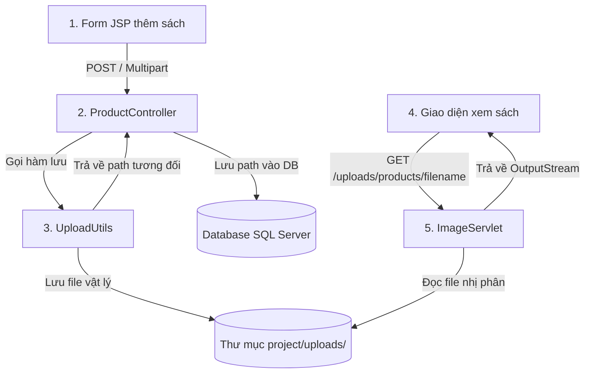

# HƯỚNG DẪN TRIỂN KHAI TÍNH NĂNG UPLOAD & HIỂN THỊ ẢNH
*(Dành cho thành viên phụ trách Module Catalog / Product CRUD)*

Tài liệu này hướng dẫn chi tiết cách triển khai tính năng Upload ảnh và hiển thị ảnh động trong dự án **Aurelia Books**. Hướng dẫn này áp dụng phương pháp **Đường dẫn động (Dynamic Path)** giúp dự án hoạt động trên mọi máy tính (nhóm làm việc chung hoặc máy thầy giáo chấm bài) mà không cần sửa code cấu hình ổ đĩa cứng.

---

## 🗺️ Quy trình Luồng hoạt động (Workflow)



---

## 🛠️ Hướng dẫn Triển khai từng bước

### Bước 1: Cấu hình Form tải ảnh ở phía View (JSP)
Khi tạo hoặc sửa sản phẩm có tải file, thẻ `<form>` bắt buộc phải có thuộc tính `enctype="multipart/form-data"` và `method="POST"`.

*Ví dụ cấu hình trong `create.jsp` hoặc `update.jsp`:*
```html
<form action="${pageContext.request.contextPath}/product?action=create" method="POST" enctype="multipart/form-data">
    <!-- Các trường nhập liệu thông thường -->
    <input type="text" name="title" required />
    
    <!-- Trường chọn file ảnh -->
    <div class="mb-3">
        <label for="image" class="form-label">Hình ảnh minh họa</label>
        <input type="file" class="form-control" id="image" name="image" accept="image/*">
    </div>
    
    <button type="submit">Lưu sản phẩm</button>
</form>
```

---

### Bước 2: Thiết lập lớp tiện ích lưu file động (`UploadUtils.java`)
Để tránh việc ảnh bị xóa khi NetBeans/Tomcat thực hiện **Clean & Build**, ta lưu ảnh vào thư mục `/uploads` nằm ở **thư mục gốc của project**. 
Để code chạy được trên mọi máy tính, ta sẽ dùng thuật toán **dò tìm ngược từ thư mục deploy thực tế** để lấy đường dẫn tương đối.

*Cấu hình chuẩn trong `src/main/java/com/mycompany/aureliabooks/util/UploadUtils.java`:*
```java
package com.mycompany.aureliabooks.util;

import jakarta.servlet.ServletContext;
import jakarta.servlet.http.Part;
import java.io.File;
import java.io.IOException;
import java.util.UUID;

public class UploadUtils {

    /**
     * Lấy đường dẫn tuyệt đối của thư mục "uploads" nằm ở gốc dự án một cách tự động.
     */
    public static String getUploadPath(ServletContext context) {
        // Đường dẫn thực tế khi deploy (ví dụ: D:\Project\target\AureliaBooks-1.0-SNAPSHOT\)
        String deployPath = context.getRealPath("/");
        File deployDir = new File(deployPath);
        
        // Đi ngược lên 2 cấp để ra ngoài thư mục target/ và build/
        File projectRootDir = deployDir.getParentFile().getParentFile();
        
        // Trỏ tới thư mục "uploads" ở gốc project
        File uploadsDir = new File(projectRootDir, "uploads");
        if (!uploadsDir.exists()) {
            uploadsDir.mkdirs(); // Tạo thư mục nếu chưa tồn tại
        }
        return uploadsDir.getAbsolutePath();
    }

    /**
     * Lưu file tải lên vào thư mục vật lý và trả về đường dẫn tương đối để lưu DB.
     * 
     * @param filePart Đối tượng Part nhận từ Request
     * @param context ServletContext để dò tìm đường dẫn động
     * @param subFolder Thư mục con (ví dụ: "products" hoặc "avatars")
     * @return Chuỗi đường dẫn tương đối lưu vào DB (ví dụ: "products/uuid.jpg")
     */
    public static String saveUploadedFile(Part filePart, ServletContext context, String subFolder) throws IOException {
        if (filePart == null || filePart.getSize() == 0) {
            return null;
        }

        String submittedFileName = filePart.getSubmittedFileName();
        if (submittedFileName == null || submittedFileName.isEmpty()) {
            return null;
        }

        // Trích xuất đuôi mở rộng (.jpg, .png...)
        String extension = "";
        int dotIndex = submittedFileName.lastIndexOf('.');
        if (dotIndex >= 0) {
            extension = submittedFileName.substring(dotIndex);
        }

        // Tạo tên file ngẫu nhiên tránh trùng tên
        String newFileName = UUID.randomUUID().toString() + extension;

        // Thư mục lưu trữ vật lý: project/uploads/products/
        String baseUploadPath = getUploadPath(context);
        File uploadFolder = new File(baseUploadPath + File.separator + subFolder);
        if (!uploadFolder.exists()) {
            uploadFolder.mkdirs();
        }

        // Ghi file xuống ổ đĩa
        String filePath = uploadFolder.getAbsolutePath() + File.separator + newFileName;
        filePart.write(filePath);

        // Trả về đường dẫn để lưu vào database (ví dụ: "products/abc.jpg")
        return subFolder + "/" + newFileName;
    }
}
```

---

### Bước 3: Đọc file ảnh trong Servlet xử lý (Controller)
Servlet tiếp nhận thông tin lưu sản phẩm bắt buộc phải có annotation `@MultipartConfig`.

*Ví dụ cấu hình trong `ProductController.java`:*
```java
@WebServlet(name = "ProductController", urlPatterns = {"/product"})
@MultipartConfig(
    fileSizeThreshold = 1024 * 1024 * 2,  // 2MB
    maxFileSize = 1024 * 1024 * 10,       // 10MB
    maxRequestSize = 1024 * 1024 * 50     // 50MB
)
public class ProductController extends HttpServlet {

    protected void doPost(HttpServletRequest request, HttpServletResponse response)
            throws ServletException, IOException {
        
        // 1. Đọc các thông tin chữ
        String title = request.getParameter("title");
        
        // 2. Đọc file ảnh từ request
        Part filePart = request.getPart("image"); 
        
        // 3. Gọi hàm tiện ích để lưu ảnh và lấy chuỗi path tương đối
        String imageRelativePath = UploadUtils.saveUploadedFile(filePart, getServletContext(), "products");
        
        // 4. Tạo đối tượng Product và lưu vào database
        Product product = new Product();
        product.setTitle(title);
        product.setImageUrl(imageRelativePath); // Lưu chuỗi dạng "products/ten_anh.jpg"
        
        // Gọi DAO để insert/update vào database...
    }
}
```

---

### Bước 4: Cấu hình Servlet hiển thị ảnh ra trình duyệt (`ImageServlet.java`)
Do trình duyệt bị cấm đọc trực tiếp từ thư mục vật lý ngoài luồng Web, ta sử dụng một Servlet trung gian để stream dữ liệu nhị phân của ảnh về trình duyệt.

*Cấu hình trong `src/main/java/com/mycompany/aureliabooks/controller/ImageServlet.java`:*
```java
package com.mycompany.aureliabooks.controller;

import com.mycompany.aureliabooks.util.UploadUtils;
import java.io.File;
import java.io.FileInputStream;
import java.io.IOException;
import java.io.OutputStream;
import jakarta.servlet.ServletException;
import jakarta.servlet.annotation.WebServlet;
import jakarta.servlet.http.HttpServlet;
import jakarta.servlet.http.HttpServletRequest;
import jakarta.servlet.http.HttpServletResponse;

@WebServlet(name = "ImageServlet", urlPatterns = {"/uploads/*"})
public class ImageServlet extends HttpServlet {

    @Override
    protected void doGet(HttpServletRequest request, HttpServletResponse response)
            throws ServletException, IOException {
        
        // 1. Lấy thông tin file cần hiển thị (ví dụ: /products/ten_file.jpg)
        String pathInfo = request.getPathInfo();
        if (pathInfo == null || pathInfo.equals("/")) {
            response.sendError(HttpServletResponse.SC_NOT_FOUND);
            return;
        }

        // 2. Dựng đường dẫn vật lý động trỏ tới thư mục uploads ngoài gốc project
        String baseUploadPath = UploadUtils.getUploadPath(getServletContext());
        File file = new File(baseUploadPath + pathInfo);

        // 3. Kiểm tra file tồn tại
        if (!file.exists() || !file.isFile()) {
            response.sendError(HttpServletResponse.SC_NOT_FOUND);
            return;
        }

        // 4. Thiết lập Header phản hồi (MIME Type và độ dài file)
        String contentType = getServletContext().getMimeType(file.getName());
        response.setContentType(contentType != null ? contentType : "application/octet-stream");
        response.setContentLength((int) file.length());

        // 5. Stream dữ liệu nhị phân về trình duyệt
        try (FileInputStream fis = new FileInputStream(file);
             OutputStream os = response.getOutputStream()) {
            byte[] buffer = new byte[4096];
            int bytesRead;
            while ((bytesRead = fis.read(buffer)) != -1) {
                os.write(buffer, 0, bytesRead);
            }
        }
    }
}
```

---

### Bước 5: Hiển thị ảnh trên trang JSP
Khi hiển thị ảnh, ta chỉ cần gọi URL dẫn tới `ImageServlet` kèm đường dẫn tương đối đã lưu trong CSDL:

```html
<!-- Dữ liệu book.imageUrl lấy từ DB sẽ có dạng: "products/ten_anh.jpg" -->

```

---

## ⚠️ Lưu ý quan quan trọng khi làm việc nhóm với Git:
*   Mỗi máy thành viên test sẽ tự phát sinh ảnh upload trong thư mục `uploads/` của họ. Để tránh việc xung đột hoặc push rác lên GitHub, hãy thêm dòng sau vào file `.gitignore` ở gốc dự án:
    ```text
    /uploads/
    ```
    *(Điều này giúp thư mục uploads của mỗi người tự chạy riêng cục bộ trên máy mà không bị commit chéo lên Git).*
