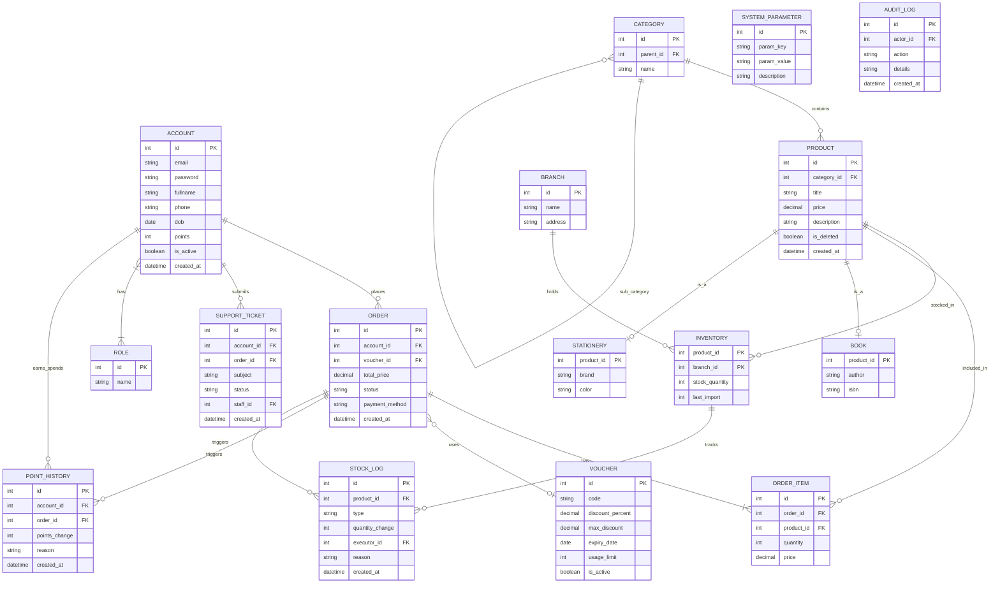
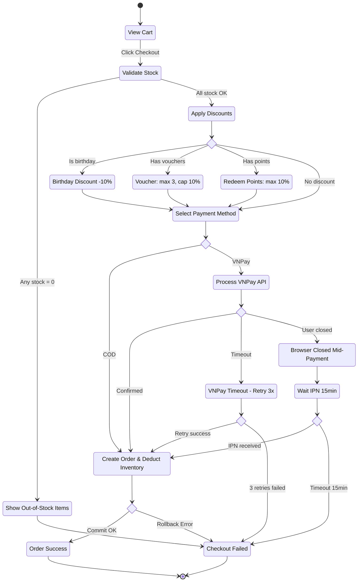
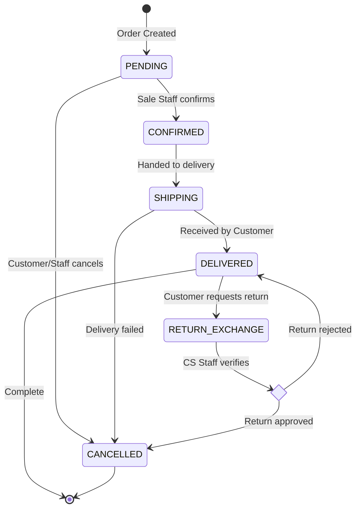
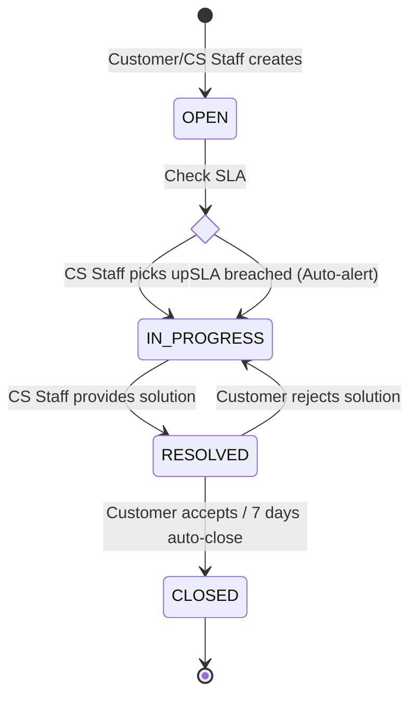

# Software Requirements Specification
## for
## Mini Fahasa Integrated Bookstore Website, Release 1.0

**Version 1.0 approved**  
**Prepared by Le Tien Dung & Tran Huynh Giac**  
**June 29, 2026**

---

## Table of Contents
* [Revision History](#revision-history)
* [1. Introduction](#1-introduction)
  * [1.1 Purpose](#11-purpose)
  * [1.2 Document Conventions](#12-document-conventions)
  * [1.3 Project Scope and Product Features](#13-project-scope-and-product-features)
  * [1.4 References](#14-references)
* [2. Overall Description](#2-overall-description)
  * [2.1 Product Perspective](#21-product-perspective)
  * [2.2 User Classes and Characteristics](#22-user-classes-and-characteristics)
  * [2.3 Operating Environment](#23-operating-environment)
  * [2.4 Design and Implementation Constraints](#24-design-and-implementation-constraints)
  * [2.5 Assumptions and Dependencies](#25-assumptions-and-dependencies)
* [3. System Features](#3-system-features)
  * [3.1 Account & Access Management (FE-1)](#31-account--access-management-fe-1)
  * [3.2 Product Catalog Management (FE-2)](#32-product-catalog-management-fe-2)
  * [3.3 Shopping Cart & Order Management (FE-3)](#33-shopping-cart--order-management-fe-3)
  * [3.4 Inventory Management (FE-4)](#34-inventory-management-fe-4)
  * [3.5 Payment Processing (FE-5)](#35-payment-processing-fe-5)
  * [3.6 Customer Support (FE-6)](#36-customer-support-fe-6)
  * [3.7 System Administration (FE-7)](#37-system-administration-fe-7)
  * [3.8 Reports & Statistics (FE-8)](#38-reports-statistics-fe-8)
* [4. Data Requirements](#4-data-requirements)
  * [4.1 Logical Data Model](#41-logical-data-model)
  * [4.2 Data Dictionary](#42-data-dictionary)
  * [4.3 Reports](#43-reports)
  * [4.4 Data Integrity, Retention, and Disposal](#44-data-integrity-retention-and-disposal)
* [5. External Interface Requirements](#5-external-interface-requirements)
  * [5.1 User Interfaces](#51-user-interfaces)
  * [5.2 Software Interfaces](#52-software-interfaces)
  * [5.3 Hardware Interfaces](#53-hardware-interfaces)
  * [5.4 Communications Interfaces](#54-communications-interfaces)
* [6. Quality Attributes](#6-quality-attributes)
  * [6.1 Usability Requirements](#61-usability-requirements)
  * [6.2 Performance Requirements](#62-performance-requirements)
  * [6.3 Security Requirements](#63-security-requirements)
  * [6.4 Safety Requirements](#64-safety-requirements)
  * [6.5 Availability Requirements](#65-availability-requirements)
  * [6.6 Robustness Requirements](#66-robustness-requirements)
* [Appendix A: Analysis Models](#appendix-a-analysis-models)
  * [1. Use Case Diagram](#1-use-case-diagram)
  * [2. Entity Relationship Diagram (ERD)](#2-entity-relationship-diagram-erd)
  * [3. Checkout Flow (Activity Diagram)](#3-checkout-flow-activity-diagram)
  * [4. State-Transition Diagrams (Lifecycles)](#4-state-transition-diagrams-lifecycles)

---

## Revision History
| Name | Date | Reason For Changes | Version |
| :--- | :--- | :--- | :--- |
| Le Tien Dung & Tran Huynh Giac | 23/06/2026 | Initialized SRS document framework combining business rules and Use Case list | 1.0 Draft |
| Le Tien Dung & Tran Huynh Giac | 29/06/2026 | Synchronized all Use Case codes (t.k2qvj9n2h148), integrated Manager role for inventory management, and finalized document based on standard template | 1.0 Final |
| Le Tien Dung & Tran Huynh Giac | 30/06/2026 | Fixed Use Case mapping errors from 1-61, supplemented missing FRs for CS Staff, Admin, and decomposed requirements for author/publisher/brand management | 1.1 Final |

---

## 1. Introduction

### 1.1 Purpose
This Software Requirements Specification (SRS) document details the functional requirements and non-functional requirements for version 1.0 of the **Mini Fahasa Integrated Bookstore Website System**. 
This document is prepared for the following audiences:
*   **Development Team:** Used as a technical basis for designing system architecture, building the database, and implementing software functionalities.
*   **Testing/QA Team:** Used as a foundation for creating test cases.
*   **Customers & Stakeholders:** Used to verify and cross-check the delivery scope, serving as a basis for system acceptance upon completion of Release 1.0.

### 1.2 Document Conventions
To ensure consistency, readability, and ease of cross-checking, this SRS document applies the following conventions:
1.  **Requirement Tagging:**
    *   *Functional Requirements:* `FR-[Module]-[Sequence Number]` (Example: `FR-ACC-01`, `FR-ORD-02`).
        *   `ACC` (Account): Account management and authorization module.
        *   `PRO` (Product): Product catalog management module.
        *   `ORD` (Cart & Order): Shopping cart and order processing module.
        *   `INV` (Inventory): Inventory management and stock transaction module.
        *   `PAY` (Payment): Payment module.
        *   `SUP` (Support): Customer support and return/exchange module.
        *   `ADM` (Admin): System administration module.
        *   `REP` (Reports): Reports and statistics module.
    *   *Non-functional Requirements:* `NFR-[Requirement Type]-[Sequence Number]` (Example: `NFR-SEC-01`).
        *   `SEC` (Security): Security.
        *   `PER` (Performance): Performance.
        *   `USA` (Usability): Usability.
        *   `AVA` (Availability): Availability.
2.  **Business Rules Reference:** Codes such as `BR-01` to `BR-16` refer directly to the project's Business Rules list.
3.  **Priority Levels:**
    *   *High:* Mandatory for core system operation.
    *   *Medium:* Advanced features (e.g., VNPay gateway, applying vouchers).
    *   *Low:* Supplementary features or those to be developed in future releases.

### 1.3 Project Scope and Product Features
The Mini Fahasa project is an integrated e-commerce storefront and intuitive ERP-Lite inventory management system, operating on two main interfaces:
*   **Storefront (Online Sales Channel):** A minimalist Web interface for Customers to browse, search, and order Books & Stationery in a single order, pay online or via COD, track orders, and submit support/complaint requests.
*   **Dashboard (Internal Management Panel):** An interface for the operational team (Admin, Manager, Sale Staff, CS Staff) to manage inventory, process orders, handle returns/exchanges, and reconcile real-time stock.

Summary of Feature Epics (FE):
*   **FE-1: Account Management:** Registration (age $\ge 15$), login, Google OAuth 2.0, view/edit personal profile and accumulated points balance.
*   **FE-2: Product Management:** Product management (Book, Stationery), recursive categories, manage authors, publishers, brands, and automated clearance sale alerts.
*   **FE-3: Cart and Order Management:** Cart management, apply birthday discounts/vouchers/loyalty points, place orders, and manage the entire order lifecycle.
*   **FE-4: Inventory Management:** Inventory management for Managers, low stock alerts, and Stock Transaction Logs.
*   **FE-5: Payment Processing:** Process payment method selection, integrate VNPay Sandbox gateway.
*   **FE-6: Customer Support:** Submit support requests (Tickets), CS Staff checks history, invoices, creates return/exchange requests on behalf of customers, and performance statistics.
*   **FE-7: System Administration:** System administration, configure system parameters, and view System Audit Logs.
*   **FE-8: Reports & Statistics:** Export revenue, inventory, order reports, and periodic payment reconciliation for Managers.

### 1.4 References
1.  **Vision and Scope Document** (Mini Fahasa Project Vision and Scope, Group 1).
2.  **Business Rules Group 1 (BR-01 to BR-16)** (Business Rules List).
3.  **Use Cases Group 1 (UC-01 to UC-61)** (Standard use case document at tab `t.k2qvj9n2h148`).

---

## 2. Overall Description

### 2.1 Product Perspective
Mini Fahasa is a new software system intended to replace traditional sales management methods (using Excel, paper ledgers) by allowing customers to view, order online, and receive home delivery, while simultaneously providing an ERP-Lite management system for the store. The system addresses issues such as: inventory data discrepancies, loss, slow order processing, and the lack of an online sales channel.

The Context Diagram below illustrates the data interaction boundaries between the system and external entities:

```mermaid
graph TD
    %% Actors
    Guest((Guest))
    Customer((Customer))
    Admin((Admin))
    Manager((Manager))
    SaleStaff((Sale Staff))
    CSStaff((CS Staff))
    
    %% External Systems
    VNPay[VNPay Payment Gateway]
    GoogleOAuth[Google OAuth 2.0 API]
    
    %% Central System
    System[Mini-Fahasa Bookstore Website]

    %% Guest Flows
    Guest -->|Product Search & Catalog Request, Registration/Login Details| System
    System -->|Product Catalog & Detail Info, Account Creation Status, JWT Token| Guest
    
    %% Customer Flows
    Customer -->|Cart Modification Request, Checkout Details, Payment Method Selection, Cancel Order, Ticket/Return Request| System
    System -->|Updated Cart Status, Order Invoice, Order Status Timeline, Ticket ID & Support Resolution Status| Customer
    
    %% Admin Flows
    Admin -->|Staff Account Management Data, Role Configuration RBAC| System
    System -->|Account & Role Update Status| Admin
    
    %% Manager Flows
    Manager -->|Product & Category CRUD Data, Manual Stock Adjustment, Branch Transfer Request, Clearance/Return Approvals| System
    System -->|Product, Catalog & Stock Update Status, Auto Clearance Sale Proposal, Reports & Stock Transaction Logs| Manager
    
    %% Sale Staff Flows
    SaleStaff -->|Order Verification Request, Shipping Status Update, Order Cancellation Request| System
    System -->|Order List & Details, Order Status Update Status| SaleStaff
    
    %% CS Staff Flows
    CSStaff -->|Support Reply Content, Return & Exchange Verification Result| System
    System -->|Assigned Support Ticket List, Customer History, Ticket Status Update Status| CSStaff
    
    %% External Integrations
    System -->|Payment Transaction Request| VNPay
    VNPay -->|IPN Payment Transaction Result| System
    System -->|Google OAuth Request| GoogleOAuth
    GoogleOAuth -->|User Identity Profile| System

    style System fill:#dae8fc,stroke:#6c8ebf,stroke-width:3px,color:#000
    style Guest fill:#f5f5f5,stroke:#666,stroke-width:1px,color:#000
    style Customer fill:#ffe6cc,stroke:#d79b00,stroke-width:1px,color:#000
    style Manager fill:#e1d5e7,stroke:#b85450,stroke-width:1px,color:#000
```



### 2.2 User Classes and Characteristics
*   **Guest:** Accesses the Storefront to search and browse products but is not logged in.
*   **Customer:** Logged in. Can browse, add products to the cart, place orders, make payments, track orders, and submit support requests.
*   **Sale Staff:** Uses the Dashboard to process orders (PENDING $\rightarrow$ CONFIRMED $\rightarrow$ SHIPPING $\rightarrow$ DELIVERED), update statuses, and check inventory.
*   **CS Staff (Customer Service Staff):** Receives and processes support Tickets, complaints, and return/exchange requests from customers. Has Read-only access to order and customer data.
*   **Manager:** Has full control over the product catalog, inventory (view, manual stock adjustments, inter-branch transfers), promotions, and views revenue and inventory reports.
*   **Admin:** Manages internal user accounts and assigns RBAC roles.

### 2.3 Operating Environment
*   **Client (Frontend):** Modern web browsers (Chrome, Firefox, Safari, Edge) supporting HTML5/CSS3. Compatible and displays well on Desktop, Tablet, and Smartphone.
*   **Server (Backend):** Server running Linux/Windows operating system. Java Runtime Environment (JRE 17+).
*   **Database:** MySQL or PostgreSQL.

### 2.4 Design and Implementation Constraints
*   **CO-1:** The Backend system uses Java Spring Boot, Frontend uses ReactJS / pure HTML CSS JS.
*   **CO-2:** Transactions related to inventory and payments must adhere to ACID properties to ensure data integrity (Data discrepancies are not allowed).
*   **CO-3:** Sensitive configuration information (JWT Secret, API Keys) must not be stored directly in the source code (Hard-code).

### 2.5 Assumptions and Dependencies
*   **AS-1:** The production deployment server is capable of handling at least 100 concurrent users.
*   **AS-2:** The VNPay Sandbox environment operates stably throughout the development and testing process.
*   **DE-1:** The Single Sign-On (SSO) feature depends on the Google OAuth 2.0 API.
*   **DE-2:** Online payment depends on the VNPay system.

---

## 3. System Features

### 3.1 Account & Access Management (FE-1)
**Description:** Provides functionality for users to register, log in, manage personal profiles, and system authorization.
**Functional Requirements:**
#### FR-ACC-01 (UC-05 - Register Account)
*   **Input:** Full Name, Email, Phone Number, Password, Confirm Password, Date of Birth (format YYYY-MM-DD).
*   **Validation Rules:**
    *   Email must be in RFC 5322 format (regex: `^[a-zA-Z0-9._%+-]+@[a-zA-Z0-9.-]+\.[a-zA-Z]{2,}$`) and not exist in the system.
    *   Phone number: 10 digits, starting with 0 (regex: `^0[0-9]{9}$`).
    *   Password: Minimum 8 characters, containing at least 1 uppercase letter, 1 lowercase letter, and 1 number.
    *   Date of Birth: System calculates age = (Current Date − Date of Birth) / 365.25. Must be $\ge 15$ years old.
*   **Output (Happy Path):** Account created successfully, confirmation email sent (if applicable), redirects to the Login page.
*   **Error Codes:**
    *   `ERR-ACC-01`: "Email is already in use by another account."
    *   `ERR-ACC-02`: "Invalid phone number format (10 digits, starting with 0)."
    *   `ERR-ACC-03`: "Password must be at least 8 characters long, including uppercase, lowercase, and numeric characters."
    *   `ERR-ACC-04`: "You must be at least 15 years old to register an account."
    *   `ERR-ACC-05`: "Password confirmation does not match."

#### FR-ACC-02 (UC-06 - Login & UC-09 - Logout)
*   **Input:** Email, Password.
*   **Output (Happy Path):** System authenticates successfully, issues JWT Access Token (30-minute validity) and Refresh Token (7-day validity). Redirects: Customer $\rightarrow$ Storefront; Sale/CS/Manager/Admin $\rightarrow$ Dashboard.
*   **Error Codes:**
    *   `ERR-ACC-06`: "Incorrect email or password."
    *   `ERR-ACC-07`: "Your account has been disabled. Please contact Admin."
*   **Exception Flow:** If the JWT Access Token expires, the Client automatically sends the Refresh Token to obtain a new Access Token. If the Refresh Token also expires, redirects to the Login page.

#### FR-ACC-03 (UC-58 - Manage Customer Accounts & UC-59 - Manage Staff Accounts)
*   **Scope:** Only Admin has permission to execute.
*   **Functionality:** Admin can manage the Customer list (`UC-58`) and internal staff accounts (`UC-59`).
*   **Customer Management Details (UC-58):** View customer list, lock/unlock customer accounts for policy violations, manually adjust loyalty points (in case of transaction issues).
*   **Staff Management Details (UC-59):** Create new staff accounts (Sale Staff, CS Staff, Manager), assign roles (Role), deactivate staff accounts, or reset staff passwords.
*   **Constraints:** Admin cannot deactivate their own currently logged-in account.
*   **Error Codes:**
    *   `ERR-ACC-08`: "Cannot deactivate the currently logged-in Admin account."

#### FR-ACC-04 (RBAC Authorization)
*   The system implements strict authorization based on the JWT role (Admin, Manager, Sale, CS, Customer) configured when the Admin manages staff accounts (`UC-59`).
*   Every API endpoint must verify the JWT token and role before executing business logic.
*   **Permission Matrix:**
    | Functionality | Guest | Customer | Sale Staff | CS Staff | Manager | Admin |
    | :--- | :---: | :---: | :---: | :---: | :---: | :---: |
    | Browse products (UC-01 to UC-04) | ✅ | ✅ | ✅ | ✅ | ✅ | ✅ |
    | Manage cart, profile & orders (UC-07, UC-08, UC-10, UC-11, UC-16 to UC-19) | ❌ | ✅ | ❌ | ❌ | ❌ | ❌ |
    | Place Order / Payment (UC-12, UC-15) | ❌ | ✅ | ❌ | ❌ | ❌ | ❌ |
    | Submit support & return requests (UC-20 to UC-22) | ❌ | ✅ | ❌ | ❌ | ❌ | ❌ |
    | Process orders (UC-23 to UC-26) | ❌ | ❌ | ✅ | ❌ | ✅ | ❌ |
    | Manage products / Inventory (UC-42 to UC-52) | ❌ | ❌ | ❌ | ❌ | ✅ | ❌ |
    | Process Support Tickets & Complaints (UC-27 to UC-31, UC-33 to UC-41) | ❌ | ❌ | ❌ | ✅ | ✅ | ❌ |
    | System management / Configuration (UC-58 to UC-61) | ❌ | ❌ | ❌ | ❌ | ❌ | ✅ |

#### FR-ACC-05 (UC-10 - View/Edit Profile)
*   **Scope:** For logged-in Customers.
*   **Functionality:** Customers can view and edit their own personal information.
*   **Input:** Full Name, Phone Number, Default Shipping Address, Date of Birth.
*   **Constraints:** When updating to a new date of birth, the $\ge 15$ years old minimum age requirement must still be met. The phone number must be in the correct 10-digit format.
*   **Output:** Information updated successfully, saved to the database, and status response sent to the Client.
*   **Error Codes:**
    *   `ERR-ACC-09`: "Invalid update information (age < 15 or incorrect phone format)."

#### FR-ACC-06 (UC-11 - View Loyalty Points Balance)
*   **Scope:** For logged-in Customers.
*   **Functionality:** Customers view their current loyalty points balance and points transaction history.
*   **Output:** Returns the current points and a list of points history (transaction date, related order code, points added/deducted, reason for change).

### 3.2 Product Catalog Management (FE-2)
**Description:** Manages products including Books and Stationery, categories, and related entities.
**Functional Requirements:**
#### FR-PRO-01 (UC-42 - Manage Product)
*   **Scope:** Only Manager has permission to execute.
*   **Functionality:** Create, Update, Soft Delete items.
*   **Input when creating Book:** Title, Price (DECIMAL, $> 0$), Product Images (max 5 images, each $\le 5MB$, JPG/PNG format), Category (Category ID), Author (Author ID), Publisher (Publisher ID), ISBN, Pages (number of pages), Description.
*   **Input when creating Stationery:** Title, Price, Product Images, Category, Brand (Brand ID), Color, Material, Origin (country of origin).
*   **Validation Rules:**
    *   Price must be $> 0$ VND.
    *   Title must not be duplicated within the same Category.
*   **Error Codes:**
    *   `ERR-PRO-01`: "Product title already exists in this category."
    *   `ERR-PRO-02`: "Price must be greater than 0."
    *   `ERR-PRO-03`: "Image exceeds allowed size (max 5MB/image)."

#### FR-PRO-02 (UC-43 - Manage Categories)
*   Managers can manage a multi-level recursive Category structure (Parent Category $\rightarrow$ Child Category).
*   **Constraints:** Cannot delete a Category if there are still products linked to it.
*   **Error Codes:**
    *   `ERR-PRO-04`: "Cannot delete category because there are still products belonging to this category."

#### FR-PRO-02a (UC-44 - Manage Authors)
*   **Functionality:** Managers perform CRUD operations on book author information.
*   **Input:** Author name, brief biography, birth/death year.
*   **Constraints:** Cannot delete an author if there are linked books in the system.

#### FR-PRO-02b (UC-45 - Manage Publishers)
*   **Functionality:** Managers perform CRUD operations on book publisher information.
*   **Input:** Publisher name, address, contact phone number, tax code.
*   **Constraints:** Cannot delete a publisher if there are linked books in the system.

#### FR-PRO-02c (UC-46 - Manage Brands)
*   **Functionality:** Managers perform CRUD operations on stationery brand information.
*   **Input:** Brand name, country of origin, logo.
*   **Constraints:** Cannot delete a brand if there are linked stationery products.

#### FR-PRO-03 (UC-01 - Browse Catalog, UC-02 - Search Products, UC-03 - View Details, UC-04 - Browse Categories)
*   Displays the product list with pagination (default 20 products/page).
*   **Automatic Badging:**
    *   "Low Stock": When StockQuantity $< 10\% \times$ Quantity_of_Last_Import (`BR-04`).
    *   "Best Seller": When a product sells $> 50$ units/month (`BR-13`), categorized into 3 price segments (`BR-05`): Under 500k | 500k–1M | Over 1M.
*   **Filters:** By Category (`UC-04`), Price Range (Min–Max), Author/Brand, Sorting (Price Asc/Desc, Newest, Best Selling).
*   **Applicable Rules:** `BR-04`, `BR-05`, `BR-13`.

#### FR-PRO-04 (UC-52 - View Stock Alerts - BR-06 Auto Clearance)
*   The system runs a Background Job (Cronjob) at 00:00 every day to scan all products.
*   **Trigger Condition:** Product price $< 500,000$ VND AND actual inventory holding time $> 1.5 \times$ expected sell-out time.
*   **Behavior:** The system automatically creates a proposal for a clearance sale discount program and displays an alert (Stock Alert) to the Manager on the Dashboard.
*   **Note:** The Manager must manually approve (Approve) before the discount program is applied. The system does NOT automatically change prices.
*   **Applicable Rules:** `BR-06`.

### 3.3 Shopping Cart & Order Management (FE-3)
**Description:** The process from cart management, applying discounts, checkout to handling the order lifecycle.
**Functional Requirements:**
#### FR-ORD-01 (UC-07 - View Cart & UC-08 - Update Cart)
*   Customers can view the cart (`UC-07`) and update the cart (`UC-08` - add new products to the cart, increase/decrease product quantity, or remove products from the cart).
*   **Inventory Mechanism:** Inventory is NOT deducted when a product is in the cart. Inventory is only deducted upon a successful Checkout. If inventory $= 0$ at the time of Checkout, the system returns an error.
*   **Validation Rules:**
    *   Quantity added to cart must be $\ge 1$.
    *   The system displays a warning if the quantity in the cart $>$ current stock quantity (but still allows keeping it in the cart).
*   **Error Codes:**
    *   `ERR-ORD-01`: "This product is currently out of stock."

#### FR-ORD-02 (UC-12 - Place Order, UC-13 - Apply Discount Codes, UC-14 - Redeem Loyalty Points)
The Checkout flow is decomposed into sequential steps:
*   **FR-CHK-01 (Inventory Verification):** The system locks and re-verifies inventory for each product in the cart at the moment "Checkout" is clicked. If any product is out of stock, the entire Checkout is blocked, and a list of insufficient products is displayed.
    *   `ERR-CHK-01`: "Product [Product Name] only has [X] units left, you selected [Y] units."
*   **FR-CHK-02 (Discount Calculation):** The system applies discounts in the following priority order:
    *   *Step 1:* Check birthday $\rightarrow$ If today is the Customer's birthday AND this is the first order of the day $\rightarrow$ 10% discount on the total order (`BR-09`).
    *   *Step 2:* If the Customer does NOT use the birthday discount $\rightarrow$ Allow entering up to 3 Voucher codes (`UC-13`). Calculation logic: Additive discount percentages on the original price. If the total discount exceeds 10% of the order value (`BR-14`), the system automatically caps the discount at exactly 10%.
    *   *Step 3:* If the Customer does NOT use the birthday discount AND does NOT use Vouchers $\rightarrow$ Allow Redeeming Loyalty Points (`UC-14`, $\ge 5000$ points, conversion rate 100 points = 1,000 VND, max 10% discount on the order) (`BR-11`). If the calculated point discount exceeds 10%, the system automatically caps it at exactly 10%.
    *   *Exclusion Rule:* Birthday Discount, Vouchers, and Points Redemption are mutually exclusive — only 1 of the 3 can be selected (`BR-14`).
    *   `ERR-CHK-02`: "Cannot use discount codes and birthday discount simultaneously."
    *   `ERR-CHK-04`: "You need a minimum of 5,000 points to redeem a voucher. Current points: [X]."
*   **FR-CHK-03 (Order Creation):** After calculation is complete, the system executes within 1 Database Transaction (ACID):
    *   Deduct StockQuantity for each OrderItem.
    *   Create Order record (status = PENDING) and OrderItem.
    *   Add loyalty points: Points += `floor(TotalPrice / 1000)` (`BR-10`).
    *   Write StockLog (type = ORDER_DEDUCT).
    *   If any step fails $\rightarrow$ Rollback the entire Transaction.
    *   `ERR-CHK-05`: "An error occurred while processing the order. Please try again."
*   **Applicable Rules:** `BR-09`, `BR-10`, `BR-11`, `BR-14`.

#### FR-ORD-03 (UC-18 - Track Order Status & UC-19 - Cancel Order)
*   Customers track order status on the Storefront (displays status timeline) (`UC-18`).
*   Customers are only allowed to cancel an order when the status is PENDING (`UC-19`).
*   Upon cancellation: The system refunds inventory (StockLog type = ORDER_RETURN), refunds deducted points, and refunds money if paid via VNPay.
*   **Error Codes:**
    *   `ERR-ORD-02`: "Cannot cancel an order that has been confirmed or is being shipped."

#### FR-ORD-04 (UC-23 - View Order List & UC-25 - Process Order Status)
*   Sale Staff on the Dashboard manages orders: View order list (`UC-23`), view order details (`UC-24`), and transition order statuses (`UC-25`) following the sequential process:
    *   `PENDING` $\rightarrow$ `CONFIRMED` (Confirm order after verifying physical inventory).
    *   `CONFIRMED` $\rightarrow$ `SHIPPING` (Handed over to the shipping provider).
    *   `SHIPPING` $\rightarrow$ `DELIVERED` (Customer receives goods successfully).
*   **Constraints:** Statuses must only be transitioned sequentially. Skipping steps is not allowed (e.g., PENDING $\rightarrow$ SHIPPING is invalid).
*   **Error Codes:**
    *   `ERR-ORD-03`: "Cannot transition status from [Status A] to [Status B]."

#### FR-ORD-05 (UC-53 - Manage Holiday Campaign)
*   **Scope:** Only Manager has permission to execute.
*   **Functionality:** Create and manage promotional campaigns during National Holidays (`BR-15`).
*   **Input when creating a campaign:** Promotion campaign name, Start Date (format YYYY-MM-DD HH:mm), End Date, List of Products/Categories applicable to the program, Discount Percentage.
*   **Constraints:**
    *   Products with original price $< 1,000,000$ VND: configurable for 10–15% discount.
    *   Products with original price $\ge 1,000,000$ VND: configurable for 5–10% discount.
    *   National Holiday promotions CANNOT be stacked with Vouchers or points redemption.
*   **Applicable Rules:** `BR-15`.

#### FR-ORD-06 (UC-16 - View Order History)
*   **Scope:** For logged-in Customers.
*   **Functionality:** View the list of all orders the customer has ever placed.
*   **Output:** Returns a paginated list of orders. Each order includes: Order ID, Order Date, Total Payment Amount, Payment Method, and Current Status.

#### FR-ORD-07 (UC-17 - View Order Details)
*   **Scope:** For logged-in Customers.
*   **Functionality:** View details of a specific order.
*   **Output:** Returns information: Order ID, Name and quantity of each product in the order, Unit price at the time of purchase, Total original price, Total discount amount, Final total payment amount, Shipping Address, Payment Information, and Order Status History Tracker (Timeline).

#### FR-ORD-08 (UC-26 - Cancel Order by Sale Staff)
*   **Scope:** For Sale Staff and Managers on the Dashboard.
*   **Functionality:** Cancel a customer's order when delivery fails or upon a valid cancellation request from the customer.
*   **Constraints:** Can only be cancelled when the order is in `PENDING` or `CONFIRMED` status.
*   **System Behavior:**
    1. Transition order status to `CANCELLED`.
    2. Automatically refund the corresponding inventory quantities of the items in the order back to the physical warehouse.
    3. Write StockLog (type = ORDER_RETURN).
    4. Refund the loyalty points the customer used (if any) and revoke the points awarded for the purchase.

#### FR-ORD-09 (UC-32 - Manage Discount Code)
*   **Scope:** For Sale Staff and Managers on the Dashboard.
*   **Functionality:** Create new, edit, view list, and deactivate discount codes (Vouchers) on the system.
*   **Input when creating Voucher:** Voucher code (uppercase alphanumeric string, e.g., `FAHASA20`), Discount Type (Percentage or Fixed Amount), Discount Value, Expiry Date, Minimum order value to apply, Maximum usage limit, Maximum discount amount.
*   **Validation Rules:**
    *   Discount value must be $> 0$.
    *   Voucher code must not duplicate any active codes.
    *   Expiry time must be greater than the current date.
*   **Output:** Voucher code is successfully saved and displayed in ACTIVE status on the system.

### 3.4 Inventory Management (FE-4)
**Description:** Track and control the actual flow of goods to prevent loss and inventory discrepancies.
**Functional Requirements:**
#### FR-INV-01 (UC-49 - Adjust Stock & UC-50 - Transfer Stock Between Branches)
*   **Scope:** Only Manager has permission to execute (`UC-47` to view inventory).
*   **Functionality:** Manually adjust inventory up/down (`UC-49`), transfer goods between branches (`UC-50`, `BR-07`), view inventory reports (`UC-55`).
*   **Validation Rules:**
    *   First-time new import (`UC-48`): Maximum 100 units/branch. Exception: Textbooks (SGK) maximum 500 units/branch (`BR-01`).
    *   Formula for calculating supplementary import quantity: $Q = R \times T$ (`BR-02`), where R = Average sales velocity (units sold per day/month since first import), T = Target sell-out period (expected number of days to sell out the stock).
    *   Not allowed to reduce inventory below 0.
*   **Error Codes:**
    *   `ERR-INV-01`: "First-time import quantity exceeds the allowed limit (100 units, Textbooks: 500 units)." (BR-01)
    *   `ERR-INV-02`: "Cannot reduce inventory below 0."
*   **Applicable Rules:** `BR-01`, `BR-02`, `BR-07`.

#### FR-INV-02 (UC-51 - View Stock Transaction Logs)
*   Every inventory change must be logged (Audit Trail) in the StockLog table.
*   **Transaction Types:** `IMPORT` (Stock entry), `EXPORT` (Stock exit/Transfer), `ORDER_DEDUCT` (Deduction due to order), `ORDER_RETURN` (Refund due to order cancellation/return), `DEFECTIVE_RETURN` (Defective goods return).
*   **Logged Information:** Product Code, Transaction Type, Quantity Change (+/-), Performer (Account ID), Time (Timestamp), Notes (Reason).

#### FR-INV-03 (UC-52 - View Stock Alerts - BR-04 Low Stock Warning)
*   **Scope:** For Managers on the Dashboard.
*   **Functionality:** Display a list of low stock alerts so the Manager can promptly create a supplementary import order.
*   **Trigger Condition:** When `StockQuantity < 10% * Quantity_of_Last_Import` for the current branch (`BR-04`).
*   **System Behavior:** Automatically creates a red alert (Alert) next to the item on the inventory management page of the Dashboard. Sends a periodic warning email to the Manager at the end of the day if the alert list has not been processed.
*   **Applicable Rules:** `BR-04`.

### 3.5 Payment Processing (FE-5)
**Description:** Integrate and process payments for orders.
**Functional Requirements:**
#### FR-PAY-01 (UC-15 - Process Payment)
*   The system allows Customers to select a payment method during the checkout flow.
*   **Options:**
    *   `COD` (Cash on Delivery): Order is created with PENDING status, pay upon receipt.
    *   `VNPay`: Redirects to the VNPay Sandbox payment gateway for online payment.

#### FR-PAY-02 (UC-15 - Process Payment - Online VNPay Integration)
*   **Main Flow:**
    1.  System generates a VNPay payment URL with SHA256/HMAC signature.
    2.  Redirect Customer to the VNPay Sandbox payment page.
    3.  After payment, VNPay sends an IPN (Instant Payment Notification) callback to the Backend.
    4.  Backend verifies the IPN signature and updates the payment status.
*   **Retry Mechanism:** If calling the VNPay API times out ($> 10$ seconds), the system retries a maximum of 3 times, with a 2-second interval between each try.
*   **Exception Flow:**
    1.  If the Customer closes the browser midway $\rightarrow$ Order remains in PENDING status. The system waits for the IPN callback from VNPay for 15 minutes. If the time expires without receiving a callback $\rightarrow$ Automatically cancel the order and refund inventory.
    2.  If all 3 Retries fail $\rightarrow$ Display error message, keep order in PENDING status, allow Customer to re-select payment method or switch to COD.
*   **Error Codes:**
    *   `ERR-PAY-01`: "VNPay payment failed. Please try again or choose COD."
    *   `ERR-PAY-02`: "Payment session expired. Please perform the transaction again."

### 3.6 Customer Support (FE-6)
**Description:** Process support requests, complaints, and returns/exchanges.
**Functional Requirements:**
#### FR-SUP-01 (UC-20 - Submit Support Request)
*   Customer creates a support request Ticket on the Storefront.
*   **Input:** Subject, Description content, Related Order ID (optional), Attached images (max 3 images, each $\le 5MB$, JPG/PNG).
*   **Output:** Ticket is created with OPEN status, displaying the Ticket ID for the Customer to track (`UC-21 - View Support Request Status`).

#### FR-SUP-02 (UC-22 - Request Return Or Exchange)
*   **Pre-conditions:**
    1.  Order must be in DELIVERED status.
    2.  Timeframe: Within 7 calendar days (including Saturdays, Sundays, and holidays) from the successful delivery date (`BR-12`).
*   **Mandatory Input:**
    1.  Order ID.
    2.  Reason for return/exchange (select from list + optional notes).
    3.  Photo of the invoice (mandatory, max 3 images, each $\le 5MB$, JPG/PNG).
    4.  Photo of the goods with intact stamps/tags (mandatory, max 3 images, each $\le 5MB$, JPG/PNG).
*   **Processing Flow:** CS Staff verifies documentary evidence images $\rightarrow$ If valid, create a return/exchange request pending Sale Staff or Manager approval.
*   **Error Codes:**
    *   `ERR-SUP-01`: "The 7-day limit from the delivery date has passed. Cannot create a return/exchange request."
    *   `ERR-SUP-02`: "Please upload a photo of the invoice for verification."
    *   `ERR-SUP-03`: "Please upload a photo of the goods with intact stamps/tags."
    *   `ERR-SUP-04`: "Image exceeds allowed size (max 5MB/image, JPG/PNG format)."
*   **Applicable Rules:** `BR-12`.

#### FR-SUP-03 (UC-33 - View Support Ticket List & UC-35 - Reply to Support Request)
*   CS Staff receives Ticket (`UC-34` to view details), responds, and closes Ticket.
*   **SLA (Service Level Agreement):** All Tickets must be fully resolved within 2 working days from creation (`BR-08`, `UC-36`).
*   **Alert System:** If a Ticket is overdue by 2 days without being resolved, the system automatically sends an alert (Notification) to the CS Staff and Manager on the Dashboard.
*   **Error Codes:**
    *   `ERR-SUP-05`: "Ticket is already closed, cannot be edited."
*   **Applicable Rules:** `BR-08`.

#### FR-SUP-04 (UC-27 - Process Return, UC-28 - Process Exchange, UC-30 - Approve Return/Exchange)
*   CS Staff verifies return/exchange documents (`UC-38`). If conditions of `BR-12` are met, create a return/exchange order awaiting approval.
*   Manager or Sale Staff approves (`UC-30` or `UC-31` to reject) on the Dashboard.
*   **After successful approval:**
    *   *Return Flow:* Update inventory (add back to product stock), create StockLog `ORDER_RETURN`.
    *   *Exchange Flow:* Deduct inventory for replacement product, create StockLog `ORDER_DEDUCT` and add exchange note.

#### FR-SUP-05 (UC-37 - View Support Ticket Statistics)
*   **Scope:** For CS Staff and Managers on the Dashboard.
*   **Functionality:** View report charts and statistical metrics for customer care tickets.
*   **Output:** Displays total tickets by status (OPEN, IN_PROGRESS, RESOLVED, CLOSED), the rate of tickets breaching the 2-working-day SLA (`BR-08`), and average staff response time.

#### FR-SUP-06 (UC-39 - Initiate Return Or Exchange Request)
*   **Scope:** For CS Staff.
*   **Functionality:** CS Staff proactively initiates a return/exchange request on behalf of a Customer (in cases where the customer calls the support hotline directly and provides sufficient information).
*   **System Behavior:** CS Staff enters the order ID and reason, the system automatically checks the condition of successful delivery under 7 days (`BR-12`), allows CS Staff to skip the invoice photo upload step if there is internal reconciliation information on the system, and initiates the return/exchange ticket changing to pending approval status.

#### FR-SUP-07 (UC-40 - View Customer Transaction History)
*   **Scope:** For CS Staff and Managers.
*   **Functionality:** View purchase history, payment history, and points accumulation history of a specific customer to assist in handling complaints.
*   **Output:** Displays a consolidated table of transaction history: List of purchased orders, revenue contribution, points usage history, previous complaints.

#### FR-SUP-08 (UC-41 - View Invoices And Order Details)
*   **Scope:** For CS Staff and Managers.
*   **Functionality:** View details of financial invoices and payment information for complained orders.
*   **Output:** Displays invoice details (VNPay transaction ID, actual payment amount, voucher discount, VAT if any) to support accurate refunds for customers.

### 3.7 System Administration (FE-7)
**Description:** Configure system parameters and monitor system activity logs.
**Functional Requirements:**
#### FR-ADM-01 (UC-60 - Configure System Parameters)
*   **Scope:** Only Admin has permission to execute.
*   **Functionality:** Admin configures system-wide operational parameters.
*   **Input:** 
    *   Maximum return/exchange period (days) (default 7 days as per `BR-12`).
    *   Ticket processing SLA time limit (working days) (default 2 days as per `BR-08`).
    *   Minimum sales threshold for a product to achieve Best Seller status (units/month) (default 50 units as per `BR-13`).
    *   Minimum age for account registration (years) (default 15).
    *   Minimum age for purchasing age-restricted books (years) (default 15 as per `BR-16`).
*   **Output:** New configurations are applied immediately to the entire sales and management system.

#### FR-ADM-02 (UC-61 - View System Audit Log)
*   **Scope:** Only Admin has permission to execute.
*   **Functionality:** Monitor system activity logs (System Audit Log) for security control purposes.
*   **Output:** A list of logs recording actions: Who (Admin/Manager ID), did what action (create internal account, change permissions, configure system parameters, large manual stock adjustment), when (timestamp), and the accessing IP address.

### 3.8 Reports & Statistics (FE-8)
**Description:** Assist Managers in generating and viewing financial, inventory, and order reports periodically.
**Functional Requirements:**
#### FR-REP-01 (UC-54. View Revenue Report, UC-55. View Stock Report, UC-56. View Order Report, UC-57. View Payment Reconciliation Report)
*   **Scope:** Only Manager has permission to execute.
*   **Functionality:** Generate periodic statistical reports at the end of the month (`BR-03`).
*   **Report Types and Behaviors:**
    1.  *Revenue Report (UC-54):* Total revenue collected by day/month, contribution percentage of each payment method, Best Seller product statistics across 3 price segments (`BR-05`).
    2.  *Inventory Report (UC-55):* Statistics on book inventory quantities for each branch, list of products alerting low stock (`BR-04`), StockLog history.
    3.  *Order Report (UC-56):* Statistics on total orders created, successful delivery rate, cancellation rate, or return rate.
    4.  *Payment Reconciliation Report (UC-57):* Statistics on revenue from VNPay, cross-checking IPN signatures to detect discrepant transactions.
*   **Input:** Statistical time frame (From Date - To Date), Type of report to generate.
*   **Output:** Reports displayed visually as charts on the Dashboard, supporting file downloads (PDF, Excel).

---

## 4. Data Requirements

### 4.1 Logical Data Model
The logical data model consists of the following core entities:
*   **Account & Role:** Manages users, mapped N-N with Role for authorization.
*   **Product Hierarchy:** Product entity (Parent) inherited by Book and Stationery (Child). Links to Category (recursive parent-child), Publisher, Brand, Supplier.
*   **Contributor:** N-N linking table between Book and Author.
*   **Order & OrderItem:** Order stores general info (total price, status, address, voucher, account), OrderItem stores detailed purchased products and quantities. Order links optionally (Nullable) to Voucher.
*   **Inventory & StockLog:** Inventory entity stores current stock per Branch, along with `last_import_quantity` to calculate the alert threshold (`BR-04`). StockLog stores export/import/adjustment history along with reasons (`reason`).
*   **Voucher:** Stores discount code info (code, percentage, expiry date, usage limits).
*   **PointHistory:** Stores loyalty points transaction history for each Customer.
*   **SupportTicket:** Stores customer support requests, complaints, returns/exchanges.
*   **Branch:** Stores warehouse branch info.
*   **Category:** Stores recursive product categories (parent-child).
*   **SystemParameter & AuditLog:** Stores system configuration parameters and security logs for administrators.

### 4.2 Data Dictionary

#### Account Table
| Field | Data Type | Required | Constraint | Default Value | Notes |
| :--- | :--- | :---: | :--- | :--- | :--- |
| `id` | INT | ✅ | PK, Auto Increment | — | Primary Key |
| `email` | VARCHAR(100) | ✅ | UNIQUE, RFC 5322 format | — | Used for login |
| `password` | VARCHAR(255) | ✅ | Min 8 chars, 1 uppercase, 1 lowercase, 1 number | — | Stores BCrypt hash |
| `fullname` | VARCHAR(150) | ✅ | — | — | User's full name |
| `phone` | VARCHAR(10) | ✅ | Regex: `^0[0-9]{9}$` | — | Phone number |
| `dob` | DATE | ✅ | Age $\ge 15$ (BR-16) | — | Format YYYY-MM-DD |
| `points` | INT | ✅ | $\ge 0$ | 0 | Loyalty points |
| `is_active` | BOOLEAN | ✅ | — | TRUE | FALSE = Account disabled |
| `created_at` | DATETIME | ✅ | — | CURRENT_TIMESTAMP | Account creation date |

#### Role Table
| Field | Data Type | Required | Constraint | Default Value | Notes |
| :--- | :--- | :---: | :--- | :--- | :--- |
| `id` | INT | ✅ | PK, Auto Increment | — | Primary Key |
| `name` | VARCHAR(50) | ✅ | UNIQUE | — | Admin, Manager, Sale, CS, Customer |

> **Note:** Account and Role have an N-N relationship, managed via an intermediate `Account_Role` table (account_id FK, role_id FK) — no direct `role_id` column needed in Account.

#### Category Table
| Field | Data Type | Required | Constraint | Default Value | Notes |
| :--- | :--- | :---: | :--- | :--- | :--- |
| `id` | INT | ✅ | PK, Auto Increment | — | Primary Key |
| `parent_id` | INT | ❌ | FK $\rightarrow$ Category(id), Nullable | NULL | NULL = Root category |
| `name` | VARCHAR(100) | ✅ | UNIQUE within same parent | — | Category name |

#### Branch Table
| Field | Data Type | Required | Constraint | Default Value | Notes |
| :--- | :--- | :---: | :--- | :--- | :--- |
| `id` | INT | ✅ | PK, Auto Increment | — | Primary Key |
| `name` | VARCHAR(100) | ✅ | — | — | Branch name |
| `address` | VARCHAR(500) | ✅ | — | — | Branch address |

#### Product Table
| Field | Data Type | Required | Constraint | Default Value | Notes |
| :--- | :--- | :---: | :--- | :--- | :--- |
| `id` | INT | ✅ | PK, Auto Increment | — | Primary Key |
| `category_id` | INT | ✅ | FK $\rightarrow$ Category(id) | — | Linked category |
| `title` | VARCHAR(255) | ✅ | UNIQUE within same category | — | Product name |
| `price` | DECIMAL(12,2) | ✅ | $> 0$ | — | Avoid FLOAT to prevent precision loss |
| `description` | TEXT | ❌ | — | NULL | Detailed description |
| `is_deleted` | BOOLEAN | ✅ | — | FALSE | Soft delete |
| `created_at` | DATETIME | ✅ | — | CURRENT_TIMESTAMP | Creation date |

#### Book Table (inherits Product)
| Field | Data Type | Required | Constraint | Default Value | Notes |
| :--- | :--- | :---: | :--- | :--- | :--- |
| `product_id` | INT | ✅ | PK, FK $\rightarrow$ Product(id) | — | PK and FK |
| `publisher_id` | INT | ❌ | FK $\rightarrow$ Publisher(id) | NULL | Publisher |
| `isbn` | VARCHAR(20) | ❌ | UNIQUE | NULL | ISBN code |
| `translator` | VARCHAR(150) | ❌ | — | NULL | Translator |
| `publication_year` | INT | ❌ | $> 0$ | NULL | Publication year |
| `language` | VARCHAR(50) | ❌ | — | NULL | Language |

#### Stationery Table (inherits Product)
| Field | Data Type | Required | Constraint | Default Value | Notes |
| :--- | :--- | :---: | :--- | :--- | :--- |
| `product_id` | INT | ✅ | PK, FK $\rightarrow$ Product(id) | — | PK and FK |
| `brand_id` | INT | ✅ | FK $\rightarrow$ Brand(id) | — | Brand |
| `color` | VARCHAR(50) | ❌ | — | NULL | Color |
| `material` | VARCHAR(100) | ❌ | — | NULL | Material |
| `specifications` | VARCHAR(255) | ❌ | — | NULL | Specifications |
| `warning` | VARCHAR(255) | ❌ | — | NULL | Usage warning |

#### Author Table
| Field | Data Type | Required | Constraint | Default Value | Notes |
| :--- | :--- | :---: | :--- | :--- | :--- |
| `id` | INT | ✅ | PK, Auto Increment | — | Primary Key |
| `name` | VARCHAR(150) | ✅ | — | — | Author name |
| `biography` | TEXT | ❌ | — | NULL | Biography |

#### Contributor Table (Book - Author Link)
| Field | Data Type | Required | Constraint | Default Value | Notes |
| :--- | :--- | :---: | :--- | :--- | :--- |
| `book_id` | INT | ✅ | PK, FK $\rightarrow$ Book(product_id) | — | FK to Book |
| `author_id` | INT | ✅ | PK, FK $\rightarrow$ Author(id) | — | FK to Author |
| `role` | VARCHAR(50) | ❌ | — | NULL | Role (e.g., Author, Translator) |

#### Publisher Table
| Field | Data Type | Required | Constraint | Default Value | Notes |
| :--- | :--- | :---: | :--- | :--- | :--- |
| `id` | INT | ✅ | PK, Auto Increment | — | Primary Key |
| `name` | VARCHAR(150) | ✅ | UNIQUE | — | Publisher name |
| `address` | VARCHAR(255) | ❌ | — | NULL | Address |

#### Brand Table
| Field | Data Type | Required | Constraint | Default Value | Notes |
| :--- | :--- | :---: | :--- | :--- | :--- |
| `id` | INT | ✅ | PK, Auto Increment | — | Primary Key |
| `name` | VARCHAR(150) | ✅ | UNIQUE | — | Brand name |
| `country` | VARCHAR(100) | ❌ | — | NULL | Country |

#### Supplier Table
| Field | Data Type | Required | Constraint | Default Value | Notes |
| :--- | :--- | :---: | :--- | :--- | :--- |
| `id` | INT | ✅ | PK, Auto Increment | — | Primary Key |
| `name` | VARCHAR(150) | ✅ | UNIQUE | — | Supplier name |
| `contact_email` | VARCHAR(100) | ❌ | — | NULL | Contact email |
| `phone` | VARCHAR(20) | ❌ | — | NULL | Phone number |

#### Cart Table
| Field | Data Type | Required | Constraint | Default Value | Notes |
| :--- | :--- | :---: | :--- | :--- | :--- |
| `id` | INT | ✅ | PK, Auto Increment | — | Primary Key |
| `account_id` | INT | ✅ | UNIQUE, FK $\rightarrow$ Account(id) | — | Whose cart |
| `updated_at` | DATETIME | ✅ | — | CURRENT_TIMESTAMP | Last update time |

#### CartItem Table
| Field | Data Type | Required | Constraint | Default Value | Notes |
| :--- | :--- | :---: | :--- | :--- | :--- |
| `cart_id` | INT | ✅ | PK, FK $\rightarrow$ Cart(id) | — | Belongs to which cart |
| `product_id` | INT | ✅ | PK, FK $\rightarrow$ Product(id) | — | Which product |
| `quantity` | INT | ✅ | $> 0$ | 1 | Quantity |

#### Voucher (Discount) Table
| Field | Data Type | Required | Constraint | Default Value | Notes |
| :--- | :--- | :---: | :--- | :--- | :--- |
| `id` | INT | ✅ | PK, Auto Increment | — | Primary Key |
| `code` | VARCHAR(50) | ✅ | UNIQUE | — | Voucher code (e.g., `FAHASA20`) |
| `discount_percent` | DECIMAL(5,2) | ✅ | $> 0$, $\le 100$ | — | Discount percentage |
| `max_discount_amount` | DECIMAL(12,2) | ❌ | $\ge 0$ | NULL | Max discount amount (NULL = no limit) |
| `start_date` | DATE | ✅ | — | — | Validity start date |
| `expiry_date` | DATE | ✅ | $>$ `start_date` | — | Expiry date |
| `usage_limit` | INT | ✅ | $\ge 0$ | — | Max number of usages (0 = no limit) |
| `usage_count` | INT | ✅ | $\ge 0$ | 0 | Number of times used |
| `is_active` | BOOLEAN | ✅ | — | TRUE | FALSE = Voucher disabled |

#### Order Table
| Field | Data Type | Required | Constraint | Default Value | Notes |
| :--- | :--- | :---: | :--- | :--- | :--- |
| `id` | INT | ✅ | PK, Auto Increment | — | Primary Key |
| `account_id` | INT | ✅ | FK $\rightarrow$ Account(id) | — | Customer who ordered |
| `voucher_id` | INT | ❌ | FK $\rightarrow$ Voucher(id), Nullable | NULL | Applied voucher code (if any) |
| `total_price` | DECIMAL(12,2) | ✅ | $> 0$ | — | Total amount after discounts |
| `status` | ENUM | ✅ | PENDING, CONFIRMED, SHIPPING, DELIVERED, CANCELLED | PENDING | Order status |
| `payment_method` | ENUM | ✅ | COD, VNPAY | — | Payment method |
| `shipping_address` | VARCHAR(500) | ✅ | — | — | Delivery address |
| `created_at` | DATETIME | ✅ | — | CURRENT_TIMESTAMP | Creation time |

#### OrderItem Table
| Field | Data Type | Required | Constraint | Default Value | Notes |
| :--- | :--- | :---: | :--- | :--- | :--- |
| `id` | INT | ✅ | PK, Auto Increment | — | Primary Key |
| `order_id` | INT | ✅ | FK $\rightarrow$ Order(id) | — | Order ID |
| `product_id` | INT | ✅ | FK $\rightarrow$ Product(id) | — | Product ID |
| `quantity` | INT | ✅ | $> 0$ | — | Quantity purchased |
| `price` | DECIMAL(12,2) | ✅ | $\ge 0$ | — | Unit price at time of purchase (snapshot) |

#### PointHistory Table
| Field | Data Type | Required | Constraint | Default Value | Notes |
| :--- | :--- | :---: | :--- | :--- | :--- |
| `id` | INT | ✅ | PK, Auto Increment | — | Primary Key |
| `account_id` | INT | ✅ | FK $\rightarrow$ Account(id) | — | Account with points change |
| `order_id` | INT | ❌ | FK $\rightarrow$ Order(id), Nullable | NULL | Related order (if any) |
| `points_change` | INT | ✅ | — | — | Points change (+ add, - deduct) |
| `reason` | VARCHAR(255) | ✅ | — | — | Reason: "Order #X", "Redeem voucher", "Refund cancelled order" |
| `created_at` | DATETIME | ✅ | — | CURRENT_TIMESTAMP | Change time |

#### Inventory Table
| Field | Data Type | Required | Constraint | Default Value | Notes |
| :--- | :--- | :---: | :--- | :--- | :--- |
| `product_id` | INT | ✅ | PK, FK $\rightarrow$ Product(id) | — | Product ID |
| `branch_id` | INT | ✅ | PK, FK $\rightarrow$ Branch(id) | — | Warehouse branch ID |
| `stock_quantity` | INT | ✅ | $\ge 0$ | 0 | Actual stock quantity |
| `last_import_quantity` | INT | ❌ | — | NULL | Last import quantity. Used for "Low stock" alert = 10% × this value (`BR-04`) |

#### StockLog Table
| Field | Data Type | Required | Constraint | Default Value | Notes |
| :--- | :--- | :---: | :--- | :--- | :--- |
| `id` | INT | ✅ | PK, Auto Increment | — | Primary Key |
| `product_id` | INT | ✅ | FK $\rightarrow$ Product(id) | — | Product ID changed |
| `type` | ENUM | ✅ | IMPORT, EXPORT, ORDER_DEDUCT, ORDER_RETURN, DEFECTIVE_RETURN | — | Transaction type |
| `quantity_change` | INT | ✅ | — | — | Quantity change (+ or -) |
| `executor_id` | INT | ✅ | FK $\rightarrow$ Account(id) | — | User who executed transaction |
| `reason` | VARCHAR(500) | ❌ | — | NULL | Notes/Reason (e.g., "Cancel order #123", "Defective goods from Supplier") |
| `created_at` | DATETIME | ✅ | — | CURRENT_TIMESTAMP | Transaction time |

#### SupportTicket Table
| Field | Data Type | Required | Constraint | Default Value | Notes |
| :--- | :--- | :---: | :--- | :--- | :--- |
| `id` | INT | ✅ | PK, Auto Increment | — | Primary Key |
| `account_id` | INT | ✅ | FK $\rightarrow$ Account(id) | — | Customer who created Ticket |
| `order_id` | INT | ❌ | FK $\rightarrow$ Order(id), Nullable | NULL | Related order (optional) |
| `subject` | VARCHAR(255) | ✅ | — | — | Request subject |
| `description` | TEXT | ✅ | — | — | Detailed description |
| `status` | ENUM | ✅ | OPEN, IN_PROGRESS, RESOLVED, CLOSED | OPEN | Ticket status |
| `created_by_staff` | INT | ❌ | FK $\rightarrow$ Account(id), Nullable | NULL | CS Staff who created it on behalf of customer (UC-39). NULL = Customer created |
| `created_at` | DATETIME | ✅ | — | CURRENT_TIMESTAMP | Creation time |

#### SystemParameter Table
| Field | Data Type | Required | Constraint | Default Value | Notes |
| :--- | :--- | :---: | :--- | :--- | :--- |
| `id` | INT | ✅ | PK, Auto Increment | — | Primary Key |
| `param_key` | VARCHAR(100) | ✅ | UNIQUE | — | Constant name (e.g., `LIMIT_AGE`, `SLA_DAYS`) |
| `param_value` | VARCHAR(255) | ✅ | — | — | System config value |
| `description` | VARCHAR(500) | ❌ | — | NULL | Parameter function description |
| `updated_at` | DATETIME | ✅ | — | CURRENT_TIMESTAMP | Last update time |

#### AuditLog Table
| Field | Data Type | Required | Constraint | Default Value | Notes |
| :--- | :--- | :---: | :--- | :--- | :--- |
| `id` | INT | ✅ | PK, Auto Increment | — | Primary Key |
| `actor_id` | INT | ✅ | FK $\rightarrow$ Account(id) | — | User who performed action |
| `action` | VARCHAR(150) | ✅ | — | — | Name of executed action |
| `details` | TEXT | ✅ | — | — | Detailed log description |
| `ip_address` | VARCHAR(50) | ❌ | — | NULL | Accessing IP address |
| `created_at` | DATETIME | ✅ | — | CURRENT_TIMESTAMP | Log recording time |

### 4.3 Reports
As per rule `BR-03`, the system must automatically calculate statistics for sold items, and Managers have the right to export reports on the last day of each month:
*   **Revenue Report (`UC-54`):** Total revenue by day/month/year, percentage of each payment method (COD vs VNPay), Best Seller product statistics across 3 price segments (`BR-05`, `BR-13`).
*   **Inventory Report (`UC-55`):** Statistics on inventory quantities for each branch, list of products nearing out-of-stock (under 10% of the latest import quantity as per `BR-04`), and StockLog history.
*   **Order Report (`UC-56`):** Total orders by status (PENDING/CONFIRMED/SHIPPING/DELIVERED/CANCELLED), successful delivery rate, order cancellation rate, average processing time.
*   **Payment Reconciliation Report (`UC-57`):** Total VNPay revenue versus total amount for DELIVERED orders, list of transactions yet to receive IPN callback (hanging status), identifying discrepancies between the internal system and the payment gateway.

### 4.4 Data Integrity, Retention, and Disposal
*   **DIS-01:** All operations related to creating an Order (reducing StockQuantity, creating Order, creating OrderItem) and Cancelling an order must be executed within a Database Transaction. If an error occurs, it automatically rolls back.
*   **DIS-02:** Order history, payment history, and StockLogs are never completely deleted from the DB (Soft Delete or Archive) for financial reconciliation and auditing purposes.
*   **DIS-03:** The AuditLog table is Immutable (no UPDATE or DELETE allowed), INSERT only.

---

## 5. External Interface Requirements

### 5.1 User Interfaces
#### Storefront (Customer Interface):
*   Designed in a Minimalist style, primary white background (`#FFFFFF`), with prominent product images.
*   Main screens:
    *   `[UI-SF-HOME]` Homepage: Promo banners, Featured products, Best Sellers.
    *   `[UI-SF-SEARCH]` Search & Filter products: Category filter, Price range, Author/Brand.
    *   `[UI-SF-DETAIL]` Product Details: Images, Description, Price, "Add to cart" button, "Best Seller" / "Low Stock" badges.
    *   `[UI-SF-CART]` Cart: List of products, Subtotal, "Checkout" button.
    *   `[UI-SF-CHECKOUT]` Checkout: Shipping address form, Select payment method, Enter Voucher/Redeem points.
    *   `[UI-SF-TRACKING]` Order Tracking: Status timeline (PENDING $\rightarrow$ DELIVERED).
    *   `[UI-SF-TICKET]` Submit support request / Return/Exchange.
    *   `[UI-SF-PROFILE]` View/Edit personal profile and loyalty points balance.
*   **Client-side Validation:** All input forms must undergo validation on the Client side (JavaScript) before sending requests to the Server. Includes: Email format, Phone format, password strength, image size limits.

#### Dashboard (Staff/Manager Interface):
*   Left Sidebar interface containing the navigation menu.
*   Main screens:
    *   `[UI-DB-ORDER]` Order Management: Order list table, filter by status, switch status button.
    *   `[UI-DB-PRODUCT]` Product Management: Product CRUD, image uploads.
    *   `[UI-DB-INVENTORY]` Inventory Management: Inventory table by branch, adjustment form, StockLog history, low stock alerts.
    *   `[UI-DB-TICKET]` Support Ticket Management: Ticket list, overdue SLA warning badge, ticket statistics.
    *   `[UI-DB-REPORT]` Reports: Revenue charts, Best Seller, Inventory, Orders, Payment Reconciliation.
    *   `[UI-DB-ACCOUNT]` Account Management (Admin only).
    *   `[UI-DB-CONFIG]` System Parameter Configuration (Admin only).
    *   `[UI-DB-AUDIT]` View System Logs (Admin only).

### 5.2 Software Interfaces
#### Google OAuth 2.0 API:
*   **Purpose:** Allows Customers to log in using a Google account (SSO) (`UC-06`).
*   **Protocol:** OAuth 2.0 Authorization Code Flow.
*   **Endpoint:** `https://accounts.google.com/o/oauth2/v2/auth`
*   **Received Data:** email, name, profile_picture.
*   **Constraints:** Must register OAuth 2.0 Credentials on the Google Cloud Console. Client ID and Client Secret stored in Environment Variables (`CO-3`).

#### VNPay Sandbox API:
*   **Purpose:** Process online payments (testing environment) (`UC-15`).
*   **Protocol:** HTTPS POST/GET with SHA256/HMAC signature.
*   **Timeout:** 10 seconds per request.
*   **Retry Policy:** Max 3 retries, 2 seconds between each attempt.
*   **IPN Webhook:** Backend must expose endpoint `/api/v1/payment/vnpay-ipn` to receive Instant Payment Notification callback from VNPay.
*   **Constraints:** VNPay API Key and Secret Hash stored in Environment Variables (`CO-3`). Backend must verify IPN signature before updating payment status.

### 5.3 Hardware Interfaces
No special hardware requirements on the Client side. On the Server side, hardware must ensure CPU and RAM capacity to run Java Spring Boot, handling up to 100 concurrent connections.

### 5.4 Communications Interfaces
*   All connections between Client and Server must be over HTTPS (unencrypted HTTP is blocked in Production environment).
*   Backend API provided as RESTful JSON. Authentication based on HTTP Header `Authorization: Bearer <JWT>`.
*   **CORS Policy:** Backend only accepts requests from Frontend domains configured in the whitelist.

---

## 6. Quality Attributes

### 6.1 Usability Requirements
*   **USE-01:** The system supports Responsive Design, easily operable across Desktop, Tablet, and Mobile.
*   **USE-02:** Sale Staff must be able to confirm an order with a maximum of 2 mouse clicks from the order list to meet the BO-1 target (increase processing speed).

### 6.2 Performance Requirements
*   **PER-01:** The system must respond to search and catalog browsing requests in under 2 seconds.
*   **PER-02:** Processing the Checkout flow (including DB writing and 3rd-party API calls) must not exceed 5 seconds.

### 6.3 Security Requirements
*   **SEC-01:** Passwords stored in the database must be one-way encrypted (e.g., BCrypt).
*   **SEC-02:** API endpoints must verify the JWT and role (RBAC) before allowing logic execution.
*   **SEC-03:** Block "Read-only" actions from becoming "Write" for CS Staff at the API level.

### 6.4 Safety Requirements
*   **SAF-01:** A Pessimistic Locking or Optimistic Locking mechanism must be applied to the Inventory table to prevent Race Condition errors when multiple customers simultaneously purchase an item with only 1 unit left in stock.

### 6.5 Availability Requirements
*   **AVL-01:** The Backend system and Database must achieve a minimum availability of 99.9% (excluding pre-announced maintenance periods).

### 6.6 Robustness Requirements
*   **ROB-01:** If the VNPay API responds with a timeout, the system automatically keeps the order status as PENDING and alerts the customer to try again or switch to COD.

---

## Appendix A: Analysis Models

### 1. Use Case Diagram
Represents the Actors (Guest, Customer, Sale Staff, CS Staff, Manager, Admin) interacting with the Use Cases within the system. See details in the attached Use_Case_Diagram.html file in the documentation package.

### 2. Entity Relationship Diagram (ERD)
The Logical Data Model showing the core database structure of the Mini Fahasa system.



<details>
<summary><strong>📋 Raw Mermaid Code (Copy to paste into Draw.io)</strong></summary>

```text
// ============================================================
// Mini Fahasa — ERD Schema (DBML) — Release 2
// Optimized for dbdiagram.io
// ============================================================

// ============================================================
// ZONE A — AUTH & USERS
// ============================================================

Table ROLE {
  id   int         [pk, increment]
  name varchar(50) [unique, not null, note: "ADMIN | MANAGER | SALE | CS | CUSTOMER"]
}

Table ACCOUNT {
  id         int          [pk, increment]
  email      varchar(100) [unique, not null, note: "RFC 5322. Used for login"]
  password   varchar(255) [not null, note: "BCrypt hash"]
  fullname   varchar(150) [not null]
  phone      varchar(10)  [not null, note: "^0[0-9]{9}$"]
  dob        date         [not null, note: "Age >= 15 (BR-16)"]
  points     int          [not null, default: 0, note: ">= 0"]
  is_active  boolean      [not null, default: true]
  created_at datetime     [not null, default: `CURRENT_TIMESTAMP`]
}

Table ACCOUNT_ROLE {
  account_id int [not null, ref: > ACCOUNT.id]
  role_id    int [not null, ref: > ROLE.id]
  indexes { (account_id, role_id) [pk] }
}

Table CUSTOMER_ADDRESS {
  id             int          [pk, increment]
  account_id     int          [not null, ref: > ACCOUNT.id]
  recipient_name varchar(150) [not null]
  phone          varchar(10)  [not null]
  address_line   varchar(500) [not null]
  is_default     boolean      [not null, default: false]
  created_at     datetime     [not null, default: `CURRENT_TIMESTAMP`]
}

// ============================================================
// ZONE B — PRODUCT CATALOG
// ============================================================

Table CATEGORY {
  id        int          [pk, increment]
  parent_id int          [ref: > CATEGORY.id, note: "NULL = Root. Max depth 3"]
  name      varchar(100) [not null, note: "UNIQUE within same parent_id"]
}

Table PUBLISHER {
  id       int          [pk, increment]
  name     varchar(150) [unique, not null]
  address  varchar(255)
  phone    varchar(20)
  tax_code varchar(20)
}

Table BRAND {
  id       int          [pk, increment]
  name     varchar(150) [unique, not null]
  country  varchar(100)
  logo_url varchar(500)
}

Table AUTHOR {
  id         int          [pk, increment]
  name       varchar(150) [not null]
  biography  text
  birth_year int
  death_year int          [note: "NULL if still alive"]
}

Table SUPPLIER {
  id            int          [pk, increment]
  name          varchar(150) [unique, not null]
  contact_email varchar(100)
  phone         varchar(20)
  address       varchar(255)
}

Table PRODUCT {
  id          int           [pk, increment]
  category_id int           [not null, ref: > CATEGORY.id]
  title       varchar(255)  [not null, note: "UNIQUE within category"]
  price       decimal(12,2) [not null, note: "> 0. DECIMAL — not FLOAT"]
  description text
  is_deleted  boolean       [not null, default: false, note: "Soft delete"]
  created_at  datetime      [not null, default: `CURRENT_TIMESTAMP`]
}

Table BOOK {
  product_id       int         [pk, ref: - PRODUCT.id, note: "1-to-1"]
  publisher_id     int         [ref: > PUBLISHER.id]
  isbn             varchar(20) [unique]
  publication_year int
  language         varchar(50)
  page_count       int
}

Table STATIONERY {
  product_id     int          [pk, ref: - PRODUCT.id, note: "1-to-1"]
  brand_id       int          [not null, ref: > BRAND.id]
  color          varchar(50)
  material       varchar(100)
  specifications varchar(255)
  warning        varchar(255)
}

Table CONTRIBUTOR {
  book_id   int         [not null, ref: > BOOK.product_id]
  author_id int         [not null, ref: > AUTHOR.id]
  role      varchar(50) [not null, note: "AUTHOR | CO_AUTHOR | TRANSLATOR | EDITOR"]
  indexes { (book_id, author_id) [pk] }
}

Table PRODUCT_IMAGE {
  id            int          [pk, increment]
  product_id    int          [not null, ref: > PRODUCT.id]
  image_url     varchar(500) [not null, note: "CDN URL. Max 5 per product"]
  display_order int          [not null, default: 1, note: "1 = thumbnail"]
  created_at    datetime     [not null, default: `CURRENT_TIMESTAMP`]
}

// ============================================================
// ZONE C — CART
// ============================================================

Table CART {
  id         int      [pk, increment]
  account_id int      [unique, not null, ref: > ACCOUNT.id, note: "1 Account = 1 Cart"]
  updated_at datetime [not null, default: `CURRENT_TIMESTAMP`]
}

Table CART_ITEM {
  cart_id    int [not null, ref: > CART.id]
  product_id int [not null, ref: > PRODUCT.id]
  quantity   int [not null, default: 1, note: "> 0"]
  indexes { (cart_id, product_id) [pk] }
}

// ============================================================
// ZONE D — PROMOTIONS
// ============================================================

Table VOUCHER {
  id                  int           [pk, increment]
  code                varchar(50)   [unique, not null, note: "E.g. FAHASA20"]
  discount_percent    decimal(5,2)  [not null, note: "> 0 and <= 100"]
  max_discount_amount decimal(12,2) [note: "NULL = no cap"]
  start_date          date          [not null]
  expiry_date         date          [not null, note: "> start_date"]
  usage_limit         int           [not null, default: 0, note: "0 = unlimited"]
  usage_count         int           [not null, default: 0]
  is_active           boolean       [not null, default: true]
}

// ============================================================
// ZONE E — ORDERS & PAYMENT
// ============================================================

Table ORDER {
  id              int           [pk, increment]
  account_id      int           [not null, ref: > ACCOUNT.id]
  address_id      int           [not null, ref: > CUSTOMER_ADDRESS.id, note: "Snapshot at order time"]
  discount_type   varchar(20)   [note: "BIRTHDAY | VOUCHER | POINTS | NONE (BR-14)"]
  discount_amount decimal(12,2) [not null, default: 0]
  total_price     decimal(12,2) [not null, note: "> 0. After discount"]
  status          varchar(20)   [not null, default: "PENDING", note: "PENDING|CONFIRMED|SHIPPING|DELIVERED|RETURN_EXCHANGE|CANCELLED"]
  payment_method  varchar(10)   [not null, note: "COD | VNPAY"]
  points_used     int           [not null, default: 0]
  points_earned   int           [not null, default: 0, note: "floor(total_price/1000) per BR-10"]
  created_at      datetime      [not null, default: `CURRENT_TIMESTAMP`]
}

Table ORDER_ITEM {
  id         int           [pk, increment]
  order_id   int           [not null, ref: > ORDER.id]
  product_id int           [not null, ref: > PRODUCT.id]
  quantity   int           [not null, note: "> 0"]
  price      decimal(12,2) [not null, note: "SNAPSHOT — never JOIN live Product.price"]
}

Table ORDER_VOUCHER {
  order_id   int [not null, ref: > ORDER.id]
  voucher_id int [not null, ref: > VOUCHER.id]
  indexes { (order_id, voucher_id) [pk] }
}

Table PAYMENT_TRANSACTION {
  id                int           [pk, increment]
  order_id          int           [not null, ref: > ORDER.id]
  vnp_txn_ref       varchar(100)  [unique, not null, note: "Idempotency key for Retry"]
  vnp_amount        decimal(12,2) [not null]
  vnp_response_code varchar(10)   [note: "00 = success"]
  vnp_bank_code     varchar(20)
  ipn_payload       text          [note: "Raw VNPay IPN JSON — for PAY-R-1 reconciliation"]
  status            varchar(10)   [not null, default: "PENDING", note: "PENDING|SUCCESS|FAILED|EXPIRED"]
  retry_count       int           [not null, default: 0, note: "Max 3, 2s apart (FR-PAY-02)"]
  created_at        datetime      [not null, default: `CURRENT_TIMESTAMP`]
  updated_at        datetime      [not null, default: `CURRENT_TIMESTAMP`]
}

Table POINT_HISTORY {
  id            int          [pk, increment]
  account_id    int          [not null, ref: > ACCOUNT.id]
  order_id      int          [ref: > ORDER.id, note: "Nullable"]
  points_change int          [not null, note: "+ earn, - redeem/revoke"]
  reason        varchar(255) [not null]
  created_at    datetime     [not null, default: `CURRENT_TIMESTAMP`]
}

// ============================================================
// ZONE F — INVENTORY & STOCK
// ============================================================

Table BRANCH {
  id      int          [pk, increment]
  name    varchar(100) [not null]
  address varchar(500) [not null]
}

Table INVENTORY {
  product_id           int [not null, ref: > PRODUCT.id]
  branch_id            int [not null, ref: > BRANCH.id]
  stock_quantity       int [not null, default: 0, note: ">= 0. Pessimistic Lock on Checkout (SAF-01)"]
  last_import_quantity int [note: "Low stock = stock_quantity < 10% × this (BR-04)"]
  indexes { (product_id, branch_id) [pk] }
}

Table STOCK_LOG {
  id              int         [pk, increment]
  product_id      int         [not null, ref: > PRODUCT.id]
  branch_id       int         [not null, ref: > BRANCH.id, note: "Source branch"]
  branch_to_id    int         [ref: > BRANCH.id, note: "Destination — BRANCH_TRANSFER_OUT only (BR-07)"]
  order_id        int         [ref: > ORDER.id, note: "Nullable — ORDER_DEDUCT/ORDER_RETURN"]
  supplier_id     int         [ref: > SUPPLIER.id, note: "Nullable — IMPORT/DEFECTIVE_RETURN"]
  type            varchar(30) [not null, note: "IMPORT|EXPORT|ORDER_DEDUCT|ORDER_RETURN|DEFECTIVE_RETURN|BRANCH_TRANSFER_OUT|BRANCH_TRANSFER_IN|MANUAL_ADJUSTMENT"]
  quantity_change int         [not null, note: "+ increase, - decrease"]
  executor_id     int         [not null, ref: > ACCOUNT.id]
  reason          varchar(500)
  created_at      datetime    [not null, default: `CURRENT_TIMESTAMP`]
}

// ============================================================
// ZONE G — CUSTOMER SUPPORT
// ============================================================

Table SUPPORT_TICKET {
  id               int          [pk, increment]
  account_id       int          [not null, ref: > ACCOUNT.id, note: "Customer the ticket is for"]
  order_id         int          [ref: > ORDER.id, note: "Nullable"]
  subject          varchar(255) [not null]
  description      text         [not null]
  status           varchar(15)  [not null, default: "OPEN", note: "OPEN|IN_PROGRESS|RESOLVED|CLOSED"]
  created_by_staff int          [ref: > ACCOUNT.id, note: "NULL = customer. CS Staff for UC-39."]
  assigned_to      int          [ref: > ACCOUNT.id, note: "CS Staff handling ticket"]
  resolved_at      datetime
  closed_at        datetime     [note: "Auto-close 7 days after RESOLVED"]
  created_at       datetime     [not null, default: `CURRENT_TIMESTAMP`, note: "Authoritative for BR-12 (7-day return window)"]
}

Table TICKET_ATTACHMENT {
  id         int          [pk, increment]
  ticket_id  int          [not null, ref: > SUPPORT_TICKET.id]
  file_url   varchar(500) [not null, note: "CDN URL. Max 3 per ticket, 5MB each"]
  file_type  varchar(20)  [not null, note: "INVOICE_PHOTO | PRODUCT_PHOTO | OTHER"]
  created_at datetime     [not null, default: `CURRENT_TIMESTAMP`]
}

// ============================================================
// ZONE H — SYSTEM ADMINISTRATION
// ============================================================

Table SYSTEM_PARAMETER {
  id          int          [pk, increment]
  param_key   varchar(100) [unique, not null, note: "LIMIT_AGE|SLA_DAYS|MAX_CATEGORY_DEPTH|BEST_SELLER_THRESHOLD|POINTS_RATE"]
  param_value varchar(255) [not null, note: "App layer validates range per key"]
  description varchar(500)
  updated_by  int          [ref: > ACCOUNT.id]
  updated_at  datetime     [not null, default: `CURRENT_TIMESTAMP`]
}

Table AUDIT_LOG {
  id         int          [pk, increment]
  actor_id   int          [not null, ref: > ACCOUNT.id]
  action     varchar(150) [not null, note: "CREATE_STAFF|CHANGE_ROLE|CONFIGURE_PARAM|MANUAL_STOCK_ADJUST"]
  details    text         [not null, note: "May contain VNPay IPN JSON payload"]
  ip_address varchar(50)
  created_at datetime     [not null, default: `CURRENT_TIMESTAMP`, note: "IMMUTABLE — INSERT only (DIS-03)"]
}

// ============================================================
// TABLE GROUPS — Visual clustering on dbdiagram.io canvas
// ============================================================

TableGroup "A — Auth & Users" {
  ROLE
  ACCOUNT
  ACCOUNT_ROLE
  CUSTOMER_ADDRESS
}

TableGroup "B — Product Catalog" {
  CATEGORY
  PUBLISHER
  BRAND
  AUTHOR
  SUPPLIER
  PRODUCT
  BOOK
  STATIONERY
  CONTRIBUTOR
  PRODUCT_IMAGE
}

TableGroup "C — Cart" {
  CART
  CART_ITEM
}

TableGroup "D — Promotions" {
  VOUCHER
}

TableGroup "E — Orders & Payment" {
  ORDER
  ORDER_ITEM
  ORDER_VOUCHER
  PAYMENT_TRANSACTION
  POINT_HISTORY
}

TableGroup "F — Inventory & Stock" {
  BRANCH
  INVENTORY
  STOCK_LOG
}

TableGroup "G — Customer Support" {
  SUPPORT_TICKET
  TICKET_ATTACHMENT
}

TableGroup "H — Administration" {
  SYSTEM_PARAMETER
  AUDIT_LOG
}
```
</details>

### 3. Checkout Flow (Activity Diagram)
Activity diagram for the checkout process, illustrating the application of promotional business rules (BR-09, BR-10, BR-14) and inventory verification, payment (VNPay / COD).



<details>
<summary><strong>📋 Raw Mermaid Code (Copy to paste into Draw.io)</strong></summary>

```text
stateDiagram-v2
    state "View Cart" as ViewCart
    state "Validate Stock" as ValidateStock
    state "Show Out-of-Stock Items" as ShowOOS
    state "Apply Discounts" as ApplyDiscounts
    state discount_choice <<choice>>
    state "Birthday Discount -10%" as Birthday
    state "Voucher: max 3, cap 10%" as Voucher
    state "Redeem Points: max 10%" as Points
    state "Select Payment Method" as Payment
    state payment_choice <<choice>>
    state "Process VNPay API" as VNPay
    state vnpay_result <<choice>>
    state "VNPay Timeout - Retry 3x" as VNPayRetry
    state retry_result <<choice>>
    state "Create Order & Deduct Inventory" as CreateOrder
    state db_result <<choice>>
    state "Order Success" as Success
    state "Checkout Failed" as Failed
    state "Browser Closed Mid-Payment" as BrowserClosed
    state "Wait IPN 15min" as WaitIPN
    state ipn_result <<choice>>

    [*] --> ViewCart
    ViewCart --> ValidateStock : Click Checkout
    ValidateStock --> ShowOOS : Any stock = 0
    ValidateStock --> ApplyDiscounts : All stock OK
    ShowOOS --> Failed
    ApplyDiscounts --> discount_choice
    discount_choice --> Birthday : Is birthday
    discount_choice --> Voucher : Has vouchers
    discount_choice --> Points : Has points
    discount_choice --> Payment : No discount
    Birthday --> Payment
    Voucher --> Payment
    Points --> Payment
    Payment --> payment_choice
    payment_choice --> CreateOrder : COD
    payment_choice --> VNPay : VNPay
    VNPay --> vnpay_result
    vnpay_result --> CreateOrder : Confirmed
    vnpay_result --> VNPayRetry : Timeout
    vnpay_result --> BrowserClosed : User closed
    VNPayRetry --> retry_result
    retry_result --> CreateOrder : Retry success
    retry_result --> Failed : 3 retries failed
    BrowserClosed --> WaitIPN
    WaitIPN --> ipn_result
    ipn_result --> CreateOrder : IPN received
    ipn_result --> Failed : Timeout 15min
    CreateOrder --> db_result
    db_result --> Success : Commit OK
    db_result --> Failed : Rollback Error
    Success --> [*]
    Failed --> [*]
```
</details>

### 4. State-Transition Diagrams (Lifecycles)
State lifecycle models of core entities in the system.

#### 4.1 Order Lifecycle
The lifecycle of an order, from successful placement to delivery or cancellation/return (BR-12).



<details>
<summary><strong>📋 Raw Mermaid Code (Copy to paste into Draw.io)</strong></summary>

```text
stateDiagram-v2
    [*] --> PENDING : Order Created
    state "PENDING" as PENDING
    state "CONFIRMED" as CONFIRMED
    state "SHIPPING" as SHIPPING
    state "DELIVERED" as DELIVERED
    state "RETURN_EXCHANGE" as RETURN_EXCHANGE
    state "CANCELLED" as CANCELLED
    state return_decision <<choice>>

    PENDING --> CONFIRMED : Sale Staff confirms
    PENDING --> CANCELLED : Customer/Staff cancels
    CONFIRMED --> SHIPPING : Handed to delivery
    SHIPPING --> DELIVERED : Received by Customer
    SHIPPING --> CANCELLED : Delivery failed
    DELIVERED --> RETURN_EXCHANGE : Customer requests return
    DELIVERED --> [*] : Complete
    RETURN_EXCHANGE --> return_decision : CS Staff verifies
    return_decision --> CANCELLED : Return approved
    return_decision --> DELIVERED : Return rejected
    CANCELLED --> [*]
```
</details>

#### 4.2 Support Ticket Lifecycle
The lifecycle of a Support Ticket.



<details>
<summary><strong>📋 Raw Mermaid Code (Copy to paste into Draw.io)</strong></summary>

```text
stateDiagram-v2
    [*] --> OPEN : Customer/CS Staff creates
    state "OPEN" as OPEN
    state "IN_PROGRESS" as IN_PROGRESS
    state "RESOLVED" as RESOLVED
    state "CLOSED" as CLOSED
    state sla_check <<choice>>

    OPEN --> sla_check : Check SLA
    sla_check --> IN_PROGRESS : CS Staff picks up
    sla_check --> IN_PROGRESS : SLA breached (Auto-alert)
    IN_PROGRESS --> RESOLVED : CS Staff provides solution
    RESOLVED --> CLOSED : Customer accepts / 7 days auto-close
    RESOLVED --> IN_PROGRESS : Customer rejects solution
    CLOSED --> [*]
```
</details>

*(Note: The above diagram corresponds to the 2-working-day SLA processing procedure of FR-SUP-03)*
