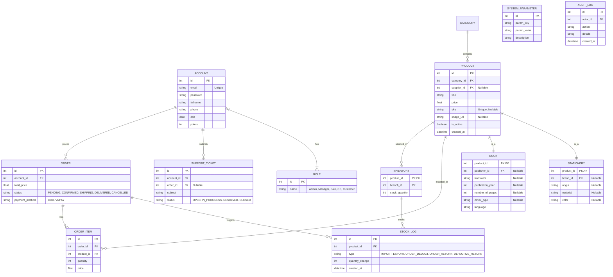
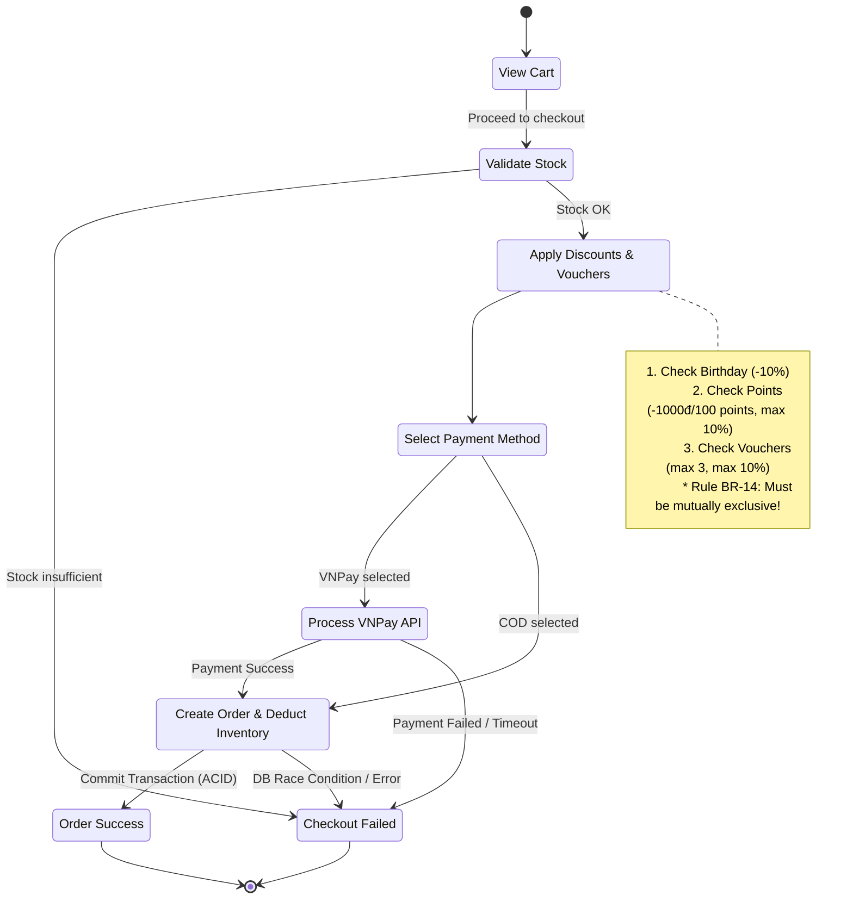
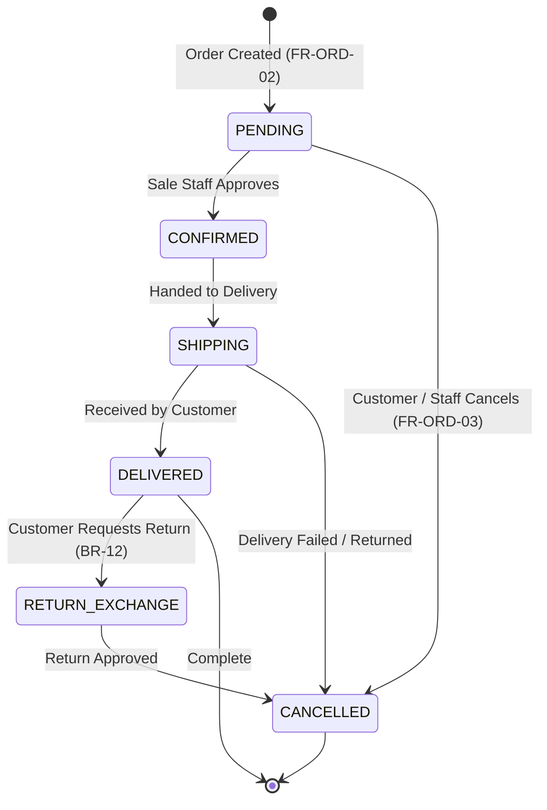
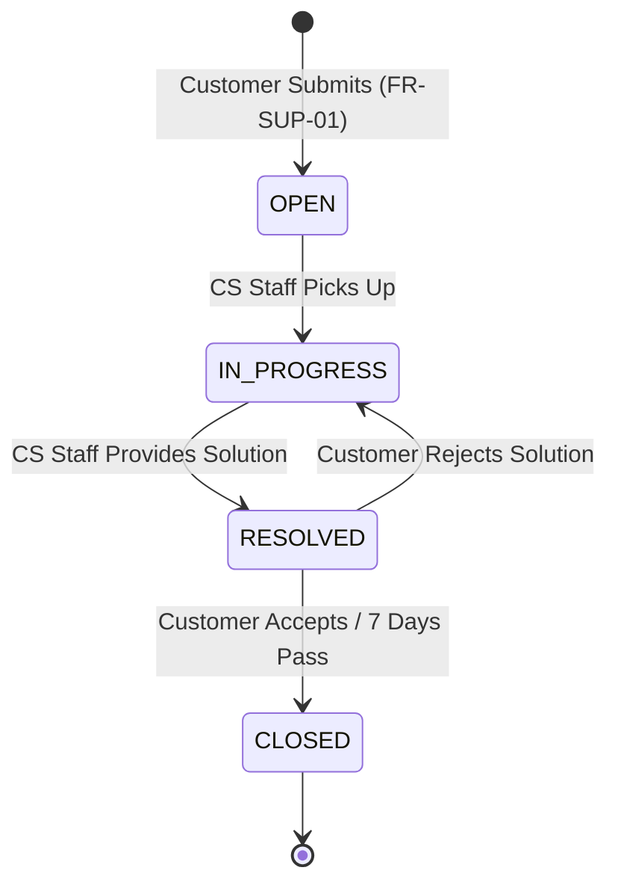

# Software Requirements Specification
## for
## Website Nhà Sách Tích Hợp Mini Fahasa, Release 1.0

**Version 1.0 approved**  
**Prepared by Lê Tiến Dũng & Trần Huỳnh Giác**  
**June 29, 2026**

---

## Table of Contents
* [Revision History](#revision-history)
* [1. Introduction](#1-introduction)
  * [1.1 Purpose](#11-purpose)
  * [1.2 Document Conventions](#12-document-conventions)
  * [1.3 Project Scope and Product Features](#13-project-scope-and-product-features)
  * [1.4 References](#14-references)
* [2. Overall Description](#2-overall-description)
  * [2.1 Product Perspective](#21-product-perspective)
  * [2.2 User Classes and Characteristics](#22-user-classes-and-characteristics)
  * [2.3 Operating Environment](#23-operating-environment)
  * [2.4 Design and Implementation Constraints](#24-design-and-implementation-constraints)
  * [2.5 Assumptions and Dependencies](#25-assumptions-and-dependencies)
* [3. System Features](#3-system-features)
  * [3.1 Account & Access Management (FE-1)](#31-account--access-management-fe-1)
  * [3.2 Product Catalog Management (FE-2)](#32-product-catalog-management-fe-2)
  * [3.3 Shopping Cart & Order Management (FE-3)](#33-shopping-cart--order-management-fe-3)
  * [3.4 Inventory Management (FE-4)](#34-inventory-management-fe-4)
  * [3.5 Payment Processing (FE-5)](#35-payment-processing-fe-5)
  * [3.6 Customer Support (FE-6)](#36-customer-support-fe-6)
  * [3.7 System Administration (FE-7)](#37-system-administration-fe-7)
  * [3.8 Reports & Statistics (FE-8)](#38-reports-statistics-fe-8)
* [4. Data Requirements](#4-data-requirements)
  * [4.1 Logical Data Model](#41-logical-data-model)
  * [4.2 Data Dictionary](#42-data-dictionary)
  * [4.3 Reports](#43-reports)
  * [4.4 Data Integrity, Retention, and Disposal](#44-data-integrity-retention-and-disposal)
* [5. External Interface Requirements](#5-external-interface-requirements)
  * [5.1 User Interfaces](#51-user-interfaces)
  * [5.2 Software Interfaces](#52-software-interfaces)
  * [5.3 Hardware Interfaces](#53-hardware-interfaces)
  * [5.4 Communications Interfaces](#54-communications-interfaces)
* [6. Quality Attributes](#6-quality-attributes)
  * [6.1 Usability Requirements](#61-usability-requirements)
  * [6.2 Performance Requirements](#62-performance-requirements)
  * [6.3 Security Requirements](#63-security-requirements)
  * [6.4 Safety Requirements](#64-safety-requirements)
  * [6.5 Availability Requirements](#65-availability-requirements)
  * [6.6 Robustness Requirements](#66-robustness-requirements)
* [Appendix A: Analysis Models](#appendix-a-analysis-models)
  * [1. Use Case Diagram](#1-use-case-diagram)
  * [2. Entity Relationship Diagram (ERD)](#2-entity-relationship-diagram-erd)
  * [3. Checkout Flow (Activity Diagram)](#3-checkout-flow-activity-diagram)
  * [4. State-Transition Diagrams (Lifecycles)](#4-state-transition-diagrams-lifecycles)

---

## Revision History
| Name | Date | Reason For Changes | Version |
| :--- | :--- | :--- | :--- |
| Lê Tiến Dũng & Trần Huỳnh Giác | 23/06/2026 | Khởi tạo khung tài liệu SRS kết hợp các luật nghiệp vụ và danh sách Use Cases | 1.0 Draft |
| Lê Tiến Dũng & Trần Huỳnh Giác | 29/06/2026 | Đồng bộ hóa toàn bộ mã số Use Case (t.k2qvj9n2h148), tích hợp vai trò Manager quản trị kho và hoàn thiện tài liệu theo template chuẩn | 1.0 Final |
| Lê Tiến Dũng & Trần Huỳnh Giác | 30/06/2026 | Sửa lỗi ánh xạ Use Case từ 1-61, bổ sung các FR bị thiếu cho CS Staff, Admin và phân rã các yêu cầu quản lý tác giả/nhà xuất bản/thương hiệu | 1.1 Final |

---

## 1. Introduction

### 1.1 Purpose
Tài liệu Đặc tả Yêu cầu Phần mềm (SRS) này mô tả chi tiết các yêu cầu chức năng (functional requirements) và yêu cầu phi chức năng (non-functional requirements) cho phiên bản 1.0 của **Hệ thống Website Nhà Sách Tích Hợp Mini Fahasa**. 
Tài liệu này được biên soạn nhằm phục vụ các đối tượng:
*   **Đội ngũ phát triển (Development Team):** Dùng làm căn cứ kỹ thuật để thiết kế kiến trúc hệ thống, xây dựng cơ sở dữ liệu và hiện thực hóa các chức năng phần mềm.
*   **Đội ngũ kiểm thử (Testing/QA Team):** Dùng làm cơ sở để xây dựng các kịch bản kiểm thử (test cases).
*   **Khách hàng & Các bên liên quan (Stakeholders):** Dùng để kiểm tra, đối soát phạm vi bàn giao và làm căn cứ nghiệm thu hệ thống khi hoàn thành Release 1.0.

### 1.2 Document Conventions
Để đảm bảo tính thống nhất, dễ đọc và dễ đối soát, tài liệu SRS này áp dụng các quy ước sau:
1.  **Quy ước mã hóa các yêu cầu (Requirement Tagging):**
    *   *Yêu cầu chức năng:* `FR-[Phân hệ]-[Số thứ tự]` (Ví dụ: `FR-ACC-01`, `FR-ORD-02`).
        *   `ACC` (Account): Phân hệ quản lý tài khoản và phân quyền.
        *   `PRO` (Product): Phân hệ quản lý danh mục sản phẩm.
        *   `ORD` (Cart & Order): Phân hệ quản lý giỏ hàng và xử lý đơn hàng.
        *   `INV` (Inventory): Phân hệ quản lý kho và giao dịch kho.
        *   `PAY` (Payment): Phân hệ thanh toán.
        *   `SUP` (Support): Phân hệ hỗ trợ khách hàng và khiếu nại/đổi trả.
        *   `ADM` (Admin): Phân hệ quản trị hệ thống.
    *   *Yêu cầu phi chức năng:* `NFR-[Loại yêu cầu]-[Số thứ tự]` (Ví dụ: `NFR-SEC-01`).
        *   `SEC` (Security): Bảo mật.
        *   `PER` (Performance): Hiệu năng.
        *   `USA` (Usability): Khả năng sử dụng.
        *   `AVA` (Availability): Tính sẵn sàng.
2.  **Tham chiếu Luật nghiệp vụ (Business Rules):** Các mã như `BR-01` đến `BR-16` tham chiếu trực tiếp đến danh sách Business Rules của dự án.
3.  **Mức độ ưu tiên (Priority Levels):**
    *   *High (Cao):* Bắt buộc phải có để hệ thống vận hành cốt lõi.
    *   *Medium (Trung bình):* Các tính năng nâng cao (ví dụ: cổng VNPay, áp dụng voucher).
    *   *Low (Thấp):* Tính năng bổ trợ hoặc sẽ phát triển ở các release sau.

### 1.3 Project Scope and Product Features
Dự án Mini Fahasa là một hệ thống tích hợp thương mại điện tử storefront và quản trị kho ERP-Lite trực quan, vận hành trên hai giao diện chính:
*   **Storefront (Kênh bán hàng trực tuyến):** Giao diện Web tối giản dành cho Khách hàng duyệt, tìm kiếm, đặt mua Sách & Văn phòng phẩm trong cùng một đơn hàng, thanh toán trực tuyến hoặc COD, theo dõi đơn hàng và gửi yêu cầu khiếu nại.
*   **Dashboard (Bảng điều khiển quản trị nội bộ):** Giao diện dành cho đội ngũ vận hành (Admin, Manager, Nhân viên bán hàng, CSKH) để quản lý kho, xử lý đơn hàng, đổi trả và đối soát tồn kho thời gian thực.

Tóm tắt các Feature Epics (FE):
*   **FE-1: Account Management:** Đăng ký (tuổi $\ge 15$), đăng nhập, Google OAuth 2.0, xem/sửa hồ sơ cá nhân và số dư tích lũy.
*   **FE-2: Product Management:** Quản lý sản phẩm (Book, Stationery), các danh mục đệ quy, quản lý tác giả, nhà xuất bản, thương hiệu, và cảnh báo xả kho tự động.
*   **FE-3: Cart and Order Management:** Quản lý giỏ hàng, áp mã ưu đãi sinh nhật/voucher/loyalty points, đặt hàng và quản lý toàn bộ vòng đời đơn hàng.
*   **FE-4: Inventory Management:** Quản lý tồn kho cho Manager, cảnh báo tồn kho thấp và nhật ký thay đổi tồn kho (Stock Transaction Log).
*   **FE-5: Payment Processing:** Xử lý chọn phương thức thanh toán, tích hợp cổng VNPay Sandbox.
*   **FE-6: Customer Support:** Gửi yêu cầu hỗ trợ (Ticket), CS Staff kiểm tra lịch sử, hóa đơn, tạo đơn đổi trả hộ khách hàng và thống kê hiệu suất.
*   **FE-7: System Administration:** Quản trị hệ thống, cấu hình tham số hệ thống và xem nhật ký hoạt động hệ thống (System Audit Log).
*   **FE-8: Reports & Statistics:** Xuất các báo cáo doanh thu, tồn kho, đơn hàng và đối soát thanh toán định kỳ cho Manager.

### 1.4 References
1.  **Vision and Scope Document** (Tầm nhìn và Phạm vi dự án Mini Fahasa, nhóm 1).
2.  **Business Rules Group 1 (BR-01 to BR-16)** (Danh sách quy định nghiệp vụ).
3.  **Use Cases Group 1 (UC-01 to UC-61)** (Tài liệu ca sử dụng chuẩn tại tab `t.k2qvj9n2h148`).

---

## 2. Overall Description

### 2.1 Product Perspective
Mini Fahasa là một hệ thống phần mềm mới nhằm thay thế phương thức quản lý bán hàng truyền thống (dùng Excel, sổ sách giấy) bằng cách cho phép khách hàng xem, đặt hàng trực tuyến và giao hàng tận nhà, đồng thời cung cấp một hệ thống quản lý ERP-Lite cho cửa hàng. Hệ thống giải quyết các vấn đề: sai lệch dữ liệu tồn kho, thất thoát, quy trình xử lý đơn hàng chậm chạp và thiếu kênh bán hàng online.

Sơ đồ ngữ cảnh (Context Diagram) dưới đây thể hiện ranh giới tương tác dữ liệu giữa hệ thống và các đối tượng bên ngoài:

```mermaid
graph TD
    %% Actors
    Guest((Guest))
    Customer((Customer))
    Admin((Admin))
    Manager((Manager))
    SaleStaff((Sale Staff))
    CSStaff((CS Staff))
    
    %% External Systems
    VNPay[VNPay Payment Gateway]
    GoogleOAuth[Google OAuth 2.0 API]
    
    %% Central System
    System[Mini-Fahasa Bookstore Website]

    %% Guest Flows
    Guest -->|Product Search & Catalog Request, Registration/Login Details| System
    System -->|Product Catalog & Detail Info, Account Creation Status, JWT Token| Guest
    
    %% Customer Flows
    Customer -->|Cart Modification Request, Checkout Details, Payment Method Selection, Cancel Order, Ticket/Return Request| System
    System -->|Updated Cart Status, Order Invoice, Order Status Timeline, Ticket ID & Support Resolution Status| Customer
    
    %% Admin Flows
    Admin -->|Staff Account Management Data, Role Configuration RBAC| System
    System -->|Account & Role Update Status| Admin
    
    %% Manager Flows
    Manager -->|Product & Category CRUD Data, Manual Stock Adjustment, Branch Transfer Request, Clearance/Return Approvals| System
    System -->|Product, Catalog & Stock Update Status, Auto Clearance Sale Proposal, Reports & Stock Transaction Logs| Manager
    
    %% Sale Staff Flows
    SaleStaff -->|Order Verification Request, Shipping Status Update, Order Cancellation Request| System
    System -->|Order List & Details, Order Status Update Status| SaleStaff
    
    %% CS Staff Flows
    CSStaff -->|Support Reply Content, Return & Exchange Verification Result| System
    System -->|Assigned Support Ticket List, Customer History, Ticket Status Update Status| CSStaff
    
    %% External Integrations
    System -->|Payment Transaction Request| VNPay
    VNPay -->|IPN Payment Transaction Result| System
    System -->|Google OAuth Request| GoogleOAuth
    GoogleOAuth -->|User Identity Profile| System

    style System fill:#dae8fc,stroke:#6c8ebf,stroke-width:3px,color:#000
    style Guest fill:#f5f5f5,stroke:#666,stroke-width:1px,color:#000
    style Customer fill:#ffe6cc,stroke:#d79b00,stroke-width:1px,color:#000
    style Manager fill:#e1d5e7,stroke:#b85450,stroke-width:1px,color:#000
```

### 2.2 User Classes and Characteristics
Hệ thống Mini Fahasa phục vụ 6 vai trò người dùng chính với các đặc điểm kỹ thuật và tần suất sử dụng chi tiết như sau (được đồng bộ từ tài liệu Vision & Scope):

*   **Guest (Khách vãng lai):**
    *   *Mô tả:* Người dùng truy cập Storefront để tìm kiếm và duyệt sản phẩm nhưng chưa đăng nhập.
    *   *Tần suất sử dụng:* Không thường xuyên, mang tính chất ngẫu nhiên.
    *   *Mức độ kỹ thuật:* Cơ bản (kỹ năng sử dụng trình duyệt web thông thường).
    *   *Yêu cầu đặc thù:* Cần giao diện trực quan, tìm kiếm nhanh và luồng đăng ký/đăng nhập đơn giản.
*   **Customer (Khách hàng):**
    *   *Mô tả:* Người dùng đã đăng ký và đăng nhập vào hệ thống Storefront. Có thể quản lý giỏ hàng, đặt hàng, thanh toán trực tuyến/COD, theo dõi đơn hàng, tích điểm thành viên và gửi yêu cầu hỗ trợ/đổi trả.
    *   *Tần suất sử dụng:* Trung bình đến thường xuyên (khi có nhu cầu mua sắm).
    *   *Mức độ kỹ thuật:* Cơ bản (người tiêu dùng trực tuyến thông thường).
    *   *Yêu cầu đặc thù:* Đòi hỏi giao diện tải nhanh, bảo mật thông tin cá nhân, và các bước thanh toán rõ ràng, ổn định.
*   **Sale Staff (Nhân viên bán hàng):**
    *   *Mô tả:* Nhân viên sử dụng Dashboard nội bộ để xử lý và quản lý vòng đời đơn hàng, xác nhận đơn hàng, cập nhật trạng thái giao hàng và kiểm tra tồn kho thực tế.
    *   *Tần suất sử dụng:* Hằng ngày, liên tục với cường độ cao trong ca làm việc.
    *   *Mức độ kỹ thuật:* Trung bình (được đào tạo quy trình vận hành Dashboard).
    *   *Yêu cầu đặc thù:* Dashboard phải xử lý mượt mà, phản hồi nhanh, giao diện thao tác nhanh tối giản số click chuột để xử lý lượng đơn lớn.
*   **CS Staff (Nhân viên CSKH):**
    *   *Mô tả:* Nhân viên sử dụng Dashboard để tiếp nhận và phản hồi Ticket hỗ trợ, xử lý khiếu nại và khởi tạo yêu cầu đổi/trả hàng thay cho khách. Có quyền đọc (Read-only) thông tin đơn hàng và lịch sử khách hàng để đối soát.
    *   *Tần suất sử dụng:* Hằng ngày, liên tục trong ca làm việc.
    *   *Mức độ kỹ thuật:* Trung bình.
    *   *Yêu cầu đặc thù:* Cần công cụ quản lý ticket tập trung, hiển thị rõ ràng cảnh báo quá hạn SLA (2 ngày làm việc) và truy xuất nhanh lịch sử giao dịch của khách hàng.
*   **Manager (Quản lý):**
    *   *Mô tả:* Quản lý có toàn quyền trên Dashboard đối với danh mục sản phẩm (sách, văn phòng phẩm, tác giả, nhà xuất bản, thương hiệu), điều chỉnh tồn kho vật lý, luân chuyển hàng giữa các chi nhánh, cấu hình khuyến mãi (Holiday Campaign, Auto Clearance) và xuất báo cáo tài chính/tồn kho định kỳ.
    *   *Tần suất sử dụng:* Hằng ngày hoặc định kỳ (cuối tuần/cuối tháng).
    *   *Mức độ kỹ thuật:* Trung bình (không yêu cầu kiến thức kỹ thuật sâu nhưng cần hiểu rõ quy trình nghiệp vụ).
    *   *Yêu cầu đặc thù:* Cần các báo cáo dạng biểu đồ trực quan, đề xuất xả kho tự động chính xác và giao diện duyệt lệnh điều chuyển kho rõ ràng.
*   **Admin (Quản trị viên):**
    *   *Mô tả:* Quản trị viên hệ thống chịu trách nhiệm quản lý tài khoản nhân viên nội bộ, phân quyền RBAC, cấu hình các tham số hệ thống toàn cục và kiểm tra nhật ký hoạt động hệ thống (System Audit Log).
    *   *Tần suất sử dụng:* Khi cần thiết (thiết lập ban đầu, cấp/thu hồi quyền nhân viên, cấu hình tham số hoặc điều tra sự cố bảo mật).
    *   *Mức độ kỹ thuật:* Cao (yêu cầu kiến thức về quản trị hệ thống và bảo mật).
    *   *Yêu cầu đặc thù:* Giao diện quản lý tài khoản chặt chẽ, Audit Log chi tiết và không thể tự vô hiệu hóa tài khoản của chính mình.

### 2.3 Operating Environment
*   **Client (Frontend):** Trình duyệt web hiện đại (Chrome, Firefox, Safari, Edge) hỗ trợ HTML5/CSS3. Tương thích hiển thị tốt trên Desktop, Tablet và Smartphone.
*   **Server (Backend):** Server chạy hệ điều hành Linux/Windows. Java Runtime Environment (JRE 17+).
*   **Database:** MySQL hoặc PostgreSQL.

### 2.4 Design and Implementation Constraints
*   **CO-1:** Hệ thống Backend sử dụng Java Spring Boot, Frontend sử dụng ReactJS / HTML CSS JS thuần.
*   **CO-2:** Giao dịch liên quan đến kho hàng và thanh toán phải tuân thủ chuẩn ACID để đảm bảo tính toàn vẹn (Không được phép sai lệch dữ liệu).
*   **CO-3:** Không được phép lưu trữ thông tin cấu hình nhạy cảm (JWT Secret, API Keys) trực tiếp trong source code (Hard-code).

### 2.5 Assumptions and Dependencies
*   **AS-1:** Server deployment production có đủ khả năng chịu tải ít nhất 100 concurrent users.
*   **AS-2:** Môi trường Sandbox của VNPay hoạt động ổn định trong suốt quá trình phát triển và kiểm thử.
*   **DE-1:** Tính năng Đăng nhập một lần (SSO) phụ thuộc vào API Google OAuth 2.0.
*   **DE-2:** Thanh toán trực tuyến phụ thuộc vào hệ thống VNPay.

---

## 3. System Features

### 3.1 Account & Access Management (FE-1)
**Description:** Cung cấp chức năng cho người dùng đăng ký, đăng nhập, quản lý hồ sơ cá nhân và phân quyền hệ thống.
**Functional Requirements:**
#### FR-ACC-01 (UC-05 - Register Account)
*   **Input:** Họ tên, Email, Số điện thoại, Mật khẩu, Xác nhận mật khẩu, Ngày sinh (định dạng YYYY-MM-DD).
*   **Validation Rules:**
    *   Email phải đúng định dạng RFC 5322 (regex: `^[a-zA-Z0-9._%+-]+@[a-zA-Z0-9.-]+\.[a-zA-Z]{2,}$`) và chưa tồn tại trong hệ thống.
    *   Số điện thoại: 10 chữ số, bắt đầu bằng 0 (regex: `^0[0-9]{9}$`).
    *   Mật khẩu: Tối thiểu 8 ký tự, chứa ít nhất 1 chữ hoa, 1 chữ thường và 1 chữ số.
    *   Ngày sinh: Hệ thống tính tuổi = (Ngày hiện tại − Ngày sinh) / 365.25. Phải $\ge 15$ tuổi (BR-16).
*   **Output (Happy Path):** Tạo tài khoản thành công, gửi email xác nhận (nếu có), chuyển hướng đến trang Đăng nhập.
*   **Error Codes:**
    *   `ERR-ACC-01`: "Email đã được sử dụng bởi tài khoản khác."
    *   `ERR-ACC-02`: "Số điện thoại không đúng định dạng (10 chữ số, bắt đầu bằng 0)."
    *   `ERR-ACC-03`: "Mật khẩu phải có tối thiểu 8 ký tự, bao gồm chữ hoa, chữ thường và chữ số."
    *   `ERR-ACC-04`: "Bạn phải từ đủ 15 tuổi trở lên để đăng ký tài khoản." (BR-16)
    *   `ERR-ACC-05`: "Mật khẩu xác nhận không khớp."
*   **Luật áp dụng:** `BR-16`.

#### FR-ACC-02 (UC-06 - Login & UC-09 - Logout)
*   **Input:** Email, Mật khẩu.
*   **Output (Happy Path):** Hệ thống xác thực thành công, cấp JWT Access Token (thời hạn 30 phút) và Refresh Token (thời hạn 7 ngày). Chuyển hướng: Customer $\rightarrow$ Storefront; Sale/CS/Manager/Admin $\rightarrow$ Dashboard.
*   **Error Codes:**
    *   `ERR-ACC-06`: "Email hoặc mật khẩu không chính xác."
    *   `ERR-ACC-07`: "Tài khoản của bạn đã bị vô hiệu hóa. Vui lòng liên hệ Admin."
*   **Exception Flow:** Nếu JWT Access Token hết hạn, Client tự động gửi Refresh Token để lấy Access Token mới. Nếu Refresh Token cũng hết hạn, chuyển hướng về trang Đăng nhập.

#### FR-ACC-03 (UC-58 - Manage Customer Accounts & UC-59 - Manage Staff Accounts)
*   **Phạm vi:** Chỉ Admin mới có quyền thực hiện.
*   **Chức năng:** Admin có thể quản lý danh sách Customer (`UC-58`) và các tài khoản nhân viên nội bộ (`UC-59`).
*   **Chi tiết quản lý Customer (UC-58):** Xem danh sách khách hàng, khóa/mở khóa tài khoản khách hàng khi vi phạm chính sách, điều chỉnh điểm tích lũy thủ công (nếu có sự cố giao dịch).
*   **Chi tiết quản lý Staff (UC-59):** Tạo tài khoản nhân viên mới (Sale Staff, CS Staff, Manager), thiết lập vai trò (Role), vô hiệu hóa (Deactivate) tài khoản nhân viên hoặc đặt lại mật khẩu cho nhân viên.
*   **Ràng buộc:** Admin không thể tự vô hiệu hóa chính tài khoản của mình.
*   **Error Codes:**
    *   `ERR-ACC-08`: "Không thể vô hiệu hóa tài khoản Admin đang đăng nhập."

#### FR-ACC-04 (Phân quyền RBAC)
*   Hệ thống phân quyền chặt chẽ dựa trên JWT role (Admin, Manager, Sale, CS, Customer) được cấu hình tại thời điểm Admin quản lý tài khoản nhân viên (`UC-59`).
*   Mỗi API endpoint phải kiểm tra JWT token và role trước khi thực thi logic nghiệp vụ.
*   **Ma trận phân quyền (Permission Matrix):**
    | Chức năng | Guest | Customer | Sale Staff | CS Staff | Manager | Admin |
    | :--- | :---: | :---: | :---: | :---: | :---: | :---: |
    | Duyệt sản phẩm (UC-01 to UC-04) | ✅ | ✅ | ✅ | ✅ | ✅ | ✅ |
    | Quản lý giỏ hàng, hồ sơ & đơn hàng (UC-07, UC-08, UC-10, UC-11, UC-16 to UC-19) | ❌ | ✅ | ❌ | ❌ | ❌ | ❌ |
    | Đặt hàng / Thanh toán (UC-12, UC-15) | ❌ | ✅ | ❌ | ❌ | ❌ | ❌ |
    | Gửi yêu cầu hỗ trợ & Đổi trả (UC-20 to UC-22) | ❌ | ✅ | ❌ | ❌ | ❌ | ❌ |
    | Xử lý đơn hàng (UC-23 to UC-26) | ❌ | ❌ | ✅ | ❌ | ✅ | ❌ |
    | Quản lý sản phẩm / Kho (UC-42 to UC-52) | ❌ | ❌ | ❌ | ❌ | ✅ | ❌ |
    | Xử lý Ticket hỗ trợ & Khiếu nại (UC-27 to UC-31, UC-33 to UC-41) | ❌ | ❌ | ❌ | ✅ | ✅ | ❌ |
    | Quản lý hệ thống / Cấu hình (UC-58 to UC-61) | ❌ | ❌ | ❌ | ❌ | ❌ | ✅ |

#### FR-ACC-05 (UC-10 - View/Edit Profile)
*   **Phạm vi:** Dành cho Customer đã đăng nhập.
*   **Chức năng:** Khách hàng tự xem và chỉnh sửa thông tin cá nhân.
*   **Input:** Họ tên, Số điện thoại, Địa chỉ giao hàng mặc định, Ngày sinh.
*   **Ràng buộc:** Khi cập nhật ngày sinh mới, vẫn phải đáp ứng quy định tuổi $\ge 15$ (`BR-16`). Số điện thoại phải đúng định dạng 10 chữ số.
*   **Output:** Cập nhật thông tin thành công, lưu vào CSDL và phản hồi trạng thái cho Client.
*   **Error Codes:**
    *   `ERR-ACC-09`: "Thông tin cập nhật không hợp lệ (tuổi < 15 hoặc SĐT sai định dạng)."

#### FR-ACC-06 (UC-11 - View Loyalty Points Balance)
*   **Phạm vi:** Dành cho Customer đã đăng nhập.
*   **Chức năng:** Khách hàng xem số dư điểm tích lũy hiện tại và lịch sử biến động điểm.
*   **Output:** Trả về số điểm hiện tại và danh sách lịch sử điểm tích lũy (ngày giao dịch, mã đơn hàng liên quan, số điểm cộng thêm/khấu trừ, lý do biến động).

### 3.2 Product Catalog Management (FE-2)
**Description:** Quản lý các sản phẩm bao gồm Sách và Văn phòng phẩm, danh mục và các đối tượng liên quan.
**Functional Requirements:**
#### FR-PRO-01 (UC-42 - Manage Product)
*   **Phạm vi:** Chỉ Manager mới có quyền thực hiện.
*   **Chức năng:** Thêm (Create), Sửa (Update), Xóa mềm (Soft Delete) các mặt hàng.
*   **Input khi tạo Book:** Tiêu đề, Giá bán (DECIMAL, $> 0$), Ảnh sản phẩm (tối đa 5 ảnh, mỗi ảnh $\le 5MB$, định dạng JPG/PNG), Danh mục (Category ID), Tác giả (Author ID), Nhà xuất bản (Publisher ID), ISBN, Mô tả.
*   **Input khi tạo Stationery:** Tiêu đề, Giá bán, Ảnh sản phẩm, Danh mục, Thương hiệu (Brand ID), Màu sắc, Chất liệu.
*   **Validation Rules:**
    *   Giá bán phải $> 0$ VNĐ.
    *   Tiêu đề không được trùng lặp trong cùng một Category.
*   **Error Codes:**
    *   `ERR-PRO-01`: "Tiêu đề sản phẩm đã tồn tại trong danh mục này."
    *   `ERR-PRO-02`: "Giá bán phải lớn hơn 0."
    *   `ERR-PRO-03`: "Ảnh vượt quá dung lượng cho phép (tối đa 5MB/ảnh)."

#### FR-PRO-02 (UC-43 - Manage Categories)
*   Manager có thể quản lý cấu trúc Category đệ quy đa tầng (Parent Category $\rightarrow$ Child Category).
*   **Ràng buộc:** Không được xóa Category nếu còn sản phẩm đang liên kết.
*   **Error Codes:**
    *   `ERR-PRO-04`: "Không thể xóa danh mục vì vẫn còn sản phẩm đang thuộc danh mục này."

#### FR-PRO-02a (UC-44 - Manage Authors)
*   **Chức năng:** Manager thực hiện CRUD thông tin các tác giả viết sách.
*   **Input:** Tên tác giả, tiểu sử tóm tắt, năm sinh/năm mất.
*   **Ràng buộc:** Không được xóa tác giả nếu đang có sách liên kết trong hệ thống.

#### FR-PRO-02b (UC-45 - Manage Publishers)
*   **Chức năng:** Manager thực hiện CRUD thông tin các nhà xuất bản sách.
*   **Input:** Tên nhà xuất bản, địa chỉ, số điện thoại liên hệ, mã số thuế.
*   **Ràng buộc:** Không được xóa nhà xuất bản nếu đang có sách liên kết trong hệ thống.

#### FR-PRO-02c (UC-46 - Manage Brands)
*   **Chức năng:** Manager thực hiện CRUD thông tin các thương hiệu văn phòng phẩm.
*   **Input:** Tên thương hiệu, quốc gia xuất xứ, logo.
*   **Ràng buộc:** Không được xóa thương hiệu nếu đang có sản phẩm văn phòng phẩm liên kết.

#### FR-PRO-03 (UC-01 - Browse Catalog, UC-02 - Search Products, UC-03 - View Details, UC-04 - Browse Categories)
*   Hiển thị danh sách sản phẩm có phân trang (mặc định 20 sản phẩm/trang).
*   **Tự động gắn nhãn (Badge):**
    *   "Sắp hết hàng": Khi StockQuantity $< 10\% \times$ Quantity_of_Last_Import (`BR-04`).
    *   "Best Seller": Khi sản phẩm bán $> 50$ chiếc/tháng (`BR-13`), phân loại theo 3 phân khúc giá (`BR-05`): Dưới 500k | 500k–1M | Trên 1M.
*   **Bộ lọc:** Theo Category (`UC-04`), Khoảng giá (Min–Max), Tác giả/Thương hiệu, Sắp xếp (Giá tăng/giảm, Mới nhất, Bán chạy nhất).
*   **Luật áp dụng:** `BR-04`, `BR-05`, `BR-13`.

#### FR-PRO-04 (Auto Clearance Proposal)
*   Hệ thống chạy Background Job (Cronjob) vào lúc 00:00 mỗi ngày để quét toàn bộ sản phẩm nhằm phục vụ chính sách xả hàng tồn kho.
*   **Điều kiện kích hoạt:** Sản phẩm có giá bán $< 500.000$ VNĐ VÀ thời gian tồn kho thực tế $> 1.5 \times$ thời gian bán hết dự kiến (BR-06).
*   **Hành vi:** Hệ thống tự động tạo đề xuất chương trình giảm giá hoặc tặng kèm để xả kho, đồng thời gửi thông báo đề xuất này đến Manager trên Dashboard.
*   **Ràng buộc phê duyệt:** Manager phải duyệt (Approve) thủ công đề xuất này trên Dashboard thì chương trình xả kho mới được áp dụng. Hệ thống KHÔNG tự động thay đổi giá bán của sản phẩm khi chưa được phê duyệt.
*   **Luật áp dụng:** `BR-06`.

### 3.3 Shopping Cart & Order Management (FE-3)
**Description:** Quy trình từ quản lý giỏ hàng, áp mã ưu đãi, checkout đến xử lý vòng đời đơn hàng.
**Functional Requirements:**
#### FR-ORD-01 (UC-07 - View Cart & UC-08 - Update Cart)
*   Customer có thể xem giỏ hàng (`UC-07`) và cập nhật giỏ hàng (`UC-08` - thêm sản phẩm mới vào giỏ, tăng/giảm số lượng sản phẩm, hoặc xóa sản phẩm khỏi giỏ hàng).
*   **Cơ chế tồn kho:** Tồn kho KHÔNG bị trừ khi sản phẩm nằm trong giỏ hàng. Tồn kho chỉ bị trừ tại thời điểm Checkout thành công. Nếu tồn kho $= 0$ tại thời điểm Checkout, hệ thống báo lỗi.
*   **Validation Rules:**
    *   Số lượng thêm vào giỏ phải $\ge 1$.
    *   Hệ thống hiển thị cảnh báo nếu số lượng trong giỏ $>$ số lượng tồn kho hiện tại (nhưng vẫn cho phép giữ trong giỏ).
*   **Error Codes:**
    *   `ERR-ORD-01`: "Sản phẩm này hiện đã hết hàng."

#### FR-ORD-02 (UC-12 - Place Order, UC-13 - Apply Discount Codes, UC-14 - Redeem Loyalty Points)
Luồng Checkout được phân rã thành các bước tuần tự:
*   **FR-CHK-01 (Xác thực tồn kho):** Hệ thống khóa và kiểm tra lại tồn kho cho từng sản phẩm trong giỏ hàng tại thời điểm nhấn "Thanh toán". Nếu bất kỳ sản phẩm nào hết hàng, toàn bộ Checkout bị chặn và hiển thị danh sách sản phẩm không đủ hàng.
    *   `ERR-CHK-01`: "Sản phẩm [Tên SP] chỉ còn [X] chiếc, bạn đã chọn [Y] chiếc."
*   **FR-CHK-02 (Tính toán ưu đãi):** Hệ thống áp dụng giảm giá theo thứ tự ưu tiên sau:
    *   *Bước 1:* Kiểm tra sinh nhật $\rightarrow$ Nếu hôm nay là sinh nhật Customer VÀ đây là đơn đầu tiên trong ngày $\rightarrow$ Giảm 10% trên tổng đơn (`BR-09`).
    *   *Bước 2:* Nếu Customer KHÔNG dùng ưu đãi sinh nhật $\rightarrow$ Cho phép nhập tối đa 3 mã Voucher (`UC-13`). Logic tính: Cộng dồn (Additive) phần trăm giảm giá trên giá gốc, tổng giảm không vượt quá 10% giá trị đơn hàng (`BR-14`).
    *   *Bước 3:* Nếu Customer KHÔNG dùng ưu đãi sinh nhật VÀ KHÔNG dùng Voucher $\rightarrow$ Cho phép đổi Điểm tích lũy (`UC-14`, $\ge 5000$ điểm, quy đổi 100 điểm = 1.000 VNĐ, tối đa giảm 10% đơn hàng) (`BR-11`).
    *   *Quy tắc loại trừ:* Ưu đãi Sinh nhật, Voucher, và Đổi điểm là loại trừ lẫn nhau (Mutually Exclusive) — chỉ được chọn 1 trong 3 (`BR-14`).
    *   `ERR-CHK-02`: "Không thể sử dụng đồng thời mã giảm giá và ưu đãi sinh nhật."
    *   `ERR-CHK-03`: "Tổng giảm giá vượt quá 10% giá trị đơn hàng. Vui lòng bỏ bớt mã giảm giá."
    *   `ERR-CHK-04`: "Bạn cần tối thiểu 5.000 điểm để đổi voucher. Số điểm hiện tại: [X]."
*   **FR-CHK-03 (Tạo đơn hàng):** Sau khi tính toán xong, hệ thống thực hiện trong 1 Database Transaction (ACID):
    *   Trừ StockQuantity cho từng OrderItem.
    *   Tạo bản ghi Order (trạng thái = PENDING) và OrderItem.
    *   Cộng điểm tích lũy: Points += `floor(TotalPrice / 1000)` (`BR-10`).
    *   Ghi StockLog (type = ORDER_DEDUCT).
    *   Nếu bất kỳ bước nào thất bại $\rightarrow$ Rollback toàn bộ Transaction.
    *   `ERR-CHK-05`: "Đã có lỗi xảy ra khi xử lý đơn hàng. Vui lòng thử lại."
*   **Luật áp dụng:** `BR-09`, `BR-10`, `BR-11`, `BR-14`.

#### FR-ORD-03 (UC-18 - Track Order Status & UC-19 - Cancel Order)
*   Customer theo dõi trạng thái đơn hàng trên Storefront (hiển thị timeline trạng thái) (`UC-18`).
*   Customer chỉ được phép hủy đơn khi trạng thái là PENDING (`UC-19`).
*   Khi hủy: Hệ thống hoàn lại tồn kho (StockLog type = ORDER_RETURN), hoàn điểm đã trừ, hoàn tiền nếu đã thanh toán VNPay.
*   **Error Codes:**
    *   `ERR-ORD-02`: "Không thể hủy đơn hàng đã được xác nhận hoặc đang giao."

#### FR-ORD-04 (UC-23 - View Order List & UC-25 - Process Order Status)
*   Sale Staff trên Dashboard quản lý đơn hàng: Xem danh sách đơn (`UC-23`), xem chi tiết đơn (`UC-24`) và chuyển dịch trạng thái đơn hàng (`UC-25`) theo đúng quy trình tuần tự:
    *   `PENDING` $\rightarrow$ `CONFIRMED` (Xác nhận đơn sau khi kiểm tra tồn kho thực tế).
    *   `CONFIRMED` $\rightarrow$ `SHIPPING` (Bàn giao cho đơn vị vận chuyển).
    *   `SHIPPING` $\rightarrow$ `DELIVERED` (Khách hàng nhận hàng thành công).
*   **Ràng buộc:** Trạng thái chỉ được chuyển theo thứ tự tuần tự. Không được nhảy cóc (VD: PENDING $\rightarrow$ SHIPPING là không hợp lệ).
*   **Error Codes:**
    *   `ERR-ORD-03`: "Không thể chuyển trạng thái từ [Trạng thái A] sang [Trạng thái B]."

#### FR-ORD-05 (UC-53 - Manage Holiday Campaign)
*   **Phạm vi:** Chỉ Manager mới có quyền thực hiện.
*   **Chức năng:** Tạo và quản lý các chương trình khuyến mãi vào các dịp Lễ Quốc gia (`BR-15`).
*   **Input khi tạo chiến dịch:** Tên chiến dịch khuyến mãi, Ngày bắt đầu (định dạng YYYY-MM-DD HH:mm), Ngày kết thúc, Danh sách các Sản phẩm/Danh mục áp dụng chương trình, Phần trăm giảm giá.
*   **Ràng buộc:** 
    *   Sản phẩm có giá gốc $< 1.000.000$ VNĐ: cho phép cấu hình giảm 10–15%.
    *   Sản phẩm có giá gốc $\ge 1.000.000$ VNĐ: cho phép cấu hình giảm 5–10%.
    *   Khuyến mãi Lễ Quốc gia KHÔNG được cộng gộp với Voucher hoặc đổi điểm.
*   **Luật áp dụng:** `BR-15`.

#### FR-ORD-06 (UC-16 - View Order History)
*   **Phạm vi:** Dành cho Customer đã đăng nhập.
*   **Chức năng:** Xem danh sách toàn bộ đơn hàng khách hàng đã từng đặt từ trước đến nay.
*   **Output:** Trả về danh sách đơn hàng có phân trang. Mỗi đơn hàng bao gồm: Mã đơn hàng (Order ID), Ngày đặt hàng, Tổng số tiền thanh toán, Phương thức thanh toán và Trạng thái hiện tại.

#### FR-ORD-07 (UC-17 - View Order Details)
*   **Phạm vi:** Dành cho Customer đã đăng nhập.
*   **Chức năng:** Xem chi tiết về một đơn hàng cụ thể.
*   **Output:** Trả về các thông tin: Mã đơn hàng, Tên và số lượng từng sản phẩm trong đơn, Đơn giá lúc mua, Tổng tiền gốc, Số tiền giảm giá, Tổng tiền thanh toán cuối cùng, Địa chỉ giao hàng, Thông tin thanh toán, và Trình theo dõi lịch sử trạng thái đơn hàng (Timeline).

#### FR-ORD-08 (UC-26 - Cancel Order by Sale Staff)
*   **Phạm vi:** Dành cho Sale Staff và Manager trên Dashboard.
*   **Chức năng:** Hủy đơn hàng của khách khi giao hàng thất bại hoặc có yêu cầu hủy đơn hợp lệ từ khách.
*   **Ràng buộc:** Chỉ được hủy khi đơn hàng ở trạng thái `PENDING` hoặc `CONFIRMED`.
*   **Hành vi hệ thống:** 
    1. Chuyển trạng thái đơn hàng thành `CANCELLED`.
    2. Tự động hoàn lại số lượng tồn kho tương ứng của các mặt hàng trong đơn về kho vật lý.
    3. Ghi StockLog (type = ORDER_RETURN).
    4. Hoàn lại số điểm tích lũy khách hàng đã sử dụng (nếu có) và thu hồi số điểm đã cộng khi mua hàng.

#### FR-ORD-09 (UC-32 - Manage Discount Code)
*   **Phạm vi:** Dành cho Sale Staff và Manager trên Dashboard.
*   **Chức năng:** Tạo mới, chỉnh sửa, xem danh sách và vô hiệu hóa các mã giảm giá (Voucher) trên hệ thống.
*   **Input khi tạo Voucher:** Mã voucher (chuỗi ký tự viết hoa không dấu, ví dụ: `FAHASA20`), Loại giảm giá (Phần trăm hoặc Số tiền cố định), Giá trị giảm giá, Ngày hết hạn, Giá trị đơn hàng tối thiểu để áp dụng, Số lượt sử dụng tối đa, Số tiền giảm giá tối đa.
*   **Validation Rules:**
    *   Giá trị giảm giá phải $> 0$.
    *   Mã voucher không được trùng lặp với các mã đang hoạt động.
    *   Thời gian hết hạn phải lớn hơn ngày hiện tại.
*   **Output:** Mã voucher được lưu thành công, hiển thị ở trạng thái ACTIVE trên hệ thống.

### 3.4 Inventory Management (FE-4)
**Description:** Theo dõi và kiểm soát dòng luân chuyển hàng hóa thực tế để tránh thất thoát và sai lệch kho.
**Functional Requirements:**
#### FR-INV-01 (UC-47 - View Stock, UC-48 - Import Stock, UC-49 - Adjust Stock & UC-50 - Transfer Stock Between Branches)
*   **Phạm vi:** Chỉ Manager mới có quyền thực hiện (`UC-47` để xem tồn kho).
*   **Chức năng:** Điều chỉnh tăng/giảm tồn kho thủ công (`UC-49`), luân chuyển hàng giữa các chi nhánh (`UC-50`, `BR-07`), xem báo cáo tồn kho (`UC-55`).
*   **Validation Rules:**
    *   Hàng mới nhập lần đầu (`UC-48`): Tối đa 100 đơn vị/chi nhánh. Ngoại lệ: SGK (Sách giáo khoa) tối đa 500 đơn vị/chi nhánh (`BR-01`).
    *   Công thức tính số lượng nhập bổ sung: $Q = R \times T$ (`BR-02`), trong đó R = Số lượng hàng bán được trong một tháng/ngày kể từ lần đầu nhập hàng, T = Thời gian bán hết dự kiến.
    *   Không cho phép giảm tồn kho xuống dưới 0.
*   **Error Codes:**
    *   `ERR-INV-01`: "Số lượng nhập lần đầu vượt quá giới hạn cho phép (100 đơn vị, SGK: 500 đơn vị)." (BR-01)
    *   `ERR-INV-02`: "Không thể giảm tồn kho xuống dưới 0."
*   **Luật áp dụng:** `BR-01`, `BR-02`, `BR-07`.

#### FR-INV-02 (UC-51 - View Stock Transaction Logs)
*   Mọi thay đổi tồn kho đều bắt buộc phải ghi log (Audit Trail) vào bảng StockLog.
*   **Các loại giao dịch:** `IMPORT` (Nhập hàng), `EXPORT` (Xuất hàng/Luân chuyển), `ORDER_DEDUCT` (Trừ do đơn hàng), `ORDER_RETURN` (Hoàn do hủy đơn/đổi trả), `DEFECTIVE_RETURN` (Hàng lỗi trả về).
*   **Thông tin ghi nhận:** Mã sản phẩm, Loại giao dịch, Số lượng thay đổi (+/-), Người thực hiện (Account ID), Thời gian (Timestamp), Ghi chú (Reason).

#### FR-INV-03 (UC-52 - View Stock Alerts - BR-04 Low Stock Warning)
*   **Phạm vi:** Dành cho Manager trên Dashboard.
*   **Chức năng:** Hiển thị danh sách cảnh báo tồn kho thấp để Manager kịp thời tạo lệnh nhập hàng bổ sung.
*   **Điều kiện hiển thị:** Khi `StockQuantity < 10% * Quantity_of_Last_Import` của chi nhánh hiện tại (`BR-04`).
*   **Hành vi hệ thống:** Tự động tạo cảnh báo đỏ (Alert) kế bên mặt hàng tại trang quản lý kho trên Dashboard. Gửi email cảnh báo định kỳ cho Manager vào cuối ngày nếu danh sách cảnh báo chưa được xử lý.
*   **Luật áp dụng:** `BR-04`.

### 3.5 Payment Processing (FE-5)
**Description:** Tích hợp và xử lý thanh toán cho đơn hàng.
**Functional Requirements:**
#### FR-PAY-01 (UC-15 - Process Payment)
*   Hệ thống cho phép Customer chọn phương thức thanh toán trong luồng đặt hàng.
*   **Các tùy chọn:**
    *   `COD` (Cash on Delivery): Đơn hàng được tạo với trạng thái PENDING, thanh toán khi nhận hàng.
    *   `VNPay`: Chuyển hướng sang cổng thanh toán VNPay Sandbox để thanh toán trực tuyến.

#### FR-PAY-02 (UC-15 - Process Payment - Online VNPay Integration)
*   **Luồng chính:**
    1.  Hệ thống tạo URL thanh toán VNPay với chữ ký SHA256/HMAC.
    2.  Redirect Customer sang trang thanh toán VNPay Sandbox.
    3.  Sau khi thanh toán, VNPay gửi IPN (Instant Payment Notification) callback về Backend.
    4.  Backend xác thực chữ ký IPN, cập nhật trạng thái thanh toán.
*   **Cơ chế Retry:** Nếu gọi API VNPay bị Timeout ($> 10$ giây), hệ thống thử gọi lại tối đa 3 lần, khoảng cách mỗi lần 2 giây.
*   **Exception Flow:**
    1.  Nếu Customer tắt trình duyệt giữa chừng $\rightarrow$ Đơn hàng vẫn giữ trạng thái PENDING. Hệ thống chờ IPN callback từ VNPay trong vòng 15 phút. Nếu hết thời gian mà không nhận được callback $\rightarrow$ Tự động hủy đơn và hoàn tồn kho.
    2.  Nếu 3 lần Retry đều thất bại $\rightarrow$ Hiển thị thông báo lỗi, giữ đơn ở trạng thái PENDING, cho phép Customer chọn lại phương thức thanh toán hoặc chuyển sang COD.
*   **Error Codes:**
    *   `ERR-PAY-01`: "Thanh toán VNPay không thành công. Vui lòng thử lại hoặc chọn phương thức COD."
    *   `ERR-PAY-02`: "Phiên thanh toán đã hết hạn. Vui lòng thực hiện lại."

### 3.6 Customer Support (FE-6)
**Description:** Xử lý các yêu cầu hỗ trợ, khiếu nại, và đổi/trả hàng.
**Functional Requirements:**
#### FR-SUP-01 (UC-20 - Submit Support Request)
*   Customer tạo Ticket yêu cầu hỗ trợ trên Storefront.
*   **Input:** Tiêu đề, Nội dung mô tả, Mã đơn hàng liên quan (tùy chọn), Ảnh đính kèm (tối đa 3 ảnh, mỗi ảnh $\le 5MB$, JPG/PNG).
*   **Output:** Ticket được tạo với trạng thái OPEN, hiển thị mã Ticket để Customer theo dõi (`UC-21 - View Support Request Status`).

#### FR-SUP-02 (UC-22 - Request Return Or Exchange)
*   **Điều kiện tiên quyết (Pre-conditions):**
    1.  Đơn hàng phải ở trạng thái DELIVERED.
    2.  Thời hạn: Trong vòng 7 ngày lịch (Calendar days, kể cả T7, CN, và ngày lễ) kể từ ngày giao hàng thành công (`BR-12`).
*   **Input bắt buộc:**
    1.  Mã đơn hàng.
    2.  Lý do đổi/trả (chọn từ danh sách + ghi chú tùy chọn).
    3.  Ảnh chụp hóa đơn (bắt buộc, tối đa 3 ảnh, mỗi ảnh $\le 5MB$, JPG/PNG).
    4.  Ảnh chụp hàng hóa còn nguyên tem mác (bắt buộc, tối đa 3 ảnh, mỗi ảnh $\le 5MB$, JPG/PNG).
*   **Luồng xử lý:** CS Staff xác minh ảnh chứng từ $\rightarrow$ Nếu hợp lệ, tạo yêu cầu đổi/trả chờ Sale Staff hoặc Manager phê duyệt.
*   **Error Codes:**
    *   `ERR-SUP-01`: "Đã quá thời hạn 7 ngày kể từ ngày giao hàng. Không thể tạo yêu cầu đổi/trả."
    *   `ERR-SUP-02`: "Vui lòng tải lên ảnh chụp hóa đơn để xác minh."
    *   `ERR-SUP-03`: "Vui lòng tải lên ảnh chụp hàng hóa còn nguyên tem mác."
    *   `ERR-SUP-04`: "Ảnh vượt quá dung lượng cho phép (tối đa 5MB/ảnh, định dạng JPG/PNG)."
*   **Luật áp dụng:** `BR-12`.

#### FR-SUP-03 (UC-33 - View Support Ticket List & UC-35 - Reply to Support Request)
*   CS Staff tiếp nhận Ticket (`UC-34` để xem chi tiết), phản hồi và đóng Ticket.
*   **SLA (Service Level Agreement):** Mọi Ticket phải được phản hồi lần đầu trong vòng 2 ngày làm việc kể từ khi tạo (`BR-08`, `UC-36`).
*   **Hệ thống cảnh báo:** Nếu Ticket quá hạn 2 ngày mà chưa được phản hồi, hệ thống tự động gửi cảnh báo (Notification) đến CS Staff và Manager trên Dashboard.
*   **Error Codes:**
    *   `ERR-SUP-05`: "Ticket đã được đóng, không thể chỉnh sửa."
*   **Luật áp dụng:** `BR-08`.

#### FR-SUP-04 (UC-27 - Process Return, UC-28 - Process Exchange, UC-29 - View Return & Exchange Requests, UC-30 - Approve Return/Exchange, UC-31 - Reject Return/Exchange Request, UC-38 - Verify Return/Exchange Status)
*   CS Staff thực hiện xác minh chứng từ đổi trả (thông qua `UC-38 - Verify Return/Exchange Status`). Nếu đủ điều kiện của `BR-12`, CS Staff tạo lệnh đổi/trả hàng ở trạng thái chờ duyệt.
*   Sale Staff hoặc Manager sử dụng giao diện Dashboard để xem danh sách các yêu cầu đổi trả (`UC-29 - View Return & Exchange Requests`).
*   Manager hoặc Sale Staff thực hiện phê duyệt (`UC-30 - Approve Return/Exchange`) hoặc từ chối (`UC-31 - Reject Return/Exchange Request`) yêu cầu đổi trả trên Dashboard.
*   **Sau khi phê duyệt thành công:**
    *   *Luồng trả hàng:* Cập nhật tồn kho (cộng lại kho sản phẩm), tạo StockLog `ORDER_RETURN`.
    *   *Luồng đổi hàng:* Trừ tồn kho cho sản phẩm thay thế, tạo StockLog `ORDER_DEDUCT` và ghi chú đổi hàng.

#### FR-SUP-05 (UC-37 - View Support Ticket Statistics)
*   **Phạm vi:** Dành cho CS Staff và Manager trên Dashboard.
*   **Chức năng:** Xem biểu đồ báo cáo và các chỉ số thống kê ticket chăm sóc khách hàng.
*   **Output:** Hiển thị tổng số ticket theo trạng thái (OPEN, IN_PROGRESS, RESOLVED, CLOSED), tỷ lệ ticket quá hạn SLA 2 ngày làm việc (`BR-08`), và thời gian phản hồi trung bình của nhân viên.

#### FR-SUP-06 (UC-39 - Initiate Return Or Exchange Request)
*   **Phạm vi:** Dành cho CS Staff.
*   **Chức năng:** CS Staff chủ động khởi tạo một yêu cầu đổi/trả hàng thay cho Customer (trong trường hợp khách hàng gọi điện trực tiếp lên tổng đài hỗ trợ và cung cấp đủ thông tin).
*   **Hành vi hệ thống:** CS Staff nhập mã đơn hàng và lý do, hệ thống tự động kiểm tra điều kiện giao hàng thành công dưới 7 ngày (`BR-12`), cho phép CS Staff bỏ qua bước tải ảnh hóa đơn nếu có thông tin đối soát nội bộ trên hệ thống, và khởi tạo ticket đổi trả chuyển sang trạng thái chờ duyệt.

#### FR-SUP-07 (UC-40 - View Customer Transaction History)
*   **Phạm vi:** Dành cho CS Staff và Manager.
*   **Chức năng:** Xem lịch sử mua hàng, lịch sử thanh toán và lịch sử tích điểm của một khách hàng cụ thể để hỗ trợ xử lý khiếu nại.
*   **Output:** Hiển thị bảng tổng hợp lịch sử giao dịch: Danh sách đơn hàng đã mua, doanh thu đóng góp, lịch sử dùng điểm tích lũy, các khiếu nại trước đây.

#### FR-SUP-08 (UC-41 - View Invoices And Order Details)
*   **Phạm vi:** Dành cho CS Staff và Manager.
*   **Chức năng:** Xem chi tiết hóa đơn tài chính và thông tin thanh toán của đơn hàng có khiếu nại.
*   **Output:** Hiển thị chi tiết hóa đơn (mã giao dịch VNPay, số tiền thanh toán thực tế, chiết khấu voucher, thuế GTGT nếu có) hỗ trợ việc hoàn tiền chính xác cho khách hàng.

### 3.7 System Administration (FE-7)
**Description:** Cấu hình tham số hệ thống và giám sát nhật ký hoạt động hệ thống.
**Functional Requirements:**
#### FR-ADM-01 (UC-60 - Configure System Parameters)
*   **Phạm vi:** Chỉ Admin mới có quyền thực hiện.
*   **Chức năng:** Admin cấu hình các tham số vận hành toàn hệ thống.
*   **Input:** 
    *   Thời hạn đổi trả tối đa (ngày) (mặc định 7 ngày theo `BR-12`).
    *   Thời gian giới hạn xử lý ticket SLA (ngày làm việc) (mặc định 2 ngày theo `BR-08`).
    *   Ngưỡng doanh số tối thiểu của sản phẩm để đạt danh hiệu Best Seller (chiếc/tháng) (mặc định 50 chiếc theo `BR-13`).
    *   Độ tuổi tối thiểu đăng ký tài khoản (tuổi) (mặc định 15 theo `BR-16`).
*   **Output:** Cấu hình mới được áp dụng ngay lập tức cho toàn bộ hệ thống bán hàng và quản lý.

#### FR-ADM-02 (UC-61 - View System Audit Log)
*   **Phạm vi:** Chỉ Admin mới có quyền thực hiện.
*   **Chức năng:** Giám sát nhật ký hoạt động hệ thống (System Audit Log) để phục vụ kiểm soát an ninh.
*   **Output:** Bảng danh sách log ghi nhận các hành động: Ai (Admin/Manager ID), làm hành động gì (tạo tài khoản nội bộ, thay đổi quyền, cấu hình tham số hệ thống, điều chỉnh kho thủ công lớn), vào lúc nào (timestamp), và địa chỉ IP truy cập.

### 3.8 Reports & Statistics (FE-8)
**Description:** Hỗ trợ Manager kết xuất và xem báo cáo tài chính, tồn kho và đơn hàng theo định kỳ.
**Functional Requirements:**
#### FR-REP-01 (UC-54. View Revenue Report, UC-55. View Stock Report, UC-56. View Order Report, UC-57. View Payment Reconciliation Report)
*   **Phạm vi:** Chỉ Manager mới có quyền thực hiện.
*   **Chức năng:** Kết xuất các loại báo cáo thống kê định kỳ vào cuối tháng (`BR-03`).
*   **Các loại báo cáo và hành vi:**
    1.  *Báo cáo Doanh số (UC-54):* Tổng số doanh thu thu được theo ngày/tháng, tỷ lệ đóng góp của từng phương thức thanh toán, thống kê sản phẩm Best Seller theo 3 phân khúc giá (`BR-05`).
    2.  *Báo cáo Tồn kho (UC-55):* Thống kê lượng sách tồn kho của từng chi nhánh, danh sách sản phẩm cảnh báo sắp hết hàng (`BR-04`), lịch sử StockLog.
    3.  *Báo cáo Đơn hàng (UC-56):* Thống kê tổng số đơn hàng đã tạo, tỷ lệ đơn giao thành công, bị hủy, hoặc đổi trả.
    4.  *Báo cáo Đối soát thanh toán (UC-57):* Thống kê doanh thu từ VNPay, đối chiếu chữ ký IPN để phát hiện các giao dịch sai lệch.
*   **Input:** Thời gian thống kê (Từ ngày - Đến ngày), Loại báo cáo cần kết xuất.
*   **Output:** Báo cáo hiển thị trực quan dưới dạng biểu đồ trên Dashboard, hỗ trợ tải file (PDF, Excel).

---

## 4. Data Requirements

### 4.1 Logical Data Model
Mô hình dữ liệu logic gồm các thực thể cốt lõi:
*   **Account & Role:** Quản lý người dùng, mapping N-N với Role để phân quyền.
*   **Product Hierarchy:** Entity Product (Parent) kế thừa bởi Book và Stationery (Child). Liên kết tới Category (đệ quy cha-con), Author, Publisher, Brand.
*   **Order & OrderItem:** Order lưu thông tin tổng quát (tổng tiền, trạng thái, địa chỉ, tài khoản), OrderItem lưu chi tiết sản phẩm mua và số lượng.
*   **Inventory & StockLog:** Entity Inventory lưu số lượng hiện tại theo từng chi nhánh, StockLog lưu lịch sử xuất/nhập/điều chỉnh (loại IMPORT, EXPORT, RETURN, DEFECTIVE).
*   **Discount & Points:** Voucher, PointHistory.
*   **SystemParameter & AuditLog:** Lưu các tham số cấu hình hệ thống và nhật ký bảo mật của quản trị viên.

### 4.2 Data Dictionary

#### Bảng Account
| Trường | Kiểu dữ liệu | Bắt buộc | Ràng buộc | Giá trị mặc định | Ghi chú |
| :--- | :--- | :---: | :--- | :--- | :--- |
| `id` | INT | ✅ | PK, Auto Increment | — | Khóa chính |
| `email` | VARCHAR(100) | ✅ | UNIQUE, RFC 5322 format | — | Dùng để đăng nhập |
| `password` | VARCHAR(255) | ✅ | Min 8 ký tự, 1 chữ hoa, 1 chữ thường, 1 số | — | Lưu chuỗi băm BCrypt |
| `fullname` | VARCHAR(150) | ✅ | — | — | Họ tên người dùng |
| `phone` | VARCHAR(10) | ✅ | Regex: `^0[0-9]{9}$` | — | Số điện thoại |
| `dob` | DATE | ✅ | Tuổi $\ge 15$ (BR-16) | — | Định dạng YYYY-MM-DD |
| `points` | INT | ✅ | $\ge 0$ | 0 | Điểm tích lũy |
| `is_active` | BOOLEAN | ✅ | — | TRUE | FALSE = Tài khoản bị vô hiệu hóa |
| `created_at` | DATETIME | ✅ | — | CURRENT_TIMESTAMP | Ngày tạo tài khoản |

#### Bảng Product
| Trường | Kiểu dữ liệu | Bắt buộc | Ràng buộc | Giá trị mặc định | Ghi chú |
| :--- | :--- | :---: | :--- | :--- | :--- |
| `id` | INT | ✅ | PK, Auto Increment | — | Khóa chính |
| `category_id` | INT | ✅ | FK $\rightarrow$ Category(id) | — | Danh mục liên kết |
| `title` | VARCHAR(255) | ✅ | UNIQUE trong cùng category | — | Tên sản phẩm |
| `price` | DECIMAL(12,2) | ✅ | $> 0$ | — | Tránh dùng FLOAT để ngăn sai số |
| `description` | TEXT | ❌ | — | NULL | Mô tả chi tiết |
| `is_deleted` | BOOLEAN | ✅ | — | FALSE | Xóa mềm |
| `created_at` | DATETIME | ✅ | — | CURRENT_TIMESTAMP | Ngày tạo |

#### Bảng Order
| Trường | Kiểu dữ liệu | Bắt buộc | Ràng buộc | Giá trị mặc định | Ghi chú |
| :--- | :--- | :---: | :--- | :--- | :--- |
| `id` | INT | ✅ | PK, Auto Increment | — | Khóa chính |
| `account_id` | INT | ✅ | FK $\rightarrow$ Account(id) | — | Người đặt hàng |
| `total_price` | DECIMAL(12,2) | ✅ | $> 0$ | — | Tổng tiền sau giảm giá |
| `status` | ENUM | ✅ | PENDING, CONFIRMED, SHIPPING, DELIVERED, CANCELLED | PENDING | Trạng thái đơn hàng |
| `payment_method` | ENUM | ✅ | COD, VNPAY | — | Phương thức thanh toán |
| `shipping_address` | VARCHAR(500) | ✅ | — | — | Địa chỉ nhận hàng |
| `created_at` | DATETIME | ✅ | — | CURRENT_TIMESTAMP | Thời điểm tạo |

#### Bảng OrderItem
| Trường | Kiểu dữ liệu | Bắt buộc | Ràng buộc | Giá trị mặc định | Ghi chú |
| :--- | :--- | :---: | :--- | :--- | :--- |
| `id` | INT | ✅ | PK, Auto Increment | — | Khóa chính |
| `order_id` | INT | ✅ | FK $\rightarrow$ Order(id) | — | Mã đơn hàng |
| `product_id` | INT | ✅ | FK $\rightarrow$ Product(id) | — | Mã sản phẩm |
| `quantity` | INT | ✅ | $> 0$ | — | Số lượng sản phẩm mua |
| `price` | DECIMAL(12,2) | ✅ | $\ge 0$ | — | Đơn giá tại thời điểm mua |

#### Bảng Inventory
| Trường | Kiểu dữ liệu | Bắt buộc | Ràng buộc | Giá trị mặc định | Ghi chú |
| :--- | :--- | :---: | :--- | :--- | :--- |
| `product_id` | INT | ✅ | PK, FK $\rightarrow$ Product(id) | — | Mã sản phẩm |
| `branch_id` | INT | ✅ | PK | — | Mã chi nhánh kho |
| `stock_quantity` | INT | ✅ | $\ge 0$ | 0 | Số lượng tồn kho thực tế |

#### Bảng StockLog
| Trường | Kiểu dữ liệu | Bắt buộc | Ràng buộc | Giá trị mặc định | Ghi chú |
| :--- | :--- | :---: | :--- | :--- | :--- |
| `id` | INT | ✅ | PK, Auto Increment | — | Khóa chính |
| `product_id` | INT | ✅ | FK $\rightarrow$ Product(id) | — | Mã sản phẩm biến động |
| `type` | ENUM | ✅ | IMPORT, EXPORT, ORDER_DEDUCT, ORDER_RETURN, DEFECTIVE_RETURN | — | Loại giao dịch biến động |
| `quantity_change` | INT | ✅ | — | — | Số lượng thay đổi (+ hoặc -) |
| `executor_id` | INT | ✅ | FK $\rightarrow$ Account(id) | — | Người thực hiện giao dịch |
| `created_at` | DATETIME | ✅ | — | CURRENT_TIMESTAMP | Thời gian biến động |

#### Bảng SystemParameter
| Trường | Kiểu dữ liệu | Bắt buộc | Ràng buộc | Giá trị mặc định | Ghi chú |
| :--- | :--- | :---: | :--- | :--- | :--- |
| `id` | INT | ✅ | PK, Auto Increment | — | Khóa chính |
| `param_key` | VARCHAR(100) | ✅ | UNIQUE | — | Tên hằng số (VD: `LIMIT_AGE`, `SLA_DAYS`) |
| `param_value` | VARCHAR(255) | ✅ | — | — | Giá trị cấu hình hệ thống |
| `description` | VARCHAR(500) | ❌ | — | NULL | Mô tả chức năng tham số |
| `updated_at` | DATETIME | ✅ | — | CURRENT_TIMESTAMP | Thời điểm cập nhật cuối |

#### Bảng AuditLog
| Trường | Kiểu dữ liệu | Bắt buộc | Ràng buộc | Giá trị mặc định | Ghi chú |
| :--- | :--- | :---: | :--- | :--- | :--- |
| `id` | INT | ✅ | PK, Auto Increment | — | Khóa chính |
| `actor_id` | INT | ✅ | FK $\rightarrow$ Account(id) | — | Người thực hiện hành động |
| `action` | VARCHAR(150) | ✅ | — | — | Tên hành động thực hiện |
| `details` | TEXT | ✅ | — | — | Mô tả chi tiết log hoạt động |
| `ip_address` | VARCHAR(50) | ❌ | — | NULL | Địa chỉ IP truy cập |
| `created_at` | DATETIME | ✅ | — | CURRENT_TIMESTAMP | Thời gian ghi nhận log |

### 4.3 Reports
Theo quy định `BR-03`, hệ thống phải tự động thống kê mặt hàng bán được và Manager có quyền xuất các báo cáo vào ngày cuối cùng của mỗi tháng (`UC-54`, `UC-55`):
*   **Báo cáo doanh số:** Tổng doanh thu theo ngày/tháng/năm, tỷ trọng phương thức thanh toán.
*   **Báo cáo Best Seller:** (`BR-05`, `BR-13`) Lọc ra các sản phẩm bán $> 50$ chiếc/tháng, phân loại theo 3 phân khúc giá ($<500k$, 500k-1M, $>1M$).
*   **Báo cáo Tồn kho:** Các mặt hàng sắp hết (dưới 10% lượng nhập gần nhất theo `BR-04`) và lịch sử StockLog.

### 4.4 Data Integrity, Retention, and Disposal
*   **DIS-01:** Tất cả các thao tác liên quan đến tạo Đơn hàng (giảm StockQuantity, tạo Order, tạo OrderItem) và Hủy đơn hàng phải thực thi trong một Database Transaction. Nếu xảy ra lỗi sẽ tự động rollback.
*   **DIS-02:** Lịch sử đơn hàng, thanh toán và StockLog không bao giờ bị xóa hoàn toàn khỏi CSDL (Soft Delete hoặc Archive) nhằm mục đích đối soát tài chính và kiểm toán.

---

## 5. External Interface Requirements

### 5.1 User Interfaces
#### Storefront (Giao diện Khách hàng):
*   Thiết kế theo phong cách tối giản (Minimalist), nền trắng chủ đạo (`#FFFFFF`), hình ảnh sản phẩm nổi bật.
*   Các màn hình chính:
    *   `[UI-SF-HOME]` Trang chủ: Banner khuyến mãi, Sản phẩm nổi bật, Best Seller.
    *   `[UI-SF-SEARCH]` Tìm kiếm & Lọc sản phẩm: Bộ lọc Category, Khoảng giá, Tác giả/Thương hiệu.
    *   `[UI-SF-DETAIL]` Chi tiết sản phẩm: Ảnh, Mô tả, Giá, Nút "Thêm vào giỏ", Badge "Best Seller" / "Sắp hết hàng".
    *   `[UI-SF-CART]` Giỏ hàng: Danh sách sản phẩm, Tổng tiền tạm tính, Nút "Thanh toán".
    *   `[UI-SF-CHECKOUT]` Checkout: Form địa chỉ giao hàng, Chọn phương thức thanh toán, Nhập Voucher/Đổi điểm.
    *   `[UI-SF-TRACKING]` Theo dõi đơn hàng: Timeline trạng thái (PENDING $\rightarrow$ DELIVERED).
    *   `[UI-SF-TICKET]` Gửi yêu cầu hỗ trợ / Đổi trả.
*   **Client-side Validation:** Tất cả các form nhập liệu phải kiểm tra validation ở phía Client (JavaScript) trước khi gửi request lên Server. Bao gồm: Email format, SĐT format, độ mạnh mật khẩu, giới hạn dung lượng ảnh.

#### Dashboard (Giao diện Nhân viên/Quản lý):
*   Giao diện Sidebar trái chứa menu điều hướng.
*   Các màn hình chính:
    *   `[UI-DB-ORDER]` Quản lý đơn hàng: Bảng danh sách đơn, lọc theo trạng thái, nút chuyển trạng thái.
    *   `[UI-DB-PRODUCT]` Quản lý sản phẩm: CRUD sản phẩm, upload ảnh.
    *   `[UI-DB-INVENTORY]` Quản lý kho: Bảng tồn kho theo chi nhánh, form điều chỉnh, lịch sử StockLog.
    *   `[UI-DB-TICKET]` Quản lý Ticket hỗ trợ: Danh sách Ticket, badge cảnh báo SLA quá hạn.
    *   `[UI-DB-REPORT]` Báo cáo: Biểu đồ doanh thu, Best Seller, Tồn kho.
    *   `[UI-DB-ACCOUNT]` Quản lý tài khoản (chỉ Admin).

### 5.2 Software Interfaces
#### Google OAuth 2.0 API:
*   **Mục đích:** Cho phép Customer đăng nhập bằng tài khoản Google (SSO) (`UC-09`).
*   **Giao thức:** OAuth 2.0 Authorization Code Flow.
*   **Endpoint:** `https://accounts.google.com/o/oauth2/v2/auth`
*   **Dữ liệu nhận về:** email, name, profile_picture.
*   **Ràng buộc:** Phải đăng ký OAuth 2.0 Credentials trên Google Cloud Console. Client ID và Client Secret lưu trong Environment Variables (`CO-3`).

#### VNPay Sandbox API:
*   **Mục đích:** Xử lý thanh toán trực tuyến (môi trường thử nghiệm) (`UC-21`).
*   **Giao thức:** HTTPS POST/GET với chữ ký SHA256/HMAC.
*   **Timeout:** 10 giây cho mỗi request.
*   **Retry Policy:** Tối đa 3 lần retry, khoảng cách 2 giây giữa mỗi lần.
*   **IPN Webhook:** Backend phải expose endpoint `/api/v1/payment/vnpay-ipn` để nhận Instant Payment Notification callback từ VNPay.
*   **Ràng buộc:** VNPay API Key và Secret Hash lưu trong Environment Variables (`CO-3`). Backend phải xác thực chữ ký IPN trước khi cập nhật trạng thái thanh toán.

### 5.3 Hardware Interfaces
Không yêu cầu giao tiếp phần cứng đặc biệt ở phía Client. Ở phía Server, phần cứng cần đảm bảo yêu cầu CPU và RAM đáp ứng Java Spring Boot, tải tối đa 100 kết nối cùng lúc.

### 5.4 Communications Interfaces
*   Mọi kết nối giữa Client và Server phải qua HTTPS (HTTP không mã hóa bị chặn trong môi trường Production).
*   API Backend cung cấp dưới dạng RESTful JSON. Xác thực dựa trên HTTP Header `Authorization: Bearer <JWT>`.
*   **CORS Policy:** Backend chỉ chấp nhận request từ domain Frontend đã được cấu hình trong whitelist.

---

## 6. Quality Attributes

### 6.1 Usability Requirements
*   **USE-01:** Hệ thống hỗ trợ Responsive Design, có thể thao tác dễ dàng trên cả Desktop, Tablet và Mobile.
*   **USE-02:** Sale Staff phải có khả năng xác nhận đơn hàng chỉ với tối đa 2 click chuột từ danh sách đơn hàng để đạt chỉ tiêu BO-2 (tăng tốc độ xử lý).

### 6.2 Performance Requirements
*   **PER-01:** Hệ thống phải phản hồi các yêu cầu tìm kiếm và duyệt danh mục sản phẩm dưới 2 giây.
*   **PER-02:** Xử lý luồng Checkout (bao gồm cả ghi DB và gọi API bên thứ 3) không vượt quá 5 giây.

### 6.3 Security Requirements
*   **SEC-01:** Mật khẩu lưu trong CSDL phải được mã hóa một chiều (ví dụ: BCrypt).
*   **SEC-02:** API endpoints phải kiểm tra JWT và vai trò (RBAC) trước khi cho phép thực thi logic.
*   **SEC-03:** Chặn thao tác "Read-only" thành "Write" đối với CS Staff ở cấp độ API.

### 6.4 Safety Requirements
*   **SAF-01:** Cơ chế khóa bi quan (Pessimistic Locking) hoặc khóa lạc quan (Optimistic Locking) phải được áp dụng trên bảng Inventory để tránh lỗi Race Condition khi nhiều khách hàng mua cùng lúc một sản phẩm chỉ còn 1 kho.

### 6.5 Availability Requirements
*   **AVL-01:** Hệ thống Backend và Database phải đạt độ sẵn sàng tối thiểu 99.9% (ngoại trừ thời gian bảo trì có thông báo trước).

### 6.6 Robustness Requirements
*   **ROB-01:** Nếu API VNPay phản hồi timeout, hệ thống tự động giữ trạng thái đơn hàng là PENDING và cảnh báo để khách hàng thử lại hoặc chuyển sang COD.

---

## Appendix A: Analysis Models

### 1. Use Case Diagram
Biểu diễn các Actors (Guest, Customer, Sale Staff, CS Staff, Manager, Admin) tương tác với các Use Cases thuộc hệ thống. Xem chi tiết bằng file Use_Case_Diagram.html đính kèm trong bộ hồ sơ.

### 2. Entity Relationship Diagram (ERD)
Sơ đồ thực thể kết nối (Logical Data Model) thể hiện cấu trúc cơ sở dữ liệu cốt lõi của hệ thống Mini Fahasa.

### 3. Checkout Flow (Activity Diagram)
Sơ đồ luồng hoạt động cho quá trình thanh toán, thể hiện việc áp dụng các luật nghiệp vụ ưu đãi (BR-09, BR-10, BR-14) và xác thực tồn kho, thanh toán (VNPay / COD).

### 4. State-Transition Diagrams (Lifecycles)
Mô hình vòng đời trạng thái của các thực thể cốt lõi trong hệ thống.

#### 4.1 Order Lifecycle
Vòng đời của một đơn hàng, từ lúc đặt thành công đến khi giao hàng hoặc bị hủy/đổi trả (BR-12).

#### 4.2 Support Ticket Lifecycle
Vòng đời của một yêu cầu hỗ trợ (Support Ticket).

*(Ghi chú: Lược đồ trên tương ứng với quy trình xử lý SLA 2 ngày làm việc của FR-SUP-03)*
