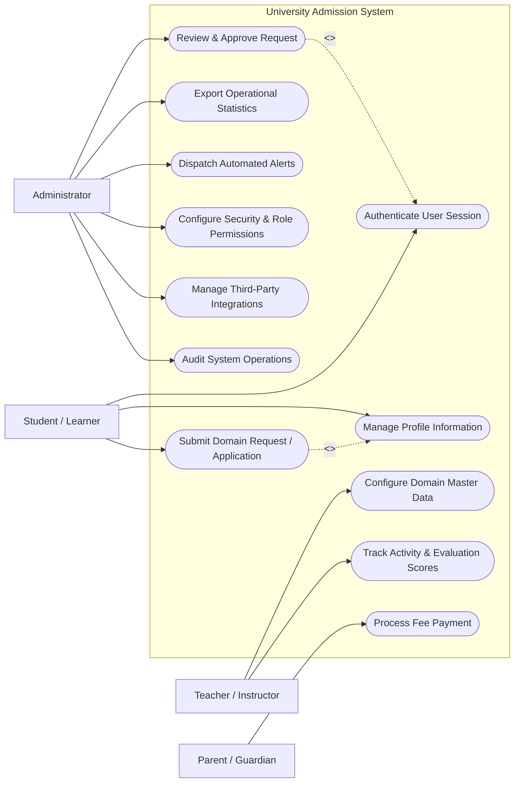

# Use Case Diagram — University Admission System

## Mermaid Code

## Actor Table | Bảng Actor

| # | Actor | Actor Type | Role Description | Related Use Cases |
|---|-------|------------|------------------|-------------------|
| 1 | Student / Learner | Primary | Người sử dụng chính của hệ thống | UC01, UC02, UC03, UC04 |
| 2 | Teacher / Instructor | Primary | Người quản lý nội dung và đánh giá | UC01, UC02, UC03, UC04 |
| 3 | Administrator | Primary | Quản trị viên vận hành hệ thống | UC01, UC02, UC03, UC04 |
| 4 | Parent / Guardian | Primary | Người giám sát và hỗ trợ người học | UC01, UC02, UC03, UC04 |
| 5 | Payment Gateway | Supporting | Cổng thanh toán điện tử trực tuyến | UC01, UC02, UC03, UC04 |
| 6 | Notification Service | Supporting | Dịch vụ gửi Email/SMS/Push notification | UC01, UC02, UC03, UC04 |
| 7 | Educational Board / Ministry | Regulatory | Cơ quan quản lý giáo dục nhà nước | UC01, UC02, UC03, UC04 |

## Use Case Table | Bảng Use Case

| # | UC ID | Use Case Name | Primary Actor | Secondary Actor | Description | Priority |
|---|-------|---------------|---------------|-----------------|-------------|----------|
| 1 | UC01 | Authenticate User Session | Student / Learner | Teacher / Instructor | Allows users to log in securely and maintain an active session. | High |
| 2 | UC02 | Manage Profile Information | Student / Learner | None | Enables updating personal details and emergency contacts. | Medium |
| 3 | UC03 | Submit Domain Request / Application | Student / Learner | Administrator | Submits formal service or academic applications. | High |
| 4 | UC04 | Review & Approve Request | Administrator | Teacher / Instructor | Inspects submitted applications and approves or rejects them. | High |
| 5 | UC05 | Configure Domain Master Data | Teacher / Instructor | Administrator | Creates and publishes primary educational resources. | High |
| 6 | UC06 | Track Activity & Evaluation Scores | Teacher / Instructor | Student / Learner | Monitors progress, records component grades, and generates evaluations. | High |
| 7 | UC07 | Process Fee Payment | Parent / Guardian | Payment Gateway | Pays for invoices and queries payment transaction status. | High |
| 8 | UC08 | Export Operational Statistics | Administrator | Educational Board / Ministry | Generates analytical dashboards and compliance reports. | Medium |
| 9 | UC09 | Dispatch Automated Alerts | Administrator | Notification Service | Sends Email/SMS reminders and status notifications. | Medium |
| 10 | UC10 | Configure Security & Role Permissions | Administrator | None | Sets system parameters, roles, and access boundaries. | High |
| 11 | UC11 | Manage Third-Party Integrations | Administrator | Payment Gateway | Synchronizes data via external APIs. | Low |
| 12 | UC12 | Audit System Operations | Administrator | Educational Board / Ministry | Logs user actions and provides data security audits. | Medium |

## Use Case Specification | Đặc tả Use Case

### UC01 — Authenticate User Session

| Field | Detail |
|-------|--------|
| **UC ID** | UC01 |
| **Use Case Name** | Authenticate User Session |
| **Actor(s)** | Primary: Student / Learner / Secondary: Teacher / Instructor |
| **Description** | Cho phép người dùng đăng nhập an toàn và khởi tạo phiên làm việc trên hệ thống. |
| **Precondition** | 1. Người dùng sở hữu tài khoản đã kích hoạt.   2. Hệ thống kết nối thành công với cơ sở dữ liệu xác thực. |
| **Main Flow** | 1. Người dùng nhập tên đăng nhập và mật khẩu.   2. Hệ thống mã hóa thông tin và truy vấn trong CSDL.   3. Hệ thống tạo mã phiên làm việc JWT.   4. Hệ thống chuyển hướng tới giao diện theo vai trò người dùng.   5. Ghi nhận thời điểm đăng nhập thành công vào System Log. |
| **Alternative Flow** | AF1 — Đăng nhập SSO: Cho phép đăng nhập thông qua Google/Microsoft Workspace.   AF2 — Quên mật khẩu: Khôi phục mật khẩu qua link gửi đến email cá nhân. |
| **Exception Flow** | EX1 — Nhập sai mật khẩu: Hệ thống thông báo 'Tài khoản hoặc mật khẩu không chính xác'.   EX2 — Tài khoản bị khóa: Hệ thống ngăn đăng nhập và hướng dẫn liên hệ Admin. |
| **Postcondition** | Phiên làm việc được tạo thành công với các quyền hạn tương ứng. |
| **Business Rule** | BR1: Mật khẩu phải có độ dài từ 8-32 ký tự.   BR2: Khóa tạm thời 15 phút nếu nhập sai quá 5 lần liên tiếp. |

---

### UC03 — Submit Domain Request / Application

| Field | Detail |
|-------|--------|
| **UC ID** | UC03 |
| **Use Case Name** | Submit Domain Request / Application |
| **Actor(s)** | Primary: Student / Learner / Secondary: Administrator |
| **Description** | Cho phép người học khởi tạo và gửi các yêu cầu nghiệp vụ chuyên môn lên hệ thống. |
| **Precondition** | 1. Người dùng đã đăng nhập vào hệ thống.   2. Hệ thống đang trong thời gian tiếp nhận yêu cầu. |
| **Main Flow** | 1. Người dùng chọn loại dịch vụ/yêu cầu muốn đăng ký.   2. Hệ thống hiển thị biểu mẫu và danh mục tài liệu cần đính kèm.   3. Người dùng điền đầy đủ thông tin và upload minh chứng.   4. Hệ thống kiểm tra định dạng dữ liệu đầu vào.   5. Người dùng nhấn 'Gửi yêu cầu'.   6. Hệ thống lưu yêu cầu ở trạng thái 'Pending' và cấp mã hồ sơ. |
| **Alternative Flow** | AF1 — Lưu nháp: Cho phép lưu hồ sơ tạm thời để hoàn thiện sau.   AF2 — Hủy yêu cầu: Cho phép hủy đơn khi đơn chưa ở trạng thái Đang thẩm định. |
| **Exception Flow** | EX1 — Tệp vượt dung lượng ( > 10MB ): Hệ thống từ chối tải tệp và báo lỗi.   EX2 — Thiếu thông tin bắt buộc: Hệ thống đánh dấu đỏ các trường còn trống. |
| **Postcondition** | Hồ sơ yêu cầu được chuyển tới hàng chờ xử lý của Administrator. |
| **Business Rule** | BR1: Tệp đính kèm chấp nhận các định dạng PDF, PNG, JPG.   BR2: Mỗi người học được mở tối đa 3 hồ sơ chưa xử lý đồng thời. |

---

### UC04 — Review & Approve Request

| Field | Detail |
|-------|--------|
| **UC ID** | UC04 |
| **Use Case Name** | Review & Approve Request |
| **Actor(s)** | Primary: Administrator / Secondary: Teacher / Instructor |
| **Description** | Cho phép Administrator thẩm định nội dung và ra quyết định phê duyệt hoặc từ chối hồ sơ. |
| **Precondition** | 1. Administrator đăng nhập bằng tài khoản có thẩm quyền.   2. Có hồ sơ ở trạng thái 'Pending' trong danh sách. |
| **Main Flow** | 1. Admin chọn hồ sơ cần thẩm định trong danh sách công việc.   2. Hệ thống hiển thị thông tin và tài liệu đính kèm.   3. Admin đối chiếu thông tin với quy định nghiệp vụ.   4. Admin chọn 'Phê duyệt' hoặc 'Từ chối' kèm nhận xét.   5. Hệ thống cập nhật trạng thái hồ sơ thành 'Approved' hoặc 'Rejected'.   6. Hệ thống phát thông báo kết quả tới người nộp hồ sơ. |
| **Alternative Flow** | AF1 — Yêu cầu bổ sung: Admin chuyển hồ sơ sang trạng thái 'Need Info' và nêu rõ nội dung cần sửa.   AF2 — Chuyển cấp duyệt: Admin gửi hồ sơ lên cấp thẩm quyền cao hơn. |
| **Exception Flow** | EX1 — Hồ sơ đã bị thay đổi: Cảnh báo nếu hồ sơ vừa được Admin khác xử lý.   EX2 — Lỗi kết nối CSDL: Giữ nguyên trạng thái và thông báo thử lại sau. |
| **Postcondition** | Hồ sơ được cập nhật trạng thái chính thức và ghi vết trong audit log. |
| **Business Rule** | BR1: Thời gian xử lý không quá 3 ngày làm việc kể từ khi nhận hồ sơ.   BR2: Thông báo kết quả phải tự động gửi qua Email/System Notice. |

---

### UC07 — Process Fee Payment

| Field | Detail |
|-------|--------|
| **UC ID** | UC07 |
| **Use Case Name** | Process Fee Payment |
| **Actor(s)** | Primary: Parent / Guardian / Secondary: Payment Gateway |
| **Description** | Thực hiện thanh toán nghĩa vụ chi phí/học phí qua cổng thanh toán trực tuyến. |
| **Precondition** | 1. Hóa đơn chi phí đã được tạo và còn hạn thanh toán.   2. Người dùng có phương thức thanh toán trực tuyến khả dụng. |
| **Main Flow** | 1. Người dùng chọn hóa đơn cần thanh toán.   2. Hệ thống hiển thị tổng tiền và danh mục chi tiết.   3. Người dùng chọn cổng thanh toán (VNPay, Banking, MoMo).   4. Hệ thống khởi tạo phiên giao dịch và chuyển hướng tới Payment Gateway.   5. Người dùng hoàn tất giao dịch tại Cổng thanh toán.   6. Payment Gateway trả kết quả thành công, hệ thống gạch nợ và phát hành biên lai. |
| **Alternative Flow** | AF1 — Chuyển khoản thủ công: Người dùng tải hóa đơn và upload minh chứng chuyển khoản.   AF2 — Tra cứu lịch sử thanh toán: Xem lại danh sách các biên lai giao dịch cũ. |
| **Exception Flow** | EX1 — Giao dịch bị hủy/thất bại: Hệ thống giữ nguyên trạng thái nợ và báo lỗi.   EX2 — Hết thời gian phiên (Timeout): Hệ thống tự động hủy phiên giao dịch. |
| **Postcondition** | Hóa đơn chuyển sang trạng thái 'Paid', tài khoản ghi nhận gạch nợ thành công. |
| **Business Rule** | BR1: Mã checksum giao dịch phải khớp 100% với dữ liệu từ Payment Gateway.   BR2: Biên lai điện tử có giá trị pháp lý được phát hành tự động. |

