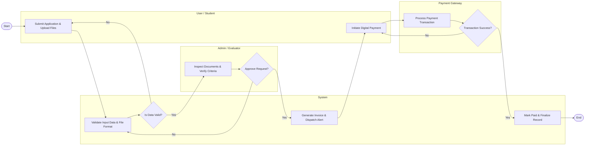

# Swimlane Diagram — Student Attendance Tracking System

## Mermaid Code

## Flow Description | Mô tả luồng

| # | Lane / Actor | Role in Flow |
|---|--------------|--------------|
| 1 | User / Student | Khởi tạo yêu cầu, nộp hồ sơ và thanh toán |
| 2 | System | Kiểm tra dữ liệu, điều phối luồng và ghi nhận CSDL |
| 3 | Admin / Evaluator | Thẩm định nội dung và ra quyết định phê duyệt |
| 4 | Payment Gateway | Xử lý giao dịch thanh toán tài chính |
