# Action Tree — Alumni Management System

## Mermaid Code

```mermaid
graph TD
    Root["Alumni Management System"]

    Root --> M1["User & Security Management"]
    M1 --> A1_1["Create Account Profile"]
    M1 --> A1_2["Assign User Roles"]
    M1 --> A1_3["Manage Credentials"]
    M1 --> A1_4["Audit Log Trail"]

    Root --> M2["Application & Submission Processing"]
    M2 --> A2_1["Submit Request Application"]
    M2 --> A2_2["Validate File Attachments"]
    M2 --> A2_3["Approve Application"]
    M2 --> A2_4["Reject / Request Amendment"]

    Root --> M3["Core Operational Management"]
    M3 --> A3_1["Define Master Entities"]
    M3 --> A3_2["Update Operational Progress"]
    M3 --> A3_3["Monitor Progress Metrics"]
    M3 --> A3_4["Archive Outdated Records"]

    Root --> M4["Financial & Billing Management"]
    M4 --> A4_1["Generate Fee Invoices"]
    M4 --> A4_2["Process Online Payment"]
    M4 --> A4_3["Issue Digital Receipt"]
    M4 --> A4_4["Track Balances"]

    Root --> M5["Communication & Alerts"]
    M5 --> A5_1["Send System Notice"]
    M5 --> A5_2["Dispatch Email Reminder"]
    M5 --> A5_3["Send SMS Alerts"]
    M5 --> A5_4["Manage Template Config"]

    Root --> M6["Analytics & Compliance Reporting"]
    M6 --> A6_1["Generate Executive Dashboard"]
    M6 --> A6_2["Export Regulatory Compliance"]
    M6 --> A6_3["Analyze Operational Trends"]
    M6 --> A6_4["Audit System Integrity"]

```

## Module Description | Mô tả Module

| # | Module | Description | Actions |
|---|--------|-------------|---------|
| 1 | User & Security Management | Quản lý tài khoản, phân quyền vai trò và nhật ký an toàn | Create Account Profile, Assign User Roles, Manage Credentials, Audit Log Trail |
| 2 | Application & Submission Processing | Tiếp nhận và xử lý hồ sơ yêu cầu nghiệp vụ | Submit Request Application, Validate File Attachments, Approve Application, Reject / Request Amendment |
| 3 | Core Operational Management | Quản lý danh mục và dữ liệu chi tiết chuyên môn | Define Master Entities, Update Operational Progress, Monitor Progress Metrics, Archive Outdated Records |
| 4 | Financial & Billing Management | Tính toán chi phí, xử lý gạch nợ và cổng thanh toán | Generate Fee Invoices, Process Online Payment, Issue Digital Receipt, Track Balances |
| 5 | Communication & Alerts | Phát tin nhắn thông báo tự động và quản lý mẫu thông báo | Send System Notice, Dispatch Email Reminder, Send SMS Alerts, Manage Template Config |
| 6 | Analytics & Compliance Reporting | Kết xuất báo cáo thống kê, dashboard và dữ liệu quy chuẩn | Generate Executive Dashboard, Export Regulatory Compliance, Analyze Operational Trends, Audit System Integrity |
