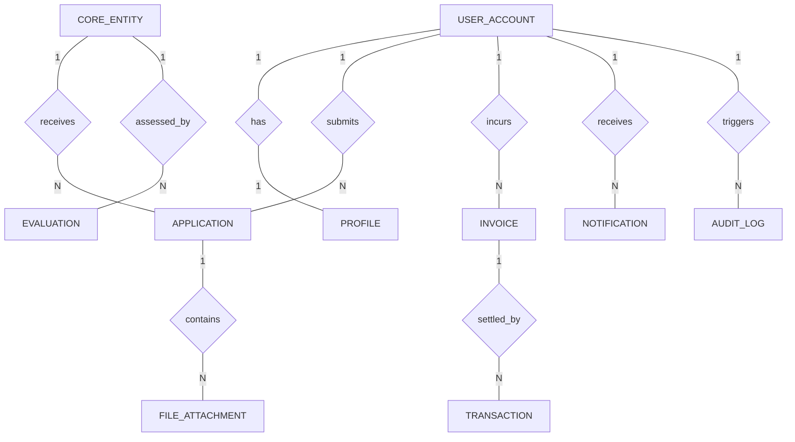

# Conceptual ERD — Blended Learning Management System

## Mermaid Code

## Entity Description Table | Bảng mô tả Entity

| # | Entity Name | Vietnamese Name | Description | Key Attributes | Main Relationships |
|---|-------------|-----------------|-------------|----------------|-------------------|
| 1 | USER_ACCOUNT | Tài khoản người dùng | Lưu trữ tài khoản và quyền hạn | user_id PK, username, password_hash, email, role, status, created_at | has one PROFILE, has many APPLICATION |
| 2 | PROFILE | Hồ sơ cá nhân | Thông tin chi tiết lý lịch người dùng | profile_id PK, user_id FK, full_name, phone, address, gender, dob | belongs to USER_ACCOUNT |
| 3 | CORE_ENTITY | Thành phần nghiệp vụ chính | Đối tượng cốt lõi của hệ thống (Khóa học/Sự kiện/Tài nguyên) | entity_id PK, entity_code, title, description, status, created_at | has many APPLICATION, has many EVALUATION |
| 4 | APPLICATION | Hồ sơ / Yêu cầu | Đơn xin hoặc hồ sơ đăng ký của người dùng | app_id PK, user_id FK, entity_id FK, submit_date, status, notes | belongs to USER_ACCOUNT, belongs to CORE_ENTITY, has many FILE_ATTACHMENT |
| 5 | FILE_ATTACHMENT | Tệp đính kèm | Minh chứng hoặc tài liệu gửi kèm hồ sơ | file_id PK, app_id FK, file_name, file_path, file_size, uploaded_at | belongs to APPLICATION |
| 6 | EVALUATION | Đánh giá / Điểm số | Kết quả theo dõi hoặc điểm đánh giá chuyên môn | eval_id PK, entity_id FK, user_id FK, score_val, comments, eval_date | belongs to CORE_ENTITY, belongs to USER_ACCOUNT |
| 7 | INVOICE | Hóa đơn | Nghĩa vụ tài chính liên quan | invoice_id PK, user_id FK, app_id FK, total_amount, due_date, status | belongs to USER_ACCOUNT, has many TRANSACTION |
| 8 | TRANSACTION | Giao dịch thanh toán | Nhật ký thanh toán điện tử | trans_id PK, invoice_id FK, amount, payment_method, gateway_trans_id, paid_at | belongs to INVOICE |
| 9 | NOTIFICATION | Thông báo hệ thống | Lịch sử tin nhắn thông báo | notif_id PK, user_id FK, title, content, is_read, sent_at | belongs to USER_ACCOUNT |
| 10 | AUDIT_LOG | Nhật ký hệ thống | Vết thao tác và an toàn thông tin | log_id PK, user_id FK, action, ip_address, timestamp | belongs to USER_ACCOUNT |

## Relationship Description | Mô tả Quan hệ

| # | From Entity | Cardinality | To Entity | Relationship Label | Business Explanation |
|---|-------------|-------------|-----------|-------------------|----------------------|
| 1 | USER_ACCOUNT | one-to-one | PROFILE | has | Một Tài khoản đi kèm một Hồ sơ lý lịch |
| 2 | USER_ACCOUNT | one-to-many | APPLICATION | submits | Một Người dùng có thể nộp nhiều Hồ sơ |
| 3 | CORE_ENTITY | one-to-many | APPLICATION | receives | Một Thành phần nghiệp vụ tiếp nhận nhiều Hồ sơ |
| 4 | APPLICATION | one-to-many | FILE_ATTACHMENT | contains | Một Hồ sơ có thể đính kèm nhiều Tệp |
| 5 | CORE_ENTITY | one-to-many | EVALUATION | assessed_by | Một Thành phần nghiệp vụ sinh ra nhiều Đánh giá |
| 6 | USER_ACCOUNT | one-to-many | INVOICE | incurs | Người dùng phát sinh nhiều Hóa đơn thanh toán |
| 7 | INVOICE | one-to-many | TRANSACTION | settled_by | Một Hóa đơn được hoàn tất bằng các Giao dịch thanh toán |
| 8 | USER_ACCOUNT | one-to-many | NOTIFICATION | receives | Người dùng nhận nhiều Thông báo hệ thống |
| 9 | USER_ACCOUNT | one-to-many | AUDIT_LOG | triggers | Thao tác của Người dùng được ghi vết trong Audit Log |
