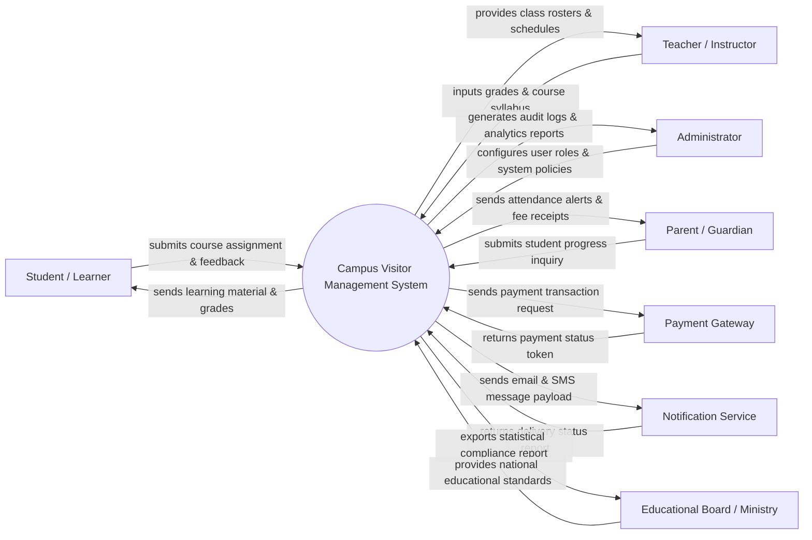

# Context Diagram — Campus Visitor Management System

## Mermaid Code

## Actor & Interaction Table | Bảng Actor & Tương tác

| # | Actor | Actor Type | Data Sent TO System | Data Received FROM System | Notes |
|---|-------|------------|---------------------|---------------------------|-------|
| 1 | Student / Learner | Primary | Requests, submissions, profile updates, feedback | Notifications, academic results, schedules, receipts | Người sử dụng chính của hệ thống |
| 2 | Teacher / Instructor | Primary | Grades, attendance, course content, evaluation criteria | Rosters, schedules, submission files, analytics | Người quản lý nội dung và đánh giá |
| 3 | Administrator | Primary | System configurations, user assignments, policy updates | Audit logs, analytical reports, system alerts | Quản trị viên vận hành hệ thống |
| 4 | Parent / Guardian | Primary | Inquiries, consent forms, payments | Progress updates, attendance alerts, payment receipts | Người giám sát và hỗ trợ người học |
| 5 | Payment Gateway | Supporting | Payment status, transaction tokens | Payment requests, invoice details | Cổng thanh toán điện tử trực tuyến |
| 6 | Notification Service | Supporting | Delivery confirmations, error logs | Message templates, recipient numbers/emails | Dịch vụ gửi Email/SMS/Push notification |
| 7 | Educational Board / Ministry | Regulatory | Compliance guidelines, accreditation standards | Statistical reports, audit exports | Cơ quan quản lý giáo dục nhà nước |

## System Boundary Description | Mô tả Phạm vi Hệ thống

Hệ thống Campus Visitor Management System (Hệ thống Quản lý Khách thăm Khuôn viên) chịu trách nhiệm quản lý toàn bộ các quy trình nghiệp vụ chuyên biệt của hệ thống quản lý khách thăm khuôn viên. Phạm vi bên trong hệ thống bao gồm tiếp nhận hồ sơ, khởi tạo và theo dõi các thành phần nghiệp vụ, quản lý phân quyền và lưu trữ nhật ký hệ thống. Ngược lại, các thành phần không thuộc phạm vi xử lý của hệ thống bao gồm: xử lý cổng giao dịch tài chính điện tử (ủy quyền cho Payment Gateway), hạ tầng phần cứng viễn thông phát tin nhắn (giao cho Notification Service) và xây dựng bộ tiêu chuẩn khung pháp lý cấp quốc gia (do Educational Board / Ministry ban hành).
