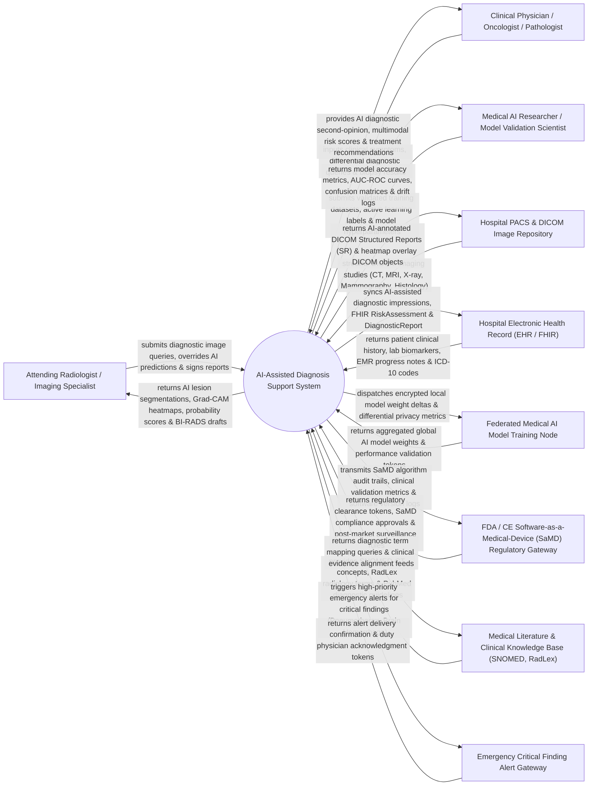

# Context Diagram — AI-Assisted Diagnosis Support System

## Mermaid Code

## Actor & Interaction Table | Bảng Actor & Tương tác

| # | Actor | Actor Type | Data Sent TO System | Data Received FROM System | Notes |
|---|-------|------------|---------------------|---------------------------|-------|
| 1 | Attending Radiologist / Specialist | Primary | Diagnostic DICOM image review queries, AI prediction acceptance/overrule decisions, clinical report edits, final digital signatures. | AI deep learning lesion bounding boxes, Grad-CAM saliency heatmaps, differential diagnosis confidence %, draft BI-RADS/LUNG-RADS reports. | Board-certified radiologist or imaging specialist reviewing AI computer-aided detection (CADe) and diagnosis (CADx) outputs. |
| 2 | Clinical Physician / Oncologist | Primary | Clinical symptom checklist, physical exam findings, biopsy pathology results, differential diagnostic query requests. | AI diagnostic second-opinion analysis, multimodal disease probability scores, treatment response prediction summaries. | Treating physicians (oncologists, neurologists, pulmonologists) utilizing AI diagnostic support for clinical decision-making. |
| 3 | Medical AI Researcher / Scientist | Primary | Annotated ground-truth training datasets, active learning correction labels, model training hyperparameter configurations. | Model performance evaluation metrics (AUC-ROC, Sensitivity, Specificity, F1-Score), algorithmic drift logs, validation curves. | Data scientists and medical AI researchers monitoring model accuracy, retraining algorithms, and validating clinical safety. |
| 4 | Hospital PACS Archive | Supporting System | DICOM imaging studies (CT scans, brain MRIs, digital mammograms, chest X-rays, whole-slide pathology images). | AI-annotated DICOM Structured Reports (SR), secondary capture DICOM heatmap overlay objects, image triage priority tags. | Picture Archiving and Communication System (PACS) managing hospital diagnostic image storage and DICOM communications. |
| 5 | Hospital Electronic Health Record (EHR) | Supporting System | Patient EMR clinical history, laboratory biomarkers (tumor markers, CBC), prior diagnostic reports, ICD-10 codes. | FHIR `DiagnosticReport` and `Observation` resources containing AI diagnostic impressions, structured findings, and risk scores. | Enterprise hospital EMR (Epic, Cerner) integrating AI diagnostic findings using HL7 FHIR R4 standard interfaces. |
| 6 | Federated Medical AI Model Node | Supporting System | Aggregated global neural network model weights, federated consensus validation tokens, cross-site accuracy benchmarks. | Encrypted local model weight update deltas ($\Delta W$), differential privacy noise parameters ($\epsilon$), local validation metrics. | Distributed multi-hospital enclave nodes enabling collaborative AI training across hospitals without sharing raw DICOM images. |
| 7 | FDA / CE SaMD Regulatory Gateway | Supporting System | Regulatory clearance tokens (FDA 510k, CE-Mark SaMD), post-market surveillance reporting rules, algorithmic compliance standards. | Software-as-a-Medical-Device (SaMD) execution audit trails, clinical accuracy validation dossiers, algorithm version logs. | Government regulatory bodies governing medical device AI software safety, performance, and clinical transparency. |
| 8 | Clinical Decision Knowledge Base | Supporting System | SNOMED-CT clinical concepts, RadLex radiology lexicon terms, NCCN oncology guidelines, PubMed diagnostic literature. | Diagnostic term mapping queries, clinical evidence alignment requests, differential diagnosis ontology lookups. | Standard medical nomenclature registries (SNOMED, RadLex, LOINC) providing clinical diagnostic terminology standards. |
| 9 | Emergency Critical Alert Gateway | Supporting System | Alert delivery status receipts, duty physician smartphone push notifications, clinical call center acknowledgment tokens. | Urgent critical finding notifications (acute intracranial hemorrhage, tension pneumothorax, pulmonary embolism), patient location. | High-priority clinical notification gateway dispatching instant STAT alerts to attending physicians upon AI critical finding detection. |

## System Boundary Description | Mô tả Phạm vi Hệ thống

The **AI-Assisted Diagnosis Support System (AIDSS)** is an enterprise clinical computer-aided detection (CADe), computer-aided diagnosis (CADx), multimodal explainable AI (XAI), and radiology workflow optimization platform. Operating across hospital radiology departments, oncology centers, pathology labs, and emergency rooms, it ingests multi-modal DICOM imaging studies (CT, MRI, X-ray, Pathology) and EMR clinical data, executes deep learning neural networks (CNNs, Vision Transformers) for automated lesion segmentation and differential diagnosis probability scoring, generates Explainable AI (Grad-CAM) heatmaps, triggers STAT emergency critical finding alerts, and syncs DICOM Structured Reports with enterprise PACS and EHR systems.

**Inside System Scope:**
- DICOM image ingestion, preprocessing, normalization, and automated windowing (Lung, Bone, Brain windows).
- Deep learning computer-aided detection (CADe) for lesion localization, bounding-box generation, and volumetric measurement.
- Computer-aided diagnosis (CADx) providing multi-class differential diagnosis probability scoring (e.g., Benign vs Malignant).
- Explainable AI (XAI) engine rendering Grad-CAM saliency heatmaps and feature attribution scores for clinical transparency.
- Automated STAT emergency critical finding detection (Pneumothorax, Intracranial Hemorrhage, Pulmonary Embolism) with immediate alert escalation.
- Interactive radiologist review workspace enabling one-click acceptance, modification, or overrule of AI diagnostic predictions.
- Automatic draft generation of structured radiology reports conforming to BI-RADS, LUNG-RADS, and PI-RADS standards.
- Federated privacy-preserving model updating ($\epsilon$-differential privacy) and continuous model accuracy drift monitoring.

**Outside System Scope:**
- Primary physical operation and hardware calibration of DICOM radiology modalities (CT scanners, MRI machines).
- Final autonomous legal diagnostic sign-off without human licensed physician review (AIDSS acts strictly as a Decision Support tool).
- General non-diagnostic hospital billing, patient scheduling, and room management (handled by HIS / RIS).
