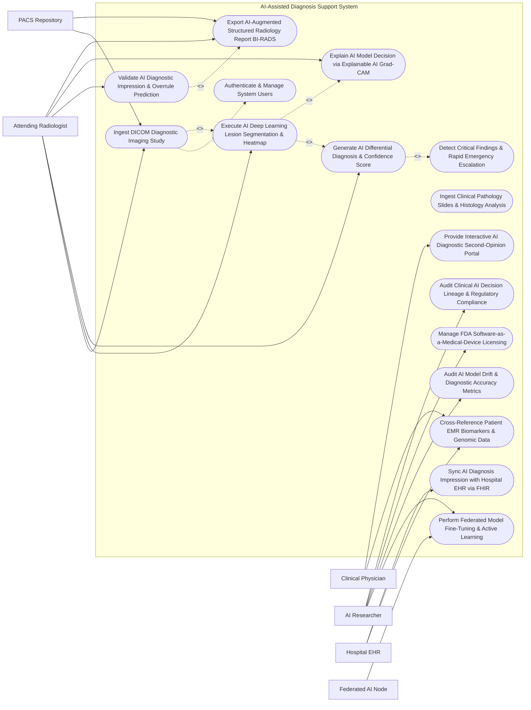

# Use Case Diagram — AI-Assisted Diagnosis Support System

## Mermaid Code

## Actor Table | Bảng Actor

| # | Actor | Actor Type | Role Description | Related Use Cases |
|---|-------|------------|------------------|-------------------|
| 1 | Attending Radiologist | Primary | Board-certified radiologist reviewing DICOM image studies, evaluating AI deep learning findings, validating/overruling diagnoses, and signing structured reports. | UC01, UC02, UC03, UC05, UC08, UC09 |
| 2 | Clinical Physician | Primary | Treating physician (oncologist, neurologist, surgeon) querying AI diagnostic second opinions and cross-referencing diagnostic findings with clinical history. | UC07, UC14 |
| 3 | AI Researcher | Primary | Medical data scientist monitoring model diagnostic performance, managing active learning feedback loops, and auditing algorithmic drift. | UC10, UC11, UC13, UC15 |
| 4 | PACS Repository | Secondary / System | Picture Archiving and Communication System streaming DICOM imaging studies to AIDSS and receiving AI-annotated DICOM Structured Reports (SR). | UC01, UC09 |
| 5 | Hospital EHR | Secondary / System | Enterprise Electronic Health Record system providing patient EMR history and receiving FHIR `DiagnosticReport` resources containing AI impressions. | UC07, UC12 |
| 6 | Federated AI Node | Secondary / System | Distributed multi-hospital enclave node participating in privacy-preserving federated model training without centralizing patient DICOM images. | UC10 |

## Use Case Table | Bảng Use Case

| # | UC ID | Use Case Name | Primary Actor | Secondary Actor | Description | Priority |
|---|-------|---------------|---------------|-----------------|-------------|----------|
| 1 | UC01 | Ingest DICOM Diagnostic Imaging Study | Attending Radiologist | PACS Repository | Retrieve DICOM diagnostic imaging studies (CT, MRI, X-ray, Mammography) from PACS, validate DICOM headers, and initialize AI pipeline. | High |
| 2 | UC02 | Execute AI Deep Learning Lesion Segmentation & Heatmap | Attending Radiologist | None | Run convolutional neural networks (3D U-Net / Vision Transformers) to segment anatomical lesions, calculate volumes, and render visual overlays. | High |
| 3 | UC03 | Generate AI Differential Diagnosis & Confidence Score | Attending Radiologist | None | Compute multi-class differential diagnosis probability distribution (e.g., Malignant Carcinoma 87.4%, Benign Fibroadenoma 12.6%) with confidence intervals. | High |
| 4 | UC04 | Detect Critical Findings & Rapid Emergency Escalation | AI Engine | None | Automatically identify STAT emergency critical findings (acute intracranial hemorrhage, tension pneumothorax) and dispatch urgent notifications to duty physicians. | High |
| 5 | UC05 | Validate AI Diagnostic Impression & Overrule Prediction | Attending Radiologist | None | Enable radiologist to accept, modify, or overrule AI-generated findings, logging clinician feedback and clinical rationale for active learning. | High |
| 6 | UC06 | Ingest Clinical Pathology Slides & Histology Analysis | Attending Radiologist | None | Analyze Whole-Slide Images (WSI) of biopsy tissue, performing digital cell counting, mitotic index estimation, and cancer grading (Gleason score). | Medium |
| 7 | UC07 | Cross-Reference Patient EMR Biomarkers & Genomic Data | Clinical Physician | Hospital EHR | Combine AI imaging findings with patient EMR blood biomarkers (CEA, PSA, CA-125) and genomic variant profiles for multimodal diagnostic scoring. | High |
| 8 | UC08 | Explain AI Model Decision via Explainable AI Grad-CAM | Attending Radiologist | None | Display Explainable AI (XAI) Grad-CAM saliency heatmaps highlighting exact pixel regions driving the neural network's diagnostic decision. | High |
| 9 | UC09 | Export AI-Augmented Structured Radiology Report BI-RADS | Attending Radiologist | PACS Repository | Auto-populate standardized structured radiology report drafts (BI-RADS, LUNG-RADS, PI-RADS) with AI lesion measurements and export DICOM SR to PACS. | High |
| 10 | UC10 | Perform Federated Model Fine-Tuning & Active Learning | AI Researcher | Federated AI Node | Retrain diagnostic neural networks using privacy-preserving federated learning across multi-hospital nodes, updating global model weights. | Medium |
| 11 | UC11 | Audit AI Model Drift & Diagnostic Accuracy Metrics | AI Researcher | None | Track model performance metrics (AUC-ROC, Sensitivity, Specificity, F1-Score) over time to detect diagnostic accuracy degradation and algorithmic drift. | High |
| 12 | UC12 | Sync AI Diagnosis Impression with Hospital EHR via FHIR | Attending Radiologist | Hospital EHR | Export validated diagnostic impressions, recommendations, and ICD-10/SNOMED codes to hospital EHR as HL7 FHIR `DiagnosticReport` resources. | High |
| 13 | UC13 | Manage FDA Software-as-a-Medical-Device Licensing | AI Researcher | None | Enforce FDA 510(k) / CE-Mark SaMD regulatory constraints, algorithm versioning controls, and post-market surveillance logging. | High |
| 14 | UC14 | Provide Interactive AI Diagnostic Second-Opinion Portal | Clinical Physician | None | Provide treating clinicians with an interactive second-opinion portal displaying AI risk scores, similar historical case matchings, and NCCN guideline links. | Medium |
| 15 | UC15 | Audit Clinical AI Decision Lineage & Regulatory Compliance | AI Researcher | None | Maintain immutable cryptographic audit trail of all AI predictions, model version IDs, raw DICOM hashes, and physician validation/overrule logs. | High |
| 16 | UC16 | Authenticate & Manage System Users | All Users | None | Authenticate users via multi-factor authentication (MFA), enforce role-based access control (Radiologist, Physician, Researcher), and audit access. | High |

## Use Case Specification | Đặc tả Use Case

---

### UC01 — Ingest DICOM Diagnostic Imaging Study

| Field | Detail |
|-------|--------|
| **UC ID** | UC01 |
| **Use Case Name** | Ingest DICOM Diagnostic Imaging Study |
| **Actor(s)** | Primary: Attending Radiologist   Secondary: PACS Repository |
| **Description** | Automatically or manually queries and ingests multi-slice DICOM diagnostic imaging studies (Chest CT, Brain MRI, Digital Mammogram, Digital X-ray) from hospital PACS, validates DICOM tag metadata (Modality, Patient ID, Study UID, Slice Thickness), performs image normalization/windowing, and queues study for AI deep learning inference. |
| **Precondition** | 1. Attending Radiologist is authenticated in AIDSS with valid clinical credentials.   2. PACS DICOM C-MOVE / C-STORE network connection is active. |
| **Main Flow** | 1. The Attending Radiologist opens "Unread Imaging Worklist" in AIDSS.   2. The Radiologist selects Study `STU-CT-2026-99182` (Patient: *Jane Doe*, Modality: `CT`, Body Part: `CHEST`, Reason: *Persistent Cough & Dyspnea*).   3. The System sends a DICOM C-MOVE query to the Hospital PACS Repository.   4. The PACS Repository streams 450 DICOM image slices ($512 \times 512$ matrix, $1.0\text{ mm}$ slice thickness, DICOM UID `1.2.840.113619.2.99182.2026`).   5. The System validates DICOM Metadata:   &nbsp;&nbsp;&nbsp;&nbsp;- Verifies pixel array integrity & Hounsfield Unit (HU) calibration   &nbsp;&nbsp;&nbsp;&nbsp;- Applies automated pre-processing: Lung Windowing ($\text{WW}=1500, \text{WL}=-600$).   6. The System initializes AI Deep Learning Inference Pipeline `PIPE-LUNG-CADx-v3.2` (UC02). |
| **Alternative Flow** | **AF1** — Direct Modality Push Ingestion: CT scanner automatically pushes DICOM image series directly to AIDSS listener port (DICOM C-STORE) immediately post-acquisition, enabling background pre-computation before radiologist opens study.   **AF2** — Whole-Slide Pathology Image Ingestion: Pathologist uploads 40x Whole-Slide Histology Image (`SAMP-HIST-88192.svs` - 2.4 GB); System initializes Digital Pathology AI Pipeline. |
| **Exception Flow** | **EX1** — Corrupted DICOM Pixel Array Error: 15 DICOM slices contain corrupted data frames; System flags "DICOM Data Corruption Error — Incomplete Series Ingested", notifying PACS administrator.   **EX2** — Unsupported Imaging Modality Warning: User uploads Ultrasound series to a Pulmonary CT AI model; System blocks inference with error "Modality Mismatch — Selected AI Model Requires CT Modality". |
| **Postcondition** | Study STU-CT-2026-99182 (450 slices) is ingested, validated, windowed, and queued for AI deep learning inference. |
| **Business Rule** | **BR1**: Diagnostic imaging studies MUST undergo DICOM tag validation (Modality, Slice Thickness, HU Calibration) prior to neural network inference to prevent model misclassification.   **BR2**: AI diagnostic inference MUST NOT modify original raw DICOM pixel data; all AI annotations MUST be rendered as separate overlay layers or DICOM Structured Reports (SR). |

---

### UC02 — Execute AI Deep Learning Lesion Segmentation & Heatmap

| Field | Detail |
|-------|--------|
| **UC ID** | UC02 |
| **Use Case Name** | Execute AI Deep Learning Lesion Segmentation & Heatmap |
| **Actor(s)** | Primary: Attending Radiologist |
| **Description** | Executes 3D Convolutional Neural Networks (3D U-Net / Vision Transformers) on ingested DICOM imaging studies, automatically detecting, segmenting, and measuring anatomical lesions (solitary pulmonary nodules, brain tumors, hepatic masses), calculating 3D lesion volumes ($\text{mm}^3$), and rendering 3D bounding boxes and Explainable AI (Grad-CAM) heatmaps. |
| **Precondition** | 1. DICOM study `STU-CT-2026-99182` (UC01) is ingested and windowed.   2. FDA-cleared AI Inference Engine `PIPE-LUNG-CADx-v3.2` is running on GPU cluster. |
| **Main Flow** | 1. The AI Inference Engine dispatches 450 CT slices to the GPU Tensor Core cluster.   2. The System executes **3D U-Net Lesion Segmentation Model**:   &nbsp;&nbsp;&nbsp;&nbsp;- Scans entire lung parenchyma in $64 \times 64 \times 64$ sub-volumes   &nbsp;&nbsp;&nbsp;&nbsp;- Identifies suspicious lesion in Right Upper Lobe (RUL) at coordinate $(X: 142, Y: 218, Z: 84)$.   3. The System computes **Automated 3D Lesion Measurements**:   &nbsp;&nbsp;&nbsp;&nbsp;- Maximum Diameter: $\mathbf{14.2\text{ mm}}$   &nbsp;&nbsp;&nbsp;&nbsp;- Mean Diameter: $12.8\text{ mm}$   &nbsp;&nbsp;&nbsp;&nbsp;- Total 3D Volume: $\mathbf{892\text{ mm}^3}$   &nbsp;&nbsp;&nbsp;&nbsp;- Hounsfield Density: Mean $\mathbf{+42\text{ HU}}$ (Soft Tissue Density with Speculated Margins).   4. The System generates **Explainable AI (Grad-CAM) Saliency Heatmap**:   &nbsp;&nbsp;&nbsp;&nbsp;- Renders semi-transparent color overlay (Red = High Model Focus, Blue = Low Model Focus) highlighting spiculation features.   5. The System overlays 3D Bounding Box `BOX-RUL-01` on the Radiologist's DICOM viewer interface.   6. The System routes segmented lesion parameters to the Differential Diagnosis Engine (UC03). |
| **Alternative Flow** | **AF1** — Multi-Lesion Pulmonary Metastases Detection: AI model detects 8 distinct pulmonary nodules across both lungs; System numbers each lesion (`LES-01` to `LES-08`), sorting by volume and malignancy risk score.   **AF2** — Longitudinal Nodule Growth Comparison: System compares current nodule volume ($892\text{ mm}^3$) with prior CT scan from 6 months ago ($520\text{ mm}^3$), computing Volume Doubling Time (VDT = 184 Days -> Fast Growth Rate). |
| **Exception Flow** | **EX1** — GPU Out-of-Memory Execution Error: 4K High-Res MRI study exceeds GPU memory capacity; System automatically splits volume into sub-batches and executes inference.   **EX2** — Sub-Threshold Lesion Artifact Suppressed: Model detects tiny $1.2\text{ mm}$ vascular calcification below clinical cutoff ($< 3.0\text{ mm}$); System suppresses bounding box to prevent false alarm noise. |
| **Postcondition** | Lesion BOX-RUL-01 is segmented ($14.2\text{ mm}$, $892\text{ mm}^3$), Grad-CAM heatmap rendered, and sent to differential diagnosis scoring. |
| **Business Rule** | **BR1**: AI lesion segmentation algorithms MUST provide exact 3D volumetric measurements ($\text{mm}^3$) and mean Hounsfield Unit (HU) density values for all detected masses.   **BR2**: Visual AI heatmaps MUST use standardized semi-transparent color overlays that can be toggled on/off instantly by the reviewing radiologist. |

---

### UC03 — Generate AI Differential Diagnosis & Confidence Score

| Field | Detail |
|-------|--------|
| **UC ID** | UC03 |
| **Use Case Name** | Generate AI Differential Diagnosis & Confidence Score |
| **Actor(s)** | Primary: Attending Radiologist |
| **Description** | Evaluates segmented lesion features (morphology, density, spiculation, growth rate) using multi-task deep neural networks, computing a ranked differential diagnosis probability distribution (e.g., Primary Non-Small Cell Lung Cancer vs Granuloma) with statistical confidence intervals and clinical risk categorization (LUNG-RADS Category 4B). |
| **Precondition** | 1. Segmented lesion `BOX-RUL-01` ($14.2\text{ mm}$) (UC02) is available.   2. The Multi-Task Classification Model `MODEL-CADx-LUNG-v3.2` is loaded. |
| **Main Flow** | 1. The Multi-Task Classification Model analyzes extracted radiomic features of Lesion `BOX-RUL-01`.   2. The System computes **Differential Diagnosis Probability Distribution**:   &nbsp;&nbsp;&nbsp;&nbsp;- **Primary Diagnosis 1**: *Malignant Lung Adenocarcinoma (ICD-10 C34.1)* -> **Probability: $\mathbf{87.4\%}$** ($95\%\text{ CI: } 82.1\% - 91.8\%$)   &nbsp;&nbsp;&nbsp;&nbsp;- **Differential 2**: *Tuberculous Granuloma (ICD-10 A15.0)* -> **Probability: $9.2\%$**   &nbsp;&nbsp;&nbsp;&nbsp;- **Differential 3**: *Hamartoma (ICD-10 D14.3)* -> **Probability: $3.4\%$**.   3. The System maps findings to **ACR LUNG-RADS Classification**:   &nbsp;&nbsp;&nbsp;&nbsp;- Score: **LUNG-RADS Category 4B** (High Suspicion of Malignancy — Solid Nodule $\ge 15\text{ mm}$ or Spiculated $\ge 8\text{ mm}$).   4. The System retrieves **Clinical Management Recommendations**:   &nbsp;&nbsp;&nbsp;&nbsp;- *Action Recommended*: Chest PET-CT scan and CT-guided percutaneous needle biopsy.   5. The System presents the AI Diagnostic Summary Card on the Radiologist Workstation.   6. The Radiologist reviews the AI prediction and opens the Validation Workspace (UC05). |
| **Alternative Flow** | **AF1** — Brain MRI Multi-Class Tumor Diagnosis: AI model evaluates brain MRI (T1, T2, FLAIR), computing probability distribution: Glioblastoma Multiforme (78.2%), Anaplastic Astrocytoma (14.5%), Primary CNS Lymphoma (7.3%).   **AF2** — Low Confidence Differential Fallback: AI confidence score is $< 60\%$ (Equivocal finding); System flags "Equivocal AI Prediction — Manual Sub-Specialist Radiologist Review Recommended". |
| **Exception Flow** | **EX1** — Rare Disease Phenotype Warning: Model detects radiomic features not represented in training set; System flags "Out-of-Distribution Feature Pattern — Exercise Clinical Caution".   **EX2** — Missing Clinical Biomarker Input: EMR lacks CEA tumor marker value; System calculates image-only probability and displays prompt "Add CEA Biomarker to Improve Accuracy". |
| **Postcondition** | Differential diagnosis (Malignant Adenocarcinoma 87.4%), LUNG-RADS 4B classification, and biopsy recommendation are generated and presented to radiologist. |
| **Business Rule** | **BR1**: AI differential diagnosis outputs MUST display exact probability percentages with 95% Confidence Intervals and map results to standard clinical categorization frameworks (BI-RADS, LUNG-RADS, PI-RADS).   **BR2**: AI diagnostic predictions with confidence scores below 60% MUST be explicitly flagged as Equivocal to prevent over-reliance by junior clinicians. |

---

### UC04 — Detect Critical Findings & Rapid Emergency Escalation

| Field | Detail |
|-------|--------|
| **UC ID** | UC04 |
| **Use Case Name** | Detect Critical Findings & Rapid Emergency Escalation |
| **Actor(s)** | Primary: AI Engine   Secondary: Attending Radiologist |
| **Description** | Automatically scans incoming DICOM studies in real-time for acute, life-threatening critical findings (acute tension pneumothorax, large intracranial hemorrhage, acute pulmonary embolism, aortic dissection), bypasses standard unread worklist queues, and dispatches instant STAT emergency alerts to duty radiologists and emergency physicians. |
| **Precondition** | 1. DICOM image ingestion pipeline (UC01) is processing incoming studies in real-time.   2. The STAT Critical Finding Emergency Escalation Engine is active. |
| **Main Flow** | 1. The Emergency AI Detection Model scans a newly ingested Brain CT Study `STU-BRAIN-2026-4412` (Patient: *Robert Smith*, Age: 61, ER Trauma Admission).   2. The Model detects an **Acute Critical Finding**:   &nbsp;&nbsp;&nbsp;&nbsp;- Finding: **Acute Right Epidural Intracranial Hemorrhage**   &nbsp;&nbsp;&nbsp;&nbsp;- Estimated Hemorrhage Volume: $\mathbf{42\text{ mL}}$ with $6.5\text{ mm}$ Midline Shift   &nbsp;&nbsp;&nbsp;&nbsp;- AI Detection Confidence: **$98.9\%$**.   3. The System classifies event severity as **STAT CRITICAL EMERGENCY** (`ALERT-STAT-2026-1102`).   4. The System executes **Emergency Escalation Protocol**:   &nbsp;&nbsp;&nbsp;&nbsp;- Immediately moves Study `STU-BRAIN-2026-4412` to **Position #1 (STAT Top Priority)** on all Radiologist PACS Worklists   &nbsp;&nbsp;&nbsp;&nbsp;- Triggers audible alarm and red flashing banner on Duty Radiologist Workstation   &nbsp;&nbsp;&nbsp;&nbsp;- Sends High-Priority Mobile Push Notification & SMS to On-Call Neurosurgeon & ER Physician: *"STAT ALERT: Acute Intracranial Hemorrhage 42 mL detected on Patient Robert Smith (ER Bed 04)"*.   5. The Duty Radiologist opens the STAT study within 30 seconds, confirms the hemorrhage, and signs the STAT Emergency Report (UC05). |
| **Alternative Flow** | **AF1** — Tension Pneumothorax Chest X-Ray Escalation: AI detects 45% right-sided Tension Pneumothorax on ICU bed X-ray; System dispatches immediate SMS alert to ICU Attending Physician.   **AF2** — Acute Pulmonary Embolism CTPA Escalation: AI detects saddle pulmonary embolism on CT Pulmonary Angiogram; System flags ER Trauma Team and prepares Cath Lab notification. |
| **Exception Flow** | **EX1** — Duty Radiologist Unacknowledged STAT Alert Timeout: Duty Radiologist fails to open STAT study within 3 minutes; System automatically escalates alert to Chief Radiologist and ER Medical Director.   **EX2** — Mobile SMS Gateway Delivery Failure: Cellular network drops SMS; System automatically falls back to automated IVR phone call to duty neurosurgeon's mobile. |
| **Postcondition** | STAT Critical Alert `ALERT-STAT-2026-1102` (Intracranial Hemorrhage 42 mL) is generated, study bumped to Position #1 in PACS queue, multi-channel alerts dispatched, and radiologist review initiated in < 30s. |
| **Business Rule** | **BR1**: AI models MUST automatically flag acute life-threatening critical findings (Pneumothorax, Brain Hemorrhage, Aortic Dissection) and bump studies to the top of clinical worklist queues.   **BR2**: STAT Critical Alerts MUST enforce a strict 3-minute physician acknowledgment SLA before escalating to department leadership. |

---

### UC05 — Validate AI Diagnostic Impression & Overrule Prediction

| Field | Detail |
|-------|--------|
| **UC ID** | UC05 |
| **Use Case Name** | Validate AI Diagnostic Impression & Overrule Prediction |
| **Actor(s)** | Primary: Attending Radiologist |
| **Description** | Enables the board-certified radiologist to review AI-generated lesion segmentations, Grad-CAM heatmaps, and differential diagnoses, allowing the clinician to accept, modify, or completely overrule the AI prediction, document clinical rationale, digitally sign the final impression, and route feedback to active learning loops. |
| **Precondition** | 1. AI diagnostic prediction (UC03) for Study `STU-CT-2026-99182` is displayed on Radiologist Workstation.   2. Radiologist is logged in with valid digital signature certificate. |
| **Main Flow** | 1. The Attending Radiologist opens the **AI Interactive Validation Panel** for Study `STU-CT-2026-99182`.   2. The Radiologist inspects the AI segmentation `BOX-RUL-01` ($14.2\text{ mm}$, Malignant Adenocarcinoma 87.4%, LUNG-RADS 4B).   3. The Radiologist toggles the Grad-CAM Heatmap overlay (UC08) to inspect lesion spiculation.   4. The Radiologist agrees with lesion segmentation but **modifies the clinical category**:   &nbsp;&nbsp;&nbsp;&nbsp;- Radiologist adjusts maximum diameter measurement from $14.2\text{ mm}$ to **$15.1\text{ mm}$** based on manual caliper measurement   &nbsp;&nbsp;&nbsp;&nbsp;- Radiologist confirms **LUNG-RADS Category 4B**   &nbsp;&nbsp;&nbsp;&nbsp;- Radiologist accepts primary diagnosis: *Malignant Lung Adenocarcinoma (ICD-10 C34.1)*.   5. The Radiologist clicks "Validate & Sign Impression".   6. The System locks the final diagnostic impression:   &nbsp;&nbsp;&nbsp;&nbsp;- Clinician Validation Status: **APPROVED WITH MINOR MODIFICATION**   &nbsp;&nbsp;&nbsp;&nbsp;- Digital Signature: Cryptographic Hash attached (`SIG-RAD-2026-8812`).   7. The System generates the AI-Augmented Structured Radiology Report (UC09) and syncs FHIR `DiagnosticReport` to the Hospital EHR (UC12).   8. The System logs the radiologist's modification to the Active Learning Feedback Database (UC10). |
| **Alternative Flow** | **AF1** — Complete AI Overrule (False Positive): Radiologist determines AI-segmented lesion ($8.2\text{ mm}$ Nodule 74% Malignant) is actually a benign pleural plaque; Radiologist clicks "OVERRULE AI PREDICTION", selects reason "False Positive — Benign Pleural Plaque", and sets final diagnosis to Benign.   **AF2** — Missed Lesion Addition (False Negative): AI missed a subtle $4.1\text{ mm}$ ground-glass nodule in Left Lower Lobe; Radiologist manually draws bounding box `BOX-LLL-02`, tagging it as "AI False Negative — Added by Radiologist". |
| **Exception Flow** | **EX1** — Unsigned Clinical Overrule Attempt: Radiologist attempts to overrule AI high-risk prediction without entering mandatory text rationale; System blocks sign-off with error "Clinical Rationale Required — Document Reason for Overruling High-Risk AI Prediction".   **EX2** — Digital Certificate Expired: Radiologist's digital signature key is expired; System prompts "Digital Signature Certificate Expired — Renew Certificate to Sign Diagnostic Report". |
| **Postcondition** | Diagnostic impression is validated with minor modification (15.1 mm, LUNG-RADS 4B), digitally signed, exported to EHR/PACS, and overrule log routed for model retraining. |
| **Business Rule** | **BR1**: The licensed attending physician MUST retain ultimate clinical authority to validate, modify, or overrule any AI-generated diagnostic prediction prior to final report sign-off.   **BR2**: All clinician overrule actions MUST capture mandatory structured feedback (reason for overrule, corrected diagnosis) and be logged for regulatory SaMD post-market surveillance. |
