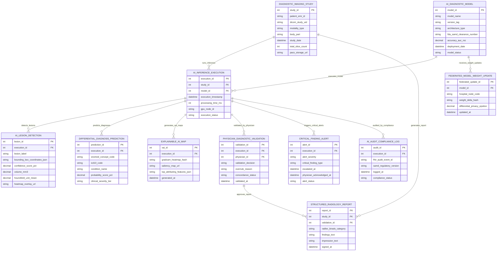

# Conceptual ERD — AI-Assisted Diagnosis Support System

## Mermaid Code

## Entity Description Table | Bảng mô tả Entity

| # | Entity Name | Vietnamese Name | Description | Key Attributes | Main Relationships |
|---|-------------|-----------------|-------------|----------------|-------------------|
| 1 | DIAGNOSTIC_IMAGING_STUDY | Ca Chụp Chẩn đoán Hình ảnh DICOM | DICOM imaging study record retrieved from PACS storing DICOM UID, modality (CT, MRI, X-ray), body part, study date, slice count, and PACS storage URL. | study_id, patient_emr_id, dicom_study_uid, modality_type, body_part, study_date, total_slice_count, pacs_storage_url | Has AI_INFERENCE_EXECUTION and STRUCTURED_RADIOLOGY_REPORT. |
| 2 | AI_DIAGNOSTIC_MODEL | Mô hình AI Chẩn đoán Y tế | Deep learning neural network model record storing version tag, architecture (3D U-Net, Vision Transformer), FDA SaMD clearance, AUC-ROC accuracy, and status. | model_id, model_name, version_tag, architecture_type, fda_samd_clearance_number, accuracy_auc_roc, deployment_date, model_status | Has AI_INFERENCE_EXECUTION and FEDERATED_MODEL_WEIGHT_UPDATE. |
| 3 | AI_INFERENCE_EXECUTION | Lần Chạy Suy luận AI | Deep learning inference execution record tracking study ID, model ID, execution timestamp, processing time (ms), GPU node ID, and execution status. | execution_id, study_id, model_id, execution_timestamp, processing_time_ms, gpu_node_id, execution_status | Belongs to DIAGNOSTIC_IMAGING_STUDY and AI_DIAGNOSTIC_MODEL; Has LESION, DIAGNOSIS, XAI, VALIDATION, ALERT, AUDIT. |
| 4 | AI_LESION_DETECTION | Tổn thương AI Phân lập | Segmented lesion detection record storing 3D bounding box coordinates, confidence score %, 3D volume ($\text{mm}^3$), Hounsfield density, and Grad-CAM URL. | lesion_id, execution_id, lesion_label, bounding_box_coordinates_json, confidence_score_pct, volume_mm3, hounsfield_unit_mean, heatmap_overlay_url | Belongs to AI_INFERENCE_EXECUTION. |
| 5 | DIFFERENTIAL_DIAGNOSIS_PREDICTION | Dự đoán Chẩn đoán Phân biệt | Computed differential diagnosis prediction record storing SNOMED-CT code, ICD-10 code, condition name, probability score %, and severity tier. | prediction_id, execution_id, snomed_concept_code, icd10_code, condition_name, probability_score_pct, clinical_severity_tier | Belongs to AI_INFERENCE_EXECUTION. |
| 6 | EXPLAINABLE_AI_MAP | Bản đồ Giải thích AI Grad-CAM | Explainable AI (XAI) feature attribution map record storing Grad-CAM heatmap hash, saliency map URL, and top attributing radiomic features JSON. | xai_id, execution_id, gradcam_heatmap_hash, saliency_map_url, top_attributing_features_json, generated_at | Belongs to AI_INFERENCE_EXECUTION. |
| 7 | PHYSICIAN_DIAGNOSTIC_VALIDATION | Phê duyệt Chẩn đoán của Bác sĩ | Clinician validation and overrule record tracking radiologist ID, decision (Accepted, Modified, Overruled), overrule reason, and concordance status. | validation_id, execution_id, physician_id, validation_decision, overrule_reason, concordance_status, validated_at | Belongs to AI_INFERENCE_EXECUTION; Approves STRUCTURED_RADIOLOGY_REPORT. |
| 8 | CRITICAL_FINDING_ALERT | Cảnh báo Ca Bệnh Nguy cấp STAT | STAT emergency alert record generated when AI detects acute life-threatening critical findings (Pneumothorax, Brain Hemorrhage) tracking physician acknowledgment. | alert_id, execution_id, alert_severity, critical_finding_type, escalated_at, physician_acknowledged_at, alert_status | Belongs to AI_INFERENCE_EXECUTION. |
| 9 | STRUCTURED_RADIOLOGY_REPORT | Báo cáo Chẩn đoán Hình ảnh Chuẩn | Standardized structured radiology report (BI-RADS, LUNG-RADS) storing findings text, diagnostic impression, RadLex codes, and digital signature. | report_id, study_id, validation_id, radlex_birads_category, findings_text, impression_text, signed_at | Belongs to DIAGNOSTIC_IMAGING_STUDY and PHYSICIAN_DIAGNOSTIC_VALIDATION. |
| 10 | FEDERATED_MODEL_WEIGHT_UPDATE | Cập nhật Trọng số AI Liên kết | Federated model fine-tuning record storing hospital node code, encrypted weight delta hash ($\Delta W$), differential privacy noise ($\epsilon$), and timestamp. | federated_update_id, model_id, hospital_node_code, weight_delta_hash, differential_privacy_epsilon, updated_at | Belongs to AI_DIAGNOSTIC_MODEL. |
| 11 | AI_AUDIT_COMPLIANCE_LOG | Nhật ký Tuân thủ Kiểm toán AI | FDA SaMD regulatory audit trail logging execution ID, FHIR AuditEvent ID, regulatory software version, logged timestamp, and compliance status. | audit_id, execution_id, fhir_audit_event_id, samd_regulatory_version, logged_at, compliance_status | Belongs to AI_INFERENCE_EXECUTION. |

## Relationship Description | Mô tả Quan hệ

| # | From Entity | Cardinality | To Entity | Relationship Label | Business Explanation |
|---|-------------|-------------|-----------|-------------------|----------------------|
| 1 | DIAGNOSTIC_IMAGING_STUDY | one-to-many | AI_INFERENCE_EXECUTION | runs_inference | One DICOM imaging study runs deep learning AI inference executions. |
| 2 | DIAGNOSTIC_IMAGING_STUDY | one-to-many | STRUCTURED_RADIOLOGY_REPORT | generates_report | One DICOM imaging study generates standardized structured radiology reports. |
| 3 | AI_DIAGNOSTIC_MODEL | one-to-many | AI_INFERENCE_EXECUTION | executes_model | One AI diagnostic neural network model executes inference runs across studies. |
| 4 | AI_DIAGNOSTIC_MODEL | one-to-many | FEDERATED_MODEL_WEIGHT_UPDATE | receives_weight_updates | One AI model receives federated weight updates ($\Delta W$) from multi-hospital nodes. |
| 5 | AI_INFERENCE_EXECUTION | one-to-many | AI_LESION_DETECTION | detects_lesions | One AI inference execution detects and segments 3D anatomical lesions. |
| 6 | AI_INFERENCE_EXECUTION | one-to-many | DIFFERENTIAL_DIAGNOSIS_PREDICTION | predicts_diagnoses | One AI inference execution predicts ranked differential diagnosis probabilities. |
| 7 | AI_INFERENCE_EXECUTION | one-to-many | EXPLAINABLE_AI_MAP | generates_xai_maps | One AI inference execution generates Explainable AI (Grad-CAM) saliency maps. |
| 8 | AI_INFERENCE_EXECUTION | one-to-many | PHYSICIAN_DIAGNOSTIC_VALIDATION | validated_by_physician | One AI inference execution is validated or overruled by an attending physician. |
| 9 | AI_INFERENCE_EXECUTION | one-to-many | CRITICAL_FINDING_ALERT | triggers_critical_alerts | Severe AI predictions trigger STAT emergency critical finding alert escalations. |
| 10 | AI_INFERENCE_EXECUTION | one-to-many | AI_AUDIT_COMPLIANCE_LOG | audited_by_compliance | One AI inference execution generates FDA SaMD regulatory compliance audit logs. |
| 11 | PHYSICIAN_DIAGNOSTIC_VALIDATION | one-to-many | STRUCTURED_RADIOLOGY_REPORT | approves_report | Physician diagnostic validation approves final structured radiology reports. |
