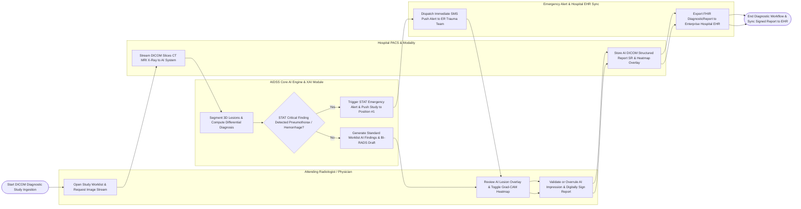

# Swimlane Diagram — AI-Assisted Diagnosis Support System

## Mermaid Code

## Flow Description | Mô tả luồng

| Lane | Actor / Subsystem | Role in Flow |
|------|-------------------|--------------|
| 1 | Attending Radiologist / Physician | Opens diagnostic worklist, inspects AI 3D lesion segmentations, toggles Explainable AI (Grad-CAM) heatmaps, validates or overruling AI predictions, and signs structured reports. |
| 2 | Hospital PACS & Modality | Streams DICOM image series (CT, MRI, X-ray) to AIDSS and archives AI-annotated DICOM Structured Reports (SR) and secondary capture heatmap objects. |
| 3 | AIDSS Core AI Engine & XAI Module | Runs 3D U-Net neural networks for automated lesion segmentation, calculates 3D volumes and differential diagnosis probabilities, renders Grad-CAM heatmaps, and identifies STAT critical findings. |
| 4 | Emergency Alert & Hospital EHR Sync | Dispatches STAT emergency SMS/Push alerts for critical findings (Pneumothorax, Brain Hemorrhage) to ER trauma teams and syncs FHIR `DiagnosticReport` resources to enterprise EHRs. |
