# Action Tree — AI-Assisted Diagnosis Support System

## Mermaid Code

```mermaid
graph TD
    Root["AI-Assisted Diagnosis Support System"]

    Root --> M1["DICOM Image Ingestion & Preprocessing"]
    Root --> M2["AI Deep Learning Lesion Segmentation"]
    Root --> M3["Differential Diagnosis & Probability Scoring"]
    Root --> M4["Explainable AI XAI Grad-CAM Engine"]
    Root --> M5["STAT Emergency Critical Finding Escalation"]
    Root --> M6["Radiologist Validation & Overrule Workflow"]
    Root --> M7["Structured Radiology Reporting & PACS SR"]
    Root --> M8["Federated AI Training & SaMD Compliance"]

    M1 --> A11["Query PACS via DICOM C-MOVE C-STORE Protocols"]
    M1 --> A12["Validate DICOM Tag Metadata & Windowing HU"]
    M1 --> A13["Apply Automated Image Denoising & Normalization"]
    M1 --> A14["Ingest Pathology Whole-Slide Histology Images"]

    M2 --> A21["Execute 3D U-Net Neural Network Segmentation"]
    M2 --> A22["Calculate 3D Lesion Volume Density Measurements"]
    M2 --> A23["Render 3D Bounding Box Overlay Coordinates"]
    M2 --> A24["Compare Nodule Growth Volume Doubling Time"]

    M3 --> A31["Compute Multi-Class Differential Diagnosis Probabilities"]
    M3 --> A32["Map Findings to ACR BI-RADS LUNG-RADS Categories"]
    M3 --> A33["Calculate 95 Percent Statistical Confidence Intervals"]
    M3 --> A34["Cross-Reference EMR Tumor Biomarkers & Genomics"]

    M4 --> A41["Render Grad-CAM Visual Saliency Heatmap Overlays"]
    M4 --> A42["Extract Top Attributing Radiomic Texture Features"]
    M4 --> A43["Provide Interactive Feature Attribution Controls"]
    M4 --> A44["Generate Visual AI Decision Explanation Card"]

    M5 --> A51["Detect STAT Intracranial Hemorrhage & Pneumothorax"]
    M5 --> A52["Bump Critical Studies to Position 1 in PACS Queue"]
    M5 --> A53["Dispatch Multi-Channel Mobile Push SMS Alerts"]
    M5 --> A54["Track STAT Alert Physician Acknowledgment SLA"]

    M6 --> A61["Provide Interactive Radiologist Review Workspace"]
    M6 --> A62["Log Physician Overrule Rationale & Corrections"]
    M6 --> A63["Attach Cryptographic Digital Signature to Approval"]
    M6 --> A64["Route Overrule Logs to Active Learning Database"]

    M7 --> A71["Auto-Populate Structured Radiology Report Drafts"]
    M7 --> A72["Export DICOM Structured Reports SR to PACS"]
    M7 --> A73["Sync FHIR DiagnosticReport Resources to EHR"]
    M7 --> A74["Attach RadLex & SNOMED-CT Standardized Codes"]

    M8 --> A81["Execute Privacy-Preserving Federated Model Weight Sync"]
    M8 --> A82["Audit Model Accuracy AUC-ROC & Algorithmic Drift"]
    M8 --> A83["Enforce FDA SaMD 510k Regulatory Version Controls"]
    M8 --> A84["Maintain Immutable Clinical Decision Lineage Logs"]
```

## Module Description | Mô tả Module

| # | Module | Description | Actions |
|---|--------|-------------|---------|
| 1 | DICOM Image Ingestion & Preprocessing | Queries PACS via DICOM C-MOVE/C-STORE, validates DICOM metadata, applies windowing (HU calibration), and ingests pathology whole-slide images. | Query PACS via DICOM C-MOVE C-STORE Protocols, Validate DICOM Tag Metadata & Windowing HU, Apply Automated Image Denoising & Normalization, Ingest Pathology Whole-Slide Histology Images |
| 2 | AI Deep Learning Lesion Segmentation | Executes 3D U-Net neural networks for automated lesion segmentation, calculates 3D volume/density ($\text{mm}^3$, HU), and compares volume doubling time. | Execute 3D U-Net Neural Network Segmentation, Calculate 3D Lesion Volume Density Measurements, Render 3D Bounding Box Overlay Coordinates, Compare Nodule Growth Volume Doubling Time |
| 3 | Differential Diagnosis & Probability Scoring | Computes multi-class differential diagnosis probability scores, maps findings to BI-RADS/LUNG-RADS categories, and cross-references EMR biomarkers. | Compute Multi-Class Differential Diagnosis Probabilities, Map Findings to ACR BI-RADS LUNG-RADS Categories, Calculate 95 Percent Statistical Confidence Intervals, Cross-Reference EMR Tumor Biomarkers & Genomics |
| 4 | Explainable AI XAI Grad-CAM Engine | Renders Grad-CAM visual saliency heatmaps, extracts top attributing radiomic features, and provides interactive explanation cards for clinical transparency. | Render Grad-CAM Visual Saliency Heatmap Overlays, Extract Top Attributing Radiomic Texture Features, Provide Interactive Feature Attribution Controls, Generate Visual AI Decision Explanation Card |
| 5 | STAT Emergency Critical Finding Escalation | Detects STAT intracranial hemorrhage, pneumothorax, and pulmonary embolism, bumps studies to Position #1 in PACS, and dispatches SMS alerts. | Detect STAT Intracranial Hemorrhage & Pneumothorax, Bump Critical Studies to Position 1 in PACS Queue, Dispatch Multi-Channel Mobile Push SMS Alerts, Track STAT Alert Physician Acknowledgment SLA |
| 6 | Radiologist Validation & Overrule Workflow | Enables radiologists to accept, modify, or overrule AI findings, logs clinical overrule rationale, attaches digital signatures, and routes logs to active learning. | Provide Interactive Radiologist Review Workspace, Log Physician Overrule Rationale & Corrections, Attach Cryptographic Digital Signature to Approval, Route Overrule Logs to Active Learning Database |
| 7 | Structured Radiology Reporting & PACS SR | Auto-populates structured report drafts (BI-RADS), exports DICOM Structured Reports (SR) to PACS, and syncs FHIR `DiagnosticReport` to hospital EHRs. | Auto-Populate Structured Radiology Report Drafts, Export DICOM Structured Reports SR to PACS, Sync FHIR DiagnosticReport Resources to EHR, Attach RadLex & SNOMED-CT Standardized Codes |
| 8 | Federated AI Training & SaMD Compliance | Executes federated model weight updates with differential privacy, audits model AUC-ROC accuracy drift, and enforces FDA SaMD regulatory compliance logs. | Execute Privacy-Preserving Federated Model Weight Sync, Audit Model Accuracy AUC-ROC & Algorithmic Drift, Enforce FDA SaMD 510k Regulatory Version Controls, Maintain Immutable Clinical Decision Lineage Logs |
