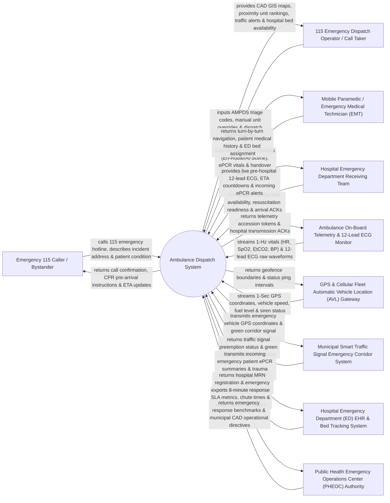

# Context Diagram — Ambulance Dispatch System

## Mermaid Code

## Actor & Interaction Table | Bảng Actor & Tương tác

| # | Actor | Actor Type | Data Sent TO System | Data Received FROM System | Notes |
|---|-------|------------|---------------------|---------------------------|-------|
| 1 | Emergency 115 Caller / Bystander | Primary | Emergency 115 call voice, incident location (address / GPS), patient symptoms (unresponsive, chest pain). | Pre-arrival telephone CPR/first-aid instructions, ambulance arrival ETA countdown updates. | Individual calling municipal 115 emergency dispatch during a medical crisis or traffic accident. |
| 2 | 115 Emergency Dispatch Operator / Call Taker | Primary | Advanced Medical Priority Dispatch System (AMPDS) triage codes, manual ambulance dispatch overrides. | Computer-Aided Dispatch (CAD) GIS maps, proximity unit rankings, real-time traffic alerts, hospital bed status. | Dispatcher triaging emergency calls, assigning ambulances, and monitoring response timelines. |
| 3 | Mobile Paramedic / EMT | Primary | Unit status updates (Dispatched, En-Route, At-Scene, Transporting), ePCR vital logs, handover sign-offs. | Turn-by-turn GPS navigation, patient pre-existing medical history, receiving hospital ED bed assignment. | Emergency Medical Technician (EMT) or paramedic operating the ambulance and rendering pre-hospital care. |
| 4 | Hospital Emergency Department Receiving Team | Primary | ED resuscitation room availability, trauma bed readiness flags, ambulance arrival acknowledgments. | Live pre-hospital 12-lead ECG, estimated time of arrival (ETA) countdowns, incoming ePCR alerts. | ER doctors and trauma nurses preparing the emergency room to receive critical patients. |
| 5 | Ambulance On-Board Telemetry & 12-Lead ECG Monitor | Supporting System | Real-time vitals stream (Heart Rate, SpO2, Blood Pressure, EtCO2), 12-lead ECG raw waveforms. | Telemetry transmission acknowledgments, hospital connection status, sensor calibration flags. | Clinical monitor (e.g., ZOLL X Series, Corpuls3, Physio-Control LIFEPAK) streaming live patient vitals. |
| 6 | GPS & Cellular Fleet AVL Gateway | Supporting System | High-frequency 1-second GPS latitude/longitude, vehicle speed (km/h), fuel level %, siren active status. | Geofence zone boundaries, status ping rate adjustments, fleet diagnostic commands. | Automatic Vehicle Location (AVL) IoT gateway tracking physical ambulance positions continuously. |
| 7 | Municipal Smart Traffic Signal System | Supporting System | Traffic signal preemption confirmation, green corridor route clearance status, intersection clearing alerts. | Active emergency vehicle GPS coordinates, route destination vectors, siren preemption requests. | Smart city traffic management system clearing green lights along the ambulance's route. |
| 8 | Hospital Emergency Department EHR & Bed System | Supporting System | Patient Medical Record Number (MRN) registration, emergency resuscitation bed allocation tokens. | Pre-hospital electronic Patient Care Record (ePCR) summaries, preliminary ICD-10 emergency codes. | Hospital enterprise EHR receiving pre-hospital ambulance records prior to patient arrival. |
| 9 | PHEOC Authority | Regulatory | Emergency medical response target SLAs (e.g., 8-minute urban response time), CAD operational directives. | Incident response time audit logs, chute time metrics, municipal ambulance dispatch statistics. | Public Health Emergency Operations Center overseeing municipal emergency medical services (115). |

## System Boundary Description | Mô tả Phạm vi Hệ thống

The **Ambulance Dispatch System (ADS)** is a mission-critical Computer-Aided Dispatch (CAD), pre-hospital emergency telemetry, and fleet routing platform. Operating across Municipal 115 Emergency Operations Centers, mobile ambulance units, and hospital Emergency Departments (ED), it manages 115 emergency call intake, Advanced Medical Priority Dispatch System (AMPDS) triage, Automatic Vehicle Location (AVL) GPS fleet tracking, automated proximity unit routing, traffic signal emergency green corridors, pre-hospital 12-lead ECG video streaming, electronic Patient Care Record (ePCR) documentation, and ED trauma bed handover.

**Inside System Scope:**
- Emergency 115 call intake, caller phone number location lookup, and AMPDS protocol-driven triage (Red Alpha, Orange Bravo, Yellow Charlie, Green Delta).
- Computer-Aided Dispatch (CAD) GIS mapping and real-time Automatic Vehicle Location (AVL) GPS tracking.
- Intelligent multi-criteria ambulance unit assignment (closest available unit, traffic-aware routing, paramedic skill level).
- Smart city traffic signal emergency green corridor integration (traffic light preemption).
- Ambulance on-board telemetry streaming (12-lead ECG, HR, SpO2, EtCO2, Blood Pressure) directly to hospital ED trauma teams.
- Mobile paramedic electronic Patient Care Record (ePCR) tablet app (medication administration, GCS score, trauma scoring).
- Hospital Emergency Department (ED) pre-notification alerts, ETA countdown timers, and resuscitation bed handover.
- Statutory emergency response time SLA auditing (Call intake time, Chute time, Response time < 8 mins, Transport time).

**Outside System Scope:**
- Long-term inpatient hospital ward clinical care after ED admission (handled by Inpatient HIS).
- Physical repair and mechanical maintenance of ambulance motor vehicles (handled by Fleet Maintenance System).
- Municipal 115 telecommunication fiber-optic hardware infrastructure (handled by Telecom Operator).
- General corporate accounting and payroll for paramedics (handled by enterprise ERP).
