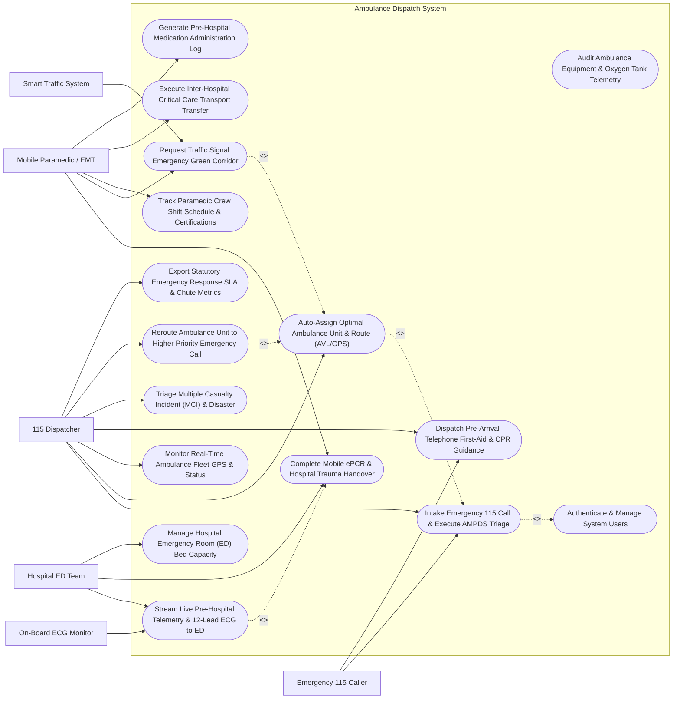

# Use Case Diagram — Ambulance Dispatch System

## Mermaid Code

## Actor Table | Bảng Actor

| # | Actor | Actor Type | Role Description | Related Use Cases |
|---|-------|------------|------------------|-------------------|
| 1 | Emergency 115 Caller | Primary | Citizen calling emergency 115 hotline during an accident or acute medical crisis. | UC01, UC07 |
| 2 | 115 Dispatcher | Primary | Emergency call taker and dispatcher triaging incident severity, executing AMPDS protocols, and assigning ambulances. | UC01, UC02, UC06, UC07, UC08, UC13, UC15 |
| 3 | Mobile Paramedic / EMT | Primary | On-board emergency medical technician providing pre-hospital care, driving ambulance, and logging ePCR. | UC04, UC05, UC10, UC11, UC14 |
| 4 | Hospital ED Team | Primary | Emergency Department trauma team receiving live ECG telemetry, pre-notifications, and taking patient handovers. | UC03, UC04, UC09 |
| 5 | On-Board ECG Monitor | Secondary / System | On-board clinical telemetry hardware streaming 12-lead ECG waveforms and continuous vital signs to ED. | UC03 |
| 6 | Smart Traffic System | Secondary / System | Municipal smart city traffic control system managing emergency green light signal preemption corridors. | UC05 |

## Use Case Table | Bảng Use Case

| # | UC ID | Use Case Name | Primary Actor | Secondary Actor | Description | Priority |
|---|-------|---------------|---------------|-----------------|-------------|----------|
| 1 | UC01 | Intake Emergency 115 Call & Execute AMPDS Triage | 115 Dispatcher | Emergency 115 Caller | Intake 115 emergency calls, capture caller location via phone GPS/CLI, and execute AMPDS protocol triage (Red/Orange/Yellow/Green). | High |
| 2 | UC02 | Auto-Assign Optimal Ambulance Unit & Route (AVL/GPS) | 115 Dispatcher | None | Automatically calculate and assign the closest available ambulance unit using real-time GPS AVL pings, traffic algorithms, and paramedic skills. | High |
| 3 | UC03 | Stream Live Pre-Hospital Telemetry & 12-Lead ECG to ED | Hospital ED Team | On-Board ECG Monitor | Stream continuous 1-Hz vitals (HR, SpO2, BP, EtCO2) and 12-lead ECG raw waveforms from ambulance directly to receiving hospital ER. | High |
| 4 | UC04 | Complete Mobile ePCR & Hospital Trauma Handover | Mobile Paramedic / EMT | Hospital ED Team | Complete electronic Patient Care Record (ePCR) on paramedic tablet (Glasgow Coma Scale, medications), obtaining ED doctor digital handover sign-off. | High |
| 5 | UC05 | Request Traffic Signal Emergency Green Corridor | Mobile Paramedic / EMT | Smart Traffic System | Transmit active emergency vehicle route vectors to municipal traffic system, clearing green light corridors along the ambulance route. | High |
| 6 | UC06 | Monitor Real-Time Ambulance Fleet GPS & Status (CAD GIS) | 115 Dispatcher | None | Render dynamic CAD GIS map displaying all active ambulance locations (AVL), unit statuses (Available, En-Route, At-Scene), and traffic density. | High |
| 7 | UC07 | Dispatch Pre-Arrival Telephone First-Aid & CPR Guidance | 115 Dispatcher | Emergency 115 Caller | Provide step-by-step pre-arrival voice CPR instructions, choking relief, or hemorrhage control guidance to the 115 caller while unit is en-route. | High |
| 8 | UC08 | Triage Multiple Casualty Incident (MCI) & Mass Disaster | 115 Dispatcher | None | Execute START triage protocol during mass casualty incidents (bus crashes, explosions), dispatching multiple ambulance fleets and staging areas. | High |
| 9 | UC09 | Manage Hospital Emergency Room (ED) Bed Capacity & Status | Hospital ED Team | None | Update real-time ED resuscitation bed availability, trauma room status, and diversion status across all municipal hospital emergency rooms. | High |
| 10 | UC10 | Track Paramedic Crew Shift Schedule & Certifications | Mobile Paramedic / EMT | None | Track paramedic shift rotations, Advanced Cardiac Life Support (ACLS) certifications, and driver qualifications to ensure compliant dispatch. | Medium |
| 11 | UC11 | Execute Inter-Hospital Critical Care Transport Transfer | Mobile Paramedic / EMT | Hospital ED Team | Manage planned inter-hospital transfer of critically ill ventilator-dependent patients between provincial and tertiary central hospitals. | Medium |
| 12 | UC12 | Audit Ambulance Equipment & Oxygen Tank Telemetry | Mobile Paramedic / EMT | None | Monitor IoT sensor telemetry on ambulance equipment: defibrillator battery levels, oxygen cylinder pressure (PSI), and drug kit seals. | Medium |
| 13 | UC13 | Reroute Ambulance Unit to Higher Priority Emergency Call | 115 Dispatcher | None | Preemptively reroute an en-route unit from a Low Priority (Yellow) call to a nearby High Priority Cardiac Arrest (Red) call. | High |
| 14 | UC14 | Generate Pre-Hospital Medication Administration Log | Mobile Paramedic / EMT | None | Record emergency pre-hospital medication doses (Epinephrine, Nitroglycerin, Morphine, Salbutamol) given during transport with time logs. | High |
| 15 | UC15 | Export Statutory Emergency Response SLA & Chute Metrics | 115 Dispatcher | None | Render municipal 115 emergency response KPI dashboards: Call Intake Time (< 60s), Chute Time (< 90s), Urban Response Time (< 8 mins). | Medium |
| 16 | UC16 | Authenticate & Manage System Users | All Users | None | Enforce secure multi-factor authentication, CAD role-based access control, radio channel encryption, and audit trail security. | High |

## Use Case Specification | Đặc tả Use Case

---

### UC01 — Intake Emergency 115 Call & Execute AMPDS Triage

| Field | Detail |
|-------|--------|
| **UC ID** | UC01 |
| **Use Case Name** | Intake Emergency 115 Call & Execute AMPDS Triage |
| **Actor(s)** | Primary: 115 Dispatcher   Secondary: Emergency 115 Caller |
| **Description** | Ingests an incoming 115 emergency telephone call, automatically captures caller phone number and cell tower GPS location via Caller ID/CLI, executes Advanced Medical Priority Dispatch System (AMPDS) algorithmic questioning, categorizes incident priority (RED Alpha / ORANGE Bravo / YELLOW Charlie / GREEN Delta), and generates an emergency Computer-Aided Dispatch (CAD) ticket. |
| **Precondition** | 1. The 115 Emergency Dispatch Operator workstation is active in the CAD System.   2. The 115 telecommunication voice line and CLI location gateway are operational. |
| **Main Flow** | 1. An incoming emergency 115 call rings at the 115 Emergency Operations Center.   2. The Dispatcher answers the call; the CAD System automatically captures **Caller Metadata**:   &nbsp;&nbsp;&nbsp;&nbsp;- Caller Phone: `0908123456`   &nbsp;&nbsp;&nbsp;&nbsp;- Cellular Tower Location Ping: Lat 10.7769, Long 106.6951 (Intersection Le Loi & Nguyen Hue, Dist 1, HCM City).   3. The Dispatcher verifies **Incident Address & Chief Complaint**: *"58-year-old male collapsed, non-responsive, gasping for breath."*   4. The Dispatcher initiates **AMPDS Protocol Questioning**:   &nbsp;&nbsp;&nbsp;&nbsp;- *Question 1*: Is the patient conscious? -> **No (Unconscious)**   &nbsp;&nbsp;&nbsp;&nbsp;- *Question 2*: Is the patient breathing normally? -> **No (Agonal Breathing)**   &nbsp;&nbsp;&nbsp;&nbsp;- *Question 3*: Is there severe bleeding or trauma? -> No.   5. The CAD System calculates **AMPDS Triage Category**:   &nbsp;&nbsp;&nbsp;&nbsp;- **Protocol 9-E-1**: **CARDIAC ARREST / INEFFECTIVE BREATHING**   &nbsp;&nbsp;&nbsp;&nbsp;- **Priority Code**: **RED ALPHA (CRITICAL LIFE THREAT - Target SLA < 8 Mins)**.   6. The System generates Emergency CAD Ticket `CAD-115-2026-08192` and immediately triggers Automated Proximity Ambulance Unit Assignment (UC02).   7. The Dispatcher transitions to Telephone Pre-Arrival CPR Guidance (UC07). |
| **Alternative Flow** | **AF1** — Traffic Accident Mass Casualty Incident (MCI) Triage: Caller reports a multi-vehicle highway bus crash with 15 injured; System assigns AMPDS Protocol 29-D-1 (MCI Red) and auto-triggers Mass Casualty Incident Workflow (UC08).   **AF2** — Low-Priority Minor Injury Triage: Caller reports a minor ankle sprain; System assigns Priority GREEN DELTA (Non-Urgent), queuing an available transport unit without siren dispatch. |
| **Exception Flow** | **EX1** — Caller Location Disconnected / Silent Call: Caller hangs up after 5 seconds without speaking; CAD System pins cell tower location, flags "Silent Emergency 115 Ping", and dispatches nearest police/ambulance unit to investigate.   **EX2** — Prank / False Emergency Call: Dispatcher identifies malicious prank caller; System logs phone number to Blacklist Registry and archives ticket. |
| **Postcondition** | Emergency ticket CAD-115-2026-08192 is created, AMPDS Triage (RED ALPHA 9-E-1) is assigned, incident location is pinned on GIS CAD map, and unit auto-assignment is triggered. |
| **Business Rule** | **BR1**: Emergency 115 call intake and AMPDS priority triage calculation MUST be completed within 60 seconds of call connection.   **BR2**: Calls categorized as RED ALPHA (Cardiac Arrest, Severe Airway Obstruction, Massive Hemorrhage) MUST trigger instantaneous priority ambulance dispatch without waiting for call completion. |

---

### UC02 — Auto-Assign Optimal Ambulance Unit & Route (AVL/GPS)

| Field | Detail |
|-------|--------|
| **UC ID** | UC02 |
| **Use Case Name** | Auto-Assign Optimal Ambulance Unit & Route (AVL/GPS) |
| **Actor(s)** | Primary: 115 Dispatcher |
| **Description** | Executes an automated spatial-temporal optimization algorithm that evaluates real-time Automatic Vehicle Location (AVL) GPS pings of all active ambulance units, current traffic density, vehicle equipment capabilities (Advanced Life Support ALS vs Basic Life Support BLS), and paramedic crew skill certifications to assign the fastest available ambulance unit and broadcast turn-by-turn navigation. |
| **Precondition** | 1. Emergency CAD Ticket `CAD-115-2026-08192` (RED ALPHA Cardiac Arrest) is created (UC01).   2. GPS AVL fleet tracking system is actively streaming 1-second location pings. |
| **Main Flow** | 1. The **CAD Dispatch Optimization Engine** receives Ticket `CAD-115-2026-08192` (Location: 142 Le Loi St, Dist 1, Priority: RED ALPHA ALS Required).   2. The Engine evaluates all 42 active municipal ambulance units:   &nbsp;&nbsp;&nbsp;&nbsp;- Filters for **Available Units** (Status: `STATIONED` or `AVAILABLE_ON_ROAD`)   &nbsp;&nbsp;&nbsp;&nbsp;- Filters for **Equipment Capabilities**: Requires `ALS_ADVANCED_LIFE_SUPPORT` (Ventilator, 12-Lead ECG, Defibrillator, ACLS Paramedic).   3. The Engine calculates **Real-Time Driving ETA** using live traffic density routing:   &nbsp;&nbsp;&nbsp;&nbsp;- *Unit 104 (Dist 3 Station)*: Distance 4.2 km -> Traffic-Adjusted ETA = 9.5 Mins   &nbsp;&nbsp;&nbsp;&nbsp;- **Unit 102 (Dist 1 Mobile Patrol)**: Distance 1.8 km -> **Traffic-Adjusted ETA = 3.8 Mins** (Fastest).   4. The Engine selects **Unit 102 (`AMB-115-102`)** as the optimal unit.   5. The System dispatches **Automated Dispatch Alert** to Unit 102's mobile paramedic tablet:   &nbsp;&nbsp;&nbsp;&nbsp;- Sounds High-Decibel Dispatch Klaxon on Tablet   &nbsp;&nbsp;&nbsp;&nbsp;- Displays Incident Address, Chief Complaint, and Patient Age   &nbsp;&nbsp;&nbsp;&nbsp;- Activates Turn-by-Turn GPS Navigation with Emergency Route.   6. Paramedic taps "DISPATCH ACKNOWLEDGED — EN ROUTE" on tablet within 22 seconds (Chute Time = 22s).   7. The System updates Unit 102 status to `EN_ROUTE_SCENE` and activates Traffic Signal Green Corridor Request (UC05). |
| **Alternative Flow** | **AF1** — Unit Preemption & Rerouting (UC13): If all ALS units are busy and Unit 102 is en-route to a Yellow minor call, System preemptively reroutes Unit 102 to the Red Cardiac Arrest, reassigning a BLS unit to the Yellow call.   **AF2** — Volunteer First Responder / Motorcycle Paramedic Dispatch: For narrow alleyways inaccessible by ambulance, System dispatches a 2-wheel Motorcycle Rapid Response Paramedic equipped with AED and airway kit. |
| **Exception Flow** | **EX1** — Paramedic Dispatch Timeout (> 90s Chute Time): Unit 102 crew fails to acknowledge dispatch within 90 seconds; System alerts Dispatcher and auto-reassigns Unit 104.   **EX2** — Zero Municipal Ambulance Availability: All units are occupied; System triggers "Mutual Aid Protocol", dispatching private hospital or military ambulances. |
| **Postcondition** | Optimal ALS Ambulance Unit 102 is assigned, ETA (3.8 mins) is recorded, paramedic tablet receives dispatch data, chute time (22s) is logged, and unit status is updated to En-Route. |
| **Business Rule** | **BR1**: Unit auto-assignment algorithms MUST prioritize the fastest traffic-adjusted Estimated Time of Arrival (ETA) while matching required clinical care capabilities (ALS vs BLS).   **BR2**: Paramedic crews MUST acknowledge dispatch and initiate vehicle roll out within a maximum Chute Time of 90 seconds from alert dispatch. |

---

### UC03 — Stream Live Pre-Hospital Telemetry & 12-Lead ECG to ED

| Field | Detail |
|-------|--------|
| **UC ID** | UC03 |
| **Use Case Name** | Stream Live Pre-Hospital Telemetry & 12-Lead ECG to ED |
| **Actor(s)** | Primary: Hospital ED Team   Secondary: On-Board ECG Monitor, Mobile Paramedic / EMT |
| **Description** | Continuously streams 1-Hz physiological vital signs (Heart Rate, Blood Pressure, SpO2, End-Tidal CO2) and high-frequency 12-lead Electrocardiogram (ECG) raw waveforms from the ambulance on-board clinical monitor directly to the receiving hospital Emergency Department (ED) trauma team, enabling early STEMI heart attack detection and cath lab activation prior to ambulance arrival. |
| **Precondition** | 1. Ambulance Unit 102 has arrived at scene and attached clinical monitor (ZOLL X Series) to patient.   2. Mobile cellular 5G data telemetry link to HWDMS Telemetry Gateway is established. |
| **Main Flow** | 1. Mobile Paramedics attach 12-lead ECG electrodes to Patient (58-year-old male with crushing chest pain).   2. The on-board clinical monitor captures **12-Lead ECG Recording** (`ECG-2026-9918`) and continuous vital signs.   3. The **Pre-Hospital Telemetry Engine** streams encrypted vitals over 5G to the destination ER (`Bach Mai Hospital Emergency Department`):   &nbsp;&nbsp;&nbsp;&nbsp;- **Continuous Vitals Stream**: HR = 112 BPM, BP = 90/60 mmHg, SpO2 = 91%, EtCO2 = 34 mmHg   &nbsp;&nbsp;&nbsp;&nbsp;- **12-Lead ECG Waveform**: ST-Segment Elevation detected in Leads II, III, aVF (2.4 mm ST Elevation).   4. The System's automated ECG algorithm flags: **ACUTE INFERIOR ST-ELEVATION MYOCARDIAL INFARCTION (STEMI)**.   5. The System dispatches an **Urgent STEMI Pre-Notification Alert** to the Hospital ED Trauma Tablet and Duty Cardiologist's phone.   6. The ED Trauma Physician reviews the live 12-lead ECG strip on the ER dashboard, confirms STEMI, and clicks **"ACTIVATE CARDIAC CATHETERIZATION LAB"**.   7. The System displays incoming Ambulance Unit 102's Live ETA (`ETA: 4 Minutes`) on the ER Resuscitation Wall Monitor. |
| **Alternative Flow** | **AF1** — Severe Acute Respiratory Failure / Capnography Streaming: For an intubated trauma patient, System streams continuous End-Tidal CO2 (EtCO2) capnography waveforms, alerting ER of tube displacement if EtCO2 drops < 15 mmHg.   **AF2** — Pre-Hospital Stroke Scale (FAST) Telemedicine Video Stream: Paramedic streams live encrypted smartphone video of facial droop and arm drift to ER Neurologist for pre-hospital tPA thrombolysis clearance. |
| **Exception Flow** | **EX1** — Cellular Telemetry Blind Spot / Signal Drop: 5G signal drops in a tunnel; Monitor caches 12-lead ECG locally and auto-resumes streaming immediately upon re-establishing cellular connection.   **EX2** — Noisy ECG Electrode Artifact: Muscle tremors create baseline noise; System prompts paramedic "Lead III Artifact — Re-apply Electrode". |
| **Postcondition** | Live vitals and 12-lead ECG (Inferior STEMI confirmed) are streamed to Bach Mai ER, Cath Lab is pre-activated, and live 4-minute ETA is displayed on ER monitors. |
| **Business Rule** | **BR1**: Pre-hospital 12-lead ECGs indicating ST-Elevation Myocardial Infarction (STEMI) MUST automatically trigger an urgent pre-notification alert to the receiving hospital ER within 30 seconds of acquisition.   **BR2**: Patient telemetry data transmitted from mobile ambulances MUST be encrypted using AES-256 end-to-end security protocols. |

---

### UC04 — Complete Mobile ePCR & Hospital Trauma Handover

| Field | Detail |
|-------|--------|
| **UC ID** | UC04 |
| **Use Case Name** | Complete Mobile ePCR & Hospital Trauma Handover |
| **Actor(s)** | Primary: Mobile Paramedic / EMT   Secondary: Hospital ED Team |
| **Description** | Documents the complete pre-hospital electronic Patient Care Record (ePCR) on a paramedic tablet—logging trauma injury mechanisms, Glasgow Coma Scale (GCS), IV access, administered emergency medications (Epinephrine, Morphine), and procedures—and obtains the receiving ER physician's digital signature during formal bedside handover. |
| **Precondition** | 1. Ambulance Unit 102 arrives at the hospital Emergency Department ambulance bay.   2. Pre-hospital care was rendered and recorded on the paramedic tablet. |
| **Main Flow** | 1. Mobile Paramedics wheel Patient into Bach Mai Hospital ED Resuscitation Bay #01.   2. The Paramedic opens the **Mobile ePCR Tablet Application** for Record `ePCR-115-2026-08192`.   3. The Paramedic verifies **Pre-Hospital Clinical Documentation**:   &nbsp;&nbsp;&nbsp;&nbsp;- **Glasgow Coma Scale (GCS)**: `GCS 14 (E4 V4 M6)`   &nbsp;&nbsp;&nbsp;&nbsp;- **Trauma / Primary Assessment**: Chest pain, diaphoresis, cold clammy skin   &nbsp;&nbsp;&nbsp;&nbsp;- **Interventions Performed**: 18G Peripheral IV placed (Left Antecubital), High-Flow Oxygen 10L/min via Non-Rebreather Mask   &nbsp;&nbsp;&nbsp;&nbsp;- **Pre-Hospital Medications Administered**: Aspirin 300mg PO + Sublingual Nitroglycerin 0.4mg (at 10:18 AM).   4. The Paramedic conducts verbal SBAR (Situation, Background, Assessment, Recommendation) bedside clinical handover to the ED Duty Physician.   5. The ED Duty Physician reviews the ePCR summary on the paramedic tablet and signs the **Digital Handover Sign-Off Block** using a stylus.   6. The System transfers patient care custody to the hospital, updates Unit 102 status to `AT_HOSPITAL_CLEARING`, and syncs the ePCR PDF to the hospital's EHR System (UC08).   7. Paramedics sanitize the ambulance bay, replenish supplies, and tap "UNIT 102 AVAILABLE FOR DISPATCH" (Unit Reset Time = 8 mins). |
| **Alternative Flow** | **AF1** — Unidentified John/Jane Doe Emergency Handover: For an unconscious trauma victim without ID, System generates temporary John Doe MRN `JD-2026-99182` with photo attachment, enabling immediate ER registration.   **AF2** — Refusal of Medical Transport (RMT) Documentation: Patient regains full consciousness, refuses hospital transport against medical advice; Paramedic logs "Refusal of Transport", records GCS 15, and obtains patient signed liability waiver. |
| **Exception Flow** | **EX1** — ER Bed Block / Hospital Diversion Conflict: ER is at 100% capacity and refuses handover; System alerts Dispatcher to reroute ambulance to secondary trauma center.   **EX2** — Medication Administration Discrepancy: Paramedic attempts to log 10mg Morphine without doctor online medical control approval; System flags "Controlled Substance Approval Required". |
| **Postcondition** | ePCR ePCR-115-2026-08192 is completed, ED doctor digital handover signature is obtained, custody is transferred, ePCR is synced to hospital EHR, and Unit 102 resets to Available. |
| **Business Rule** | **BR1**: Clinical custody of an emergency patient MUST NOT be transferred without a completed electronic Patient Care Record (ePCR) signed digitally by both the paramedic and receiving ER physician.   **BR2**: Post-handover ambulance turnaround time (from ER arrival to Unit Available reset) MUST NOT exceed 15 minutes for standard emergency runs. |

---

### UC05 — Request Traffic Signal Emergency Green Corridor

| Field | Detail |
|-------|--------|
| **UC ID** | UC05 |
| **Use Case Name** | Request Traffic Signal Emergency Green Corridor |
| **Actor(s)** | Primary: Mobile Paramedic / EMT   Secondary: Smart Traffic System |
| **Description** | Automatically transmits high-priority emergency vehicle route vectors and GPS location pings from an active Code Red ambulance to the municipal Smart City Traffic Management System, preempting traffic lights along the route to clear an unbroken "Green Corridor" and preventing intersection collisions. |
| **Precondition** | 1. Ambulance Unit 102 is en-route to a RED ALPHA incident or transporting a critical patient to hospital under emergency lights & siren (Code Red).   2. Smart Traffic Signal Preemption API integration is active. |
| **Main Flow** | 1. The Paramedic activates Emergency Lights & Siren (Code Red mode) on Ambulance Unit 102.   2. The **On-Board GPS Telemetry Unit** transmits an automated **Green Corridor Preemption Request**:   &nbsp;&nbsp;&nbsp;&nbsp;- Vehicle ID: `AMB-115-102`   &nbsp;&nbsp;&nbsp;&nbsp;- Priority Level: `CODE_RED_CRITICAL`   &nbsp;&nbsp;&nbsp;&nbsp;- Current Location: Lat 10.7769, Long 106.6951 (Heading North on Nam Ky Khoi Nghia St)   &nbsp;&nbsp;&nbsp;&nbsp;- Current Speed: 68 km/h   &nbsp;&nbsp;&nbsp;&nbsp;- Target Destination: Bach Mai Hospital ER.   3. The **Smart Traffic Control System** processes the incoming route vector:   &nbsp;&nbsp;&nbsp;&nbsp;- Identifies upcoming 4 traffic light intersections along the 2.5 km corridor   &nbsp;&nbsp;&nbsp;&nbsp;- **Intersection 1 (Nguyen Hue & NKKN)**: Holds Green light for NKKN direction; holds Red light for cross traffic   &nbsp;&nbsp;&nbsp;&nbsp;- **Intersection 2 (Pasteur & NKKN)**: Preempts signal 15 seconds prior to arrival.   4. The System displays **Green Corridor Route Clearance Status** on the paramedic's dash navigation tablet: `GREEN CORRIDOR ACTIVE — 4 INTERSECTIONS CLEARED`.   5. Ambulance Unit 102 traverses the 4 intersections safely at 65 km/h without stopping.   6. Upon Unit 102 clearing each intersection, the Traffic System restores normal traffic light signal cycling. |
| **Alternative Flow** | **AF1** — Manual Paramedic SOS Corridor Override: Paramedic encounters unexpected gridlock caused by a stalled truck, taps "MANUAL TRAFFIC EMERGENCY OVERRIDE", requesting traffic police dispatch to clear intersection.   **AF2** — Multi-Ambulance Intersection Priority Resolution: Two emergency ambulances approach the same intersection simultaneously; Traffic System prioritizes the higher-priority Cardiac Arrest unit over a lower-priority sprain unit. |
| **Exception Flow** | **EX1** — Smart Traffic Controller Offline / Communication Loss: Traffic signal hardware loses cellular connectivity; System alerts Paramedic "Traffic Preemption Unavailable — Exercise Caution at Intersections".   **EX2** — Emergency Vehicle Exits Route Corridor: Ambulance takes an unplanned detour; System cancels preemption on original route and recalculates green corridor for new route. |
| **Postcondition** | Emergency green corridor is preempted across 4 traffic intersections, Unit 102 traverses corridor safely without stopping, and normal traffic cycling is restored post-clearing. |
| **Business Rule** | **BR1**: Traffic signal preemption requests MUST strictly enforce Code Red priority validation (active emergency lights/siren and verified Red/Orange CAD ticket).   **BR2**: Traffic lights preempted for emergency vehicles MUST maintain a minimum 3-second yellow warning transition to prevent rear-end collisions in civil traffic. |
