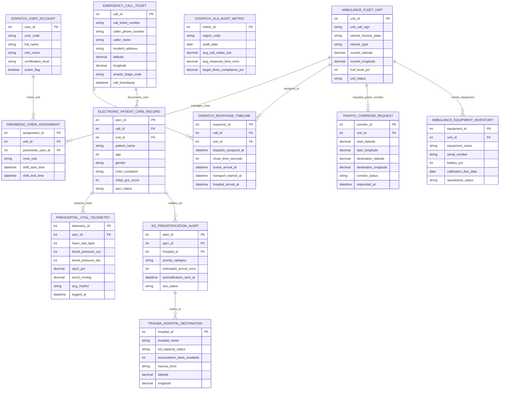

# Conceptual ERD — Ambulance Dispatch System

## Mermaid Code

## Entity Description Table | Bảng mô tả Entity

| # | Entity Name | Vietnamese Name | Description | Key Attributes | Main Relationships |
|---|-------------|-----------------|-------------|----------------|-------------------|
| 1 | EMERGENCY_CALL_TICKET | Phiếu Gọi Cấp cứu 115 | Emergency 115 call ticket record storing ticket number, caller phone, caller name, incident address, GPS lat/long, AMPDS triage code, and call timestamp. | call_id, call_ticket_number, caller_phone_number, caller_name, incident_address, latitude, longitude, ampds_triage_code, call_timestamp | Has RESPONSE_TIMELINE and ELECTRONIC_PATIENT_CARE_RECORD. |
| 2 | AMBULANCE_FLEET_UNIT | Đội xe Cấp cứu (Unit AVL) | Active ambulance vehicle unit record storing unit call sign, license plate, vehicle type (ALS/BLS), current GPS lat/long, fuel %, and unit status. | unit_id, unit_call_sign, vehicle_license_plate, vehicle_type, current_latitude, current_longitude, fuel_level_pct, unit_status | Has CREW_ASSIGNMENT, DISPATCH_TIMELINE, TRAFFIC_CORRIDOR, EQUIPMENT. |
| 3 | PARAMEDIC_CREW_ASSIGNMENT | Phân công Kíp Cấp cứu | Paramedic crew assignment record linking unit ID, paramedic user ID, crew role (Driver, Paramedic, EMT), shift start/end datetimes. | assignment_id, unit_id, paramedic_user_id, crew_role, shift_start_time, shift_end_time | Belongs to AMBULANCE_FLEET_UNIT and DISPATCH_USER_ACCOUNT. |
| 4 | DISPATCH_RESPONSE_TIMELINE | Nhật ký Thời gian Điều phối | Operational response timeline record tracking call ID, unit ID, dispatch assigned timestamp, chute time seconds, scene arrival, transport start, and hospital arrival. | response_id, call_id, unit_id, dispatch_assigned_at, chute_time_seconds, scene_arrival_at, transport_started_at, hospital_arrival_at | Belongs to EMERGENCY_CALL_TICKET and AMBULANCE_FLEET_UNIT. |
| 5 | ELECTRONIC_PATIENT_CARE_RECORD | Hồ sơ Bệnh án Cấp cứu ePCR | Pre-hospital electronic Patient Care Record (ePCR) storing call ID, unit ID, patient name, age, gender, chief complaint, initial GCS score, and status. | epcr_id, call_id, unit_id, patient_name, age, gender, chief_complaint, initial_gcs_score, epcr_status | Belongs to EMERGENCY_CALL_TICKET; Has VITAL_TELEMETRY and PRENOTIFICATION_ALERT. |
| 6 | PREHOSPITAL_VITAL_TELEMETRY | Nhật ký Sinh hiệu Cấp cứu | Continuous pre-hospital vital signs telemetry log storing ePCR ID, heart rate BPM, BP sys/dia, SpO2 %, EtCO2 mmHg, ECG rhythm interpretation, and timestamp. | telemetry_id, epcr_id, heart_rate_bpm, blood_pressure_sys, blood_pressure_dia, spo2_pct, etco2_mmHg, ecg_rhythm, logged_at | Belongs to ELECTRONIC_PATIENT_CARE_RECORD. |
| 7 | TRAUMA_HOSPITAL_DESTINATION | Bệnh viện Tiếp nhận Cấp cứu | Receiving hospital emergency department record storing hospital name, ED capacity status, resuscitation beds available, trauma level, and GPS lat/long. | hospital_id, hospital_name, ed_capacity_status, resuscitation_beds_available, trauma_level, latitude, longitude | Has ED_PRENOTIFICATION_ALERT. |
| 8 | ED_PRENOTIFICATION_ALERT | Cảnh báo Báo trước Bệnh viện | ER pre-notification alert record tracking ePCR ID, hospital ID, priority category (STEMI, Stroke, Trauma), estimated arrival mins (ETA), and ACK status. | alert_id, epcr_id, hospital_id, priority_category, estimated_arrival_mins, prenotification_sent_at, ack_status | Belongs to ELECTRONIC_PATIENT_CARE_RECORD and TRAUMA_HOSPITAL_DESTINATION. |
| 9 | TRAFFIC_CORRIDOR_REQUEST | Luồng Ưu tiên Đèn Giao thông | Traffic signal preemption green corridor request log tracking unit ID, start lat/long, destination lat/long, corridor status, and request timestamp. | corridor_id, unit_id, start_latitude, start_longitude, destination_latitude, destination_longitude, corridor_status, requested_at | Belongs to AMBULANCE_FLEET_UNIT. |
| 10 | AMBULANCE_EQUIPMENT_INVENTORY | Trang thiết bị Trên xe Cấp cứu | On-board medical equipment inventory record tracking unit ID, equipment name (Defibrillator, Ventilator), serial number, battery %, calibration due date, and status. | equipment_id, unit_id, equipment_name, serial_number, battery_pct, calibration_due_date, operational_status | Belongs to AMBULANCE_FLEET_UNIT. |
| 11 | DISPATCH_SLA_AUDIT_METRIC | Báo cáo SLA Điều phối 115 | Aggregated emergency response SLA performance metric tracking region code, audit date, avg call intake seconds, avg response time mins, and 8-min SLA compliance %. | metric_id, region_code, audit_date, avg_call_intake_sec, avg_response_time_mins, target_8min_compliance_pct | Standalone SLA audit metric record. |
| 12 | DISPATCH_USER_ACCOUNT | Tài khoản Nhân sự Điều phối | System user account record storing user code, full name, role name (Dispatcher, Paramedic, EMT), certification level (ACLS, BLS), and active flag. | user_id, user_code, full_name, role_name, certification_level, active_flag | Has PARAMEDIC_CREW_ASSIGNMENT. |

## Relationship Description | Mô tả Quan hệ

| # | From Entity | Cardinality | To Entity | Relationship Label | Business Explanation |
|---|-------------|-------------|-----------|-------------------|----------------------|
| 1 | EMERGENCY_CALL_TICKET | one-to-many | DISPATCH_RESPONSE_TIMELINE | generates_dispatch | One 115 emergency call ticket generates response timeline tracking milestones. |
| 2 | EMERGENCY_CALL_TICKET | one-to-many | ELECTRONIC_PATIENT_CARE_RECORD | documents_care | One 115 emergency call ticket produces pre-hospital electronic Patient Care Records (ePCR). |
| 3 | AMBULANCE_FLEET_UNIT | one-to-many | PARAMEDIC_CREW_ASSIGNMENT | manages_crew | One ambulance unit manages paramedic crew shift assignments. |
| 4 | AMBULANCE_FLEET_UNIT | one-to-many | DISPATCH_RESPONSE_TIMELINE | assigned_to | One ambulance unit is assigned to response timelines for emergency calls. |
| 5 | AMBULANCE_FLEET_UNIT | one-to-many | TRAFFIC_CORRIDOR_REQUEST | requests_green_corridor | One active ambulance unit requests green light traffic signal corridor preemption. |
| 6 | AMBULANCE_FLEET_UNIT | one-to-many | AMBULANCE_EQUIPMENT_INVENTORY | carries_equipment | One ambulance unit carries on-board medical equipment (Defibrillator, Ventilator). |
| 7 | ELECTRONIC_PATIENT_CARE_RECORD | one-to-many | PREHOSPITAL_VITAL_TELEMETRY | streams_vitals | One ePCR streams continuous pre-hospital physiological vital signs and 12-lead ECGs. |
| 8 | ELECTRONIC_PATIENT_CARE_RECORD | one-to-many | ED_PRENOTIFICATION_ALERT | notifies_ed | One ePCR sends pre-arrival trauma alerts to receiving hospital Emergency Departments. |
| 9 | ED_PRENOTIFICATION_ALERT | many-to-one | TRAUMA_HOSPITAL_DESTINATION | routes_to | Multiple pre-notification alerts route incoming ambulance patients to a receiving hospital. |
| 10 | DISPATCH_USER_ACCOUNT | one-to-many | PARAMEDIC_CREW_ASSIGNMENT | crews_unit | One paramedic user account crews assigned ambulance fleet units. |
