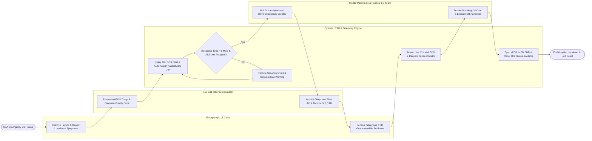

# Swimlane Diagram — Ambulance Dispatch System

## Mermaid Code

## Flow Description | Mô tả luồng

| Lane | Actor / Subsystem | Role in Flow |
|------|-------------------|--------------|
| 1 | Emergency 115 Caller | Calls 115 emergency hotline, reports incident location and patient symptoms, receives telephone CPR/first-aid instructions, and awaits ambulance arrival. |
| 2 | 115 Call Taker & Dispatcher | Answers 115 calls, executes AMPDS protocol triage (Red/Orange/Yellow/Green), provides telephone CPR instructions, and monitors CAD GIS fleet maps. |
| 3 | System / CAD & Telemetry Engine | Queries Automatic Vehicle Location (AVL) GPS pings, auto-assigns the fastest ALS unit, requests traffic light green corridors, streams 12-lead ECGs, and syncs ePCR records. |
| 4 | Mobile Paramedic & Hospital ED Team | Rolls out ambulance (< 90s chute time), navigates green corridor, renders pre-hospital ALS care, streams ECGs, transfers patient custody, and signs digital handovers. |
