# Action Tree — Ambulance Dispatch System

## Mermaid Code

```mermaid
graph TD
    Root["Ambulance Dispatch System"]

    Root --> M1["Call Intake & AMPDS Triage"]
    Root --> M2["CAD Fleet Tracking & Auto-Assignment"]
    Root --> M3["Traffic Signal Green Corridor"]
    Root --> M4["Pre-Hospital ECG & Telemetry"]
    Root --> M5["Mobile ePCR & Trauma Handover"]
    Root --> M6["Hospital ED Bed Capacity"]
    Root --> M7["Mass Casualty Incident MCI Triage"]
    Root --> M8["Dispatch SLA & Response Analytics"]

    M1 --> A11["Intake Emergency 115 Call Lines"]
    M1 --> A12["Execute Caller Phone GPS CLI Lookup"]
    M1 --> A13["Execute AMPDS Priority Triage Questions"]
    M1 --> A14["Dispatch Telephone Pre-Arrival CPR Guidance"]

    M2 --> A21["Track Real-Time Fleet Automatic Vehicle Location"]
    M2 --> A22["Calculate Traffic-Adjusted Optimal Unit ETA"]
    M2 --> A23["Auto-Assign ALS BLS Ambulance Units"]
    M2 --> A24["Reroute Unit to Higher Priority Red Incident"]

    M3 --> A31["Transmit Emergency Vehicle GPS Route Vector"]
    M3 --> A32["Request Traffic Signal Preemption Corridor"]
    M3 --> A33["Display Green Light Signal Clearance Status"]
    M3 --> A34["Restore Normal Intersection Signal Cycling"]

    M4 --> A41["Stream Continuous Pre-Hospital Vital Signs"]
    M4 --> A42["Stream High-Frequency 12-Lead ECG Waveforms"]
    M4 --> A43["Detect Acute STEMI Heart Attack Anomalies"]
    M4 --> A44["Stream FAST Stroke Telemedicine Video Feeds"]

    M5 --> A51["Document Mobile ePCR Clinical Assessments"]
    M5 --> A52["Record Pre-Hospital Medication Administrations"]
    M5 --> A53["Obtain ED Doctor Digital Handover Signature"]
    M5 --> A54["Sync ePCR Patient Care Records to Hospital EHR"]

    M6 --> A61["Monitor ER Resuscitation Bed Availability"]
    M6 --> A62["Dispatch Pre-Hospital STEMI Trauma Alerts"]
    M6 --> A63["Pre-Activate Hospital Cardiac Cath Lab Teams"]
    M6 --> A64["Track Ambulance Bay Turnaround Reset Times"]

    M7 --> A71["Activate START Mass Casualty Incident Triage"]
    M7 --> A72["Deploy Mobile Command & Staging Areas"]
    M7 --> A73["Coordinate Multi-Unit Fleet Dispatch Protocols"]
    M7 --> A74["Manage Regional Trauma Center Patient Distribution"]

    M8 --> A81["Measure Call Intake & AMPDS Triage SLA Seconds"]
    M8 --> A82["Audit Paramedic Unit Chute Time Compliance"]
    M8 --> A83["Calculate Urban 8-Minute Response SLA Percent"]
    M8 --> A84["Export Statutory PHEOC Municipal Reports"]
```

## Module Description | Mô tả Module

| # | Module | Description | Actions |
|---|--------|-------------|---------|
| 1 | Call Intake & AMPDS Triage | Ingests 115 emergency calls, captures CLI location pings, executes AMPDS priority triage (Red/Orange/Yellow/Green), and provides telephone CPR guidance. | Intake Emergency 115 Call Lines, Execute Caller Phone GPS CLI Lookup, Execute AMPDS Priority Triage Questions, Dispatch Telephone Pre-Arrival CPR Guidance |
| 2 | CAD Fleet Tracking & Auto-Assignment | Tracks Automatic Vehicle Location (AVL) GPS pings, calculates traffic-adjusted ETAs, auto-assigns optimal ALS/BLS units, and handles unit rerouting. | Track Real-Time Fleet Automatic Vehicle Location, Calculate Traffic-Adjusted Optimal Unit ETA, Auto-Assign ALS BLS Ambulance Units, Reroute Unit to Higher Priority Red Incident |
| 3 | Traffic Signal Green Corridor | Transmits emergency route vectors, requests smart traffic signal preemption corridors, displays green light clearances, and restores normal signal cycling. | Transmit Emergency Vehicle GPS Route Vector, Request Traffic Signal Preemption Corridor, Display Green Light Signal Clearance Status, Restore Normal Intersection Signal Cycling |
| 4 | Pre-Hospital ECG & Telemetry | Streams 1-Hz physiological vitals and 12-lead ECG raw waveforms, detects STEMI heart attack anomalies, and streams FAST stroke telemedicine video. | Stream Continuous Pre-Hospital Vital Signs, Stream High-Frequency 12-Lead ECG Waveforms, Detect Acute STEMI Heart Attack Anomalies, Stream FAST Stroke Telemedicine Video Feeds |
| 5 | Mobile ePCR & Trauma Handover | Documents pre-hospital ePCRs on paramedic tablets, logs medication doses, obtains ED doctor digital handover signatures, and syncs records to hospital EHRs. | Document Mobile ePCR Clinical Assessments, Record Pre-Hospital Medication Administrations, Obtain ED Doctor Digital Handover Signature, Sync ePCR Patient Care Records to Hospital EHR |
| 6 | Hospital ED Bed Capacity | Monitors ER resuscitation bed availability, dispatches pre-arrival trauma alerts, pre-activates cardiac Cath Labs, and tracks ambulance bay turnaround reset times. | Monitor ER Resuscitation Bed Availability, Dispatch Pre-Hospital STEMI Trauma Alerts, Pre-Activate Hospital Cardiac Cath Lab Teams, Track Ambulance Bay Turnaround Reset Times |
| 7 | Mass Casualty Incident MCI Triage | Activates START triage during mass disasters, deploys mobile command staging areas, coordinates multi-unit fleets, and manages regional patient distribution. | Activate START Mass Casualty Incident Triage, Deploy Mobile Command & Staging Areas, Coordinate Multi-Unit Fleet Dispatch Protocols, Manage Regional Trauma Center Patient Distribution |
| 8 | Dispatch SLA & Response Analytics | Measures call intake seconds, audits paramedic chute times (< 90s), calculates urban 8-minute response SLA percentages, and exports PHEOC reports. | Measure Call Intake & AMPDS Triage SLA Seconds, Audit Paramedic Unit Chute Time Compliance, Calculate Urban 8-Minute Response SLA Percent, Export Statutory PHEOC Municipal Reports |
