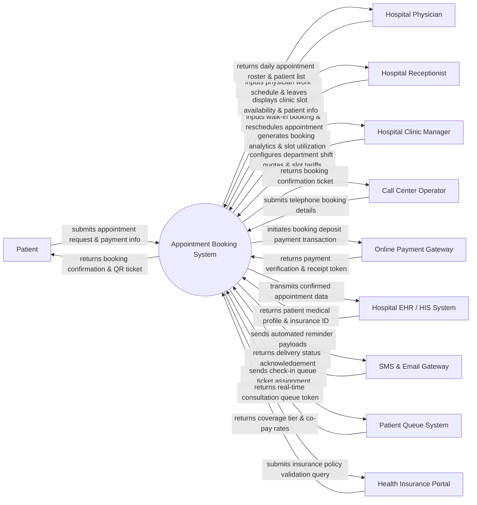

# Context Diagram — Appointment Booking System (Hospital)

## Mermaid Code

## Actor & Interaction Table | Bảng Actor & Tương tác

| # | Actor | Actor Type | Data Sent TO System | Data Received FROM System | Notes |
|---|-------|------------|---------------------|---------------------------|-------|
| 1 | Patient | Primary | Preferred doctor/specialty selection, booking dates, symptom description, deposit payment info. | Booking confirmation receipt, digital QR check-in ticket, appointment reminders, queue numbers. | Outpatient user booking online consultations via mobile app or web portal. |
| 2 | Hospital Physician | Primary | Work shift preferences, leave requests, room changes, emergency slot locks. | Daily consultation schedule, patient booking list, chief complaints, visit statistics. | Medical provider viewing assigned appointment slots and managing work availability. |
| 3 | Hospital Receptionist | Primary | Walk-in patient registration, manual appointment booking, check-in QR validation, slot reschedules. | Real-time slot matrix, patient check-in status, queue ticket numbers, doctor presence indicator. | Desk staff handling front-office appointments, patient arrival check-in, and manual adjustments. |
| 4 | Hospital Clinic Manager | Primary | Department appointment quotas, time slot durations, consultation tariffs, slot allocation rules. | Clinic slot utilization rates, no-show analytics, peak-hour demand trends, revenue reports. | Administrative role managing clinic capacity, doctor shift policies, and operational efficiency. |
| 5 | Call Center Operator | Primary | Patient telephone booking details, preferred time slots, contact numbers, reschedule requests. | Real-time slot availability, booking confirmation codes, doctor schedules. | Staff taking phone calls to assist elderly or non-tech-savvy patients with booking appointments. |
| 6 | Online Payment Gateway | Supporting | Payment transaction status (success/failed), transaction IDs, QR payment webhooks. | Deposit payment requests, bill order amounts, merchant ID, customer details. | Financial service executing digital deposit payments for appointment slot holds. |
| 7 | Hospital EHR / HIS System | Supporting | Patient master record ID, allergy flags, past consultation history, health insurance numbers. | Confirmed appointment details, visit chief complaints, expected arrival timestamps. | Enterprise hospital information system synchronizing appointment data with medical records. |
| 8 | SMS & Email Gateway | Supporting | Notification delivery receipts, SMS failure status codes, email open logs. | Appointment confirmation messages, 24h/2h reminder payloads, OTP tokens, cancellation alerts. | Third-party messaging provider sending automated multi-channel patient reminders. |
| 9 | Patient Queue System | Supporting | Queue token numbers, real-time doctor room calling status, estimated wait times. | Patient check-in confirmations, appointment booking IDs, priority queue tags. | Hospital queue system issuing physical queue tickets and driving room display monitors. |
| 10 | Health Insurance Portal | Supporting | Patient insurance policy validity, pre-authorization codes, co-pay percentages. | Insurance card numbers, scheduled visit specialty codes, ICD preliminary reasons. | Insurance verification API validating policy coverage prior to appointment booking. |

## System Boundary Description | Mô tả Phạm vi Hệ thống

The **Appointment Booking System (Hospital)** is a dedicated outpatient scheduling platform that optimizes hospital clinic capacity, reduces patient waiting times, and streamlines doctor consultation slot reservations.

**Inside System Scope:**
- Specialty search, physician profile browsing, real-time slot availability calendar display.
- Online appointment reservation, deposit payment collection, digital QR check-in ticket generation.
- Doctor shift roster management, department slot quota configuration, emergency slot locking.
- Appointment rescheduling, cancellation policies, automated multi-channel SMS/Email reminders.
- Front-desk reception check-in, arrival validation, and queue ticket integration.

**Outside System Scope:**
- In-depth clinical examination and electronic health record (EHR) note entry (handled by HIS/EHR).
- Pharmacy drug dispensing and laboratory test execution.
- Processing credit card payments directly on hospital servers (delegated to Payment Gateway APIs).
- Physical room queue calling hardware displays (handled by Queue Management System).
