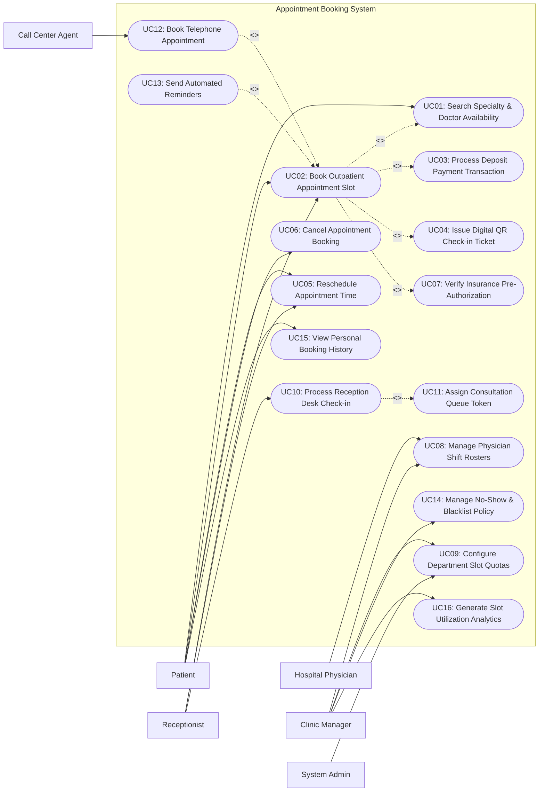

# Use Case Diagram — Appointment Booking System (Hospital)

## Mermaid Code

## Actor Table | Bảng Actor

| # | Actor | Actor Type | Role Description | Related Use Cases |
|---|-------|------------|------------------|-------------------|
| 1 | Patient | Primary | Outpatient searching for specialty doctors, booking consultation slots, and paying deposits. | UC01, UC02, UC05, UC06, UC15 |
| 2 | Hospital Physician | Primary | Clinical provider setting availability shifts, viewing daily appointment lists, and locking emergency slots. | UC08 |
| 3 | Receptionist | Primary | Front-desk staff managing walk-in patient bookings, checking in arriving patients, and reassigning slots. | UC02, UC05, UC10 |
| 4 | Call Center Agent | Primary | Assisted booking operator creating phone-in appointments on behalf of elderly or remote patients. | UC12 |
| 5 | Clinic Manager | Primary | Operational manager defining department slot quotas, managing doctor shifts, and viewing utilization metrics. | UC08, UC09, UC14, UC16 |
| 6 | System Admin | Primary | IT administrator configuring master tariffs, clinic rooms, user permissions, and gateway settings. | UC09 |
| 7 | Payment Gateway | System | Supporting financial portal processing credit card, e-wallet, and QR deposit transactions. | UC03 |
| 8 | SMS & Email Gateway | System | Messaging provider dispatching automated confirmation codes, reminders, and cancellation alerts. | UC13 |

## Use Case Table | Bảng Use Case

| # | UC ID | Use Case Name | Primary Actor | Secondary Actor | Description | Priority |
|---|-------|---------------|---------------|-----------------|-------------|----------|
| 1 | UC01 | Search Specialty & Doctor Availability | Patient | None | Query open consultation time slots by specialty department, physician name, or date. | High |
| 2 | UC02 | Book Outpatient Appointment Slot | Patient | Payment Gateway | Reserve a specific doctor consultation slot and collect deposit payment to secure booking. | High |
| 3 | UC03 | Process Deposit Payment Transaction | Patient | Payment Gateway | Execute cashless deposit payment via banking app QR, credit card, or e-wallet. | High |
| 4 | UC04 | Issue Digital QR Check-in Ticket | Patient | SMS Gateway | Generate encrypted QR code ticket for rapid self-service arrival check-in at hospital. | High |
| 5 | UC05 | Reschedule Appointment Time | Patient | Receptionist | Modify booking date or time slot prior to the 4-hour cancellation deadline. | High |
| 6 | UC06 | Cancel Appointment Booking | Patient | Receptionist | Cancel scheduled appointment and initiate partial or full deposit refund according to policy. | High |
| 7 | UC07 | Verify Insurance Pre-Authorization | Patient | Insurance Gateway | Query insurance portal to pre-validate policy benefits and determine consultation co-pay. | Medium |
| 8 | UC08 | Manage Physician Shift Rosters | Clinic Manager | Doctor | Define weekly consultation working hours, room assignments, leave calendars, and sub-slots. | High |
| 9 | UC09 | Configure Department Slot Quotas | Clinic Manager | System Admin | Set maximum online vs. walk-in booking quotas per department and time slot duration. | Medium |
| 10 | UC10 | Process Reception Desk Check-in | Receptionist | Queue System | Scan patient QR check-in ticket upon arrival at hospital reception desk. | High |
| 11 | UC11 | Assign Consultation Queue Token | Receptionist | Queue System | Issue physical/digital queue sequence number for assigned doctor's consultation room. | High |
| 12 | UC12 | Book Telephone Appointment | Call Center Agent | Patient | Assist callers in selecting available slots and creating verified phone appointments. | Medium |
| 13 | UC13 | Send Automated Reminders | System | SMS Gateway | Trigger automated 24-hour and 2-hour pre-appointment reminders via SMS, Zalo, and email. | High |
| 14 | UC14 | Manage No-Show & Blacklist Policy | Clinic Manager | System | Track missed appointments, apply penalty fees, or flag chronic no-show accounts. | Low |
| 15 | UC15 | View Personal Booking History | Patient | None | Display upcoming, completed, and canceled appointment history with receipt details. | Medium |
| 16 | UC16 | Generate Slot Utilization Analytics | Clinic Manager | None | Calculate doctor slot fill rates, peak-hour congestion metrics, and revenue breakdown. | Medium |

## Use Case Specification | Đặc tả Use Case

---

### UC02 — Book Outpatient Appointment Slot

| Field | Detail |
|-------|--------|
| **UC ID** | UC02 |
| **Use Case Name** | Book Outpatient Appointment Slot |
| **Actor(s)** | Primary: Patient   Secondary: Payment Gateway, SMS Gateway |
| **Description** | Allows an outpatient to search for open doctor consultation slots, select a preferred time, enter visit reasons, pay a deposit, and receive a confirmed QR check-in ticket. |
| **Precondition** | 1. Patient profile exists or quick enrollment is completed.   2. Doctor shift rosters and slot quotas are published in system. |
| **Main Flow** | 1. Patient selects "Book Appointment" on web portal or mobile app.   2. Patient searches and selects clinical specialty (e.g., Cardiology) and preferred physician (UC01).   3. System displays available dates and 15-minute time slots with deposit fee tariff.   4. Patient chooses an open time slot and enters brief chief complaint / visit reason.   5. System temporarily locks selected slot for 10 minutes to prevent double-booking.   6. System redirects patient to process deposit payment (UC03).   7. Payment gateway returns successful payment confirmation webhook.   8. System changes slot status to "Confirmed", issues digital QR check-in ticket (UC04), sends confirmation SMS/Email, and displays booking summary. |
| **Alternative Flow** | **AF1** — Insurance Covered Booking: If patient enters valid insurance card, system invokes UC07 to waive/reduce deposit payment requirement.   **AF2** — Receptionist Booking on Behalf: Receptionist executes booking at hospital desk and collects cash deposit directly. |
| **Exception Flow** | **EX1** — Payment Timeout / Failure: Patient fails to complete payment within 10 minutes; system releases temporary lock and notifies patient "Reservation expired".   **EX2** — Slot Concurrently Reserved: Slot is booked by another user during selection; system alerts user and highlights next available 15-minute slot. |
| **Postcondition** | Appointment record is created with status "Confirmed", doctor slot quota is decremented, deposit ledger is updated, and QR ticket is stored. |
| **Business Rule** | **BR1**: Online bookings must be completed at least 2 hours before the requested slot start time.   **BR2**: A patient cannot book more than 2 active appointments across different specialties on the same day. |

---

### UC03 — Process Deposit Payment Transaction

| Field | Detail |
|-------|--------|
| **UC ID** | UC03 |
| **Use Case Name** | Process Deposit Payment Transaction |
| **Actor(s)** | Primary: Patient   Secondary: Online Payment Gateway |
| **Description** | Facilitates cashless deposit payment (e.g., 100,000 VND) required to reserve a consultation slot using bank transfer QR, credit card, or e-wallet. |
| **Precondition** | 1. Patient has selected an open appointment slot (UC02).   2. Connection to external Payment Gateway API is active. |
| **Main Flow** | 1. System calculates required deposit amount based on department tariff.   2. System generates unique payment transaction reference and displays payment method options (VietQR, Credit Card, MoMo, ShopeePay).   3. Patient selects VietQR payment mode.   4. System renders dynamic VietQR image containing order code and exact deposit amount.   5. Patient scans QR code using mobile banking app and authorizes payment.   6. Payment Gateway transmits instant payment confirmation webhook to system.   7. System verifies transaction ID, marks deposit payment as "Paid", and generates digital invoice receipt. |
| **Alternative Flow** | **AF1** — Credit Card Payment: Patient enters card credentials, completes 3D-Secure OTP verification, and receives instant approval.   **AF2** — Deposit Waived for VIP / Insurance: System detects 100% insurance coverage, bypassing payment step and setting deposit amount to 0. |
| **Exception Flow** | **EX1** — Insufficient Funds / Card Declined: Payment Gateway returns decline code; system alerts patient and prompts to select alternative payment mode.   **EX2** — Webhook Delay: Payment gateway fails to send webhook within 3 minutes; system provides "I Have Paid - Check Status" button to poll gateway API manually. |
| **Postcondition** | Deposit transaction is recorded with payment gateway reference, deposit status is marked "Paid", and booking confirmation is unlocked. |
| **Business Rule** | **BR1**: Deposit amounts are held in hospital escrow ledger and automatically deducted from the final medical consultation bill.   **BR2**: Payment webhooks must be cryptographically verified using SHA-256 HMAC signature validation. |

---

### UC05 — Reschedule Appointment Time

| Field | Detail |
|-------|--------|
| **UC ID** | UC05 |
| **Use Case Name** | Reschedule Appointment Time |
| **Actor(s)** | Primary: Patient   Secondary: Receptionist, SMS Gateway |
| **Description** | Allows a patient (or receptionist) to modify the date or time slot of a confirmed appointment without losing the previously paid deposit. |
| **Precondition** | 1. Appointment status is "Confirmed" and not yet checked in.   2. Reschedule request is submitted prior to the mandatory 4-hour cut-off window. |
| **Main Flow** | 1. Patient logs into portal, navigates to "My Appointments", and clicks "Reschedule".   2. System validates that current time is at least 4 hours prior to the scheduled slot time.   3. System displays available alternative dates and open 15-minute slots for the same physician/department.   4. Patient selects a new open slot and confirms reschedule request.   5. System releases previous time slot back to public pool.   6. System updates appointment record with new date/time, transfers deposit reference to new slot, and re-generates QR check-in ticket (UC04).   7. System dispatches updated confirmation SMS/Email. |
| **Alternative Flow** | **AF1** — Doctor Emergency Absence Reschedule: Doctor marks emergency leave; system automatically alerts all scheduled patients and offers priority 1-click reschedule options.   **AF2** — Change of Physician: Patient chooses to switch to a different doctor in the same specialty; system recalculates fee differential if tariffs differ. |
| **Exception Flow** | **EX1** — Late Reschedule Attempt: Patient attempts to reschedule 2 hours before slot; system blocks action and displays notice "Reschedule cut-off time passed (min 4h required)".   **EX2** — Exceeded Reschedule Limit: Patient attempts 4th reschedule for same booking; system enforces rule blocking further reschedules. |
| **Postcondition** | Original time slot is freed, new time slot is reserved, appointment record is updated, and revised QR ticket is issued. |
| **Business Rule** | **BR1**: Rescheduling is free of charge if requested at least 4 hours in advance.   **BR2**: Maximum of 2 reschedules permitted per appointment booking. |

---

### UC08 — Manage Physician Shift Rosters

| Field | Detail |
|-------|--------|
| **UC ID** | UC08 |
| **Use Case Name** | Manage Physician Shift Rosters |
| **Actor(s)** | Primary: Clinic Manager   Secondary: Hospital Physician |
| **Description** | Configures physician monthly/weekly working schedules, shift hours, consultation room assignments, slot capacities, and leave approvals. |
| **Precondition** | 1. Clinic Manager is authenticated with department administration privileges.   2. Master clinic room catalog and physician list are active in system. |
| **Main Flow** | 1. Clinic Manager opens "Physician Shift Roster Management" module.   2. Manager selects department (e.g., Pediatrics) and target calendar week/month.   3. Manager assigns physician shift blocks (e.g., Morning Shift: 08:00 - 12:00, Afternoon Shift: 13:00 - 17:00).   4. Manager specifies consultation room number (e.g., Room 302) and slot interval duration (e.g., 15 minutes = 16 slots/shift).   5. System validates room and doctor schedules to prevent double-booking room conflicts.   6. Manager clicks "Publish Roster".   7. System generates corresponding open time slots (APPOINTMENT_SLOT) in public booking directory. |
| **Alternative Flow** | **AF1** — Physician Leave Request Approval: Doctor submits leave request; manager approves leave, system automatically locks slots and triggers patient reschedule workflow (UC05).   **AF2** — Recurring Master Template Copy: Manager copies previous month's schedule template to expedite roster creation. |
| **Exception Flow** | **EX1** — Room Assignment Conflict: System detects Room 302 is already assigned to another doctor on Wednesday morning; system blocks publish action and highlights conflict.   **EX2** — Unpublish Slot Conflict: Manager attempts to unpublish shift with active patient bookings; system alerts manager and requires automated patient reassignment step. |
| **Postcondition** | Physician shift roster is stored, open appointment slots are generated in public calendar, and doctor dashboard reflects new schedule. |
| **Business Rule** | **BR1**: Doctor shift rosters must be published at least 14 days in advance of the working date.   **BR2**: Once a slot is booked by a patient, physician shift start/end times cannot be shortened without triggering cancellation alerts. |

---

### UC10 — Process Reception Desk Check-in

| Field | Detail |
|-------|--------|
| **UC ID** | UC10 |
| **Use Case Name** | Process Reception Desk Check-in |
| **Actor(s)** | Primary: Receptionist   Secondary: Patient, Queue System |
| **Description** | Scans arriving patient's digital QR ticket or verifies ID at hospital reception to confirm arrival, validate deposit, and assign consultation room queue number. |
| **Precondition** | 1. Patient has a confirmed appointment for the current day (UC02).   2. Receptionist scanner is connected to reception workstation. |
| **Main Flow** | 1. Patient arrives at hospital reception and displays digital QR check-in ticket on mobile screen (or self-service kiosk).   2. Receptionist scans QR ticket code using barcode scanner.   3. System retrieves appointment details, verifies booking status ("Confirmed"), and validates payment deposit.   4. System checks arrival timestamp against scheduled slot time (e.g., within 30 minutes window).   5. System updates appointment status to "Checked-In / Arrived".   6. System interfaces with Queue System (UC11) to generate sequential consultation queue token (e.g., Token #C-014 for Room 302).   7. System prints physical queue ticket (or displays digital token) and directs patient to waiting hall. |
| **Alternative Flow** | **AF1** — Self-Service Kiosk Check-In: Patient scans QR ticket at automated kiosk, kiosk validates booking and prints queue token directly without receptionist.   **AF2** — Check-in by National ID / Phone: Patient lost QR ticket; receptionist looks up booking using national ID or phone number. |
| **Exception Flow** | **EX1** — Late Arrival (Exceeded Slot Window): Patient arrives 45 minutes late for 09:00 slot; system flags "Grace Period Expired" and prompts receptionist to convert booking to standby queue or reschedule.   **EX2** — Unpaid Deposit: System flags deposit status "Unpaid"; receptionist collects cash payment before completing check-in. |
| **Postcondition** | Appointment status transitions to "Checked-In", queue token is generated in Queue System, and physician waiting queue monitor is updated. |
| **Business Rule** | **BR1**: Patients are permitted to check in up to 45 minutes before and 15 minutes after their scheduled slot time.   **BR2**: Checked-in appointments automatically lock deposit refund capabilities. |
