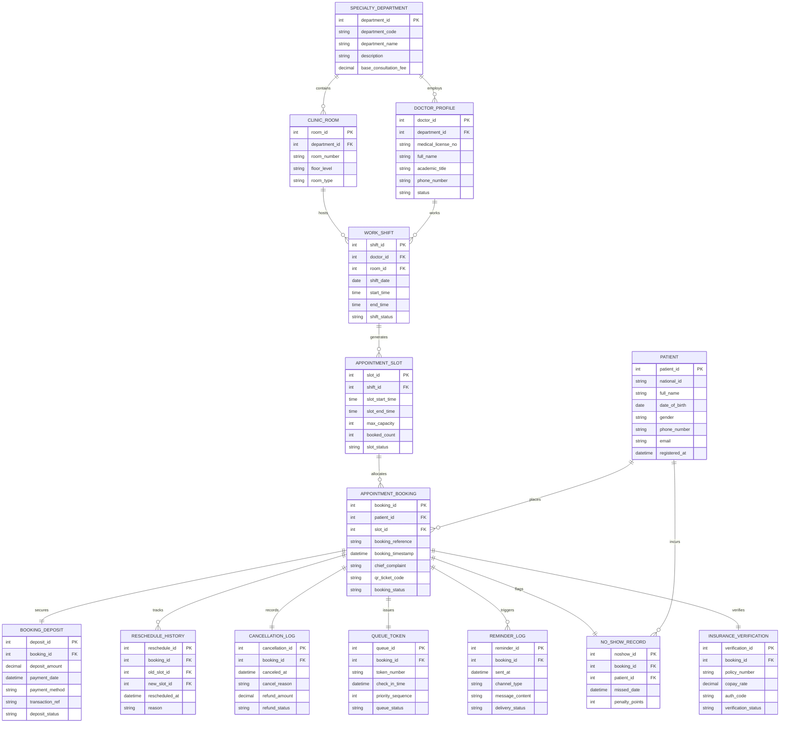

# Conceptual ERD — Appointment Booking System (Hospital)

## Mermaid Code

## Entity Description Table | Bảng mô tả Entity

| # | Entity Name | Vietnamese Name | Description | Key Attributes | Main Relationships |
|---|-------------|-----------------|-------------|----------------|-------------------|
| 1 | PATIENT | Bệnh nhân | Master record for outpatients registering for hospital appointment bookings. | patient_id (PK), national_id, full_name, date_of_birth, phone_number | Has many APPOINTMENT_BOOKING, NO_SHOW_RECORD |
| 2 | SPECIALTY_DEPARTMENT | Chuyên khoa | Medical specialty clinic department defining base consultation pricing and room maps. | department_id (PK), department_code, department_name, base_consultation_fee | Has many DOCTOR_PROFILE, CLINIC_ROOM |
| 3 | DOCTOR_PROFILE | Bác sĩ | Physician profile storing medical license, title, department, and working status. | doctor_id (PK), department_id (FK), medical_license_no, full_name, academic_title | Belongs to SPECIALTY_DEPARTMENT; Has many WORK_SHIFT |
| 4 | CLINIC_ROOM | Phòng khám | Physical consultation room location within the outpatient hospital building. | room_id (PK), department_id (FK), room_number, floor_level, room_type | Belongs to SPECIALTY_DEPARTMENT; Has many WORK_SHIFT |
| 5 | WORK_SHIFT | Ca làm việc Bác sĩ | Scheduled working shift block assigned to a physician in a specific room. | shift_id (PK), doctor_id (FK), room_id (FK), shift_date, start_time, end_time | Belongs to DOCTOR_PROFILE, CLINIC_ROOM; Has many APPOINTMENT_SLOT |
| 6 | APPOINTMENT_SLOT | Khung giờ Khám | Granular 15-minute consultation time slot generated from a doctor work shift. | slot_id (PK), shift_id (FK), slot_start_time, slot_end_time, max_capacity, booked_count | Belongs to WORK_SHIFT; Has many APPOINTMENT_BOOKING |
| 7 | APPOINTMENT_BOOKING | Lịch hẹn Đặt | Core booking transaction recording slot reservation, QR ticket code, and visit status. | booking_id (PK), patient_id (FK), slot_id (FK), booking_reference, qr_ticket_code | Belongs to PATIENT, APPOINTMENT_SLOT; Has one DEPOSIT, QUEUE_TOKEN |
| 8 | BOOKING_DEPOSIT | Tiền đặt cọc | Financial deposit payment transaction holding slot reservation fee in escrow. | deposit_id (PK), booking_id (FK), deposit_amount, payment_date, transaction_ref | Belongs to APPOINTMENT_BOOKING |
| 9 | RESCHEDULE_HISTORY | Lịch sử Đổi lịch | Audit log of booking date/time slot modification events for a patient booking. | reschedule_id (PK), booking_id (FK), old_slot_id (FK), new_slot_id (FK), rescheduled_at | Belongs to APPOINTMENT_BOOKING |
| 10 | CANCELLATION_LOG | Nhật ký Hủy lịch | Log recording appointment cancellation timestamps, reasons, and deposit refund amounts. | cancellation_id (PK), booking_id (FK), canceled_at, cancel_reason, refund_amount | Belongs to APPOINTMENT_BOOKING |
| 11 | QUEUE_TOKEN | Số Thứ tự Khám | Real-time consultation queue token issued to patient upon arrival check-in. | queue_id (PK), booking_id (FK), token_number, check_in_time, priority_sequence | Belongs to APPOINTMENT_BOOKING |
| 12 | REMINDER_LOG | Nhật ký Nhắc lịch | Tracks automated multi-channel (SMS, Email, Zalo) pre-appointment reminder dispatches. | reminder_id (PK), booking_id (FK), sent_at, channel_type, delivery_status | Belongs to APPOINTMENT_BOOKING |
| 13 | NO_SHOW_RECORD | Bệnh nhân Vắng mặt | Record of unexcused missed appointments resulting in penalty point accumulation. | noshow_id (PK), booking_id (FK), patient_id (FK), missed_date, penalty_points | Belongs to PATIENT, APPOINTMENT_BOOKING |
| 14 | INSURANCE_VERIFICATION | Xác minh Bảo hiểm | Insurance pre-authorization status recording verification codes and co-pay rates. | verification_id (PK), booking_id (FK), policy_number, copay_rate, auth_code | Belongs to APPOINTMENT_BOOKING |

## Relationship Description | Mô tả Quan hệ

| # | From Entity | Cardinality | To Entity | Relationship Label | Business Explanation |
|---|-------------|-------------|-----------|-------------------|----------------------|
| 1 | SPECIALTY_DEPARTMENT | one-to-many | DOCTOR_PROFILE | employs | Một chuyên khoa quản lý và tuyển dụng nhiều bác sĩ chuyên khoa. |
| 2 | SPECIALTY_DEPARTMENT | one-to-many | CLINIC_ROOM | contains | Một chuyên khoa sở hữu nhiều phòng khám thực địa trong khu khám bệnh. |
| 3 | DOCTOR_PROFILE | one-to-many | WORK_SHIFT | works | Một bác sĩ có nhiều ca làm việc được xếp theo lịch trình hàng tuần. |
| 4 | CLINIC_ROOM | one-to-many | WORK_SHIFT | hosts | Một phòng khám phục vụ nhiều ca làm việc của các bác sĩ khác nhau. |
| 5 | WORK_SHIFT | one-to-many | APPOINTMENT_SLOT | generates | Mỗi ca làm việc chia thành nhiều khung giờ khám 15 phút cho bệnh nhân đặt. |
| 6 | PATIENT | one-to-many | APPOINTMENT_BOOKING | places | Một bệnh nhân có thể đăng ký đặt nhiều lịch hẹn khám ở các mốc thời gian. |
| 7 | APPOINTMENT_SLOT | one-to-many | APPOINTMENT_BOOKING | allocates | Một khung giờ khám phân bổ suất khám cho bệnh nhân tương ứng với hạn ngạch. |
| 8 | APPOINTMENT_BOOKING | one-to-one | BOOKING_DEPOSIT | secures | Mỗi lượt đặt lịch hẹn tương ứng đúng một giao dịch đặt cọc giữ chỗ. |
| 9 | APPOINTMENT_BOOKING | one-to-many | RESCHEDULE_HISTORY | tracks | Một lịch hẹn có thể lưu vết nhiều lần thay đổi ngày/giờ khám. |
| 10 | APPOINTMENT_BOOKING | one-to-one | CANCELLATION_LOG | records | Một lịch hẹn bị hủy ghi nhận đúng một nhật ký lý do và hoàn tiền cọc. |
| 11 | APPOINTMENT_BOOKING | one-to-one | QUEUE_TOKEN | issues | Khi bệnh nhân đến check-in, lịch hẹn cấp ra đúng một số thứ tự khám. |
| 12 | APPOINTMENT_BOOKING | one-to-many | REMINDER_LOG | triggers | Một lịch hẹn kích hoạt nhiều thông báo nhắc lịch (trước 24h và 2h). |
| 13 | PATIENT | one-to-many | NO_SHOW_RECORD | incurs | Một bệnh nhân vắng mặt không báo trước bị ghi nhận lịch sử vi phạm no-show. |
| 14 | APPOINTMENT_BOOKING | one-to-one | NO_SHOW_RECORD | flags | Lịch hẹn quá giờ không check-in được đánh dấu thành một bản ghi no-show. |
| 15 | APPOINTMENT_BOOKING | one-to-one | INSURANCE_VERIFICATION | verifies | Lịch hẹn khám bảo hiểm liên kết với một bản ghi xác thực quyền lợi bảo hiểm. |
