# Swimlane Diagram — Appointment Booking System (Hospital)

## Mermaid Code

```mermaid
flowchart LR
    Start(["Start Appointment Booking"])

    subgraph Lane1["Patient"]
        P1["Search Specialty Doctor & Select Date"]
        P2["Choose Open Time Slot & Input Symptom"]
        P3["Select Payment Method & Pay Deposit"]
        P4["Receive Digital QR Ticket & Reminders"]
        P5["Arrive at Hospital & Present QR Code"]
    end

    subgraph Lane2["Receptionist / Call Center"]
        R1["Scan Patient QR Ticket at Reception Desk"]
        R2{"Arrived On Time?"}
        R3["Confirm Check-in & Assign Room Ticket"]
        R4["Flag Late Arrival & Assign Standby Queue"]
    end

    subgraph Lane3["Hospital Physician"]
        D1["Set Weekly Shift Roster & Open Slots"]
        D2["View Daily Appointment Queue List"]
        D3["Call Next Patient Token & Begin Visit"]
    end

    subgraph Lane4["Appointment Booking System"]
        S1["Query Real-time Slot Availability"]
        S2{"Slot Available?"}
        S3["Lock Slot for 10 Min & Render Payment QR"]
        S4{"Payment Successful?"}
        S5["Confirm Booking & Dispatch QR Ticket SMS"]
        S6["Send 24h & 2h Pre-appointment Reminders"]
        S7["Issue Consultation Queue Token to HIS"]
    end

    Finish(["End Appointment Check-in"])

    D1 --> S1
    Start --> P1 --> P2 --> S1 --> S2
    S2 -->|"No"| P1
    S2 -->|"Yes"| S3 --> P3 --> S4
    S4 -->|"No"| S3
    S4 -->|"Yes"| S5 --> P4 --> S6 --> P5 --> R1 --> R2
    R2 -->|"Yes"| R3 --> S7 --> D2 --> D3 --> Finish
    R2 -->|"No"| R4 --> S7
```

## Flow Description | Mô tả luồng

| Lane | Actor / System | Role in Flow |
|------|----------------|--------------|
| 1 | Patient | Searches doctor specialties, selects 15-minute slot, authorizes deposit payment, receives digital QR ticket, responds to reminders, and presents ticket at reception desk. |
| 2 | Receptionist / Call Center | Scans arriving patient QR tickets at hospital front desk, validates arrival window, processes check-ins, and handles late arrival standby assignments. |
| 3 | Hospital Physician | Configures weekly shift rosters and slot limits, reviews daily appointment waiting lists, calls patient queue numbers, and conducts outpatient consultations. |
| 4 | Appointment Booking System | Verifies real-time slot availability, holds temporary 10-minute slot locks, validates payment gateway webhooks, issues encrypted QR tickets, triggers automated SMS reminders, and syncs queue tokens with HIS. |
