# Action Tree — Appointment Booking System (Hospital)

## Mermaid Code

```mermaid
graph TD
    Root["Appointment Booking System"]

    Root --> M1["1. Specialty & Doctor Catalog"]
    Root --> M2["2. Slot Reservation Engine"]
    Root --> M3["3. Deposit & Payments"]
    Root --> M4["4. QR Ticket & Check-in"]
    Root --> M5["5. Reschedule & Cancel"]
    Root --> M6["6. Roster & Quota Setup"]
    Root --> M7["7. Reminders & Alerts"]
    Root --> M8["8. Analytics & No-Show"]

    M1 --> A11["Search Specialty Department"]
    M1 --> A12["View Physician Profile & Bio"]
    M1 --> A13["Filter Available Date Slots"]
    M1 --> A14["View Doctor Consultation Fee"]

    M2 --> A21["Select 15-Min Time Slot"]
    M2 --> A22["Input Chief Complaint Details"]
    M2 --> A23["Hold Temporary Slot Lock"]
    M2 --> A24["Confirm Booking Reservation"]

    M3 --> A31["Render Dynamic VietQR Code"]
    M3 --> A32["Process Credit Card Payment"]
    M3 --> A33["Verify Gateway Webhook"]
    M3 --> A34["Generate Digital Payment Receipt"]

    M4 --> A41["Generate Encrypted QR Ticket"]
    M4 --> A42["Scan QR Ticket at Reception"]
    M4 --> A43["Validate Arrival Window"]
    M4 --> A44["Issue Consultation Queue Token"]

    M5 --> A51["Request Appointment Reschedule"]
    M5 --> A52["Select New Available Slot"]
    M5 --> A53["Process Cancellation & Refund"]
    M5 --> A54["Enforce Reschedule Deadline Rule"]

    M6 --> A61["Define Weekly Doctor Shifts"]
    M6 --> A62["Assign Consultation Rooms"]
    M6 --> A63["Set Department Online Quotas"]
    M6 --> A64["Approve Physician Leave Requests"]

    M7 --> A71["Trigger 24h Pre-Visit SMS"]
    M7 --> A72["Send 2h Emergency Zalo Alert"]
    M7 --> A73["Dispatch Confirmation Email"]
    M7 --> A74["Track Notification Delivery Logs"]

    M8 --> A81["Track Unexcused No-Show Count"]
    M8 --> A82["Apply Account Blacklist Flags"]
    M8 --> A83["Calculate Slot Fill Rate Metrics"]
    M8 --> A84["Generate Clinic Revenue Summary"]
```

## Module Description | Mô tả Module

| # | Module | Description | Actions |
|---|--------|-------------|---------|
| 1 | Specialty & Doctor Catalog | Provides search and browsing capabilities for medical specialty departments, doctor profiles, fees, and open calendar dates. | Search Specialty Department, View Physician Profile & Bio, Filter Available Date Slots, View Doctor Consultation Fee |
| 2 | Slot Reservation Engine | Handles real-time selection of 15-minute appointment slots, temporary 10-minute slot locks, symptom input, and reservation holds. | Select 15-Min Time Slot, Input Chief Complaint Details, Hold Temporary Slot Lock, Confirm Booking Reservation |
| 3 | Deposit & Payments | Processes cashless deposit payments via VietQR, credit card, or e-wallet, verifying payment webhooks and issuing digital receipts. | Render Dynamic VietQR Code, Process Credit Card Payment, Verify Gateway Webhook, Generate Digital Payment Receipt |
| 4 | QR Ticket & Check-in | Issues encrypted digital QR check-in tickets, validates arrival windows at reception desks, and assigns consultation queue tokens. | Generate Encrypted QR Ticket, Scan QR Ticket at Reception, Validate Arrival Window, Issue Consultation Queue Token |
| 5 | Reschedule & Cancel | Enables patients to reschedule or cancel appointment slots before cut-off deadlines, enforcing refund policies and slot releases. | Request Appointment Reschedule, Select New Available Slot, Process Cancellation & Refund, Enforce Reschedule Deadline Rule |
| 6 | Roster & Quota Setup | Configures physician shift schedules, room assignments, department online/walk-in slot quotas, and leave approvals. | Define Weekly Doctor Shifts, Assign Consultation Rooms, Set Department Online Quotas, Approve Physician Leave Requests |
| 7 | Reminders & Alerts | Automates multi-channel (SMS, Email, Zalo) pre-appointment reminder dispatches at 24-hour and 2-hour intervals. | Trigger 24h Pre-Visit SMS, Send 2h Emergency Zalo Alert, Dispatch Confirmation Email, Track Notification Delivery Logs |
| 8 | Analytics & No-Show | Monitors unexcused patient no-shows, applies account penalty rules, and generates clinic slot fill rates and revenue reports. | Track Unexcused No-Show Count, Apply Account Blacklist Flags, Calculate Slot Fill Rate Metrics, Generate Clinic Revenue Summary |
