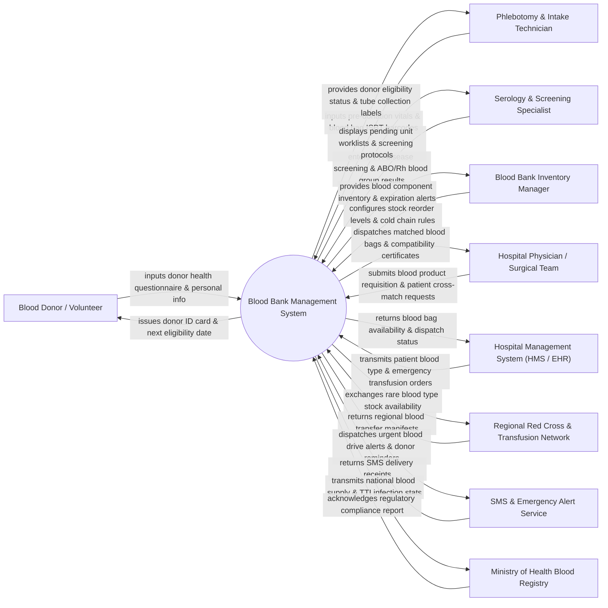

# Context Diagram — Blood Bank Management System

## Mermaid Code

## Actor & Interaction Table | Bảng Actor & Tương tác

| # | Actor | Actor Type | Data Sent TO System | Data Received FROM System | Notes |
|---|-------|------------|---------------------|---------------------------|-------|
| 1 | Blood Donor / Volunteer | Primary | Donor demographic info, health history questionnaire answers, consent forms. | Donor ID card, blood group confirmation, next eligible donation date, thank-you notices. | Individual volunteering to donate whole blood, plasma, or platelets. |
| 2 | Phlebotomy & Intake Technician | Primary | Hemoglobin levels, pre-donation blood pressure/vitals, ISBT-128 blood bag barcodes, collection volumes. | Donor eligibility clearance, ISBT-128 barcode payloads, draw time tracking alerts. | Clinical staff screening donors, performing phlebotomy draws, and tagging blood bags. |
| 3 | Serology & Screening Specialist | Primary | Transfusion-Transmissible Infection (TTI) test results (HIV, HBV, HCV, Syphilis, Malaria), ABO/Rh blood typing. | Pending screening worklists, automated testing machine outputs, quarantine release approvals. | Laboratory specialist testing blood units for infectious diseases and confirming ABO/Rh blood groups. |
| 4 | Blood Bank Inventory Manager | Primary | Cold storage temperature thresholds, component expiration rules, unit quarantine overrides, disposal logs. | Real-time blood unit stock by ABO/Rh group, expiring unit warnings, cold chain temperature alerts. | Supervisor managing blood product inventory, component processing, and quality assurance. |
| 5 | Hospital Physician / Surgical Team | Primary | Emergency blood requisitions, target patient ABO/Rh type, required component types (RBC, FFP, Platelets), unit quantities. | Cross-match compatibility certificates, reserved blood bag IDs, dispatch manifests. | Medical doctor ordering blood products for surgical procedures, trauma, or anemia treatment. |
| 6 | Hospital Management System (HMS / EHR) | Supporting | Patient Master Index (MPI) data, inpatient admission status, blood transfusion requisitions. | Blood bag dispatch tokens, patient transfusion history, billable blood product codes. | Enterprise hospital information system requesting blood units for clinical inpatient care. |
| 7 | Regional Red Cross & Transfusion Network | Supporting | Regional blood stock availability, inter-bank transfer requests, emergency blood exchange manifests. | Outward blood transfer dispatches, rare blood group requests (e.g., Bombay, Rh-negative). | Federated network of regional blood banks and Red Cross centers exchanging blood units. |
| 8 | SMS & Emergency Alert Service | Supporting | Message delivery receipts, SMS status codes, broadcast campaign logs. | Urgent blood drive alerts, targeted donor SMS calls (e.g., O-negative emergency drive), appointment reminders. | Third-party messaging engine broadcasting emergency blood donor calls during critical shortages. |
| 9 | Ministry of Health Blood Registry | Regulatory | National blood safety guidelines, TTI mandatory reporting schemas, audit protocols. | Transfusion-transmissible infection statistics, national blood reserve metrics, disposal reports. | Governmental health authority enforcing national blood safety laws and monitoring transfusion data. |

## System Boundary Description | Mô tả Phạm vi Hệ thống

The **Blood Bank Management System** is a mission-critical healthcare software platform designed to manage the end-to-end lifecycle of donated blood products, encompassing donor registration, health screening, blood collection, ISBT-128 barcode labeling, serological TTI screening (HIV, HBV, HCV, Syphilis), component separation (Red Blood Cells, Fresh Frozen Plasma, Platelets), cold chain storage monitoring, hospital requisition cross-matching, emergency dispatch, and adverse reaction tracking.

**Inside System Scope:**
- Donor database management, donation eligibility interval checking, and donor health screening history.
- ISBT-128 standardized blood bag barcoding, donation session logging, and collection volume tracking.
- Serological testing management for Transfusion-Transmissible Infections (TTIs) and ABO/Rh blood typing.
- Blood component separation tracking (PRBC, FFP, Platelet Concentrate, Cryoprecipitate) and shelf-life monitoring.
- Multi-tier quarantine management, automated cold-chain storage temperature logging, and expired unit disposal.
- Hospital blood requisition processing, serological cross-matching, compatibility verification, and emergency dispatch.

**Outside System Scope:**
- Physical execution of blood drawing, needle insertion, and physical centrifuge machine operation.
- Physical logistics transport in temperature-controlled vehicle coolers (delegated to courier vehicles).
- Final bedside blood transfusion administration to the patient (handled by hospital nursing staff).
- General hospital financial billing and cashiering (delegated to Hospital Billing systems).
