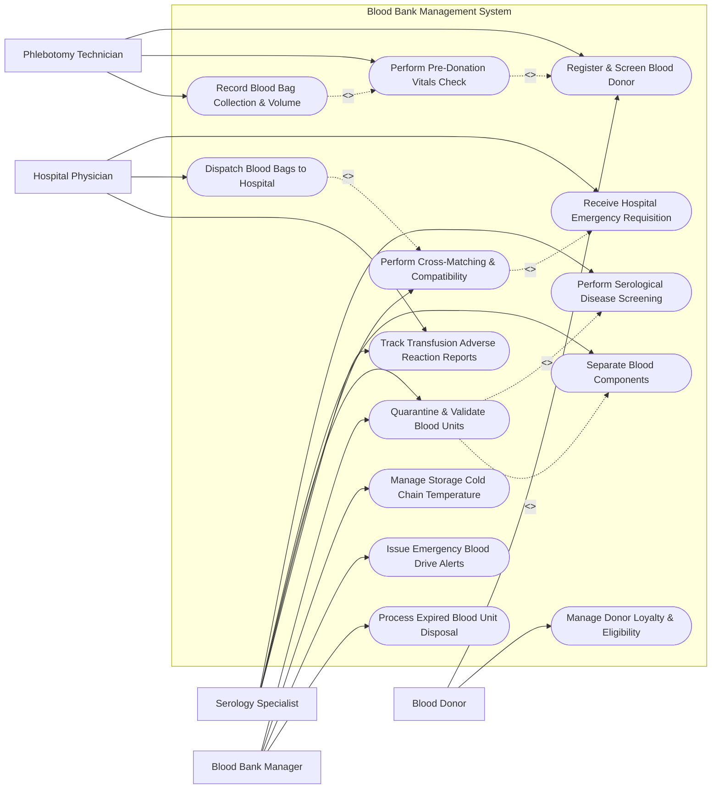

# Use Case Diagram — Blood Bank Management System

## Mermaid Code

## Actor Table | Bảng Actor

| # | Actor | Actor Type | Role Description | Related Use Cases |
|---|-------|------------|------------------|-------------------|
| 1 | Blood Donor | Primary | Volunteer donating blood, completing health questionnaires, checking eligibility intervals, and receiving donation certificates. | UC01, UC14 |
| 2 | Phlebotomy Technician | Primary | Clinical intake staff evaluating donor vital signs, checking hemoglobin levels, performing phlebotomy, and generating ISBT-128 barcodes. | UC01, UC02, UC03 |
| 3 | Serology Specialist | Primary | Laboratory specialist testing blood units for TTIs (HIV, HBV, HCV, Syphilis), performing ABO/Rh grouping, separating components, and conducting cross-matching. | UC04, UC05, UC06, UC08, UC13 |
| 4 | Blood Bank Manager | Primary | Quality and inventory supervisor managing blood stock validation, cold storage temperature alarms, emergency drive broadcasts, and biohazard disposal. | UC06, UC10, UC11, UC12 |
| 5 | Hospital Physician | Primary | Medical surgeon or emergency doctor placing blood requisitions, receiving matched units, and logging transfusion reactions. | UC07, UC09, UC13 |

## Use Case Table | Bảng Use Case

| # | UC ID | Use Case Name | Primary Actor | Secondary Actor | Description | Priority |
|---|-------|---------------|---------------|-----------------|-------------|----------|
| 1 | UC01 | Register & Screen Blood Donor | Blood Donor | Phlebotomy Technician | Captures donor demographic data, checks mandatory 84-day donation interval, and records medical history questionnaire responses. | High |
| 2 | UC02 | Perform Pre-Donation Vitals Check | Phlebotomy Technician | System Engine | Evaluates donor hemoglobin concentration (> 12.5 g/dL), blood pressure, pulse, and body weight to grant collection clearance. | High |
| 3 | UC03 | Record Blood Bag Collection & Volume | Phlebotomy Technician | System Engine | Affixes ISBT-128 barcode labels to primary collection bag and sample pilot tubes, recording draw duration and collected volume. | High |
| 4 | UC04 | Perform Serological Disease Screening | Serology Specialist | System Engine | Tests collected blood samples for Transfusion-Transmissible Infections (TTIs: HIV-1/2, HBsAg, Anti-HCV, Syphilis, Malaria) and ABO/Rh blood group. | High |
| 5 | UC05 | Separate Blood Components | Serology Specialist | System Engine | Processes whole blood into Packed Red Blood Cells (PRBC), Fresh Frozen Plasma (FFP), Platelet Concentrate, and Cryoprecipitate. | High |
| 6 | UC06 | Quarantine & Validate Blood Units | Blood Bank Manager | Serology Specialist | Holds unverified blood units in quarantine storage until all TTI tests pass, transferring clean units to available inventory. | High |
| 7 | UC07 | Receive Hospital Emergency Requisition | Hospital Physician | HMS / EHR System | Receives urgent blood requests from hospital OR/ER specifying patient ABO/Rh type, required component types, unit count, and urgency. | High |
| 8 | UC08 | Perform Cross-Matching & Compatibility | Serology Specialist | Hospital Physician | Performs major and minor serological cross-matching between donor red cells and recipient serum to verify biological compatibility. | High |
| 9 | UC09 | Dispatch Blood Bags to Hospital | Hospital Physician | Phlebotomy Technician | Issues compatible blood bags in temperature-controlled cooler transport containers with signed compatibility certificates. | High |
| 10 | UC10 | Manage Storage Cold Chain Temperature | Blood Bank Manager | System Engine | Continuously monitors cold storage refrigeration units (2-6°C for RBC, -30°C for FFP, 20-24°C with agitation for Platelets) and triggers thermal alarms. | High |
| 11 | UC11 | Issue Emergency Blood Drive Alerts | Blood Bank Manager | SMS Alert Service | Broadcasts targeted SMS alerts to registered donors of specific blood groups (e.g., O-Negative) during critical inventory shortages. | Medium |
| 12 | UC12 | Process Expired Blood Unit Disposal | Blood Bank Manager | System Engine | Identifies expired or TTI-reactive blood units, removes them from storage, and logs biohazardous medical waste disposal. | High |
| 13 | UC13 | Track Transfusion Adverse Reaction Reports | Hospital Physician | Serology Specialist | Documents post-transfusion reaction incidents (febrile, hemolytic, allergic reactions), locking donor and unit batch for investigation. | High |
| 14 | UC14 | Manage Donor Loyalty & Eligibility | Blood Donor | System Engine | Tracks donor milestone rewards, total lifetime donations, and automatically calculates the next eligible donation date. | Medium |

## Use Case Specification | Đặc tả Use Case

---

### UC01 — Register & Screen Blood Donor

| Field | Detail |
|-------|--------|
| **UC ID** | UC01 |
| **Use Case Name** | Register & Screen Blood Donor |
| **Actor(s)** | Primary: Blood Donor   Secondary: Phlebotomy Technician |
| **Description** | Intake staff registers donor details, verifies identity via National ID, checks donation interval rules (min 84 days since last whole blood donation), and records responses to the standardized Health History Questionnaire. |
| **Precondition** | 1. Donor presents at blood bank intake desk.   2. System access is active. |
| **Main Flow** | 1. Technician inputs Donor National ID, phone number, or scans Donor Card barcode.   2. System queries central donor registry for existing records.   3. System checks last donation timestamp: if last donation was < 84 days ago for whole blood, System flags "Ineligible — Donation Interval Active".   4. If eligible, Donor completes digital Health History Questionnaire (screening for high-risk behaviors, recent travel, medications, surgeries).   5. System analyzes questionnaire answers against deferral criteria rules.   6. If no risk factors are flagged, System marks donor status "Screening Passed — Cleared for Vitals Check" (UC02). |
| **Alternative Flow** | **AF1** — Permanent Deferral Flag: If donor registry contains a permanent deferral record (e.g., history of Hepatitis B/C or HIV positive), System silently alerts technician and blocks registration. |
| **Exception Flow** | **EX1** — Temporary Risk Deferral: If donor indicates recent tattoo within 6 months or recent antibiotic use, System calculates temporary deferral period (e.g., defer for 6 months) and prints Deferral Notice specifying next eligible date. |
| **Postcondition** | Donor registration is completed, donation interval is validated, and health questionnaire status is saved. |
| **Business Rule** | **BR1**: Whole blood donation interval must be at least 84 days (12 weeks) for male/female donors; apheresis platelet donation interval must be at least 14 days. |

---

### UC04 — Perform Serological Disease Screening

| Field | Detail |
|-------|--------|
| **UC ID** | UC04 |
| **Use Case Name** | Perform Serological Disease Screening |
| **Actor(s)** | Primary: Serology Specialist   Secondary: System Engine |
| **Description** | Serologist tests sample pilot tubes for Transfusion-Transmissible Infections (TTIs) and performs forward/reverse ABO and Rh(D) blood typing to ensure blood safety. |
| **Precondition** | 1. Blood bag collection is completed (UC03) and sample pilot tubes are received in serology lab. |
| **Main Flow** | 1. Serologist scans sample pilot tube ISBT-128 barcode.   2. Serologist loads sample tube into automated immunoassay analyzer.   3. Analyzer runs screening assays for TTI markers: HIV-1/2 antibodies, HBsAg (Hepatitis B), Anti-HCV (Hepatitis C), Syphilis (VDRL/TPHA), and Malaria.   4. Serologist performs forward (cell) and reverse (serum) ABO blood grouping and Rh(D) typing (including Weak D testing if Rh negative).   5. System ingests automated assay results via HL7/ASTM interface.   6. If all TTI markers are "Non-Reactive" (Negative) and forward/reverse blood groups match, System marks unit "Serologically Cleared".   7. Serologist verifies and applies digital signature to release unit for component validation (UC06). |
| **Alternative Flow** | **AF1** — Nucleic Acid Testing (NAT): System incorporates NAT molecular testing for HIV/HCV/HBV RNA/DNA to narrow window-period detection, attaching NAT clearance to unit record. |
| **Exception Flow** | **EX1** — Reactive TTI Result: If any TTI test returns "Reactive" (Positive), System immediately flags unit as "CONTAMINATED — TTI POSITIVE", locks blood bag in biohazard quarantine, alerts manager (UC12), and places donor on permanent/temporary deferral list. |
| **Postcondition** | Blood unit serological screening and ABO/Rh blood group are verified, updating unit status to Cleared or Contaminated. |
| **Business Rule** | **BR1**: Blood units with any reactive TTI test or ABO forward/reverse grouping mismatch must be permanently blocked from clinical release. |

---

### UC05 — Separate Blood Components

| Field | Detail |
|-------|--------|
| **UC ID** | UC05 |
| **Use Case Name** | Separate Blood Components |
| **Actor(s)** | Primary: Serology Specialist   Secondary: System Engine |
| **Description** | Whole blood units are centrifugally separated into discrete therapeutic blood components: Packed Red Blood Cells (PRBC), Fresh Frozen Plasma (FFP), Platelet Concentrate, and Cryoprecipitate. |
| **Precondition** | 1. Whole blood collection bag is received in processing lab within 8 hours of draw time. |
| **Main Flow** | 1. Specialist scans primary whole blood bag ISBT-128 barcode.   2. Specialist loads bag into refrigerated centrifuge for component separation.   3. After centrifugation, Specialist uses automated plasma expressor to extract plasma and buffy coat into connected satellite bags.   4. Specialist affixes unique ISBT-128 component barcode labels to each derivative satellite bag:     - Packed Red Blood Cells (PRBC)     - Fresh Frozen Plasma (FFP)     - Platelet Concentrate   5. Specialist scans each component bag barcode into system.   6. System generates derivative unit records, calculates individual expiration dates based on component type:     - PRBC: 35-42 days at 2-6°C     - FFP: 1 year at -30°C     - Platelets: 5 days at 20-24°C with constant agitation   7. System updates component inventory ledger in quarantine status (UC06). |
| **Alternative Flow** | **AF1** — Cryoprecipitate Processing: Specialist thaws FFP at 1-6°C, centrifuges precipitate, and extracts Cryoprecipitate Antihemophilic Factor (rich in Factor VIII and Fibrinogen), assigning 1-year freeze expiry. |
| **Exception Flow** | **EX1** — Processing Delay (> 8 Hours): If whole blood is not processed into FFP within 8 hours of collection, System flags plasma as "Liquid Plasma" (prohibiting FFP designation) and reduces shelf utility. |
| **Postcondition** | Whole blood bag is transformed into 3-4 distinct blood component records, each tagged with ISBT-128 barcodes and component-specific shelf lives. |
| **Business Rule** | **BR1**: Component separation must be completed within 8 hours of donation to preserve labile clotting factors in Fresh Frozen Plasma (FFP). |

---

### UC07 — Receive Hospital Emergency Requisition

| Field | Detail |
|-------|--------|
| **UC ID** | UC07 |
| **Use Case Name** | Receive Hospital Emergency Requisition |
| **Actor(s)** | Primary: Hospital Physician   Secondary: HMS / EHR System |
| **Description** | Receives and validates urgent electronic blood product requisitions from hospital operating rooms, emergency departments, or intensive care units. |
| **Precondition** | 1. Hospital physician is authenticated in HMS/EHR or Blood Bank portal. |
| **Main Flow** | 1. Physician initiates "New Blood Requisition".   2. Physician inputs Patient Name, MRN, Hospital Ward/OR Room, Patient ABO/Rh Blood Group, Required Component (PRBC, FFP, Platelets), Quantity (units), and Urgency Level (STAT Emergency, Urgent, Routine Elective).   3. Physician attaches clinical diagnosis (e.g., Severe Postpartum Hemorrhage, Massive Trauma, Gastrointestinal Bleeding).   4. System validates order completeness and queries active inventory for matching ABO/Rh component units.   5. System reserves candidate blood units in inventory database.   6. System emits high-priority visual and audible alert on Blood Bank workstation.   7. Serology Specialist accepts requisition ticket and initiates cross-matching (UC08). |
| **Alternative Flow** | **AF1** — Uncrossmatched Emergency Release (Massive Transfusion Protocol): In life-threatening trauma, Physician requests "Emergency Uncrossmatched Blood". System immediately releases O-Negative PRBC (or O-Positive for male trauma) with signed physician emergency release waiver. |
| **Exception Flow** | **EX1** — Target Blood Group Stockout: If requested blood group (e.g., AB-Negative PRBC) is out of stock, System displays Compatible Substitution Matrix (e.g., substitute A-Negative or O-Negative PRBC) and alerts Manager for regional blood transfer (UC11). |
| **Postcondition** | Hospital blood requisition is validated, candidate blood units are reserved, and cross-matching workflow is triggered. |
| **Business Rule** | **BR1**: Emergency uncrossmatched blood release requires written/electronic emergency sign-off by the attending physician accepting clinical responsibility. |

---

### UC08 — Perform Cross-Matching & Compatibility

| Field | Detail |
|-------|--------|
| **UC ID** | UC08 |
| **Use Case Name** | Perform Cross-Matching & Compatibility |
| **Actor(s)** | Primary: Serology Specialist   Secondary: Hospital Physician |
| **Description** | Performs major serological cross-matching (testing donor red cells against recipient serum) and antibody screening to ensure complete biological compatibility prior to unit dispatch. |
| **Precondition** | 1. Blood requisition is received and units are reserved (UC07).   2. Recipient blood sample tube is received in blood bank. |
| **Main Flow** | 1. Specialist scans recipient blood tube barcode and reserved donor unit ISBT-128 barcode.   2. Specialist performs recipient ABO/Rh re-typing to confirm blood group.   3. Specialist performs Indirect Antiglobulin Test (IAT) for atypical antibody screening on recipient serum.   4. Specialist executes Major Cross-Match (mixing donor RBCs with recipient serum/plasma) using gel card or tube agglutination method.   5. Specialist inspects for agglutination or hemolysis under microscope.   6. If no agglutination occurs (No Clumping), Specialist inputs "Compatible — No Agglutination".   7. System verifies compatibility status, locks unit binding to patient MRN, and generates a digitally signed Compatibility Certificate.   8. System updates unit status to "Cross-Matched & Ready for Dispatch" (UC09). |
| **Alternative Flow** | **AF1** — Computerized Electronic Cross-Match: If recipient has no atypical antibodies and two independent concordant ABO/Rh typings exist, System executes instantaneous Electronic Cross-Match verification without manual gel card incubation. |
| **Exception Flow** | **EX1** — Cross-Match Incompatibility: If agglutination occurs (Clumping detected), System flags "INCOMPATIBLE — CROSS-MATCH FAILED", blocks unit dispatch, and prompts specialist to select an alternative donor bag. |
| **Postcondition** | Biological compatibility between donor unit and recipient is established and documented on the cross-match certificate. |
| **Business Rule** | **BR1**: Blood bags cannot be dispatched without a passed physical or electronic cross-match certificate signed by a qualified serologist. |
