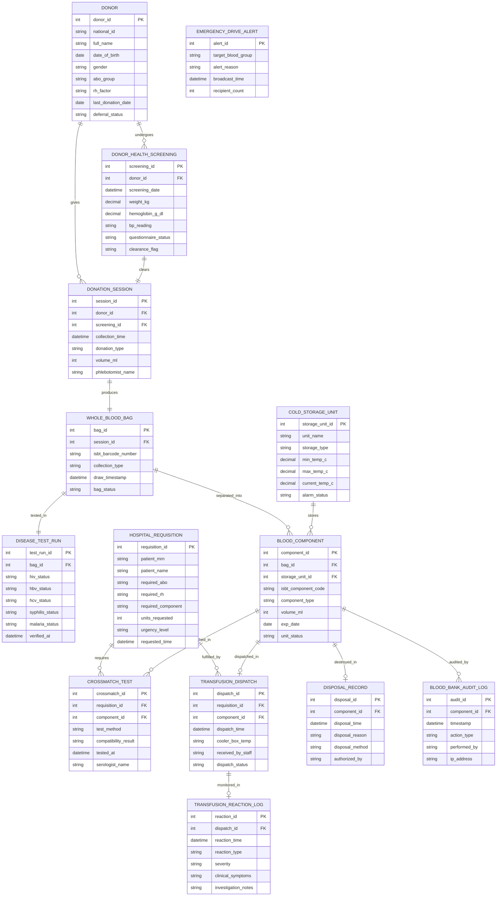

# Conceptual ERD — Blood Bank Management System

## Mermaid Code

## Entity Description Table | Bảng mô tả Entity

| # | Entity Name | Vietnamese Name | Description | Key Attributes | Main Relationships |
|---|-------------|-----------------|-------------|----------------|-------------------|
| 1 | DONOR | Người Hiến máu | Registered blood donor entity tracking national ID, ABO/Rh blood group, last donation date, and deferral status. | donor_id, national_id, full_name, abo_group, last_donation_date | Undergoes Health Screening, gives Donation Sessions. |
| 2 | DONOR_HEALTH_SCREENING | Khám Sức khỏe Người hiến | Pre-donation screening record logging hemoglobin levels, blood pressure, weight, and questionnaire evaluation. | screening_id, hemoglobin_g_dl, bp_reading, clearance_flag | Belongs to Donor, clears Donation Session. |
| 3 | DONATION_SESSION | Phiên Hiến máu | Individual phlebotomy session documenting draw timestamp, donation type (Whole Blood, Apheresis), and volume. | session_id, collection_time, donation_type, volume_ml | Given by Donor, cleared by Screening, produces Whole Blood Bag. |
| 4 | WHOLE_BLOOD_BAG | Túi Máu toàn phần | Primary collected blood container identified by a unique ISBT-128 barcode number and draw timestamp. | bag_id, isbt_barcode_number, draw_timestamp, bag_status | Produced by Session, tested in Disease Run, separated into Components. |
| 5 | DISEASE_TEST_RUN | Xét nghiệm Bệnh Truyền nhiễm | Serological TTI testing record logging HIV, HBV, HCV, Syphilis, and Malaria screening assay results. | test_run_id, hiv_status, hbv_status, hcv_status, verified_at | Tests Whole Blood Bag. |
| 6 | BLOOD_COMPONENT | Chế phẩm Máu | Derivative blood component (Packed Red Cells, FFP, Platelets, Cryo) with individual expiration dates and ISBT barcodes. | component_id, isbt_component_code, component_type, exp_date | Separated from Whole Blood Bag, stored in Storage Unit, matched in Cross-match, dispatched or destroyed. |
| 7 | COLD_STORAGE_UNIT | Tủ lạnh Bảo quản Máu | Temperature-monitored refrigeration unit or deep freezer storing blood components with automated thermal sensors. | storage_unit_id, unit_name, storage_type, min_temp_c, max_temp_c | Stores Blood Components. |
| 8 | HOSPITAL_REQUISITION | Phiếu Yêu cầu Máu Bệnh viện | Urgent or routine blood product order placed by a hospital physician specifying patient MRN, blood type, and component units. | requisition_id, patient_mrn, required_abo, required_component, units_requested | Requires Cross-match Tests, fulfilled by Transfusion Dispatches. |
| 9 | CROSSMATCH_TEST | Phản ứng Chéo Máu | Serological compatibility test record comparing donor red cells against recipient serum before release. | crossmatch_id, test_method, compatibility_result, tested_at | Linked to Hospital Requisition and Blood Component. |
| 10 | TRANSFUSION_DISPATCH | Xuất Máu Bệnh viện | Logistics dispatch record tracking blood bags issued to operating rooms or hospitals in temperature-controlled coolers. | dispatch_id, dispatch_time, cooler_box_temp, received_by_staff | Fulfills Hospital Requisition, dispatches Blood Component, monitored in Reaction Log. |
| 11 | TRANSFUSION_REACTION_LOG | Báo cáo Phản ứng Truyền máu | Post-transfusion adverse reaction incident report documenting hemolytic, febrile, or allergic events. | reaction_id, reaction_time, reaction_type, severity | Monitored in Transfusion Dispatch. |
| 12 | EMERGENCY_DRIVE_ALERT | Cảnh báo Hiến máu Khẩn cấp | Emergency SMS notification broadcast dispatched to targeted blood group donors during stock shortages. | alert_id, target_blood_group, alert_reason, broadcast_time | Standalone marketing alert. |
| 13 | DISPOSAL_RECORD | Nhật ký Hủy Máu | Biohazardous medical waste record logging expired or TTI-reactive blood unit destruction details. | disposal_id, disposal_time, disposal_reason, disposal_method | Destroys Blood Component. |
| 14 | BLOOD_BANK_AUDIT_LOG | Nhật ký Thao tác Ngân hàng Máu | Immutable audit log recording blood bag status changes, quarantine releases, and cross-match approvals. | audit_id, timestamp, action_type, performed_by | Audits Blood Component lifecycle. |

## Relationship Description | Mô tả Quan hệ

| # | From Entity | Cardinality | To Entity | Relationship Label | Business Explanation |
|---|-------------|-------------|-----------|-------------------|----------------------|
| 1 | DONOR | one-to-many | DONOR_HEALTH_SCREENING | undergoes | A donor undergoes health screenings prior to each blood donation attempt. |
| 2 | DONOR | one-to-many | DONATION_SESSION | gives | A donor gives multiple donation sessions across their lifetime. |
| 3 | DONOR_HEALTH_SCREENING | one-to-one | DONATION_SESSION | clears | A passed health screening clears exactly one blood collection session. |
| 4 | DONATION_SESSION | one-to-one | WHOLE_BLOOD_BAG | produces | A donation session produces one primary whole blood bag. |
| 5 | WHOLE_BLOOD_BAG | one-to-one | DISEASE_TEST_RUN | tested_in | A whole blood bag is tested in one comprehensive TTI disease screening run. |
| 6 | WHOLE_BLOOD_BAG | one-to-many | BLOOD_COMPONENT | separated_into | A whole blood bag is centrifugally separated into 3-4 distinct blood component bags. |
| 7 | COLD_STORAGE_UNIT | one-to-many | BLOOD_COMPONENT | stores | A cold storage unit stores multiple blood component bags within strict temperature limits. |
| 8 | HOSPITAL_REQUISITION | one-to-many | CROSSMATCH_TEST | requires | A hospital blood requisition requires serological cross-matching for requested units. |
| 9 | HOSPITAL_REQUISITION | one-to-many | TRANSFUSION_DISPATCH | fulfilled_by | A hospital requisition is fulfilled by one or more transfusion dispatches. |
| 10 | BLOOD_COMPONENT | one-to-many | CROSSMATCH_TEST | matched_in | A blood component bag is matched against patient serum in cross-match tests. |
| 11 | BLOOD_COMPONENT | one-to-one | TRANSFUSION_DISPATCH | dispatched_in | A blood component bag is issued in at most one hospital transfusion dispatch. |
| 12 | BLOOD_COMPONENT | one-to-one | DISPOSAL_RECORD | destroyed_in | An expired or reactive blood component bag is logged in exactly one disposal record. |
| 13 | BLOOD_COMPONENT | one-to-many | BLOOD_BANK_AUDIT_LOG | audited_by | A blood component maintains an immutable audit trail from collection to usage/disposal. |
| 14 | TRANSFUSION_DISPATCH | one-to-one | TRANSFUSION_REACTION_LOG | monitored_in | A transfusion dispatch may be monitored in an adverse reaction log if complications occur. |
