# Swimlane Diagram — Blood Bank Management System

## Mermaid Code

```mermaid
flowchart LR
    Start(["Start: Donor Arrives at Blood Bank Intake"])

    subgraph Lane1["Blood Donor"]
        C1["Complete Health History Questionnaire"]
        C2["Undergo Pre-Donation Hb & Vitals Check"]
        C3["Complete Blood Donation & Receive Donor Card"]
    end

    subgraph Lane2["Phlebotomy & Testing Specialist"]
        P1["Verify Donation Interval & Print ISBT-128 Barcodes"]
        P2["Draw Whole Blood Bag & Sample Pilot Tubes"]
        P3["Run TTI Serology Screening & ABO/Rh Blood Typing"]
        P4["Perform Centrifugal Component Separation"]
        P5["Execute Major Cross-Match Test with Patient Serum"]
    end

    subgraph Lane3["Blood Bank Management System"]
        S1["Verify Donor Eligibility & Record Draw Volume"]
        S2{"TTI Disease Screening Passed?"}
        S3["Quarantine Bag & Log Permanent Donor Deferral"]
        S4["Validate Component Units & Move to Active Inventory"]
        S5["Receive Emergency Hospital Requisition Ticket"]
        S6{"Cross-Match Serologically Compatible?"}
        S7["Issue Signed Compatibility Certificate & Dispatch Manifest"]
    end

    subgraph Lane4["Hospital Surgical Unit"]
        G1["Submit Emergency Blood Product Order via HMS"]
        G2["Receive Temperature-Controlled Cooler Box & Transfuse"]
    end

    Finish(["End: Blood Transfusion Completed"])

    Start --> C1 --> C2 --> P1 --> S1 --> P2 --> C3 --> P3 --> S2
    S2 -->|"No: Reactive"| S3
    S2 -->|"Yes: Non-Reactive"| P4 --> S4 --> G1 --> S5 --> P5 --> S6
    S6 -->|"No: Incompatible"| P5
    S6 -->|"Yes: Compatible"| S7 --> G2 --> Finish
```

## Flow Description | Mô tả luồng

| Lane | Actor | Role in Flow |
|------|-------|-------------|
| 1 | Blood Donor | Completes digital health history questionnaire, undergoes pre-donation hemoglobin and vitals check, completes whole blood donation, and receives official donor card with next eligible date. |
| 2 | Phlebotomy & Testing Specialist | Verifies donation interval eligibility, prints ISBT-128 barcode labels, performs blood draw, executes serological TTI screening (HIV, HBV, HCV, Syphilis), separates components centrifugally, and performs major cross-matching tests. |
| 3 | Blood Bank Management System | Validates donor eligibility intervals, ingests automated TTI assay results, quarantines reactive units, tracks blood component expiration dates in cold storage, processes hospital requisitions, verifies cross-match compatibility, and prints dispatch manifests. |
| 4 | Hospital Surgical Unit | Places urgent blood requisitions via HMS for surgical or trauma patients, receives temperature-controlled cooler transport boxes, verifies patient identity, and administers blood transfusions. |
