# Action Tree — Blood Bank Management System

## Mermaid Code

```mermaid
graph TD
    Root["Blood Bank Management System"]

    Root --> M1["1. Donor Registration & Eligibility"]
    Root --> M2["2. Collection & ISBT-128 Barcoding"]
    Root --> M3["3. TTI Disease Screening & Serology"]
    Root --> M4["4. Component Separation & Processing"]
    Root --> M5["5. Cold Chain & Inventory Storage"]
    Root --> M6["6. Hospital Requisition & Cross-Matching"]
    Root --> M7["7. Emergency Drive & Donor Engagement"]
    Root --> M8["8. Biohazard Disposal & Audit Compliance"]

    M1 --> A11["Verify Donor Identity National ID"]
    M1 --> A12["Check 84-Day Donation Interval Rule"]
    M1 --> A13["Evaluate Health Questionnaire Risk Flags"]
    M1 --> A14["Log Pre-Donation Hemoglobin Vitals"]

    M2 --> A21["Generate ISBT-128 Barcode Labels"]
    M2 --> A22["Log Phlebotomy Collection Timestamp"]
    M2 --> A23["Track Primary Bag & Pilot Tube IDs"]
    M2 --> A24["Record Collection Draw Volume"]

    M3 --> A31["Perform TTI Screening HIV HBV HCV"]
    M3 --> A32["Perform Syphilis & Malaria Assays"]
    M3 --> A33["Confirm ABO Forward Reverse Grouping"]
    M3 --> A34["Perform Weak D Testing for Rh Negative"]

    M4 --> A41["Separate PRBC Packed Red Blood Cells"]
    M4 --> A42["Extract Fresh Frozen Plasma FFP"]
    M4 --> A43["Prepare Platelet Concentrate Buffy Coat"]
    M4 --> A44["Process Cryoprecipitate Factor VIII"]

    M5 --> A51["Monitor Refrigeration Unit Temperatures"]
    M5 --> A52["Track Component Expiration Timelines"]
    M5 --> A53["Enforce Multi-Tier Unit Quarantine"]
    M5 --> A54["Trigger Thermal Cold Chain Alarms"]

    M6 --> A61["Receive Emergency Hospital Requisition"]
    M6 --> A62["Perform Major Serological Cross-Match"]
    M6 --> A63["Execute Instant Electronic Cross-Match"]
    M6 --> A64["Issue Signed Compatibility Certificate"]

    M7 --> A71["Broadcast Targeted O-Negative SMS Drive"]
    M7 --> A72["Schedule Blood Mobile Campaign Drives"]
    M7 --> A73["Manage Donor Milestone Recognition"]
    M7 --> A74["Track Regional Inter-Bank Transfers"]

    M8 --> A81["Log Reactive TTI Biohazard Disposal"]
    M8 --> A82["Process Expired Unit Incineration"]
    M8 --> A83["Investigate Transfusion Reaction Reports"]
    M8 --> A84["Audit Ministry of Health ISBT Compliance"]
```

## Module Description | Mô tả Module

| # | Module | Description | Actions |
|---|--------|-------------|---------|
| 1 | Donor Registration & Eligibility | Registers donor demographics, checks mandatory 84-day donation intervals, evaluates health questionnaire responses, and logs pre-donation hemoglobin vitals. | Verify Donor Identity National ID, Check 84-Day Donation Interval Rule, Evaluate Health Questionnaire Risk Flags, Log Pre-Donation Hemoglobin Vitals. |
| 2 | Collection & ISBT-128 Barcoding | Generates standardized ISBT-128 barcode payloads, logs draw timestamps, links primary collection bags to sample pilot tubes, and records draw volumes. | Generate ISBT-128 Barcode Labels, Log Phlebotomy Collection Timestamp, Track Primary Bag & Pilot Tube IDs, Record Collection Draw Volume. |
| 3 | TTI Disease Screening & Serology | Ingests automated TTI assay results (HIV, HBV, HCV, Syphilis, Malaria), verifies ABO forward/reverse blood grouping, and performs Weak D testing for Rh negative units. | Perform TTI Screening HIV HBV HCV, Perform Syphilis & Malaria Assays, Confirm ABO Forward Reverse Grouping, Perform Weak D Testing for Rh Negative. |
| 4 | Component Separation & Processing | Tracks centrifugal processing of whole blood into Packed Red Blood Cells (PRBC), Fresh Frozen Plasma (FFP), Platelet Concentrate, and Cryoprecipitate. | Separate PRBC Packed Red Blood Cells, Extract Fresh Frozen Plasma FFP, Prepare Platelet Concentrate Buffy Coat, Process Cryoprecipitate Factor VIII. |
| 5 | Cold Chain & Inventory Storage | Monitors cold storage unit temperatures (2-6°C, -30°C, 20-24°C), tracks component expiration timelines, enforces unit quarantine, and triggers thermal alarms. | Monitor Refrigeration Unit Temperatures, Track Component Expiration Timelines, Enforce Multi-Tier Unit Quarantine, Trigger Thermal Cold Chain Alarms. |
| 6 | Hospital Requisition & Cross-Matching | Processes urgent hospital blood requisitions, performs major serological gel-card cross-matching, executes electronic cross-matching, and issues compatibility certificates. | Receive Emergency Hospital Requisition, Perform Major Serological Cross-Match, Execute Instant Electronic Cross-Match, Issue Signed Compatibility Certificate. |
| 7 | Emergency Drive & Donor Engagement | Broadcasts targeted SMS alerts to donors of rare blood types, schedules mobile blood drive campaigns, manages donor milestone awards, and tracks inter-bank blood transfers. | Broadcast Targeted O-Negative SMS Drive, Schedule Blood Mobile Campaign Drives, Manage Donor Milestone Recognition, Track Regional Inter-Bank Transfers. |
| 8 | Biohazard Disposal & Audit Compliance | Manages biohazardous disposal of expired or TTI-reactive blood units, investigates post-transfusion adverse reaction reports, and audits ISBT-128 regulatory compliance. | Log Reactive TTI Biohazard Disposal, Process Expired Unit Incineration, Investigate Transfusion Reaction Reports, Audit Ministry of Health ISBT Compliance. |
