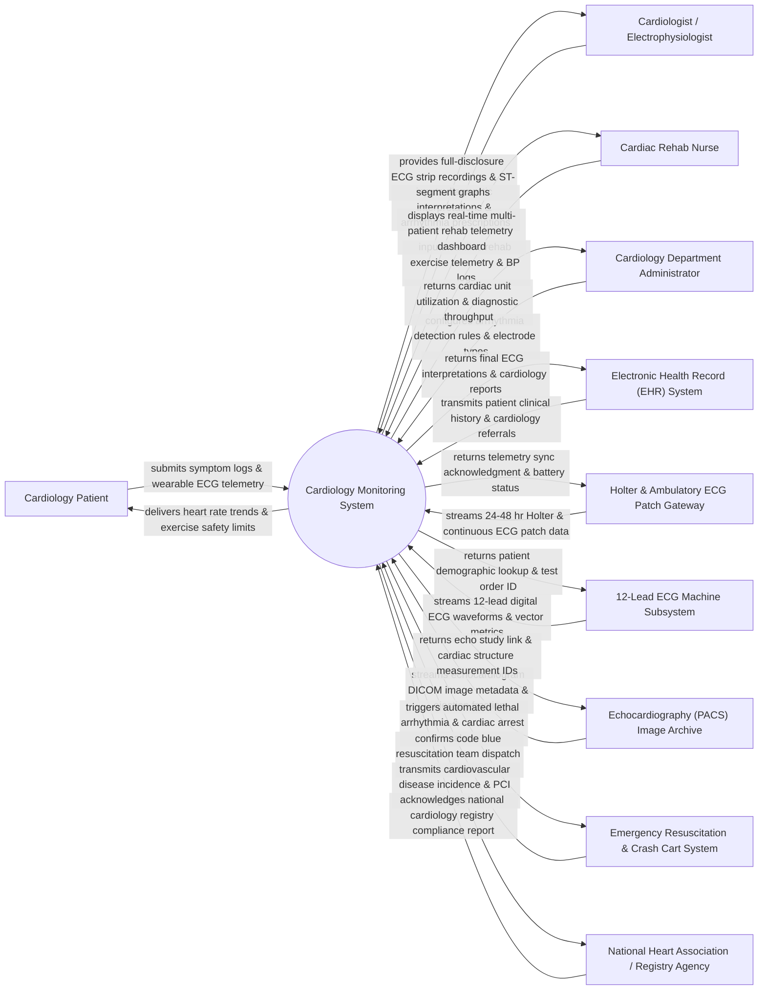

# Context Diagram — Cardiology Monitoring System

## Mermaid Code

## Actor & Interaction Table | Bảng Actor & Tương tác

| # | Actor | Actor Type | Data Sent TO System | Data Received FROM System | Notes |
|---|-------|------------|---------------------|---------------------------|-------|
| 1 | Cardiology Patient | Primary | Symptom logs (chest pain, palpitations, shortness of breath), wearable ECG patch telemetry, home BP logs. | Real-time heart rate trend visualizer, arrhythmia alert warnings, cardiac rehab exercise targets. | Patient undergoing cardiac diagnostic monitoring, Holter monitoring, or post-cardiac surgery rehabilitation. |
| 2 | Cardiologist / Electrophysiologist | Primary | Diagnostic ECG interpretations, arrhythmia classification confirmations, pacemaker parameter settings, ST-segment analysis sign-offs. | Full-disclosure 12-lead ECG waveforms, Holter summary strip reports, automated arrhythmia detection alerts, ejection fraction trends. | Medical specialist diagnosing and treating coronary artery disease, heart failure, and cardiac arrhythmias. |
| 3 | Cardiac Rehab Nurse | Primary | Exercise telemetry inputs (treadmill/stationary bike speed, RPE fatigue scale), continuous telemetry observations, post-exercise BP. | Real-time multi-patient cardiac rehab telemetry display, heart rate target zone alarms, exercise safety limits. | Nurse monitoring post-myocardial infarction or post-CABG patients during exercise rehabilitation. |
| 4 | Cardiology Department Administrator | Primary | Arrhythmia detection rule thresholds, electrode lead quality standards, device maintenance schedules, staff shift rosters. | Cardiology unit capacity metrics, ECG machine turnaround times, diagnostic procedure volume summaries. | Administrative manager overseeing cardiology lab, telemetry unit, and diagnostic equipment. |
| 5 | Electronic Health Record (EHR) System | Supporting | Patient master demographics, cardiac risk factors, past MI history, medication lists (beta-blockers, antiarrhythmics). | Finalized 12-lead ECG diagnostic reports, Holter monitoring summaries, echocardiography ejection fraction records. | Enterprise hospital EHR integrated via HL7 ORU and DICOM-SR cardiac interfaces. |
| 6 | Holter & Ambulatory ECG Patch Gateway | Supporting | Continuous 24-48 hour multi-channel ECG waveforms, patient event marker timestamps, accelerometer activity metrics. | Device sync acknowledgments, sampling rate parameters (250-1000 Hz), lead disconnect alerts. | Ambulatory Holter recorders, wearable patch sensors, and mobile cardiac telemetry (MCT) devices. |
| 7 | 12-Lead ECG Machine Subsystem | Supporting | Raw 12-lead voltage waveforms (I, II, III, aVR, aVL, aVF, V1-V6), P-QRS-T interval measurements, automated vector analysis. | Patient identity verification, active ECG order lookup, baseline ECG comparison waveforms. | Bedside or mobile 12-lead electrocardiograph machines capturing resting ECG tracings. |
| 8 | Echocardiography (PACS) Image Archive | Supporting | DICOM echocardiogram video loops, Left Ventricular Ejection Fraction (LVEF %), valve doppler velocity measurements. | Echo study linking keys, patient cardiac history cross-references, report attachment payloads. | Picture Archiving and Communication System (PACS) storing ultrasound echocardiogram studies. |
| 9 | Emergency Resuscitation & Crash Cart System | Supporting | Code Blue responder arrival timestamps, defibrillator shock energy delivered (Joules), resuscitation outcome logs. | Automated lethal arrhythmia alerts (Ventricular Fibrillation / Sustained Ventricular Tachycardia), patient location GPS. | Emergency Code Blue response system dispatched when lethal cardiac arrest arrhythmias occur. |
| 10 | National Heart Association / Registry Agency | Supporting / Regulatory | National cardiovascular data registry standards, PCI registry schemas, accreditation guidelines. | Anonymized acute coronary syndrome (ACS) outcomes, percutaneous coronary intervention (PCI) statistics, mortality rates. | National health registry tracking cardiovascular disease outcomes and interventional cardiology quality. |

## System Boundary Description | Mô tả Phạm vi Hệ thống

The **Cardiology Monitoring System (CMS)** is a high-acuity cardiovascular software platform engineered to analyze, process, and store multi-channel electrocardiography (ECG) data, Holter telemetry, echocardiogram findings, and cardiac rehabilitation progress.

**Inside System Scope:**
- Ingestion and rendering of multi-lead ECG waveforms (12-lead resting ECG, continuous 24-48 hr Holter, ambulatory ECG patches).
- Automated AI-driven arrhythmia detection (Atrial Fibrillation, PVCs, Ventricular Tachycardia, Asystole) and ST-segment elevation/depression analysis.
- Multi-patient central telemetry monitoring for cardiac intensive care and outpatient exercise rehabilitation units.
- Correlation of echocardiogram DICOM measurements (LVEF, wall motion abnormalities) with patient ECG history.
- Immediate automated Code Blue distress alert triggering upon detection of lethal cardiac arrest rhythms.
- Diagnostic report drafting, electronic signature sign-off, HL7 EHR export, and national cardiology registry reporting.

**Outside System Scope:**
- Physical hardware sensing and analog-to-digital signal conversion in ECG electrodes (handled by ECG machine hardware).
- Physical execution of cardiac catheterization or angioplasty procedures (performed in Cath Lab).
- Financial ledger posting and insurance claim generation (delegated to Patient Billing Systems).
