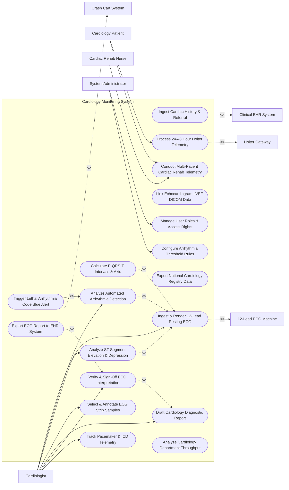

# Use Case Diagram — Cardiology Monitoring System

## Mermaid Code

## Actor Table | Bảng Actor

| # | Actor | Actor Type | Role Description | Related Use Cases |
|---|-------|------------|------------------|-------------------|
| 1 | Cardiology Patient | Primary | Patient undergoing diagnostic ECG tracings, wearing Holter monitors, or participating in rehab. | UC06, UC12 |
| 2 | Cardiologist | Primary | Specialist interpreting 12-lead ECGs, reviewing Holter scans, analyzing ST segments, and signing reports. | UC02, UC04, UC05, UC07, UC10, UC11, UC13 |
| 3 | Cardiac Rehab Nurse | Primary | Nurse monitoring live telemetry of multiple patients undergoing exercise rehabilitation. | UC12 |
| 4 | System Administrator | Primary | IT administrator configuring arrhythmia rules, user access roles, and equipment lead specifications. | UC16, UC17 |
| 5 | Clinical EHR System | System (Secondary) | Hospital EHR transferring clinical orders and receiving signed ECG reports. | UC01, UC14 |
| 6 | 12-Lead ECG Machine | System (Secondary) | Electrocardiograph device capturing resting 12-lead voltage signals and interval data. | UC02 |
| 7 | Holter Gateway | System (Secondary) | Ambulatory telemetry gateway streaming continuous 24-48 hour ECG recordings. | UC06 |
| 8 | Crash Cart System | System (Secondary) | Emergency resuscitation dispatch system alerted during lethal cardiac arrest events. | UC08 |

## Use Case Table | Bảng Use Case

| # | UC ID | Use Case Name | Primary Actor | Secondary Actor | Description | Priority |
|---|-------|---------------|---------------|-----------------|-------------|----------|
| 1 | UC01 | Ingest Cardiac History & Referral | Cardiologist | Clinical EHR | Loads patient cardiovascular risk factors, prior MI history, cardiac medications, and referral orders. | High |
| 2 | UC02 | Ingest & Render 12-Lead Resting ECG | Cardiologist | 12-Lead Machine | Captures, renders, and displays 12-lead resting electrocardiogram voltage waveforms (I, II, III, aVR, aVL, aVF, V1-V6). | High |
| 3 | UC03 | Calculate P-QRS-T Intervals & Axis | System | None | Computes heart rate, PR interval, QRS duration, QT/QTc interval, and P-QRS-T electrical frontal axes. | High |
| 4 | UC04 | Analyze Automated Arrhythmia Detection | Cardiologist | System | Analyzes ECG tracings for Atrial Fibrillation, PVCs, PACs, Bundle Branch Blocks, and Tachy/Bradyarrhythmias. | High |
| 5 | UC05 | Analyze ST-Segment Elevation & Depression | Cardiologist | System | Evaluates ST-segment deviations (STEMI / NSTEMI indicators) across all 12 leads against baseline tracings. | Critical |
| 6 | UC06 | Process 24-48 Hour Holter Telemetry | Patient | Holter Gateway | Ingests continuous ambulatory Holter ECG recordings, detects arrhythmia clusters, and isolates patient event markers. | High |
| 7 | UC07 | Select & Annotate ECG Strip Samples | Cardiologist | None | Allows cardiologist to crop, annotate, measure, and save representative 6-second ECG strip samples for report inclusion. | High |
| 8 | UC08 | Trigger Lethal Arrhythmia Code Blue Alert | System | Crash Cart System | Immediately sounds emergency alarm and dispatches Code Blue response when Ventricular Fibrillation or Asystole occurs. | Critical |
| 9 | UC09 | Link Echocardiogram LVEF DICOM Data | Cardiologist | None | Associates echocardiography Left Ventricular Ejection Fraction (LVEF %) and wall motion findings with patient ECG file. | Medium |
| 10 | UC10 | Draft Cardiology Diagnostic Report | Cardiologist | None | Compiles structured cardiology report combining automated measurements, strip samples, and clinical impression. | High |
| 11 | UC11 | Verify & Sign-Off ECG Interpretation | Cardiologist | Clinical EHR | Applies digital signature to final ECG interpretation, locking report and releasing it to central EHR. | High |
| 12 | UC12 | Conduct Multi-Patient Cardiac Rehab Telemetry | Rehab Nurse | Patient | Displays real-time multi-patient telemetry grid during exercise rehab, alerting when heart rate exceeds safe target zone. | High |
| 13 | UC13 | Track Pacemaker & ICD Telemetry | Cardiologist | None | Evaluates cardiac implantable electronic device (CIED) pacing spikes, sensing thresholds, and battery status. | Medium |
| 14 | UC14 | Export ECG Report to EHR System | System | Clinical EHR | Transmits HL7 ORU message and PDF/DICOM-SR waveform document to central hospital EHR. | High |
| 15 | UC15 | Export National Cardiology Registry Data | System | None | Aggregates anonymized acute coronary syndrome (ACS) and PCI interventional data for national registry compliance. | Medium |
| 16 | UC16 | Manage User Roles & Access Rights | Admin | None | Manages user credentials, cardiologist sign-off permissions, and telemetry unit access rights. | High |
| 17 | UC17 | Configure Arrhythmia Threshold Rules | Admin | Cardiologist | Configures heart rate limits (tachycardia > 100, bradycardia < 50), ST elevation thresholds (mm), and alarm priorities. | High |
| 18 | UC18 | Analyze Cardiology Department Throughput | System | None | Computes daily ECG procedure volumes, report turnaround times (TAT), and equipment utilization efficiency. | Medium |

## Use Case Specification | Đặc tả Use Case

---

### UC02 — Ingest & Render 12-Lead Resting ECG

| Field | Detail |
|-------|--------|
| **UC ID** | UC02 |
| **Use Case Name** | Ingest & Render 12-Lead Resting ECG |
| **Actor(s)** | Primary: Cardiologist   Secondary: 12-Lead ECG Machine |
| **Description** | Ingests digital 12-lead electrocardiogram voltage data from ECG cart, performs signal filtering, and renders standard 3x4 or 6x2 lead layout with rhythm strip. |
| **Precondition** | 1. 12-lead ECG machine is connected via network or DICOM gateway.   2. Electrodes are attached to patient limbs and chest (V1-V6). |
| **Main Flow** | 1. 12-Lead ECG Machine captures 10-second voltage sampling across all 12 leads (I, II, III, aVR, aVL, aVF, V1, V2, V3, V4, V5, V6).   2. ECG Machine transmits digital waveform payload (DICOM-Waveform or XML) to system.   3. System ingests payload, verifies patient MRN, and links tracing to active cardiology order.   4. System applies digital baseline wander filtering (0.05 Hz) and 50/60 Hz powerline notch filtering.   5. System renders interactive 12-lead display (e.g., Standard 3x4 format at 25 mm/s sweep speed and 10 mm/mV gain).   6. System displays lead Lead II rhythm strip across bottom of screen.   7. Cardiologist reviews rendered waveform, adjusts gain/sweep speed if needed, and saves tracing. |
| **Alternative Flow** | **AF1** — Historical Baseline Comparison: Cardiologist taps "Compare Prior ECG"; System displays current 12-lead tracing stacked directly above patient's baseline ECG from 6 months ago for side-by-side morphological comparison. |
| **Exception Flow** | **EX1** — Lead Disconnect / High Muscle Artifact: Lead V3 experiences loose contact; System displays yellow noise warning "Lead V3 Artifact - High Resistance" and prompts ECG technician to re-attach electrode. |
| **Postcondition** | 12-lead ECG is rendered, signal filtering is applied, and tracing is queued for interval measurement (UC03) and diagnostic interpretation. |
| **Business Rule** | **BR1**: ECG rendering must support standard calibration grids (25 mm/sec speed, 10 mm/mV amplitude) compliant with AHA/ACC standards. |

---

### UC04 — Analyze Automated Arrhythmia Detection

| Field | Detail |
|-------|--------|
| **UC ID** | UC04 |
| **Use Case Name** | Analyze Automated Arrhythmia Detection |
| **Actor(s)** | Primary: Cardiologist   Secondary: System |
| **Description** | Applies AI waveform analysis algorithms to detect cardiac arrhythmias (Atrial Fibrillation, PVCs, PACs, Heart Block, Tachy/Bradycardia) and highlights events for cardiologist confirmation. |
| **Precondition** | 1. 12-lead ECG or continuous Holter waveform is ingested in system. |
| **Main Flow** | 1. System automatically executes QRS complex detection and R-R interval variation analysis.   2. System analyzes P-wave morphology and PR intervals to evaluate AV node conduction.   3. System evaluates arrhythmia pattern algorithms:   &nbsp;&nbsp;&nbsp;&nbsp; a. Irregular R-R intervals with absent P-waves -> Flag `Atrial Fibrillation`.   &nbsp;&nbsp;&nbsp;&nbsp; b. Premature wide QRS complex (> 120 ms) -> Flag `Premature Ventricular Contraction (PVC)`.   &nbsp;&nbsp;&nbsp;&nbsp; c. Heart rate > 100 bpm with sinus P-waves -> Flag `Sinus Tachycardia`.   &nbsp;&nbsp;&nbsp;&nbsp; d. Heart rate < 50 bpm -> Flag `Sinus Bradycardia`.   4. System presents automated diagnostic statement list on cardiologist screen.   5. Cardiologist reviews flagged arrhythmia segments, accepts or modifies automated statements, and confirms diagnostic classification. |
| **Alternative Flow** | **AF1** — Paired / Couplet PVC Detection: System identifies consecutive PVCs (Bigeminy, Trigeminy, or Couplets); System calculates PVC burden percentage over 24 hours. |
| **Exception Flow** | **EX1** — High Rate False Positive: Patient movement causes rapid baseline oscillations mimicking Atrial Fibrillation; Cardiologist overrides automated statement, selects "Artifact - Sinus Rhythm", and deletes false event tag. |
| **Postcondition** | Arrhythmia events are classified, automated diagnostic statements are updated, and confirmed events are logged into cardiology report draft. |
| **Business Rule** | **BR1**: Automated arrhythmia classifications must require explicit physician verification before final report authorization. |

---

### UC06 — Process 24-48 Hour Holter Telemetry

| Field | Detail |
|-------|--------|
| **UC ID** | UC06 |
| **Use Case Name** | Process 24-48 Hour Holter Telemetry |
| **Actor(s)** | Primary: Cardiology Patient, Cardiologist   Secondary: Holter Gateway |
| **Description** | Ingests continuous multi-channel ambulatory Holter monitor ECG recordings, processes 24-48 hour R-R intervals, detects arrhythmia episodes, and correlates events with patient symptom diary logs. |
| **Precondition** | 1. Patient has completed 24-48 hour ambulatory Holter monitoring period.   2. Holter device is docked or connected via wireless gateway. |
| **Main Flow** | 1. Holter Gateway uploads full 24-48 hour continuous multi-channel ECG recording file (up to 100,000 heartbeats) to system.   2. System processes full-disclosure recording, building 24-hour heart rate trend graph (min, max, average HR).   3. System tabulates total beat counts: Normal Sinus, Supraventricular, Ventricular, and Paced beats.   4. System correlates patient physical button presses ("Symptom Event Markers") with corresponding ECG timestamp segments.   5. System generates automated Holter Summary Report highlighting worst ST-segment shifts, longest pauses (> 2.0 sec), and peak tachycardia episodes.   6. Cardiologist reviews 24-hour HR trend, inspects symptom-correlated strip samples, and writes final Holter interpretation. |
| **Alternative Flow** | **AF1** — Wireless Continuous Mobile Telemetry (MCT): Holter patch streams telemetry continuously via cellular gateway; System analyzes data in real time and alerts cardiologist immediately upon sustained arrhythmia occurrence. |
| **Exception Flow** | **EX1** — Excessive Signal Loss (> 30% Unreadable): Patient detached Holter electrodes during sleep; System flags "Inadequate Recording Duration - 34% Artifact", alerting Cardiologist to recommend repeat 24-hour monitor. |
| **Postcondition** | 24-hour Holter scan is processed, full-disclosure data is archived, and Holter summary report is generated for sign-off. |
| **Business Rule** | **BR1**: Holter summary reports must report total artifact duration and net evaluable monitoring hours. |

---

### UC08 — Trigger Lethal Arrhythmia Code Blue Alert

| Field | Detail |
|-------|--------|
| **UC ID** | UC08 |
| **Use Case Name** | Trigger Lethal Arrhythmia Code Blue Alert |
| **Actor(s)** | Primary: System   Secondary: Crash Cart System, Cardiologist, Cardiac Rehab Nurse |
| **Description** | Continuously evaluates telemetry streams for immediate life-threatening cardiac arrest rhythms (Ventricular Fibrillation, Sustained Ventricular Tachycardia, Asystole) and dispatches Code Blue alarms. |
| **Precondition** | 1. Patient is monitored via central cardiac telemetry in CCU or Rehab Unit. |
| **Main Flow** | 1. System real-time signal analysis engine detects a lethal arrhythmia pattern:   &nbsp;&nbsp;&nbsp;&nbsp; a. Chaotic unorganized ECG waveform without QRS -> `Ventricular Fibrillation (VF)`.   &nbsp;&nbsp;&nbsp;&nbsp; b. Wide QRS rate > 180 bpm lasting > 30 seconds -> `Sustained Ventricular Tachycardia (VT)`.   &nbsp;&nbsp;&nbsp;&nbsp; c. Flatline zero voltage > 4 seconds -> `Asystole / Cardiac Arrest`.   2. System immediately switches bedside and central nurse station displays to full red flashing emergency state.   3. System sounds high-decibel continuous audible Code Blue alarm siren.   4. System automatically dispatches Code Blue alert payload (Patient Name, Unit, Room/Bed Number, Arrhythmia Type) to Crash Cart System and hospital emergency pagers.   5. System locks 30 seconds of pre-event and post-event full-disclosure ECG tracing into emergency audit file for resuscitation review. |
| **Alternative Flow** | **AF1** — False Alarm Lead Disconnect Cancellation: Nurse verifies flatline is caused by detached electrode lead within 5 seconds; Nurse taps "Lead Off - False Alarm Cancel" button on central monitor, silencing alarm. |
| **Exception Flow** | **EX1** — Pager Dispatch Network Failure: Pager gateway is unresponsive; System immediately falls back to direct overhead speaker broadcast and automated SMS calls to on-duty resuscitation team phones. |
| **Postcondition** | Code Blue emergency alert is dispatched, pre-event ECG strip is locked, and emergency resuscitation workflow is activated. |
| **Business Rule** | **BR1**: Lethal arrhythmia detection (VF / Asystole) must dispatch emergency alarms within <= 3 seconds of rhythm onset. |

---

### UC12 — Conduct Multi-Patient Cardiac Rehab Telemetry

| Field | Detail |
|-------|--------|
| **UC ID** | UC12 |
| **Use Case Name** | Conduct Multi-Patient Cardiac Rehab Telemetry |
| **Actor(s)** | Primary: Cardiac Rehab Nurse   Secondary: Cardiology Patient |
| **Description** | Displays real-time multi-patient wireless telemetry grid during exercise rehabilitation sessions, monitoring heart rate response against target zones and alerting when safe thresholds are breached. |
| **Precondition** | 1. Patients are equipped with wireless cardiac rehab telemetry transmitters.   2. Individual target heart rate zones (e.g., 60-75% HR max) are configured for each patient. |
| **Main Flow** | 1. Cardiac Rehab Nurse opens "Cardiac Rehab Multi-Patient Telemetry" screen.   2. System displays grid layout showing up to 16 active patients simultaneously (live HR, ECG rhythm strip, exercise stage, target HR range).   3. Patients perform treadmill, stationary bike, or arm ergometer exercises.   4. System continuously monitors live heart rate against configured target heart rate training zone.   5. Nurse logs periodic blood pressure readings and RPE (Rating of Perceived Exertion) scale scores for each patient.   6. System highlights patient tile in green when within target HR zone.   7. Upon session completion, System calculates session mean HR, peak HR, total calorie burn, and generates Rehab Session Summary. |
| **Alternative Flow** | **AF1** — Exceeding Target Heart Rate Zone: Patient HR exceeds prescribed upper limit (e.g., HR > 140 bpm); System highlights patient tile in yellow, sounds warning chime, and prompts Nurse to instruct patient to reduce treadmill speed. |
| **Exception Flow** | **EX1** — Exercise-Induced ST Depression / Ischemia: Patient develops > 2 mm ST-segment depression during exercise; System flags "Ischemia Warning - ST Depression", Nurse immediately stops patient exercise, administers O2, and records 12-lead ECG. |
| **Postcondition** | Cardiac rehab telemetry session is completed, exercise metrics are saved, and progress summary is appended to patient rehab record. |
| **Business Rule** | **BR1**: Target heart rate training zones must be individually configured based on recent treadmill stress test results. |
