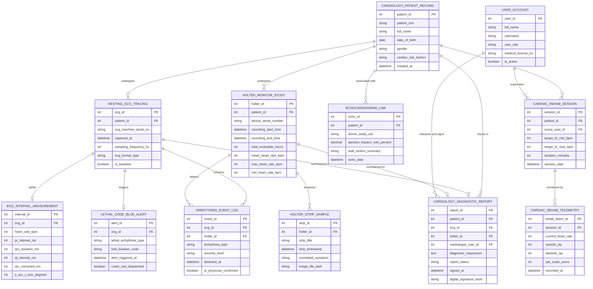

# Conceptual ERD — Cardiology Monitoring System

## Mermaid Code

## Entity Description Table | Bảng mô tả Entity

| # | Entity Name | Vietnamese Name | Description | Key Attributes | Main Relationships |
|---|-------------|-----------------|-------------|----------------|-------------------|
| 1 | USER_ACCOUNT | Tài khoản Nguời dùng | Credentials and access permissions for cardiologists, electrophysiologists, rehab nurses, and admins. | `user_id`, `username`, `user_role`, `medical_license_no` | Interprets and signs `CARDIOLOGY_DIAGNOSTIC_REPORT`, supervises `CARDIAC_REHAB_SESSION`. |
| 2 | CARDIOLOGY_PATIENT_RECORD | Hồ sơ Bệnh nhân Tim mạch | Demographics and master cardiovascular risk profile (hypertension, CAD, diabetes, smoking history). | `patient_id`, `patient_mrn`, `full_name`, `date_of_birth`, `cardiac_risk_factors` | Undergoes `RESTING_ECG_TRACING`, `HOLTER_MONITOR_STUDY`, enrolled in `CARDIAC_REHAB_SESSION`. |
| 3 | RESTING_ECG_TRACING | Dữ liệu ECG 12-Cực nghỉ | Digital 10-second voltage waveform recording captured from 12-lead electrocardiograph cart. | `ecg_id`, `patient_id`, `ecg_machine_serial_no`, `captured_at`, `is_baseline` | Belongs to `CARDIOLOGY_PATIENT_RECORD`, yields `ECG_INTERVAL_MEASUREMENT`, triggers `LETHAL_CODE_BLUE_ALERT`. |
| 4 | ECG_INTERVAL_MEASUREMENT | Đo đạc Khoảng ECG | Automated and manual P-QRS-T timing interval measurements (PR, QRS, QT, QTc) and electrical axes. | `interval_id`, `ecg_id`, `heart_rate_bpm`, `pr_interval_ms`, `qrs_duration_ms`, `qtc_corrected_ms` | Belongs to `RESTING_ECG_TRACING`. |
| 5 | ARRHYTHMIA_EVENT_LOG | Nhật ký Báo cáo Loạn nhịp | Detected cardiac arrhythmia episodes (Afib, PVCs, VT, Bradycardia) tagged with timestamp and severity. | `event_id`, `ecg_id`, `holter_id`, `arrhythmia_type`, `severity_level`, `is_physician_confirmed` | Belongs to `RESTING_ECG_TRACING` or `HOLTER_MONITOR_STUDY`. |
| 6 | HOLTER_MONITOR_STUDY | Nghiên cứu Holter 24-48 Giờ | Full 24-48 hour continuous ambulatory ECG recording metrics, HR trends, and total beat statistics. | `holter_id`, `patient_id`, `device_serial_number`, `mean_heart_rate_bpm`, `total_evaluable_hours` | Belongs to `CARDIOLOGY_PATIENT_RECORD`, produces `HOLTER_STRIP_SAMPLE`. |
| 7 | HOLTER_STRIP_SAMPLE | Mẫu Dải ECG Holter | Cropped 6-second ECG waveform strip samples illustrating key arrhythmia episodes or symptom markers. | `strip_id`, `holter_id`, `strip_title`, `strip_timestamp`, `correlated_symptom` | Belongs to `HOLTER_MONITOR_STUDY`. |
| 8 | LETHAL_CODE_BLUE_ALERT | Cảnh báo Cấp cứu Ngưng tim | Emergency resuscitation alert generated when lethal arrest rhythms (VF / Asystole) are detected. | `alert_id`, `ecg_id`, `lethal_arrhythmia_type`, `bed_location_code`, `crash_cart_dispatched` | Belongs to `RESTING_ECG_TRACING`. |
| 9 | ECHOCARDIOGRAM_LINK | Liên kết Siêu âm Tim (Echo) | Associated echocardiogram DICOM study link, LVEF ejection fraction %, and wall motion summaries. | `echo_id`, `patient_id`, `dicom_study_uid`, `ejection_fraction_lvef_percent`, `wall_motion_summary` | Belongs to `CARDIOLOGY_PATIENT_RECORD`. |
| 10 | CARDIAC_REHAB_SESSION | Buổi Tri liệu Phục hồi Tim | Exercise rehabilitation session profile defining target heart rate zones and duration. | `session_id`, `patient_id`, `nurse_user_id`, `target_hr_min_bpm`, `target_hr_max_bpm`, `session_date` | Belongs to `CARDIOLOGY_PATIENT_RECORD`, supervised by `USER_ACCOUNT`. |
| 11 | CARDIAC_REHAB_TELEMETRY | Thống kê Sinh tồn Phục hồi | Time-series telemetry logs recording live heart rate, BP, and RPE fatigue scale during exercise. | `rehab_telem_id`, `session_id`, `current_heart_rate`, `systolic_bp`, `rpe_scale_score` | Belongs to `CARDIAC_REHAB_SESSION`. |
| 12 | CARDIOLOGY_DIAGNOSTIC_REPORT | Báo cáo Chẩn đoán Tim mạch | Final signed cardiology report combining ECG tracings, Holter summaries, measurements, and impression. | `report_id`, `patient_id`, `cardiologist_user_id`, `diagnostic_impression`, `signed_at` | Belongs to `CARDIOLOGY_PATIENT_RECORD`, signed by `USER_ACCOUNT`. |

## Relationship Description | Mô tả Quan hệ

| # | From Entity | Cardinality | To Entity | Label | Business Explanation |
|---|-------------|-------------|-----------|-------|----------------------|
| 1 | CARDIOLOGY_PATIENT_RECORD | 1 to 0..N | RESTING_ECG_TRACING | undergoes | A cardiology patient undergoes resting 12-lead ECG tracings. |
| 2 | RESTING_ECG_TRACING | 1 to 0..1 | ECG_INTERVAL_MEASUREMENT | yields | A resting ECG tracing yields automated P-QRS-T interval measurements. |
| 3 | RESTING_ECG_TRACING | 1 to 0..N | ARRHYTHMIA_EVENT_LOG | contains | An ECG tracing contains detected arrhythmia event logs. |
| 4 | CARDIOLOGY_PATIENT_RECORD | 1 to 0..N | HOLTER_MONITOR_STUDY | undergoes | A patient undergoes 24-48 hour ambulatory Holter monitoring studies. |
| 5 | HOLTER_MONITOR_STUDY | 1 to 0..N | HOLTER_STRIP_SAMPLE | produces | A Holter study produces representative diagnostic ECG strip samples. |
| 6 | HOLTER_MONITOR_STUDY | 1 to 0..N | ARRHYTHMIA_EVENT_LOG | detects | A Holter study detects arrhythmia episodes across the 24-hour recording. |
| 7 | RESTING_ECG_TRACING | 1 to 0..1 | LETHAL_CODE_BLUE_ALERT | triggers | A lethal ECG waveform triggers a Code Blue resuscitation alert. |
| 8 | CARDIOLOGY_PATIENT_RECORD | 1 to 0..N | ECHOCARDIOGRAM_LINK | associated with | A patient record is associated with echocardiogram DICOM study links. |
| 9 | CARDIOLOGY_PATIENT_RECORD | 1 to 0..N | CARDIAC_REHAB_SESSION | participates in | A patient participates in exercise cardiac rehabilitation sessions. |
| 10 | CARDIAC_REHAB_SESSION | 1 to 0..N | CARDIAC_REHAB_TELEMETRY | monitored by | A cardiac rehab session is monitored by real-time exercise telemetry logs. |
| 11 | CARDIOLOGY_PATIENT_RECORD | 1 to 0..N | CARDIOLOGY_DIAGNOSTIC_REPORT | results in | A cardiology patient file yields signed cardiology diagnostic reports. |
| 12 | RESTING_ECG_TRACING | 1 to 0..1 | CARDIOLOGY_DIAGNOSTIC_REPORT | summarized in | A resting ECG tracing is summarized in a final diagnostic report. |
| 13 | HOLTER_MONITOR_STUDY | 1 to 0..1 | CARDIOLOGY_DIAGNOSTIC_REPORT | summarized in | A Holter monitoring study is summarized in a final diagnostic report. |
| 14 | USER_ACCOUNT | 1 to 0..N | CARDIOLOGY_DIAGNOSTIC_REPORT | interprets and signs | A cardiologist user account interprets and signs final diagnostic reports. |
| 15 | USER_ACCOUNT | 1 to 0..N | CARDIAC_REHAB_SESSION | supervises | A rehab nurse user account supervises cardiac rehabilitation sessions. |
