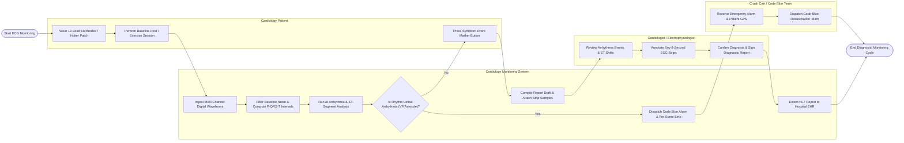

# Swimlane Diagram — Cardiology Monitoring System

## Mermaid Code

## Flow Description | Mô tả luồng

| Lane | Actor | Role in Flow |
|------|-------|-------------|
| 1 | Cardiology Patient | Wears 12-lead electrodes or ambulatory Holter patches, performs resting or exercise tests, and presses event buttons during symptom episodes. |
| 2 | Cardiology Monitoring System | Ingests multi-lead voltage signals, filters baseline noise, calculates P-QRS-T intervals, executes AI arrhythmia detection, evaluates ST elevation/depression, dispatches emergency Code Blue alerts when lethal rhythms occur, and exports HL7 reports. |
| 3 | Cardiologist / Electrophysiologist | Reviews automated arrhythmia findings, inspects ST-segment shifts, annotates representative 6-second ECG strip samples, enters diagnostic impressions, and applies digital signatures. |
| 4 | Crash Cart / Code Blue Team | Receives automated emergency alarms, location coordinates, and pre-event ECG tracings when lethal cardiac arrest rhythms occur, dispatching resuscitation teams immediately. |
