# Action Tree — Cardiology Monitoring System

## Mermaid Code

```mermaid
graph TD
    Root["Cardiology Monitoring System"]

    Root --> M1["12-Lead Resting ECG Ingestion & Analysis"]
    Root --> M2["Arrhythmia & ST-Segment Evaluation"]
    Root --> M3["Holter & Ambulatory Telemetry"]
    Root --> M4["Emergency Code Blue & Resuscitation"]
    Root --> M5["Cardiac Rehabilitation & Exercise Telemetry"]
    Root --> M6["Diagnostic Reporting & EHR Integration"]

    M1 --> A11["Ingest 12-Lead Resting Digital ECG Waveforms"]
    M1 --> A12["Apply Digital Baseline & Powerline Noise Filters"]
    M1 --> A13["Compute P-QRS-T Timing Intervals & QTc"]
    M1 --> A14["Calculate P-QRS-T Electrical Frontal Axes"]

    M2 --> A21["Detect Atrial Fibrillation & Flutter Rhythms"]
    M2 --> A22["Count PVC, PAC & Bundle Branch Block Events"]
    M2 --> A23["Analyze ST-Segment Elevation (STEMI Indicators)"]
    M2 --> A24["Select & Annotate 6-Second Diagnostic ECG Strips"]

    M3 --> A31["Process 24-48 Hour Continuous Holter Recordings"]
    M3 --> A32["Correlate Patient Symptom Markers with ECG Signals"]
    M3 --> A33["Generate 24-Hour Heart Rate Trend Graphs"]
    M3 --> A34["Track Pacemaker & ICD Pacing Spike Telemetry"]

    M4 --> A41["Detect Lethal VF, Sustained VT & Asystole Rhythms"]
    M4 --> A42["Trigger Emergency Code Blue Siren & Pager Alarms"]
    M4 --> A43["Lock Pre-Event ECG Tracing for Resuscitation Review"]
    M4 --> A44["Log Defibrillator Shock Energy & Code Outcomes"]

    M5 --> A51["Display Multi-Patient Rehab Telemetry Grid"]
    M5 --> A52["Monitor Heart Rate Against Prescribed Target Zones"]
    M5 --> A53["Log Exercise BP & RPE Fatigue Scale Scores"]
    M5 --> A54["Alert on Exercise-Induced ST-Segment Depression"]

    M6 --> A61["Draft Structured Cardiology Diagnostic Reports"]
    M6 --> A62["Apply Cryptographic Digital Report Signatures"]
    M6 --> A63["Export HL7 ORU Waveform Documents to Hospital EHR"]
    M6 --> A64["Export National ACS & PCI Cardiology Registry Data"]
```

## Module Description | Mô tả Module

| # | Module | Description | Actions |
|---|--------|-------------|---------|
| 1 | 12-Lead Resting ECG Ingestion & Analysis | Ingests digital 12-lead waveforms, applies baseline filters, calculates P-QRS-T timing intervals (PR, QRS, QT/QTc), and electrical axes. | Ingest 12-Lead Waveforms, Apply Digital Filters, Compute Timing Intervals & QTc, Calculate Electrical Axes. |
| 2 | Arrhythmia & ST-Segment Evaluation | Evaluates Atrial Fibrillation, PVC/PAC counts, bundle branch blocks, ST elevation/depression (STEMI), and crops 6-second diagnostic strip samples. | Detect Atrial Fibrillation, Count PVC/PAC Events, Analyze ST Elevation/Depression, Annotate ECG Strips. |
| 3 | Holter & Ambulatory Telemetry | Ingests 24-48 hour continuous Holter recordings, correlates patient symptom markers with ECG signals, plots 24-hr HR trends, and tracks pacemaker spikes. | Process Continuous Holter Scans, Correlate Symptom Markers, Generate 24-Hr HR Trends, Track Pacemaker Telemetry. |
| 4 | Emergency Code Blue & Resuscitation | Detects lethal cardiac arrest rhythms (VF, sustained VT, Asystole), triggers Code Blue alarms, locks pre-event ECG strips, and logs resuscitation outcomes. | Detect Lethal VF/Asystole Rhythms, Trigger Code Blue Alarms, Lock Pre-Event ECG Strips, Log Defibrillator Shocks. |
| 5 | Cardiac Rehabilitation & Exercise Telemetry | Displays multi-patient wireless telemetry grids during exercise rehab, monitors target HR zones, logs BP/RPE scores, and alerts on exercise ischemia. | Display Multi-Patient Telemetry Grid, Monitor Target HR Zones, Log BP & RPE Scores, Alert on Exercise Ischemia. |
| 6 | Diagnostic Reporting & EHR Integration | Compiles structured cardiology reports, embeds digital signatures, dispatches HL7 waveform notes to EHR, and exports national cardiology registry data. | Draft Diagnostic Reports, Apply Digital Signatures, Export HL7 Waveforms to EHR, Export Cardiology Registry Data. |
