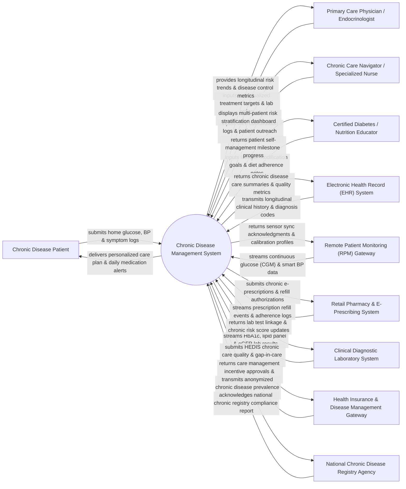

# Context Diagram — Chronic Disease Management System

## Mermaid Code

## Actor & Interaction Table | Bảng Actor & Tương tác

| # | Actor | Actor Type | Data Sent TO System | Data Received FROM System | Notes |
|---|-------|------------|---------------------|---------------------------|-------|
| 1 | Chronic Disease Patient | Primary | Home glucose readings, blood pressure logs, daily body weight, symptom assessments, dietary logs, medication compliance ticks. | Personalized care plan goals, daily medication reminders, trend charts, self-management education modules, care navigator messages. | Patient managing one or more chronic conditions (Diabetes, Hypertension, CKD, COPD, Heart Failure). |
| 2 | Primary Care Physician / Endocrinologist | Primary | Treatment target parameters (target HbA1c < 7.0%, target BP < 130/80), medication adjustment orders, clinical consult notes. | Longitudinal risk trend graphs, automated care gap alerts, remote monitoring summaries, diagnostic lab trends. | Attending physician overseeing long-term medical management and prescribing pharmacological therapies. |
| 3 | Chronic Care Navigator / Specialized Nurse | Primary | Patient phone outreach logs, social determinants of health (SDOH) assessments, care barrier notes, referral coordination. | Multi-patient risk stratification roster, missed medication alert list, overdue lab test tracking queue. | Specialized nurse providing proactive care coordination and monitoring high-risk chronic patients. |
| 4 | Certified Diabetes / Nutrition Educator | Primary | Nutritional assessment scores, carb counting goals, exercise plan targets, self-management barrier notes. | Patient dietary adherence logs, physical activity step trends, education milestone achievement reports. | Allied healthcare professional guiding lifestyle modification, nutrition, and disease self-management. |
| 5 | Electronic Health Record (EHR) System | Supporting | Chronic diagnosis codes (ICD-10 E11, I10, N18), past clinical encounter notes, active problem list, surgical history. | Updated chronic care plans, quality measure scores (HEDIS/MIPS), longitudinal lab trends, care team notes. | Main hospital or clinic EHR integrated via HL7 FHIR bi-directional care plan APIs. |
| 6 | Remote Patient Monitoring (RPM) Gateway | Supporting | Continuous Glucose Monitor (CGM) sensor streams, cellular blood pressure cuff readings, digital scale weights, pulse oximetry. | Device sync acknowledgments, target sampling intervals, patient alert notification thresholds. | IoT medical device gateway connecting cellular/Bluetooth home health sensors to the central system. |
| 7 | Retail Pharmacy & E-Prescribing System | Supporting | Prescription fill/refill timestamps, 90-day supply dispense confirmations, medication non-adherence flags. | Electronic prescription orders (e-Rx), chronic medication renewal requests, mail-order refill authorizations. | Community pharmacy networks providing prescription refill data to measure medication possession ratio (MPR). |
| 8 | Clinical Diagnostic Laboratory System | Supporting | Glycated hemoglobin (HbA1c %), lipid panel (LDL/HDL/Triglycerides), eGFR, urine albumin-to-creatinine ratio (UACR). | Lab order linkage codes, priority test requests, longitudinal laboratory trend updates. | Diagnostic laboratory system streaming routine chronic disease screening test values. |
| 9 | Health Insurance & Disease Management Gateway | Supporting | Value-based care program guidelines, HEDIS quality measure requirements, patient insurance eligibility status. | Quality measure performance scores, gap-in-care closure reports, disease management program claims. | Health insurance payer platform tracking value-based care outcomes and reimbursing care management. |
| 10 | National Chronic Disease Registry Agency | Supporting / Regulatory | Mandatory chronic disease reporting guidelines, population health benchmarks, compliance receipts. | Anonymized population prevalence statistics, diabetes control rates, hypertension control index reports. | Government public health organization tracking national chronic disease incidence and management quality. |

## System Boundary Description | Mô tả Phạm vi Hệ thống

The **Chronic Disease Management System (CDMS)** is a population health and remote care coordination platform designed to support long-term management of chronic conditions (Diabetes, Hypertension, Chronic Kidney Disease, COPD, Heart Failure).

**Inside System Scope:**
- Multi-condition patient registry management, automated risk stratification, and social determinants of health (SDOH) tracking.
- Remote Patient Monitoring (RPM) data ingestion from Continuous Glucose Monitors (CGM), smart BP cuffs, and digital scales.
- Personalized chronic care plan generation, target setting (HbA1c, BP, weight), and automated gap-in-care identification.
- Medication adherence tracking using Medication Possession Ratio (MPR) metrics and automated refill reminder dispatches.
- Interdisciplinary care team coordination (Physician, Care Navigator, Educator), patient outreach logging, and HEDIS/MIPS quality reporting.

**Outside System Scope:**
- Direct physical manufacturing of continuous glucose sensors or BP hardware (handled by medical device manufacturers).
- Direct retail sale and courier delivery of pharmaceutical drugs (performed by retail pharmacies).
- Acute emergency inpatient hospitalization care (managed by Hospital Inpatient & ICU Systems).
