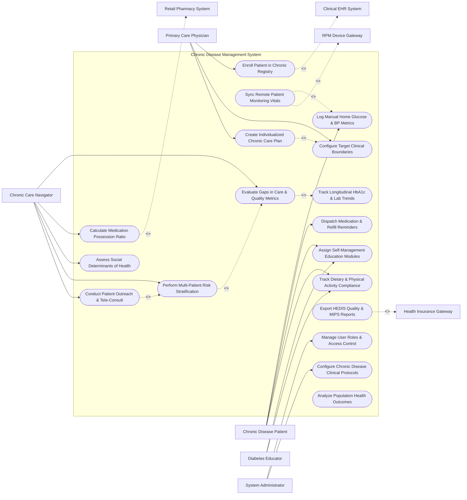

# Use Case Diagram — Chronic Disease Management System

## Mermaid Code

## Actor Table | Bảng Actor

| # | Actor | Actor Type | Role Description | Related Use Cases |
|---|-------|------------|------------------|-------------------|
| 1 | Chronic Disease Patient | Primary | Patient tracking daily home vitals, receiving care plans, adhering to medications, and completing education. | UC03, UC08, UC13, UC14 |
| 2 | Primary Care Physician | Primary | Attending doctor enrolling patients, setting target boundaries, adjusting medications, and approving care plans. | UC01, UC06, UC12 |
| 3 | Chronic Care Navigator | Primary | Specialized nurse evaluating care gaps, tracking medication adherence (MPR), risk stratifying, and conducting outreach. | UC05, UC07, UC09, UC10, UC11 |
| 4 | Diabetes Educator | Primary | Certified educator guiding lifestyle modifications, nutrition, carb counting, and self-management goals. | UC13, UC14 |
| 5 | System Administrator | Primary | IT administrator configuring user roles, clinical protocol rule sets, and security access. | UC16, UC17 |
| 6 | Clinical EHR System | System (Secondary) | Hospital EHR transferring clinical problem lists, diagnoses, and receiving chronic care summaries. | UC01 |
| 7 | RPM Device Gateway | System (Secondary) | IoT gateway streaming continuous glucose (CGM) and cellular BP cuff telemetry. | UC02 |
| 8 | Retail Pharmacy System | System (Secondary) | Pharmacy network providing 90-day refill dispense confirmations to calculate MPR. | UC07 |
| 9 | Health Insurance Gateway | System (Secondary) | Payer platform receiving HEDIS/MIPS gap closure reports and value-based care quality data. | UC15 |

## Use Case Table | Bảng Use Case

| # | UC ID | Use Case Name | Primary Actor | Secondary Actor | Description | Priority |
|---|-------|---------------|---------------|-----------------|-------------|----------|
| 1 | UC01 | Enroll Patient in Chronic Registry | PCP | Clinical EHR | Enrolls patient into disease-specific registry (Diabetes, HTN, CKD) based on ICD-10 criteria. | High |
| 2 | UC02 | Sync Remote Patient Monitoring Vitals | RPM Gateway | Patient | Automatically ingests continuous glucose (CGM), smart BP cuff, and digital weight scale telemetry. | High |
| 3 | UC03 | Log Manual Home Glucose & BP Metrics | Patient | RPM Gateway | Allows patients to manually log blood glucose levels, blood pressure readings, and symptoms. | High |
| 4 | UC04 | Track Longitudinal HbA1c & Lab Trends | Navigator | None | Aggregates and graphs historic HbA1c %, lipid panels, eGFR, and urine albumin trends over time. | High |
| 5 | UC05 | Evaluate Gaps in Care & Quality Metrics | Navigator | None | Scans patient records to identify overdue routine screenings (annual eye exam, foot exam, HbA1c). | High |
| 6 | UC06 | Configure Target Clinical Boundaries | PCP | None | Sets personalized target boundaries for patient (e.g., Target HbA1c < 7.0%, BP < 130/80 mmHg). | High |
| 7 | UC07 | Calculate Medication Possession Ratio | Navigator | Retail Pharmacy | Analyzes pharmacy fill history to calculate Medication Possession Ratio (MPR %) adherence score. | High |
| 8 | UC08 | Dispatch Medication & Refill Reminders | Patient | None | Dispatches automated mobile push alerts for daily pill doses and 90-day prescription refill warnings. | High |
| 9 | UC09 | Assess Social Determinants of Health | Navigator | None | Captures SDOH data (food insecurity, transportation access, housing stability, financial barriers). | Medium |
| 10 | UC10 | Perform Multi-Patient Risk Stratification | Navigator | None | Algorithmically categorizes chronic population into High, Moderate, and Low risk tiers based on stability. | High |
| 11 | UC11 | Conduct Patient Outreach & Tele-Consult | Navigator | None | Coordinates telephone or video check-in calls with high-risk patients to resolve care barriers. | High |
| 12 | UC12 | Create Individualized Chronic Care Plan | PCP | None | Generates comprehensive chronic care plan detailing clinical goals, medication lists, and lifestyle targets. | High |
| 13 | UC13 | Assign Self-Management Education Modules | Educator | Patient | Assigns interactive self-management education lessons (carb counting, foot care, BP tracking). | Medium |
| 14 | UC14 | Track Dietary & Physical Activity Compliance | Educator | Patient | Monitors patient self-reported daily meal logs, carbohydrate counts, and step counter activity. | Medium |
| 15 | UC15 | Export HEDIS Quality & MIPS Reports | System | Health Insurance | Compiles and exports HEDIS quality measure compliance and MIPS value-based care reporting files. | High |
| 16 | UC16 | Manage User Roles & Access Control | Admin | None | Controls user accounts, clinical role permissions, and care coordinator patient assignments. | High |
| 17 | UC17 | Configure Chronic Disease Clinical Protocols | Admin | PCP | Configures disease management guidelines, lab screening frequency rules, and clinical alert limits. | High |
| 18 | UC18 | Analyze Population Health Outcomes | System | None | Generates population-wide analytics showing % of diabetic patients with controlled HbA1c (< 8.0%). | Medium |

## Use Case Specification | Đặc tả Use Case

---

### UC02 — Sync Remote Patient Monitoring (RPM) Vitals

| Field | Detail |
|-------|--------|
| **UC ID** | UC02 |
| **Use Case Name** | Sync Remote Patient Monitoring (RPM) Vitals |
| **Actor(s)** | Primary: RPM Device Gateway   Secondary: Chronic Disease Patient |
| **Description** | Ingests, validates, and stores continuous biometric telemetry (continuous glucose CGM readings, cellular blood pressure measurements, digital weight scale values) from paired IoT home health devices. |
| **Precondition** | 1. Patient is enrolled in the Chronic Disease RPM program.   2. Cellular/Bluetooth home health device is registered to patient profile in `RPM_DEVICE_REGISTRY`. |
| **Main Flow** | 1. Patient performs home measurement (e.g., takes blood pressure using cellular BP cuff).   2. RPM Device Gateway establishes encrypted cellular connection and transmits measurement payload.   3. System ingests data, extracts timestamped values (e.g., Systolic 142, Diastolic 88 mmHg), and verifies patient ID.   4. System checks reading against physiologically valid ranges.   5. System saves reading into `RPM_VITAL_LOG` linked to patient profile.   6. System evaluates reading against patient's configured target clinical boundaries (UC06).   7. System sends confirmation acknowledgment to RPM device display and updates patient mobile app dashboard. |
| **Alternative Flow** | **AF1** — Continuous Glucose (CGM) Stream: CGM transmitter streams glucose readings every 5 minutes; System processes 288 daily readings, computes Time-in-Range (TIR 70-180 mg/dL %), and graphs daily modal glucose curve. |
| **Exception Flow** | **EX1** — Critical High / Low Glucose Alert: CGM detects glucose < 54 mg/dL (severe hypoglycemia) or > 300 mg/dL; System dispatches immediate red emergency push alert to Patient, SMS to Care Navigator, and logs urgent alert.   **EX2** — Duplicate Device Reading: Network re-transmission sends identical timestamp reading; System detects duplicate GUID, discards duplicate frame, and logs sync audit event. |
| **Postcondition** | RPM vitals are recorded, time-in-range metrics are calculated, and care navigator dashboard is updated. |
| **Business Rule** | **BR1**: Time-in-Range (TIR) for diabetic patients must be calculated as % of glucose readings between 70 mg/dL and 180 mg/dL over a 14-day window. |

---

### UC05 — Evaluate Gaps in Care & Quality Metrics

| Field | Detail |
|-------|--------|
| **UC ID** | UC05 |
| **Use Case Name** | Evaluate Gaps in Care & Quality Metrics |
| **Actor(s)** | Primary: Chronic Care Navigator   Secondary: None |
| **Description** | Scans chronic patient records against clinical practice guidelines (ADA, ACC/AHA) to identify overdue routine screenings (annual diabetic eye exam, foot exam, nephropathy screening, HbA1c test). |
| **Precondition** | 1. Patient is enrolled in a chronic disease registry (UC01). |
| **Main Flow** | 1. System background engine scans chronic patient registry records daily against clinical quality rules.   2. System evaluates screening compliance for each diabetic/hypertensive patient:   &nbsp;&nbsp;&nbsp;&nbsp; a. HbA1c lab test within last 6 months -> Checked.   &nbsp;&nbsp;&nbsp;&nbsp; b. Dilated retinal eye exam within last 12 months -> Missing (Gap identified).   &nbsp;&nbsp;&nbsp;&nbsp; c. Comprehensive diabetic foot exam within last 12 months -> Checked.   &nbsp;&nbsp;&nbsp;&nbsp; d. Urine albumin-to-creatinine ratio (UACR) within last 12 months -> Missing (Gap identified).   3. System generates a `GAP_IN_CARE` record for each missing screening.   4. Care Navigator opens "Gaps in Care" worklist and views flagged patient list sorted by gap urgency.   5. Care Navigator selects patient and clicks "Schedule Outstanding Screenings" to issue lab requisitions or eye exam referrals. |
| **Alternative Flow** | **AF1** — External Record Ingest: Patient completed eye exam at external clinic; Care Navigator uploads external report file, System resolves gap, and updates HEDIS compliance score. |
| **Exception Flow** | **EX1** — Screening Refused / Contraindicated: Patient refuses foot exam; Navigator enters refusal code "Patient Declined", System flags gap as `PATIENT_EXCEPTION`, and suppresses alert for 6 months. |
| **Postcondition** | Care gaps are identified, navigator worklist is populated, and quality screening orders are dispatched. |
| **Business Rule** | **BR1**: Diabetic care gap evaluation must align strictly with National Committee for Quality Assurance (NCQA) HEDIS quality measure definitions. |

---

### UC07 — Calculate Medication Possession Ratio (MPR)

| Field | Detail |
|-------|--------|
| **UC ID** | UC07 |
| **Use Case Name** | Calculate Medication Possession Ratio (MPR) |
| **Actor(s)** | Primary: Chronic Care Navigator   Secondary: Retail Pharmacy System |
| **Description** | Analyzes electronic pharmacy dispense confirmations over a 180-day window to calculate the Medication Possession Ratio (MPR %) adherence metric for chronic medications (statins, ACE inhibitors, insulin). |
| **Precondition** | 1. Patient has active chronic prescriptions registered in system.   2. Retail Pharmacy System streams dispense data via e-prescribing network. |
| **Main Flow** | 1. System receives 90-day prescription refill dispense confirmation payloads from Retail Pharmacy System.   2. System fetches all fill dates and days-supply values (e.g., 90-day supply of Lisinopril 20mg filled on Jan 1, Apr 5).   3. System calculates total days of medication supplied during target observation period (e.g., 180 days).   4. System computes Medication Possession Ratio formula:   &nbsp;&nbsp;&nbsp;&nbsp; `MPR = (Total Days Supply Delivered / Total Days in Period) * 100%`.   5. System evaluates MPR score against adherence benchmark:   &nbsp;&nbsp;&nbsp;&nbsp; a. MPR >= 80% -> High Adherence (Green).   &nbsp;&nbsp;&nbsp;&nbsp; b. MPR 50-79% -> Moderate Non-Adherence (Yellow).   &nbsp;&nbsp;&nbsp;&nbsp; c. MPR < 50% -> Severe Non-Adherence (Red).   6. System saves MPR calculation into `MEDICATION_ADHERENCE_LOG`.   7. If MPR < 80%, System triggers "Medication Non-Adherence Warning" on Care Navigator dashboard. |
| **Alternative Flow** | **AF1** — Mail-Order 90-Day Auto-Fill: Patient receives 90-day mail-order shipments; System calculates 100% MPR adherence and updates patient adherence reward points. |
| **Exception Flow** | **EX1** — Physician Medication Discontinuation: Physician stopped drug mid-period; Navigator logs "Discontinued by Physician", System excludes drug from MPR calculation to prevent false non-adherence flagging. |
| **Postcondition** | MPR adherence % is calculated, adherence color indicator is updated, and outreach alerts are queued for non-compliant patients. |
| **Business Rule** | **BR1**: MPR < 80% must be flagged as clinically non-adherent for chronic cardiovascular and diabetes maintenance medications. |

---

### UC10 — Perform Multi-Patient Risk Stratification

| Field | Detail |
|-------|--------|
| **UC ID** | UC10 |
| **Use Case Name** | Perform Multi-Patient Risk Stratification |
| **Actor(s)** | Primary: Chronic Care Navigator   Secondary: None |
| **Description** | Algorithmically analyzes clinical stability, lab values (HbA1c, eGFR), RPM telemetry, hospital readmissions, and SDOH barriers to stratify the chronic population into High, Moderate, and Low risk tiers. |
| **Precondition** | 1. Chronic disease patient registry is populated with active patient data (UC01). |
| **Main Flow** | 1. System risk engine executes automated stratification algorithm across all registered chronic patients every 24 hours.   2. System evaluates risk vector components for each patient:   &nbsp;&nbsp;&nbsp;&nbsp; a. Clinical Risk: HbA1c > 9.0%, BP > 160/100, eGFR declining < 30 mL/min.   &nbsp;&nbsp;&nbsp;&nbsp; b. Utilization Risk: >= 2 ED visits or hospital admissions in last 6 months.   &nbsp;&nbsp;&nbsp;&nbsp; c. Adherence Risk: MPR < 60% (UC07).   &nbsp;&nbsp;&nbsp;&nbsp; d. RPM Telemetry Risk: Time-in-Range < 50% or frequent hypoglycemic episodes (UC02).   3. System computes composite Risk Score (0-100 scale).   4. System assigns Risk Tier:   &nbsp;&nbsp;&nbsp;&nbsp; a. Tier 1 (High Risk / Complex): Score 70-100 -> Intensive Care Navigation.   &nbsp;&nbsp;&nbsp;&nbsp; b. Tier 2 (Moderate Risk / Rising): Score 40-69 -> Targeted Care Coordination.   &nbsp;&nbsp;&nbsp;&nbsp; c. Tier 3 (Low Risk / Stable): Score 0-39 -> Routine Self-Management.   5. System updates risk tier badges on Care Navigator population dashboard.   6. Care Navigator filters worklist by "High Risk Tier" to prioritize daily outreach calls. |
| **Alternative Flow** | **AF1** — Manual Risk Override: Physician or Navigator identifies severe social isolation; User manually elevates patient risk tier from Moderate to High and adds clinical justification notes. |
| **Exception Flow** | **EX1** — Sudden Acute Escalation: Patient discharged from ICU following DKA (Diabetic Ketoacidosis); System instantly escalates patient risk tier to High Risk Tier 1 without waiting for nightly batch execution. |
| **Postcondition** | Patient risk scores and risk tiers are updated, and care navigator worklists are reprioritized. |
| **Business Rule** | **BR1**: Patients with HbA1c > 9.0% or >= 2 hospital readmissions in 6 months must automatically default to High Risk Tier 1. |

---

### UC12 — Create Individualized Chronic Care Plan

| Field | Detail |
|-------|--------|
| **UC ID** | UC12 |
| **Use Case Name** | Create Individualized Chronic Care Plan |
| **Actor(s)** | Primary: Primary Care Physician   Secondary: Chronic Care Navigator, Patient |
| **Description** | Generates a comprehensive, patient-centered chronic care plan detailing clinical treatment goals, medication regimens, lifestyle targets, self-management instructions, and care team roles. |
| **Precondition** | 1. Patient is enrolled in chronic disease management program (UC01).   2. Baseline clinical evaluation, lab results, and risk stratification are completed. |
| **Main Flow** | 1. Physician opens "Care Plan Generator" for target patient.   2. System pre-populates care plan with patient active problem list (e.g., Type 2 Diabetes, Essential Hypertension).   3. Physician sets SMART clinical goals (e.g., Reduce HbA1c from 8.8% to < 7.2% in 6 months; Reduce BP to < 130/80 mmHg).   4. Physician confirms medication regimen (e.g., Metformin 1000mg BID, Empagliflozin 10mg daily, Lisinopril 20mg daily).   5. Physician specifies RPM monitoring frequency (e.g., Test blood glucose twice daily fasting and post-prandial; Check BP daily).   6. Physician incorporates self-management lifestyle targets (e.g., Low-sodium DASH diet < 2000mg/day, Walk 30 mins 5x/week).   7. Physician assigns care team roles (PCP, Care Navigator, Diabetes Educator).   8. Physician signs care plan; System publishes plan to Patient Portal mobile app and exports copy to hospital EHR. |
| **Alternative Flow** | **AF1** — Care Plan Update / Revision: Care Navigator reviews care plan during 3-month follow-up; Navigator updates goal progress, adjusts lifestyle targets, and sends plan revision to PCP for sign-off. |
| **Exception Flow** | **EX1** — Conflicting Clinical Goals: Patient has concurrent CKD Stage 4 and HTN; System alerts "ACE Inhibitor Monitoring Needed: Check Serum Potassium in 2 Weeks" and embeds mandatory lab follow-up goal into care plan. |
| **Postcondition** | Individualized chronic care plan is created, signed, published to patient portal, and synchronized with central EHR. |
| **Business Rule** | **BR1**: Chronic care plans must be reviewed and updated by the care team at least once every 6 months per CMS Chronic Care Management (CCM) guidelines. |
