# Conceptual ERD — Chronic Disease Management System

## Mermaid Code

```mermaid
erDiagram
    USER_ACCOUNT {
        int user_id PK
        string full_name
        string username
        string user_role
        string medical_license_no
        boolean is_active
    }

    CHRONIC_PATIENT_REGISTRY {
        int registry_id PK
        string patient_mrn
        string full_name
        date date_of_birth
        string gender
        string primary_chronic_condition
        string secondary_conditions
        datetime enrolled_at
    }

    RPM_DEVICE_REGISTRY {
        int device_id PK
        int registry_id FK
        string device_type
        string mac_address
        string serial_number
        datetime registered_at
        datetime last_synced_at
    }

    RPM_VITAL_LOG {
        int vital_log_id PK
        int registry_id FK
        int device_id FK
        string metric_type
        decimal metric_value
        string metric_unit
        boolean is_out_of_bounds
        datetime recorded_at
    }

    LABORATORY_TREND_RECORD {
        int lab_trend_id PK
        int registry_id FK
        decimal hba1c_percent
        int fasting_glucose_mg_dl
        int ldl_cholesterol_mg_dl
        decimal egfr_ml_min
        decimal uacr_mg_g
        datetime test_date
    }

    CARE_GAP_ENTRY {
        int gap_id PK
        int registry_id FK
        string gap_type
        string hediss_measure_code
        string gap_status
        date identified_date
        date target_closure_date
    }

    MEDICATION_ADHERENCE_LOG {
        int adherence_id PK
        int registry_id FK
        string medication_name
        int days_supply_dispensed
        decimal mpr_adherence_percent
        string adherence_tier
        datetime calculated_at
    }

    SDOH_ASSESSMENT {
        int sdoh_id PK
        int registry_id FK
        int assessed_by_user_id FK
        string food_insecurity_level
        string transportation_access
        string housing_stability
        string financial_strain
        datetime assessed_at
    }

    PATIENT_RISK_STRATIFICATION {
        int risk_id PK
        int registry_id FK
        int composite_risk_score
        string risk_tier
        string primary_risk_driver
        datetime evaluated_at
    }

    CHRONIC_CARE_PLAN {
        int plan_id PK
        int registry_id FK
        int author_physician_user_id FK
        decimal target_hba1c_percent
        string target_bp_mmHg
        text lifestyle_goals
        date start_date
        date review_due_date
        string plan_status
    }

    EDUCATION_LESSON_ASSIGNMENT {
        int lesson_id PK
        int registry_id FK
        string lesson_title
        string category
        decimal completion_progress_percent
        date assigned_date
        date completed_date
    }

    HEDIS_QUALITY_REPORT {
        int report_id PK
        string quality_measure_name
        int total_eligible_population
        int compliant_population
        decimal compliance_rate_percent
        datetime generated_at
    }

    CHRONIC_PATIENT_REGISTRY ||--o{ RPM_DEVICE_REGISTRY : "pairs"
    CHRONIC_PATIENT_REGISTRY ||--o{ RPM_VITAL_LOG : "monitored via"
    RPM_DEVICE_REGISTRY ||--o{ RPM_VITAL_LOG : "transmits"
    CHRONIC_PATIENT_REGISTRY ||--o{ LABORATORY_TREND_RECORD : "tracks"
    CHRONIC_PATIENT_REGISTRY ||--o{ CARE_GAP_ENTRY : "evaluated for"
    CHRONIC_PATIENT_REGISTRY ||--o{ MEDICATION_ADHERENCE_LOG : "measured for"
    CHRONIC_PATIENT_REGISTRY ||--o{ SDOH_ASSESSMENT : "assessed for"
    CHRONIC_PATIENT_REGISTRY ||--o{ PATIENT_RISK_STRATIFICATION : "stratified via"
    CHRONIC_PATIENT_REGISTRY ||--o{ CHRONIC_CARE_PLAN : "enrolled in"
    CHRONIC_PATIENT_REGISTRY ||--o{ EDUCATION_LESSON_ASSIGNMENT : "completes"
    USER_ACCOUNT ||--o{ CHRONIC_CARE_PLAN : "authors"
    USER_ACCOUNT ||--o{ SDOH_ASSESSMENT : "evaluates"
    USER_ACCOUNT ||--o{ CARE_GAP_ENTRY : "resolves"
```

## Entity Description Table | Bảng mô tả Entity

| # | Entity Name | Vietnamese Name | Description | Key Attributes | Main Relationships |
|---|-------------|-----------------|-------------|----------------|-------------------|
| 1 | USER_ACCOUNT | Tài khoản Nguời dùng | System user credentials and access roles for PCPs, endocrinologists, care navigators, and educators. | `user_id`, `username`, `user_role`, `medical_license_no` | Authors `CHRONIC_CARE_PLAN`, evaluates `SDOH_ASSESSMENT`, resolves `CARE_GAP_ENTRY`. |
| 2 | CHRONIC_PATIENT_REGISTRY | Sổ Quản lý Bệnh Mạn tính | Central registry tracking chronic disease patients, primary diagnosis (Diabetes, HTN, CKD), and enrolment date. | `registry_id`, `patient_mrn`, `full_name`, `primary_chronic_condition`, `enrolled_at` | Pairs `RPM_DEVICE_REGISTRY`, enrolled in `CHRONIC_CARE_PLAN`, stratified via `PATIENT_RISK_STRATIFICATION`. |
| 3 | RPM_DEVICE_REGISTRY | Sổ Thiết bị Đo Từ xa | Pairings of home cellular/Bluetooth devices (CGM, smart BP cuffs, scales) assigned to chronic patients. | `device_id`, `registry_id`, `device_type`, `mac_address`, `last_synced_at` | Belongs to `CHRONIC_PATIENT_REGISTRY`, transmits `RPM_VITAL_LOG`. |
| 4 | RPM_VITAL_LOG | Nhật ký Sinh tồn Từ xa | Continuous blood glucose, blood pressure, and weight telemetry logs ingested from home health devices. | `vital_log_id`, `registry_id`, `device_id`, `metric_type`, `metric_value`, `is_out_of_bounds` | Belongs to `CHRONIC_PATIENT_REGISTRY` and `RPM_DEVICE_REGISTRY`. |
| 5 | LABORATORY_TREND_RECORD | Nhật ký Xét nghiệm Dài hạn | Historic lab test values (HbA1c %, fasting glucose, lipid panel, eGFR, UACR) tracked over time. | `lab_trend_id`, `registry_id`, `hba1c_percent`, `fasting_glucose_mg_dl`, `egfr_ml_min`, `test_date` | Belongs to `CHRONIC_PATIENT_REGISTRY`. |
| 6 | CARE_GAP_ENTRY | Mục Lỗ hổng Chăm sóc | Overdue routine screening items (annual eye exam, foot exam, nephropathy test, HbA1c) identified by system. | `gap_id`, `registry_id`, `gap_type`, `hedis_measure_code`, `gap_status`, `target_closure_date` | Belongs to `CHRONIC_PATIENT_REGISTRY`, resolved by `USER_ACCOUNT`. |
| 7 | MEDICATION_ADHERENCE_LOG | Nhật ký Tuân thủ Thuốc | Calculated Medication Possession Ratio (MPR %) metrics evaluating 180-day prescription refill compliance. | `adherence_id`, `registry_id`, `medication_name`, `days_supply_dispensed`, `mpr_adherence_percent` | Belongs to `CHRONIC_PATIENT_REGISTRY`. |
| 8 | SDOH_ASSESSMENT | Đánh giá Yếu tố Xã hội | Social Determinants of Health screening data (food security, transportation, housing stability, financial strain). | `sdoh_id`, `registry_id`, `assessed_by_user_id`, `food_insecurity_level`, `transportation_access` | Belongs to `CHRONIC_PATIENT_REGISTRY`, evaluated by `USER_ACCOUNT`. |
| 9 | PATIENT_RISK_STRATIFICATION | Phân tầng Rủi ro Bệnh nhân | Composite population health risk scores (0-100) and risk tier assignments (High, Moderate, Low Risk). | `risk_id`, `registry_id`, `composite_risk_score`, `risk_tier`, `primary_risk_driver` | Belongs to `CHRONIC_PATIENT_REGISTRY`. |
| 10 | CHRONIC_CARE_PLAN | Kế hoạch Chăm sóc Mạn tính | Comprehensive patient-centered care plan detailing clinical target goals (HbA1c, BP), medications, and lifestyle rules. | `plan_id`, `registry_id`, `author_physician_user_id`, `target_hba1c_percent`, `target_bp_mmHg`, `plan_status` | Belongs to `CHRONIC_PATIENT_REGISTRY`, authored by `USER_ACCOUNT`. |
| 11 | EDUCATION_LESSON_ASSIGNMENT | Bài học Tự Quản lý | Assigned digital self-management education lessons, nutrition tutorials, and completion progress %. | `lesson_id`, `registry_id`, `lesson_title`, `completion_progress_percent`, `assigned_date` | Belongs to `CHRONIC_PATIENT_REGISTRY`. |
| 12 | HEDIS_QUALITY_REPORT | Báo cáo Chất lượng HEDIS | Population-wide HEDIS and MIPS value-based care quality compliance metrics exported for insurance payers. | `report_id`, `quality_measure_name`, `total_eligible_population`, `compliant_population`, `compliance_rate_percent` | Standalone analytical entity. |

## Relationship Description | Mô tả Quan hệ

| # | From Entity | Cardinality | To Entity | Label | Business Explanation |
|---|-------------|-------------|-----------|-------|----------------------|
| 1 | CHRONIC_PATIENT_REGISTRY | 1 to 0..N | RPM_DEVICE_REGISTRY | pairs | A chronic patient registry entry pairs with multiple home RPM devices. |
| 2 | CHRONIC_PATIENT_REGISTRY | 1 to 0..N | RPM_VITAL_LOG | monitored via | A patient registry entry is monitored via continuous home RPM vital logs. |
| 3 | RPM_DEVICE_REGISTRY | 1 to 0..N | RPM_VITAL_LOG | transmits | An RPM device transmits continuous vital telemetry logs. |
| 4 | CHRONIC_PATIENT_REGISTRY | 1 to 0..N | LABORATORY_TREND_RECORD | tracks | A patient registry entry tracks historic laboratory trend records. |
| 5 | CHRONIC_PATIENT_REGISTRY | 1 to 0..N | CARE_GAP_ENTRY | evaluated for | A patient registry entry is evaluated for routine clinical care gaps. |
| 6 | CHRONIC_PATIENT_REGISTRY | 1 to 0..N | MEDICATION_ADHERENCE_LOG | measured for | A patient registry entry is measured for medication refill adherence (MPR). |
| 7 | CHRONIC_PATIENT_REGISTRY | 1 to 0..N | SDOH_ASSESSMENT | assessed for | A patient registry entry is assessed for social determinants of health barriers. |
| 8 | CHRONIC_PATIENT_REGISTRY | 1 to 0..N | PATIENT_RISK_STRATIFICATION | stratified via | A patient registry entry is stratified via composite population health risk scores. |
| 9 | CHRONIC_PATIENT_REGISTRY | 1 to 0..N | CHRONIC_CARE_PLAN | enrolled in | A patient registry entry is enrolled in individualized chronic care plans. |
| 10 | CHRONIC_PATIENT_REGISTRY | 1 to 0..N | EDUCATION_LESSON_ASSIGNMENT | completes | A patient registry entry completes assigned self-management education lessons. |
| 11 | USER_ACCOUNT | 1 to 0..N | CHRONIC_CARE_PLAN | authors | A physician user account authors chronic care plans. |
| 12 | USER_ACCOUNT | 1 to 0..N | SDOH_ASSESSMENT | evaluates | A care navigator user account evaluates SDOH assessment barriers. |
| 13 | USER_ACCOUNT | 1 to 0..N | CARE_GAP_ENTRY | resolves | A care navigator user account resolves clinical gaps in care. |
