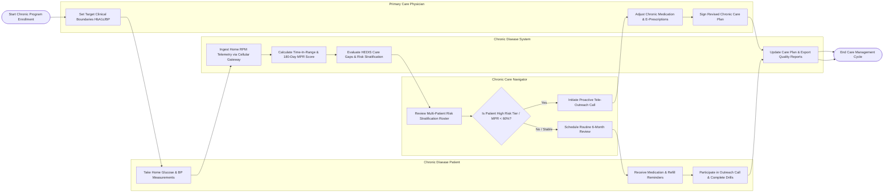

# Swimlane Diagram — Chronic Disease Management System

## Mermaid Code

## Flow Description | Mô tả luồng

| Lane | Actor | Role in Flow |
|------|-------|-------------|
| 1 | Chronic Disease Patient | Performs daily home health measurements (glucose, BP), receives automated medication/refill alarms, participates in outreach calls, and completes self-management exercises. |
| 2 | Chronic Care Navigator | Reviews daily multi-patient risk stratification rosters, identifies high-risk non-adherent patients, conducts proactive tele-outreach calls, and coordinates gap closure. |
| 3 | Chronic Disease System | Ingests home RPM device telemetry, calculates continuous Time-in-Range (TIR) and Medication Possession Ratio (MPR %), evaluates HEDIS care gaps, computes risk tiers, and exports quality reports. |
| 4 | Primary Care Physician | Establishes clinical target boundaries (HbA1c, BP), adjusts chronic medication dosages, issues e-prescriptions, and authorizes revised chronic care plans. |
