# Action Tree — Chronic Disease Management System

## Mermaid Code

```mermaid
graph TD
    Root["Chronic Disease Management System"]

    Root --> M1["Chronic Patient Registry & Enrollment"]
    Root --> M2["Remote Patient Monitoring (RPM) Telemetry"]
    Root --> M3["Gaps in Care & Quality Surveillance"]
    Root --> M4["Medication Adherence & Pharmacy Integration"]
    Root --> M5["Population Risk Stratification & Outreach"]
    Root --> M6["Care Planning, HEDIS & Payer Analytics"]

    M1 --> A11["Enroll Patients into Disease Registries"]
    M1 --> A12["Ingest Clinical Diagnoses from EHR"]
    M1 --> A13["Assess Social Determinants of Health (SDOH)"]
    M1 --> A14["Maintain Interdisciplinary Care Team Roster"]

    M2 --> A21["Ingest Continuous Glucose (CGM) Streams"]
    M2 --> A22["Process Cellular BP & Scale Weight Data"]
    M2 --> A23["Calculate Glucose Time-in-Range (TIR %)"]
    M2 --> A24["Trigger Critical Out-of-Bounds Vitals Alerts"]

    M3 --> A31["Scan Overdue Annual Retinal Eye Exams"]
    M3 --> A32["Track Diabetic Foot & Nephropathy Screenings"]
    M3 --> A33["Monitor Longitudinal HbA1c & Lipid Trends"]
    M3 --> A34["Generate Ward & Clinic Care Gap Worklists"]

    M4 --> A41["Ingest Pharmacy 90-Day Dispense Confirmation"]
    M4 --> A42["Calculate Medication Possession Ratio (MPR %)"]
    M4 --> A43["Dispatch Mobile App Dose & Refill Reminders"]
    M4 --> A44["Flag Chronic Medication Non-Adherence Warnings"]

    M5 --> A51["Execute Automated Population Risk Stratification"]
    M5 --> A52["Categorize Population into High/Mod/Low Tiers"]
    M5 --> A53["Log Nurse Care Coordinator Tele-Outreach Calls"]
    M5 --> A54["Coordinate Community Resource SDOH Referrals"]

    M6 --> A61["Generate Individualized Chronic Care Plans"]
    M6 --> A62["Assign Digital Self-Management Education Modules"]
    M6 --> A63["Export HEDIS Quality & MIPS Performance Reports"]
    M6 --> A64["Analyze Population-Wide Chronic Disease Outcomes"]
```

## Module Description | Mô tả Module

| # | Module | Description | Actions |
|---|--------|-------------|---------|
| 1 | Chronic Patient Registry & Enrollment | Manages disease-specific registry enrollment (Diabetes, HTN, CKD), ingests EHR diagnoses, tracks SDOH barriers, and maintains care team rosters. | Enroll Patients in Registries, Ingest Diagnoses from EHR, Assess SDOH Barriers, Maintain Care Team Rosters. |
| 2 | Remote Patient Monitoring (RPM) Telemetry | Ingests home health device telemetry (CGM, smart BP cuffs, scales), calculates Time-in-Range (TIR %), and triggers critical out-of-bounds alerts. | Ingest CGM Streams, Process Cellular BP Data, Calculate Time-in-Range, Trigger Out-of-Bounds Alerts. |
| 3 | Gaps in Care & Quality Surveillance | Scans patient files to identify missing routine screenings (retinal eye exams, foot exams, lab tests) and generates gap worklists for care coordinators. | Scan Overdue Eye Exams, Track Foot Screenings, Monitor Lab Trends, Generate Care Gap Worklists. |
| 4 | Medication Adherence & Pharmacy Integration | Ingests pharmacy dispense records, calculates Medication Possession Ratio (MPR %), dispatches dose/refill alarms, and flags non-adherent patients. | Ingest Pharmacy Dispense Data, Calculate MPR %, Dispatch Refill Reminders, Flag Non-Adherence Warnings. |
| 5 | Population Risk Stratification & Outreach | Stratifies chronic population into High, Moderate, and Low risk tiers based on clinical stability, and logs nurse tele-outreach care calls. | Execute Risk Stratification, Categorize Risk Tiers, Log Tele-Outreach Calls, Coordinate SDOH Referrals. |
| 6 | Care Planning, HEDIS & Payer Analytics | Generates patient-centered chronic care plans, assigns education modules, exports HEDIS quality measure files, and tracks population health outcomes. | Generate Chronic Care Plans, Assign Education Modules, Export HEDIS/MIPS Reports, Analyze Population Outcomes. |
