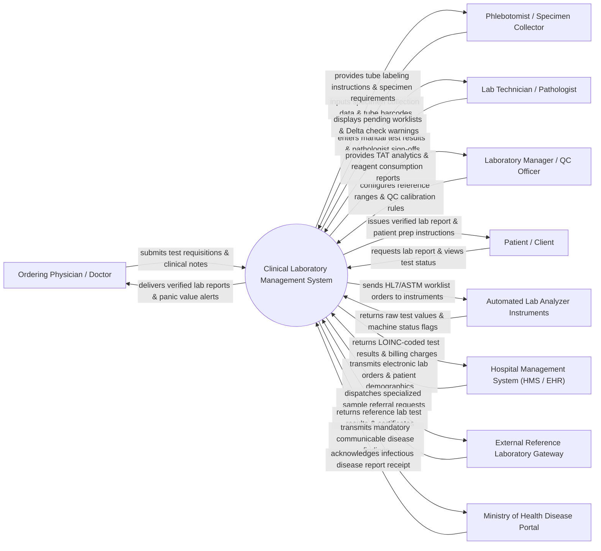

# Context Diagram — Clinical Laboratory Management System

## Mermaid Code

## Actor & Interaction Table | Bảng Actor & Tương tác

| # | Actor | Actor Type | Data Sent TO System | Data Received FROM System | Notes |
|---|-------|------------|---------------------|---------------------------|-------|
| 1 | Ordering Physician / Doctor | Primary | Electronic test requisitions, ICD-10 diagnostic codes, urgency flags (STAT/Routine), clinical indications. | Final verified lab diagnostic reports, critical panic value phone alerts, longitudinal trend charts. | Medical practitioner requesting lab testing and receiving diagnostic results. |
| 2 | Phlebotomist / Specimen Collector | Primary | Specimen collection timestamps, sample volume, tube barcode scans, collection site notes. | Specimen tube selection guide (EDTA, Serum, Heparin), barcode label payloads, draw instructions. | Clinical staff drawing blood, urine, or tissue samples and attaching barcode labels. |
| 3 | Lab Technician / Pathologist | Primary | Manual test result entries, result overrides, clinical interpretation notes, digital signatures. | Pending worklists, Delta check variance alerts, instrument status flags, quality control warnings. | Certified laboratory professional performing testing, reviewing results, and validating reports. |
| 4 | Laboratory Manager / QC Officer | Primary | Master test catalog setup, reference ranges, Levey-Jennings QC rules, reagent thresholds. | Turnaround time (TAT) performance analytics, reagent stockout alerts, Westgard QC rule violations. | Supervisor managing laboratory quality assurance, staffing, equipment, and regulatory compliance. |
| 5 | Patient / Client | Primary | Identity confirmation, online report lookup requests, self-reported fasting status. | Verified PDF lab reports, preparation instructions (e.g., fasting requirements), status updates. | Individual subject receiving laboratory diagnostic testing services. |
| 6 | Automated Lab Analyzer Instruments | Supporting | Raw numerical/qualitative test results, flag warnings (hemolysis, icterus, lipemia), instrument error codes. | HL7/ASTM worklist orders, test parameter mappings, sample barcode identifiers. | Automated chemistry, hematology, immunology, and microbiology analyzer machines (Roche, Abbott, Sysmex). |
| 7 | Hospital Management System (HMS / EHR) | Supporting | Patient Master Index (MPI) demographics, encounter IDs, electronic lab requisitions. | LOINC-coded test results, final PDF diagnostic reports, billable lab service charge codes. | Enterprise hospital administrative system ordering laboratory tests and displaying final results. |
| 8 | External Reference Laboratory Gateway | Supporting | Reference lab result payloads, test certificates, referral service pricing. | Sample dispatch manifests, referred specimen barcodes, specialized test requisitions. | External specialized commercial or university laboratories handling rare or complex genetic/pathology tests. |
| 9 | Ministry of Health Disease Portal | Regulatory | Mandatory disease tracking guidelines, public health reporting schemas. | Notifiable infectious disease reports (COVID-19, Tuberculosis, Dengue, HIV), national disease trends. | Governmental health authority receiving automated surveillance reports for infectious disease outbreaks. |

## System Boundary Description | Mô tả Phạm vi Hệ thống

The **Clinical Laboratory Management System (LIS / LIMS)** is a specialized medical software platform governing the complete laboratory testing workflow across pre-analytical, analytical, and post-analytical phases.

**Inside System Scope:**
- Electronic order entry management, specimen collection tracking, barcode labeling, and accessioning.
- Bi-directional interfacing with automated laboratory analyzers via HL7/ASTM communication protocols.
- Automated result parsing, reference range validation, Delta checking (historical variance check), and auto-verification.
- Critical panic value flagging, automated clinician alert dispatches, and Westgard quality control (QC) tracking.
- Pathologist digital sign-off, LOINC-coded diagnostic report generation, and automated integration with HMS/EHR.
- Reagent inventory management, lot expiration tracking, instrument calibration logs, and Turnaround Time (TAT) analytics.

**Outside System Scope:**
- Physical specimen collection execution and manual centrifuge/pipetting handling.
- Internal mechanical hardware calibration and fluidic maintenance of analyzer machines.
- Final clinical medical diagnosis formulation (delegated to ordering physicians).
- Patient cashier billing and financial accounting (delegated to Hospital Billing systems).
