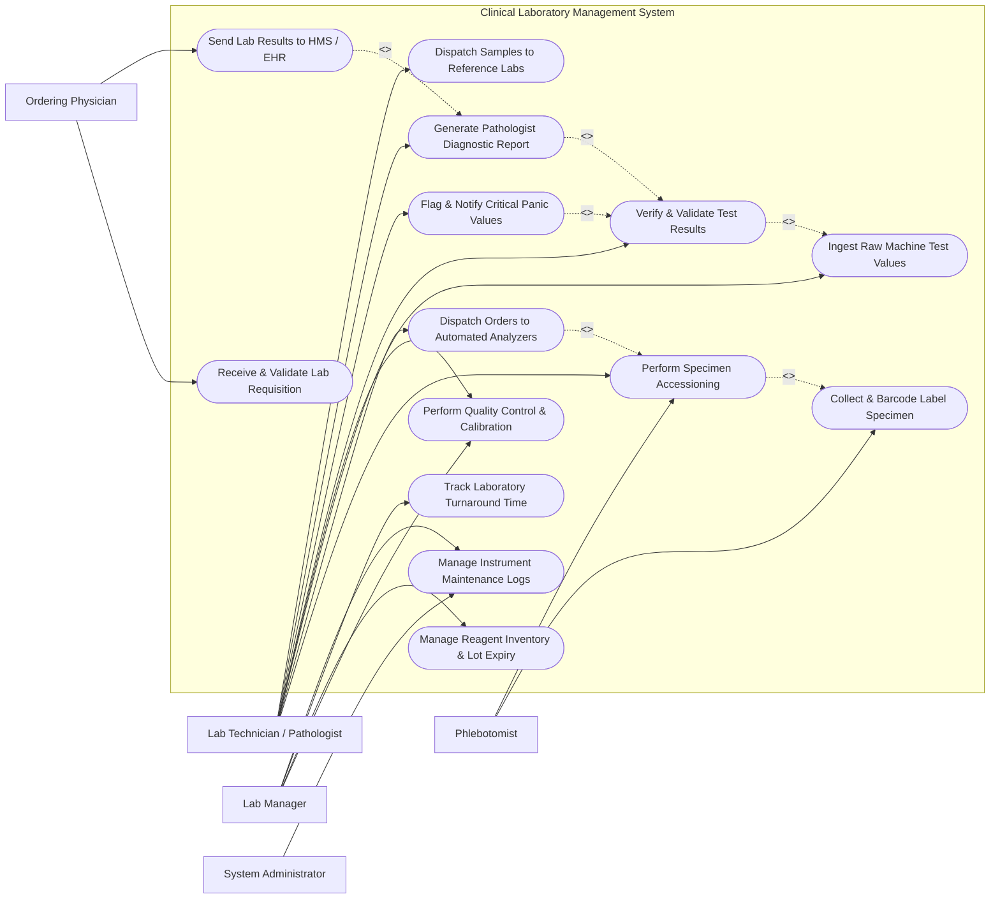

# Use Case Diagram — Clinical Laboratory Management System

## Mermaid Code

## Actor Table | Bảng Actor

| # | Actor | Actor Type | Role Description | Related Use Cases |
|---|-------|------------|------------------|-------------------|
| 1 | Ordering Physician | Primary | Medical doctor placing laboratory orders, specifying clinical indications, and receiving final verified diagnostic reports. | UC01, UC10 |
| 2 | Phlebotomist | Primary | Clinical staff responsible for drawing blood/specimen samples, scanning barcodes, and marking collection details. | UC02, UC03 |
| 3 | Lab Technician / Pathologist | Primary | Certified specialist operating analyzers, reviewing test values, managing QC, overriding alerts, validating reports, and dispatching reference tests. | UC03, UC04, UC05, UC06, UC07, UC08, UC09, UC12 |
| 4 | Lab Manager | Primary | Quality control officer overseeing lab operations, Westgard QC rule compliance, turnaround times (TAT), reagent inventory, and machine maintenance. | UC06, UC11, UC13, UC14 |
| 5 | System Administrator | Primary | Technical manager configuring analyzer HL7/ASTM interface protocols, user permissions, and master LOINC test catalogs. | UC14 |

## Use Case Table | Bảng Use Case

| # | UC ID | Use Case Name | Primary Actor | Secondary Actor | Description | Priority |
|---|-------|---------------|---------------|-----------------|-------------|----------|
| 1 | UC01 | Receive & Validate Lab Requisition | Ordering Physician | HMS / EHR System | Receives electronic lab test requisitions from HMS/EHR, validating order details, ICD-10 codes, and clinical indications. | High |
| 2 | UC02 | Collect & Barcode Label Specimen | Phlebotomist | System Engine | Generates unique 1D/2D tube barcodes, specifies specimen container types (EDTA, Serum, Sodium Citrate), and records draw timestamps. | High |
| 3 | UC03 | Perform Specimen Accessioning | Lab Technician | Phlebotomist | Accepts physical specimens into the laboratory, verifies sample volume/integrity, assigns unique accession numbers, and updates sample status. | High |
| 4 | UC04 | Dispatch Orders to Automated Analyzers | Lab Technician | Analyzer Instruments | Transmits bi-directional HL7/ASTM worklist payloads to connected chemistry, hematology, and immunology automated analyzers. | High |
| 5 | UC05 | Ingest Raw Machine Test Values | Lab Technician | Analyzer Instruments | Automatically receives, parses, and maps raw numerical and qualitative test values sent from analyzer machines via serial/TCP-IP interfaces. | High |
| 6 | UC06 | Perform Quality Control & Calibration | Lab Technician | Lab Manager | Evaluates Levey-Jennings charts, monitors Westgard QC rules, logs calibration runs, and ensures analytical accuracy before patient testing. | High |
| 7 | UC07 | Verify & Validate Test Results | Lab Technician | System Engine | Evaluates test results against age/gender reference ranges, executes Delta checks (historical variance), and auto-verifies normal results. | High |
| 8 | UC08 | Flag & Notify Critical Panic Values | Lab Technician | Ordering Physician | Automatically detects life-threatening panic values (e.g., Potassium > 6.5 mmol/L) and triggers mandatory SMS/phone notification workflow. | High |
| 9 | UC09 | Generate Pathologist Diagnostic Report | Lab Technician | System Engine | Compiles verified test results into a standardized LOINC-coded PDF report, featuring reference ranges, trend charts, and pathologist digital signature. | High |
| 10 | UC10 | Send Lab Results to HMS / EHR | Ordering Physician | HMS / EHR System | Transmits electronic FHIR ORU^R01 result messages and PDF reports back to the hospital EHR and ordering physician portal. | High |
| 11 | UC11 | Manage Reagent Inventory & Lot Expiry | Lab Manager | System Engine | Tracks reagent kit stock levels, lot numbers, open-vial stability dates, and automatically alerts when reorder thresholds are reached. | High |
| 12 | UC12 | Dispatch Samples to Reference Labs | Lab Technician | Reference Laboratory | Manages referral manifests for rare specialized tests, tracking sample shipment conditions, and receiving external lab result payloads. | Medium |
| 13 | UC13 | Track Laboratory Turnaround Time | Lab Manager | System Engine | Measures turnaround time (TAT) across pre-analytical, analytical, and post-analytical phases to optimize laboratory operational efficiency. | Medium |
| 14 | UC14 | Manage Instrument Maintenance Logs | Lab Manager | System Administrator | Logs routine preventive maintenance, reagent probe cleaning, fluidic flushes, and machine downtime service history. | Medium |

## Use Case Specification | Đặc tả Use Case

---

### UC02 — Collect & Barcode Label Specimen

| Field | Detail |
|-------|--------|
| **UC ID** | UC02 |
| **Use Case Name** | Collect & Barcode Label Specimen |
| **Actor(s)** | Primary: Phlebotomist   Secondary: System Engine |
| **Description** | Phlebotomist identifies the patient, generates unique barcode tube labels for each required test container, draws the specimen, and logs the collection event. |
| **Precondition** | 1. Active electronic test requisition exists (UC01).   2. Phlebotomy barcode label printer is connected. |
| **Main Flow** | 1. Phlebotomist scans patient ID wristband or inputs patient MRN.   2. System retrieves required test panel and displays required tube types (e.g., 1 Lavender EDTA tube for CBC, 1 Gold SST tube for Chemistry).   3. System generates and prints 1D/2D barcode labels containing Accession ID, Patient MRN, Tube Type, and Test Codes.   4. Phlebotomist draws physical blood/specimen sample into corresponding color-coded tubes.   5. Phlebotomist affixes barcode labels onto physical tubes and scans tube barcodes to confirm draw.   6. System records collection timestamp, phlebotomist ID, and updates sample status to "Collected - In Transit". |
| **Alternative Flow** | **AF1** — Non-Blood Specimen Labeling: For urine, sputum, or tissue biopsy specimens, System prints specialized sterile container labels with fixative preservation instructions (e.g., 10% Formalin). |
| **Exception Flow** | **EX1** — Hard-to-Draw / Insufficient Volume: If phlebotomist cannot obtain sufficient blood volume (QNS - Quantity Not Sufficient), Phlebotomist records QNS status; System flags requisition for secondary draw attempt.   **EX2** — Patient Identity Mismatch: If scanned wristband does not match requisition name, System locks label printing and triggers patient verification error. |
| **Postcondition** | Specimen tubes are labeled with unique barcodes and logged for transport to laboratory accessioning. |
| **Business Rule** | **BR1**: Barcode labels must be printed and attached at the patient's bedside at the exact moment of collection. |

---

### UC04 — Dispatch Orders to Automated Analyzers

| Field | Detail |
|-------|--------|
| **UC ID** | UC04 |
| **Use Case Name** | Dispatch Orders to Automated Analyzers |
| **Actor(s)** | Primary: Lab Technician   Secondary: Automated Lab Analyzer Instruments |
| **Description** | System transmits bi-directional worklist orders to automated chemistry, hematology, and immunology analyzers using HL7/ASTM protocols when specimen barcodes are loaded. |
| **Precondition** | 1. Specimen is accessioned into the laboratory (UC03).   2. Analyzer instrument interface (TCP-IP/Serial) is online and calibrated. |
| **Main Flow** | 1. Lab Technician loads barcode-labeled specimen tubes into the automated analyzer rack.   2. Analyzer internal barcode reader scans tube barcode as rack advances.   3. Analyzer sends an ASTM/HL7 Query Message (e.g., "What tests are ordered for Barcode #100234?") to LIS.   4. LIS receives query, matches Accession ID, and looks up active test requisitions.   5. LIS formats and returns an ASTM/HL7 Order Download payload specifying test channel codes (e.g., ALT, AST, Glucose, HbA1c).   6. Analyzer accepts order payload, pipets sample volume, and initiates automated testing cycle.   7. LIS updates sample status on dashboard to "In-Testing on Analyzer X". |
| **Alternative Flow** | **AF1** — Batch Worklist Download: For offline or semi-automated analyzers, Lab Technician exports a batch worklist file from LIS and loads it into the analyzer software prior to loading rack. |
| **Exception Flow** | **EX1** — Unrecognized Barcode / Unmapped Test: If analyzer scans a tube barcode not found in LIS database, analyzer rejects sample to bypass rack and LIS logs "Unrecognized Accession Query Error".   **EX2** — Interface Offline: If network interface drops, System queues worklist messages locally and re-transmits when socket connection reconnects. |
| **Postcondition** | Automated analyzer receives exact test parameter instructions for loaded specimen tubes. |
| **Business Rule** | **BR1**: Bi-directional query-response handshake between analyzer and LIS must complete within 2 seconds of rack scanning. |

---

### UC07 — Verify & Validate Test Results

| Field | Detail |
|-------|--------|
| **UC ID** | UC07 |
| **Use Case Name** | Verify & Validate Test Results |
| **Actor(s)** | Primary: Lab Technician / Pathologist   Secondary: System Engine |
| **Description** | System automatically evaluates ingested test results against reference ranges, Delta checks (historical variance), and Westgard QC rules, enabling automated or manual verification by a technician/pathologist. |
| **Precondition** | 1. Raw test values are ingested from analyzer (UC05).   2. Active Quality Control (QC) run is passed (UC06). |
| **Main Flow** | 1. System receives raw test result payload from analyzer.   2. System applies age- and gender-specific reference ranges to evaluate result status (Normal, High, Low, Critical).   3. System executes Delta Check algorithm comparing current result against patient's previous result within 30 days (e.g., > 20% sudden drop in Hemoglobin).   4. If result is within normal limits, has no machine flags, and passes Delta check, System applies Auto-Verification and marks status "Verified".   5. If result is abnormal or triggers machine flags (e.g., Hemolyzed sample), System routes result to Technician Review Workqueue.   6. Technician inspects sample, verifies value, adds technical notes, and clicks "Approve & Validate".   7. System updates status to "Validated - Ready for Report Generation". |
| **Alternative Flow** | **AF1** — Manual Rerun Request: Technician suspects machine aspiration error and requests a physical rerun on analyzer. System creates duplicate test line marked "Rerun" and holds report. |
| **Exception Flow** | **EX1** — Severe Delta Check Failure: If result shows impossible physiological shift (e.g., Potassium jumps from 4.0 to 8.5 mmol/L), System flags "Possible Sample Contamination / Swap", locks auto-verification, and alerts technician. |
| **Postcondition** | Test results are verified and authorized for official diagnostic report generation. |
| **Business Rule** | **BR1**: Results with machine interference flags (Hemolysis > 2+, Icterus, Lipemia) cannot be auto-verified and require technician manual review. |

---

### UC08 — Flag & Notify Critical Panic Values

| Field | Detail |
|-------|--------|
| **UC ID** | UC08 |
| **Use Case Name** | Flag & Notify Critical Panic Values |
| **Actor(s)** | Primary: Lab Technician   Secondary: Ordering Physician |
| **Description** | System instantly detects life-threatening critical panic laboratory values (e.g., Glucose < 2.5 mmol/L, Platelets < 20,000 /uL) and enforces mandatory physician notification and acknowledgment documentation. |
| **Precondition** | 1. Test results are ingested and evaluated by reference rules engine (UC07). |
| **Main Flow** | 1. System rules engine detects a test value exceeding established critical panic thresholds.   2. System immediately locks report, turns dashboard line flashing red, and triggers audible panic alarm on LIS workstation.   3. System dispatches urgent push notification and SMS to the Ordering Physician's registered mobile device.   4. Lab Technician places immediate telephone call to ordering physician or nursing station.   5. Technician reads back critical patient name, MRN, test item, and panic value to physician over phone.   6. Physician confirms read-back over phone.   7. Technician records notification log in LIS: Physician Name, Contact Phone, Time, Read-Back Confirmed (Yes/No), and Technician ID.   8. System unlocks report, attaches "Critical Panic Alert Recorded" stamp, and releases final report. |
| **Alternative Flow** | **AF1** — Automated Interactive Voice Response (IVR) Notification: System calls physician mobile number via automated voice engine, plays recorded panic details, and captures physician PIN press to confirm read-back automatically. |
| **Exception Flow** | **EX1** — Physician Unreachable Escalation: If physician does not respond within 15 minutes, System automatically escalates panic alert to Department Chief / On-Call Medical Officer and logs escalation event. |
| **Postcondition** | Critical panic value is communicated to clinician, and legally binding read-back audit record is appended to patient file. |
| **Business Rule** | **BR1**: Critical panic values must be successfully communicated to ordering clinician within 30 minutes of result generation (CAP/CLIA standard). |

---

### UC11 — Manage Reagent Inventory & Lot Expiry

| Field | Detail |
|-------|--------|
| **UC ID** | UC11 |
| **Use Case Name** | Manage Reagent Inventory & Lot Expiry |
| **Actor(s)** | Primary: Lab Manager   Secondary: System Engine |
| **Description** | Tracks laboratory reagent kits, calibrators, controls, consumable stock levels, lot numbers, expiration dates, and open-vial onboard stability timers. |
| **Precondition** | 1. Reagent catalog and analyzer mapping are configured in system. |
| **Main Flow** | 1. Lab Manager logs incoming reagent shipment by scanning manufacturer QR/barcode (Lot Number, Expiration Date, Kit Size).   2. System logs kit into central inventory ledger and assigns storage location (e.g., 2-8°C Refrigerator #2).   3. When technician loads reagent cartridge onto analyzer, technician scans cartridge barcode.   4. System tracks onboard open-vial stability countdown (e.g., 14 days after opening).   5. System automatically decrements reagent test tests remaining based on completed analyzer test runs (UC05).   6. When stock reaches pre-configured minimum reorder threshold, System triggers "Low Reagent Warning".   7. Manager reviews stock report and issues purchase requisition. |
| **Alternative Flow** | **AF1** — New Lot Parallel Testing (Lot-to-Lot QC Verification): When introducing a new reagent lot number, System enforces parallel testing run against current active lot before permitting clinical use. |
| **Exception Flow** | **EX1** — Expired Reagent Blocking: If technician attempts to load an expired reagent lot or expired open-vial cartridge, System locks analyzer worklist dispatch for that test parameter. |
| **Postcondition** | Reagent stock levels and lot tracking logs are updated, preventing expired reagent usage. |
| **Business Rule** | **BR1**: System must block patient test execution if analyzer active reagent lot has expired or failed lot-to-lot verification. |
