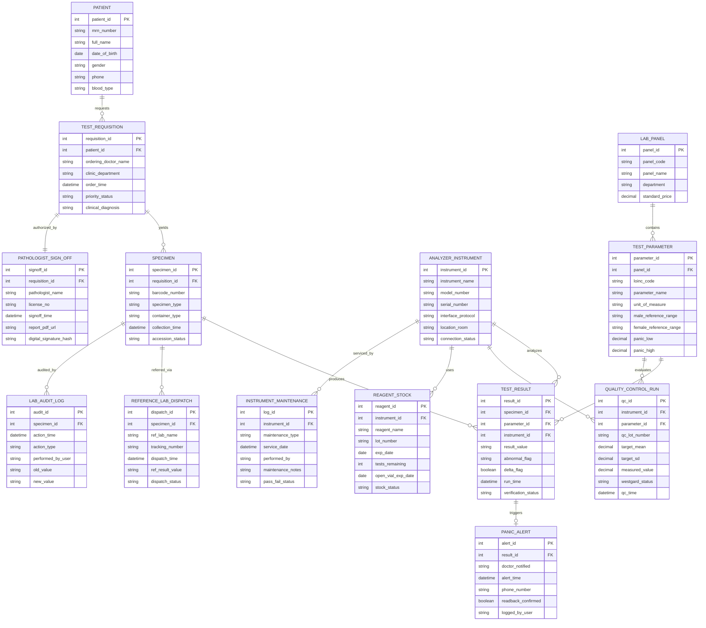

# Conceptual ERD — Clinical Laboratory Management System

## Mermaid Code

## Entity Description Table | Bảng mô tả Entity

| # | Entity Name | Vietnamese Name | Description | Key Attributes | Main Relationships |
|---|-------------|-----------------|-------------|----------------|-------------------|
| 1 | PATIENT | Bệnh nhân | Master patient demographic entity storing medical record number (MRN), full name, age, and gender. | patient_id, mrn_number, full_name, date_of_birth | Requests Test Requisitions. |
| 2 | TEST_REQUISITION | Phiếu Yêu cầu Xét nghiệm | Clinical laboratory order ticket created by an ordering physician detailing requested test panels and urgency. | requisition_id, ordering_doctor_name, priority_status | Belongs to Patient, yields Specimens, authorized by Sign-Off. |
| 3 | SPECIMEN | Mẫu Bệnh phẩm | Physical biological sample (blood, urine, tissue) identified by a unique barcode number and container type. | specimen_id, barcode_number, specimen_type, container_type | Belongs to Requisition, produces Results, referred via Dispatch. |
| 4 | LAB_PANEL | Nhóm / Bộ Xét nghiệm | Grouping of related laboratory test parameters (e.g., Complete Blood Count, Liver Function Test, Lipid Panel). | panel_id, panel_code, panel_name, standard_price | Contains Test Parameters. |
| 5 | TEST_PARAMETER | Thông số / Chỉ số Xét nghiệm | Specific analyte test item (e.g., Hemoglobin, Glucose, ALT) defined by LOINC codes, UOM, and reference ranges. | parameter_id, loinc_code, parameter_name, panic_low, panic_high | Belongs to Panel, defines Test Results, evaluated in QC. |
| 6 | ANALYZER_INSTRUMENT | Máy Xét nghiệm Tự động | Laboratory automated analyzer instrument (e.g., Roche Cobas, Sysmex XN) connected via bi-directional HL7/ASTM interface. | instrument_id, instrument_name, serial_number, interface_protocol | Analyzes Results, executes QC Runs, uses Reagents, serviced by Maintenance. |
| 7 | TEST_RESULT | Kết quả Xét nghiệm | Numerical or qualitative analytical result ingested from an analyzer or entered manually by a technician. | result_id, result_value, abnormal_flag, delta_flag, verification_status | Belongs to Specimen, Parameter, Instrument, triggers Panic Alerts. |
| 8 | QUALITY_CONTROL_RUN | Chạy Kiểm chuẩn (QC) | Quality control execution data measuring target mean, standard deviation (SD), and Westgard rule compliance. | qc_id, qc_lot_number, target_mean, measured_value, westgard_status | Linked to Instrument and Test Parameter. |
| 9 | PANIC_ALERT | Cảnh báo Giá trị Nguy hiểm | Legal record documenting immediate physician phone notification and verbal read-back confirmation for panic values. | alert_id, doctor_notified, alert_time, readback_confirmed | Triggers from Test Result. |
| 10 | PATHOLOGIST_SIGN_OFF | Chữ ký Bác sĩ Giải phẫu bệnh | Official digital signature seal and approved PDF diagnostic report generated by a certified pathologist. | signoff_id, pathologist_name, signoff_time, digital_signature_hash | Authorizes Test Requisition. |
| 11 | REAGENT_STOCK | Tồn kho Hóa chất Xét nghiệm | Inventory tracking entity monitoring reagent kit lots, expiration dates, test counts remaining, and open-vial stability. | reagent_id, reagent_name, lot_number, exp_date, tests_remaining | Linked to Analyzer Instrument. |
| 12 | REFERENCE_LAB_DISPATCH | Gửi Mẫu Ngoại viện | Referral tracking record for specialized specimens sent to external reference laboratories for testing. | dispatch_id, ref_lab_name, tracking_number, ref_result_value | Linked to Specimen. |
| 13 | INSTRUMENT_MAINTENANCE | Nhật ký Bảo trì Máy | Log of routine fluidic cleaning, probe replacement, laser alignment, and technician preventive maintenance. | log_id, maintenance_type, service_date, pass_fail_status | Serviced for Analyzer Instrument. |
| 14 | LAB_AUDIT_LOG | Nhật ký Thao tác LIMS | Immutable security audit log tracking every sample accessioning, result entry, manual value edit, or override event. | audit_id, action_time, action_type, performed_by_user | Audits Specimen lifecycle. |

## Relationship Description | Mô tả Quan hệ

| # | From Entity | Cardinality | To Entity | Relationship Label | Business Explanation |
|---|-------------|-------------|-----------|-------------------|----------------------|
| 1 | PATIENT | one-to-many | TEST_REQUISITION | requests | A patient can have multiple test requisitions across different medical visits. |
| 2 | TEST_REQUISITION | one-to-many | SPECIMEN | yields | A test requisition yields one or more physical specimen tubes (blood, urine, swab). |
| 3 | TEST_REQUISITION | one-to-one | PATHOLOGIST_SIGN_OFF | authorized_by | A completed test requisition is authorized by exactly one official pathologist sign-off. |
| 4 | LAB_PANEL | one-to-many | TEST_PARAMETER | contains | A laboratory test panel contains multiple individual test parameters. |
| 5 | SPECIMEN | one-to-many | TEST_RESULT | produces | A physical specimen tube produces one or more analyte test results. |
| 6 | SPECIMEN | one-to-many | REFERENCE_LAB_DISPATCH | referred_via | A specialized specimen can be referred via one or more external reference lab dispatches. |
| 7 | SPECIMEN | one-to-many | LAB_AUDIT_LOG | audited_by | A specimen lifecycle maintains an audit trail for accessioning and verification actions. |
| 8 | TEST_PARAMETER | one-to-many | TEST_RESULT | defines | A master test parameter definition formats and evaluates multiple individual test results. |
| 9 | TEST_PARAMETER | one-to-many | QUALITY_CONTROL_RUN | evaluates | A test parameter is evaluated across multiple routine quality control (QC) runs. |
| 10 | ANALYZER_INSTRUMENT | one-to-many | TEST_RESULT | analyzes | An automated analyzer instrument analyzes and transmits raw test results. |
| 11 | ANALYZER_INSTRUMENT | one-to-many | QUALITY_CONTROL_RUN | executes | An analyzer instrument executes daily quality control calibration runs. |
| 12 | ANALYZER_INSTRUMENT | one-to-many | REAGENT_STOCK | uses | An analyzer instrument consumes multiple reagent kit lots during operation. |
| 13 | ANALYZER_INSTRUMENT | one-to-many | INSTRUMENT_MAINTENANCE | serviced_by | An analyzer instrument is serviced under routine preventive maintenance logs. |
| 14 | TEST_RESULT | one-to-one | PANIC_ALERT | triggers | A life-threatening critical test result triggers exactly one urgent panic alert workflow. |
