# Swimlane Diagram — Clinical Laboratory Management System

## Mermaid Code

```mermaid
flowchart LR
    Start(["Start: Physician Submits Lab Test Requisition"])

    subgraph Lane1["Ordering Physician / Patient"]
        C1["Present for Phlebotomy Blood Draw"]
        C2["Receive Verbal Phone Call for Critical Panic Value"]
        C3["View Final Verified Diagnostic PDF Report"]
    end

    subgraph Lane2["Phlebotomist"]
        P1["Scan Patient Wristband & Print Barcode Labels"]
        P2["Draw Blood Sample into Color-Coded Tubes"]
        P3["Affix Barcode Labels & Transport Specimen to Lab"]
    end

    subgraph Lane3["Lab Technician / Pathologist"]
        T1["Verify Specimen Accessioning & Load Analyzer Rack"]
        T2{"Critical Panic Value Alert Flashing?"}
        T3["Place Immediate Telephone Call & Record Read-Back"]
        T4["Review Delta Checks & Apply Digital Signature Seal"]
    end

    subgraph Lane4["Clinical Laboratory Management System & Analyzer"]
        S1["Query LIS Database via HL7 & Download Worklist Order"]
        S2["Pipet Sample Volume & Execute Automated Chemical Assay"]
        S3["Transmit Raw Results via ASTM / HL7 Protocol"]
        S4["Apply Reference Ranges & Perform Delta Check Rules"]
        S5["Publish Final LOINC-Coded Diagnostic Report to EHR"]
    end

    Finish(["End: Diagnostic Laboratory Workflow Completed"])

    Start --> C1 --> P1 --> P2 --> P3 --> T1 --> S1 --> S2 --> S3 --> S4 --> T2
    T2 -->|"Yes: Panic Value"| T3 --> C2 --> T4
    T2 -->|"No: Verified"| T4 --> S5 --> C3 --> Finish
```

## Flow Description | Mô tả luồng

| Lane | Actor | Role in Flow |
|------|-------|-------------|
| 1 | Ordering Physician / Patient | Patient presents for phlebotomy blood draw; ordering physician receives urgent verbal telephone calls for critical panic values and accesses final verified LOINC diagnostic PDF reports on the hospital portal. |
| 2 | Phlebotomist | Scans patient MRN wristband, prints unique 1D/2D tube barcodes, draws blood samples into required color-coded containers, affixes labels, and transports accessioned tubes to laboratory intake. |
| 3 | Lab Technician / Pathologist | Verifies specimen integrity at accessioning desk, loads tube racks onto automated analyzer, responds to red flashing panic alerts by telephoning physician for mandatory verbal read-backs, reviews Delta check variances, and signs off final reports. |
| 4 | Clinical Laboratory Management System & Analyzer | Receives HL7 worklist queries, pipets sample volume, executes chemical assays, ingests raw test values via HL7/ASTM interfaces, executes reference range and Delta check algorithms, and publishes final LOINC diagnostic reports to HMS/EHR. |
