# Action Tree — Clinical Laboratory Management System

## Mermaid Code

```mermaid
graph TD
    Root["Clinical Laboratory Management System"]

    Root --> M1["1. Test Requisition & Order Entry"]
    Root --> M2["2. Specimen Collection & Barcode Labeling"]
    Root --> M3["3. Accessioning & Sample Triaging"]
    Root --> M4["4. Analyzer Interfacing & Worklist Dispatch"]
    Root --> M5["5. Result Verification & Auto-Validation"]
    Root --> M6["6. Critical Panic Alert & Read-Back Tracking"]
    Root --> M7["7. Quality Control & Levey-Jennings Analytics"]
    Root --> M8["8. Reagent Stock & Equipment Maintenance"]

    M1 --> A11["Receive Electronic Requisitions from HMS"]
    M1 --> A12["Validate Patient ICD-10 Diagnosis Codes"]
    M1 --> A13["Set Test Priority STAT vs Routine"]
    M1 --> A14["Check Fasting & Specimen Requirements"]

    M2 --> A21["Generate Unique Barcode Label Payloads"]
    M2 --> A22["Specify Color-Coded Tube Requirements"]
    M2 --> A23["Log Phlebotomist Collection Timestamp"]
    M2 --> A24["Record Insufficient Sample Volume QNS"]

    M3 --> A31["Receive Physical Specimen at Intake Desk"]
    M3 --> A32["Verify Sample Integrity & Centrifuge Status"]
    M3 --> A33["Assign Unique Accession Numbers"]
    M3 --> A34["Dispatch Samples to Internal Lab Workstations"]

    M4 --> A41["Configure Bi-Directional HL7 ASTM Protocols"]
    M4 --> A42["Download Worklist Orders to Analyzers"]
    M4 --> A43["Ingest Raw Numerical & Qualitative Results"]
    M4 --> A44["Monitor Analyzer Socket Communication Status"]

    M5 --> A51["Apply Age & Gender Reference Ranges"]
    M5 --> A52["Execute Historical Delta Check Algorithms"]
    M5 --> A53["Auto-Verify Normal Result Payloads"]
    M5 --> A54["Apply Pathologist Digital Signature Seal"]

    M6 --> A61["Detect Life-Threatening Panic Values"]
    M6 --> A62["Trigger Red Flashing Workstation Alarms"]
    M6 --> A63["Log Verbal Telephone Call & Read-Back Details"]
    M6 --> A64["Escalate Unresponsive Clinician Alerts"]

    M7 --> A71["Log Daily Quality Control QC Assay Runs"]
    M7 --> A72["Generate Levey-Jennings Chart Analytics"]
    M7 --> A73["Evaluate Westgard Multi-Rule Violations"]
    M7 --> A74["Enforce Lot-to-Lot Reagent Verification"]

    M8 --> A81["Track Reagent Cartridge Stock Levels"]
    M8 --> A82["Monitor Open-Vial Onboard Stability Timers"]
    M8 --> A83["Log Routine Instrument Maintenance Flushes"]
    M8 --> A84["Measure Laboratory Turnaround Time TAT"]
```

## Module Description | Mô tả Module

| # | Module | Description | Actions |
|---|--------|-------------|---------|
| 1 | Test Requisition & Order Entry | Captures electronic lab requisitions from HMS/EHR, verifies patient diagnostic indications, assigns order priorities (STAT/Routine), and checks preparation rules. | Receive Electronic Requisitions from HMS, Validate Patient ICD-10 Diagnosis Codes, Set Test Priority STAT vs Routine, Check Fasting & Specimen Requirements. |
| 2 | Specimen Collection & Barcode Labeling | Generates 1D/2D barcode labels, specifies color-coded tube container types, logs draw timestamps, and records sample volume issues (QNS). | Generate Unique Barcode Label Payloads, Specify Color-Coded Tube Requirements, Log Phlebotomist Collection Timestamp, Record Insufficient Sample Volume QNS. |
| 3 | Accessioning & Sample Triaging | Manages physical specimen intake, verifies sample hemolysis/integrity, assigns unique accession numbers, and routes tubes to specialty workstations. | Receive Physical Specimen at Intake Desk, Verify Sample Integrity & Centrifuge Status, Assign Unique Accession Numbers, Dispatch Samples to Internal Lab Workstations. |
| 4 | Analyzer Interfacing & Worklist Dispatch | Manages bi-directional HL7/ASTM socket communications with automated lab analyzers, downloading worklists and ingesting raw machine test values. | Configure Bi-Directional HL7 ASTM Protocols, Download Worklist Orders to Analyzers, Ingest Raw Numerical & Qualitative Results, Monitor Analyzer Socket Communication Status. |
| 5 | Result Verification & Auto-Validation | Evaluates raw test data against reference ranges, runs Delta checks (historical variance), auto-verifies normal results, and embeds pathologist digital signatures. | Apply Age & Gender Reference Ranges, Execute Historical Delta Check Algorithms, Auto-Verify Normal Result Payloads, Apply Pathologist Digital Signature Seal. |
| 6 | Critical Panic Alert & Read-Back Tracking | Identifies life-threatening panic values, triggers red visual alarms, enforces mandatory phone call read-back logs, and escalates unresponsive physician alerts. | Detect Life-Threatening Panic Values, Trigger Red Flashing Workstation Alarms, Log Verbal Telephone Call & Read-Back Details, Escalate Unresponsive Clinician Alerts. |
| 7 | Quality Control & Levey-Jennings Analytics | Monitors daily analytical quality control (QC) runs, plots Levey-Jennings charts, evaluates Westgard rule violations, and enforces lot-to-lot verification. | Log Daily Quality Control QC Assay Runs, Generate Levey-Jennings Chart Analytics, Evaluate Westgard Multi-Rule Violations, Enforce Lot-to-Lot Reagent Verification. |
| 8 | Reagent Stock & Equipment Maintenance | Tracks reagent inventory stock levels, open-vial onboard stability timers, logs preventive machine maintenance, and measures Turnaround Time (TAT) metrics. | Track Reagent Cartridge Stock Levels, Monitor Open-Vial Onboard Stability Timers, Log Routine Instrument Maintenance Flushes, Measure Laboratory Turnaround Time TAT. |
