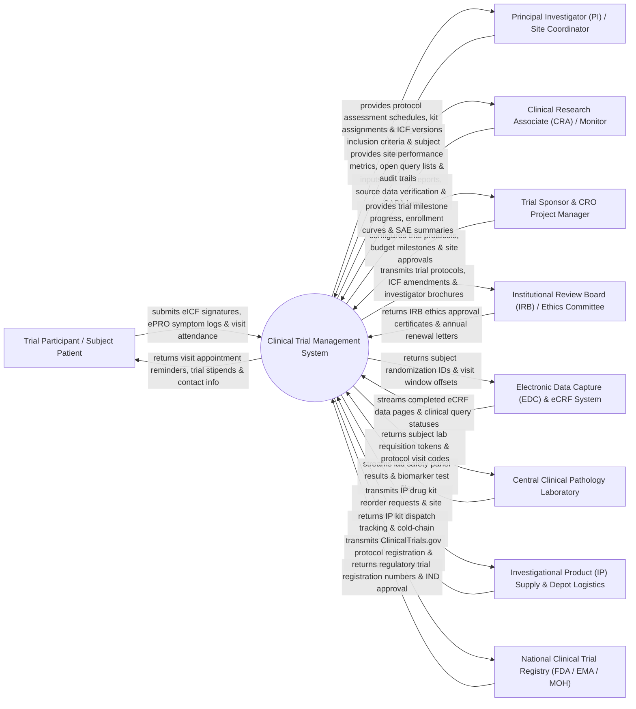

# Context Diagram — Clinical Trial Management System

## Mermaid Code

## Actor & Interaction Table | Bảng Actor & Tương tác

| # | Actor | Actor Type | Data Sent TO System | Data Received FROM System | Notes |
|---|-------|------------|---------------------|---------------------------|-------|
| 1 | Trial Participant / Subject Patient | Primary | Digital Informed Consent Form (eICF) signature, electronic Patient Reported Outcomes (ePRO), visit attendance confirmation. | Visit schedule reminders, trial stipend payment notifications, emergency contact details. | Volunteer patient participating in a Phase I-IV clinical trial protocol. |
| 2 | Principal Investigator (PI) / Site Coordinator | Primary | Subject screening logs, eligibility verification, eCRF clinical data, protocol deviation notes, SAE notifications. | Protocol Schedule of Assessments, RTSM kit assignment codes, current approved ICF versions, monitoring queries. | Physician leading clinical trial execution at an accredited trial site hospital. |
| 3 | Clinical Research Associate (CRA) / Monitor | Primary | Pre-Study Visit (PSV) reports, Site Initiation Visit (SIV) reports, Source Data Verification (SDV) progress, CAPA issue logs. | Site recruitment metrics, unverified eCRF query lists, IP kit inventory logs, audit trail histories. | Clinical monitor auditing trial site compliance with GCP guidelines and study protocol. |
| 4 | Trial Sponsor & CRO Project Manager | Primary | Master trial protocol, inclusion/exclusion rules, site budget milestones, vendor contracts, study status updates. | Global enrollment progress curves, site activation tracking, trial budget expenditure, SAE safety summaries. | Biopharmaceutical company or Contract Research Organization (CRO) managing overall trial execution. |
| 5 | Institutional Review Board (IRB) / Ethics Committee | Regulatory | Ethics approval certificates, protocol amendment approvals, safety suspension notices, annual renewal letters. | Clinical trial protocol packages, eICF templates, Investigator Brochures (IB), adverse event safety summaries. | Independent ethics body protecting trial participant rights, safety, and welfare. |
| 6 | Electronic Data Capture (EDC) System | Supporting System | Completed eCRF data pages (CDISC SDTM/CDASH), clinical data queries, electronic signatures. | Subject randomization numbers, treatment arm assignments, scheduled visit window offsets. | Enterprise clinical data system storing patient Case Report Forms (CRF). |
| 7 | Central Clinical Pathology Laboratory | Supporting System | Automated clinical laboratory safety panels (CBC, LFT, Renal), central biomarker test results, lab query flags. | Subject lab requisition barcodes, visit codes, central lab kit shipment requests. | Contracted central lab performing protocol-required blood, urine, and tissue biomarker testing. |
| 8 | Investigational Product (IP) Supply & Depot Logistics | Supporting System | Drug kit dispatch manifests, depot inventory levels, transit temperature sensor logs, kit quarantine statuses. | Automated IP drug kit reorder triggers, site inventory caps, damaged kit replacement requests. | Central clinical supply depot manufacturing, packaging, and shipping investigational drugs/placebo. |
| 9 | National Clinical Trial Registry (FDA / EMA / MOH) | Regulatory | Investigational New Drug (IND) approval letters, regulatory trial registration numbers, inspection audit findings. | ClinicalTrials.gov mandatory protocol registration data, Phase I-IV summary outcomes, safety updates. | Governmental regulatory body (e.g., FDA, EMA, Vietnam MOH) overseeing clinical trial authorization. |

## System Boundary Description | Mô tả Phạm vi Hệ thống

The **Clinical Trial Management System (CTMS)** is an enterprise clinical research platform governing the end-to-end operational lifecycle of biopharmaceutical clinical trials (Phase I to IV). It manages study protocol configuration, site feasibility and activation, patient recruitment and eligibility screening, electronic Informed Consent (eICF), Randomization and Trial Supply Management (RTSM / IWRS), CRA site monitoring visits, Serious Adverse Event (SAE) reconciliation, IRB/Ethics Committee approvals, and CDISC/GCP/21 CFR Part 11 regulatory compliance.

**Inside System Scope:**
- Trial protocol schedule configuration (Schedule of Assessments, visit window offsets, required eCRF lists).
- Trial site feasibility assessment, site activation workflows, and PI credential tracking.
- Subject screening, inclusion/exclusion eligibility verification, and eICF version management.
- Randomization & Trial Supply Management (RTSM) for double-blind treatment arm allocation and IP kit assignment.
- CRA site monitoring visit management (PSV, SIV, IMV, COV) and CAPA issue tracking.
- Serious Adverse Event (SAE) reporting and cross-reconciliation with safety databases.
- Clinical trial financial management (site milestone payments and subject stipend processing).
- Compliance with 21 CFR Part 11 audit trails, electronic signatures, and GCP guidelines.

**Outside System Scope:**
- Physical chemical manufacturing and formulation of investigational drug substances (handled by Pharma Manufacturing).
- Physical medical treatment of trial subjects during emergency room visits (handled by HIS / Hospitals).
- Commercial corporate financial general ledger accounting (handled by enterprise ERP/SAP).
- Physical hosting infrastructure of cloud data centers (handled by Cloud IT infrastructure providers).
