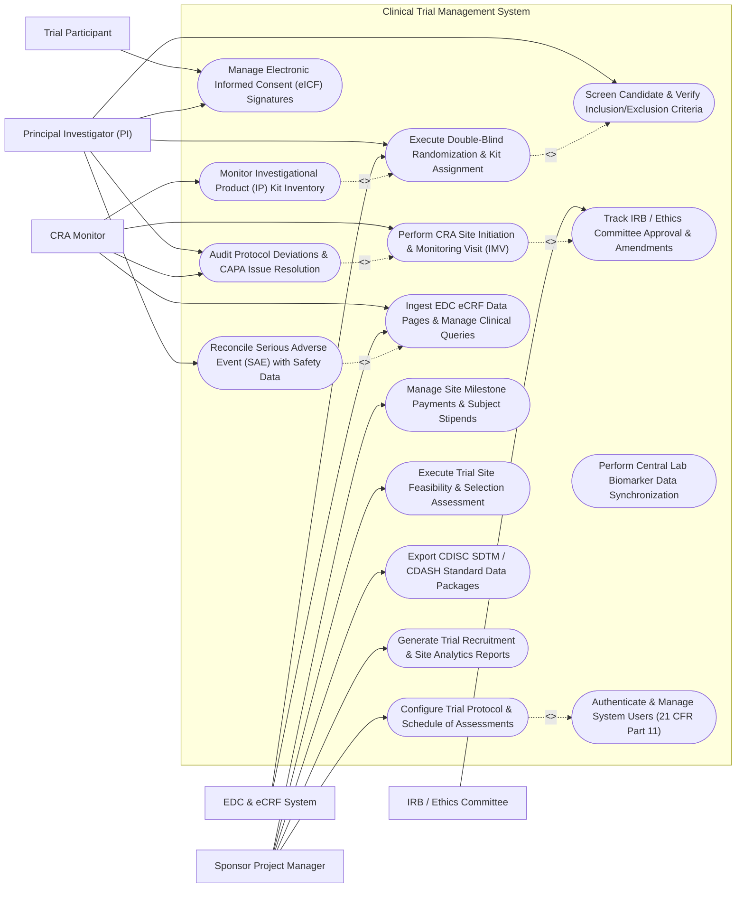

# Use Case Diagram — Clinical Trial Management System

## Mermaid Code

## Actor Table | Bảng Actor

| # | Actor | Actor Type | Role Description | Related Use Cases |
|---|-------|------------|------------------|-------------------|
| 1 | Trial Participant | Primary | Volunteer patient signing eICF documents, completing visit assessments, and receiving trial stipends. | UC06 |
| 2 | Principal Investigator (PI) | Primary | Lead physician at trial site responsible for subject screening, eligibility verification, randomization, and SAE reporting. | UC02, UC03, UC05, UC06, UC11 |
| 3 | CRA Monitor | Primary | Clinical Research Associate visiting trial sites to audit eCRF data accuracy (SDV), inspect IP inventory, and log CAPA issues. | UC04, UC08, UC09, UC11 |
| 4 | Sponsor Project Manager | Primary | Sponsor or CRO manager configuring trial protocols, selecting sites, managing milestone budgets, and generating analytics. | UC01, UC10, UC12, UC14, UC15 |
| 5 | IRB / Ethics Committee | Secondary / System | Independent ethics board reviewing and approving clinical trial protocols, consent forms, and protocol amendments. | UC07 |
| 6 | EDC & eCRF System | Secondary / System | Clinical data system capturing eCRF data and triggering randomization and visit window calculations. | UC03, UC08 |

## Use Case Table | Bảng Use Case

| # | UC ID | Use Case Name | Primary Actor | Secondary Actor | Description | Priority |
|---|-------|---------------|---------------|-----------------|-------------|----------|
| 1 | UC01 | Configure Trial Protocol & Schedule of Assessments | Sponsor Project Manager | None | Define master study protocol, Phase I-IV parameters, visit day offsets, visit window margins, and required eCRFs. | High |
| 2 | UC02 | Screen Candidate & Verify Inclusion/Exclusion Criteria | Principal Investigator (PI) | None | Register candidate screening details, evaluate inclusion/exclusion checklist criteria, and assign Screening ID. | High |
| 3 | UC03 | Execute Double-Blind Randomization & Kit Assignment | Principal Investigator (PI) | EDC & eCRF System | Run Interactive Response Technology (RTSM/IWRS) algorithm to assign treatment arm and assign investigational IP kit ID. | High |
| 4 | UC04 | Perform CRA Site Initiation & Monitoring Visit (IMV) | CRA Monitor | IRB / Ethics Committee | Conduct on-site or remote monitoring visit (IMV), perform Source Data Verification (SDV), and log monitoring report. | High |
| 5 | UC05 | Reconcile Serious Adverse Event (SAE) with Safety Data | Principal Investigator (PI) | EDC & eCRF System | Capture SAE details within 24 hours, generate CIOMS/MedWatch forms, and cross-reconcile CTMS records with sponsor safety database. | High |
| 6 | UC06 | Manage Electronic Informed Consent (eICF) Signatures | Principal Investigator (PI) | Trial Participant | Present electronic Informed Consent Form, verify participant comprehension, and capture dual digital signatures. | High |
| 7 | UC07 | Track IRB / Ethics Committee Approval & Amendments | IRB / Ethics Committee | None | Log initial IRB ethics approval certificates, track expiration dates, and process protocol amendment re-approvals. | High |
| 8 | UC08 | Ingest EDC eCRF Data Pages & Manage Clinical Queries | CRA Monitor | EDC & eCRF System | Ingest completed CDISC SDTM/CDASH eCRF data pages, issue data queries to site PI, and track query resolution. | High |
| 9 | UC09 | Monitor Investigational Product (IP) Kit Inventory | CRA Monitor | None | Track IP drug kit lot numbers, expiration dates, site stock levels, automated reorder triggers, and cold-chain temperature logs. | High |
| 10 | UC10 | Manage Site Milestone Payments & Subject Stipends | Sponsor Project Manager | None | Calculate site financial milestone completions (e.g., 50% enrollment, Database Lock) and disburse investigator payments. | Medium |
| 11 | UC11 | Audit Protocol Deviations & CAPA Issue Resolution | CRA Monitor | Principal Investigator (PI) | Log major/minor protocol deviations (missed visits, out-of-window labs), assign Corrective Action (CAPA), and track resolution. | High |
| 12 | UC12 | Execute Trial Site Feasibility & Selection Assessment | Sponsor Project Manager | None | Evaluate candidate clinical site patient volume, PI experience, facility equipment, and select sites for study activation. | Medium |
| 13 | UC13 | Perform Central Lab Biomarker Data Synchronization | Sponsor Project Manager | None | Import central laboratory safety panels, genetic biomarker data, and verify lab reference range normalizations. | Medium |
| 14 | UC14 | Export CDISC SDTM / CDASH Standard Data Packages | Sponsor Project Manager | None | Format trial operational data and eCRF datasets into CDISC SDTM (Study Data Tabulation Model) packages for regulatory submission. | Medium |
| 15 | UC15 | Generate Trial Recruitment & Site Analytics Reports | Sponsor Project Manager | None | Produce global enrollment recruitment curves, site activation velocity, query resolution turnaround, and trial completion metrics. | Medium |
| 16 | UC16 | Authenticate & Manage System Users (21 CFR Part 11) | All Users | None | Enforce 21 CFR Part 11 compliant multi-factor login, role-based access control, electronic signature audit trails, and data lock. | High |

## Use Case Specification | Đặc tả Use Case

---

### UC01 — Configure Trial Protocol & Schedule of Assessments

| Field | Detail |
|-------|--------|
| **UC ID** | UC01 |
| **Use Case Name** | Configure Trial Protocol & Schedule of Assessments |
| **Actor(s)** | Primary: Sponsor Project Manager |
| **Description** | Sets up the master clinical trial protocol parameters in CTMS, defining Protocol Number, Study Title, Trial Phase (Phase I-IV), Primary Objectives, Treatment Arms (e.g., Arm A: 50mg Drug X; Arm B: Placebo), Schedule of Assessments (Visits 1-10 with day offsets), and required eCRF modules. |
| **Precondition** | 1. The clinical trial protocol document is finalized and approved by the Sponsor Medical Director.   2. The Sponsor Project Manager is authenticated in CTMS with Protocol Builder privileges. |
| **Main Flow** | 1. The Manager opens the "Trial Protocol Builder" and inputs Master Metadata: Protocol Number (e.g., CT-2026-ONC-04), Study Title, Phase Code (Phase III), Sponsor Name, and Target Sample Size (e.g., 600 subjects across 40 sites).   2. The Manager defines Treatment Arms: **Arm A**: Active Investigational Product (IP 100mg once daily); **Arm B**: Matching Placebo.   3. The Manager configures the **Schedule of Assessments (SoA)** matrix:   &nbsp;&nbsp;&nbsp;&nbsp;- **Screening Visit (Visit 1)**: Day -14 to Day 0 (eICF, Physical Exam, ECG, Lab Panel)   &nbsp;&nbsp;&nbsp;&nbsp;- **Randomization Visit (Visit 2)**: Day 1 (IP Kit Assignment, Vital Signs)   &nbsp;&nbsp;&nbsp;&nbsp;- **Interim Visit (Visit 3)**: Day 14 ± 2 days (Safety Labs, ePRO)   &nbsp;&nbsp;&nbsp;&nbsp;- **Treatment Visit (Visit 4)**: Day 28 ± 3 days (Efficacy Evaluation, Tumour Scan)   &nbsp;&nbsp;&nbsp;&nbsp;- **End of Study Visit (Visit 10)**: Day 180 ± 7 days (Final Safety Audit, IP Reconciliation).   4. For each visit, the Manager specifies Visit Window Margins (e.g., ± 3 days) and attaches required CDISC eCRF modules.   5. The Manager sets up Inclusion/Exclusion Criteria rules (e.g., Age 18-65, HbA1c >= 8.0%, No history of renal failure).   6. The Manager signs the protocol configuration, and the System publishes Protocol Version 1.0 to the trial site activation engine. |
| **Alternative Flow** | **AF1** — Protocol Amendment Versioning: When an official Protocol Amendment (Version 2.0) occurs, the Manager creates a new protocol revision; the System tracks version differences and forces site re-consent triggers.   **AF2** — Adaptive Trial Design Modification: For adaptive Phase II trials, the Manager adjusts sample size or drops an ineffective treatment arm based on interim analysis findings. |
| **Exception Flow** | **EX1** — Visit Window Offset Overlap Error: If the Manager configures Visit 4 (Day 28 ± 5 days) overlapping with Visit 3 (Day 25 ± 5 days), the System flags a scheduling error and requires window adjustment.   **EX2** — Missing Mandatory Safety eCRF: If a protocol requires blood safety testing but no Safety Lab eCRF is attached to Visit 3, the System blocks protocol publication. |
| **Postcondition** | Master trial protocol is configured, Schedule of Assessments is locked with visit window offsets, inclusion/exclusion rules are active, and Protocol V1.0 is published. |
| **Business Rule** | **BR1**: Protocol configurations MUST define explicit Visit Day Offsets and Visit Window Margins (± days) for every protocol visit.   **BR2**: Changes to published protocols require formal Protocol Amendment versioning and re-approval by the IRB/Ethics Committee before site implementation. |

---

### UC02 — Screen Trial Candidate & Verify Inclusion/Exclusion Criteria

| Field | Detail |
|-------|--------|
| **UC ID** | UC02 |
| **Use Case Name** | Screen Trial Candidate & Verify Inclusion/Exclusion Criteria |
| **Actor(s)** | Primary: Principal Investigator (PI) |
| **Description** | Registers a candidate participant for screening, evaluates all protocol inclusion and exclusion criteria checklist items against patient medical records, and issues a deterministic Screening Status (Passed / Failed / Screen Failure). |
| **Precondition** | 1. The candidate participant has signed the electronic Informed Consent Form (UC06).   2. The trial site is active and approved by the IRB/Ethics Committee. |
| **Main Flow** | 1. The PI opens the "Subject Screening & Eligibility" module for the active site (e.g., Site 102 - City Hospital).   2. The System generates a sequential Screening ID (e.g., SCR-102-0042).   3. The PI inputs candidate baseline demographics: Subject Initials (e.g., J.D.), Age, Gender, Baseline Weight, and Medical History.   4. The System loads the protocol's **Inclusion Criteria Checklist**:   &nbsp;&nbsp;&nbsp;&nbsp;- [x] Age 18 to 65 years at time of consent   &nbsp;&nbsp;&nbsp;&nbsp;- [x] Confirmed diagnosis of Type 2 Diabetes Mellitus >= 6 months   &nbsp;&nbsp;&nbsp;&nbsp;- [x] Baseline HbA1c between 7.5% and 10.5%   &nbsp;&nbsp;&nbsp;&nbsp;- [x] Able and willing to comply with all protocol visit schedules.   5. The PI loads the **Exclusion Criteria Checklist**:   &nbsp;&nbsp;&nbsp;&nbsp;- [ ] History of severe cardiovascular event within 6 months   &nbsp;&nbsp;&nbsp;&nbsp;- [ ] eGFR < 45 mL/min/1.73m² (Renal Impairment)   &nbsp;&nbsp;&nbsp;&nbsp;- [ ] Pregnant or breastfeeding female   &nbsp;&nbsp;&nbsp;&nbsp;- [ ] Participation in another clinical trial within 30 days.   6. The System evaluates responses: All Inclusion items = YES, All Exclusion items = NO.   7. The System updates candidate status to "Screening Eligible - Ready for Randomization" and unlocks the RTSM Randomization Module (UC03). |
| **Alternative Flow** | **AF1** — Screen Failure Registration: If the candidate fails Criterion I-03 (e.g., HbA1c is 7.1%, below 7.5%), the PI checks NO, and the System automatically classifies the subject as "Screen Failure (Reason: Laboratory Criterion I-03 Failed)".   **AF2** — Re-Screening Workflow: If a screen-failed candidate's lab values normalize 30 days later, the PI initiates "Re-Screening", creating a linked Screening ID (e.g., SCR-102-0042-R). |
| **Exception Flow** | **EX1** — Unsigned Informed Consent Warning: If the PI attempts to complete eligibility screening before the eICF signature timestamp, the System blocks eligibility submission.   **EX2** — Protocol Waiver Attempt: If the PI attempts to enroll a candidate who fails an exclusion criterion without an approved Sponsor Medical Waiver, the System blocks randomization. |
| **Postcondition** | Subject Screening ID is issued, inclusion/exclusion eligibility criteria are verified and saved, and candidate status is updated to "Eligible" or "Screen Failure". |
| **Business Rule** | **BR1**: Every candidate MUST meet 100% of inclusion criteria and zero exclusion criteria to be eligible for randomization.   **BR2**: Screen failures must be logged with specific failed criterion codes to support trial recruitment audit analytics. |

---

### UC03 — Execute Double-Blind Randomization & Kit Assignment (RTSM)

| Field | Detail |
|-------|--------|
| **UC ID** | UC03 |
| **Use Case Name** | Execute Double-Blind Randomization & Kit Assignment (RTSM) |
| **Actor(s)** | Primary: Principal Investigator (PI)   Secondary: EDC & eCRF System |
| **Description** | Executes double-blind randomization via integrated Randomization and Trial Supply Management (RTSM / IWRS), assigning an eligible candidate to a treatment arm (Arm A vs Arm B) using a permuted block or minimization algorithm, and assigning a specific Investigational Product (IP) drug kit ID available in site inventory. |
| **Precondition** | 1. The candidate is verified as "Screening Eligible" (UC02).   2. IP drug kits are stocked and active in site inventory (UC09). |
| **Main Flow** | 1. The PI selects the eligible candidate (SCR-102-0042) and clicks "Execute Randomization & Kit Request".   2. The System verifies that the candidate is within the allowable Visit 2 Randomization Day Window (Day 1).   3. The RTSM Engine executes the double-blind randomization algorithm:   &nbsp;&nbsp;&nbsp;&nbsp;- Queries the encrypted Randomization Schedule (permuted block size of 4, stratified by site and baseline HbA1c).   &nbsp;&nbsp;&nbsp;&nbsp;- Assigns the candidate to the next sequential blind treatment code (e.g., Blind Code #2041).   &nbsp;&nbsp;&nbsp;&nbsp;- The actual treatment arm (Active Drug vs Placebo) remains strictly hidden from the PI, subject, and CRA.   4. The System issues a permanent **Subject Randomization ID** (e.g., RAND-102-018).   5. The RTSM Engine queries active site IP kit inventory and selects a matching unassigned IP kit (e.g., IP Kit #K-98104).   6. The System displays the kit assignment instruction on the PI screen: "Dispense IP Kit #K-98104 to Subject RAND-102-018".   7. The PI physically retrieves IP Kit #K-98104 from the temperature-controlled site pharmacy cabinet, scans the kit barcode to verify matching ID, and dispenses it to the subject.   8. The System updates IP Kit status to "Dispensed to Subject", records the dispensing timestamp, and decrements site stock. |
| **Alternative Flow** | **AF1** — Automated Emergency Unblinding: In case of a life-threatening medical emergency, the PI requests "Emergency Unblinding"; the System verifies PI credentials, displays the unblinded treatment arm (e.g., Active Drug 100mg), and dispatches an immediate notification to the Sponsor Safety Officer.   **AF2** — Automated Kit Re-Supply Order Trigger: When site available IP kits drop below the safety threshold (e.g., < 3 kits remaining), the RTSM Engine automatically dispatches an IP Reorder Order to the Central Supply Depot. |
| **Exception Flow** | **EX1** — Out-of-Stock IP Kit Exception: If no matching IP kit is available in site inventory, the RTSM Engine halts randomization, alerts the PI, and issues an emergency depot dispatch request.   **EX2** — Expired Kit Barcode Warning: If the PI scans an IP kit whose expiration date has passed, the System blocks dispensing and flashes "EXPIRED KIT - QUARANTINE IMMEDIATELY". |
| **Postcondition** | Subject is randomized with a permanent Randomization ID, treatment arm is assigned double-blind, IP drug kit is dispensed, and site inventory is updated. |
| **Business Rule** | **BR1**: Double-blind randomization schedules MUST remain cryptographically encrypted; unblinding is prohibited except under documented emergency safety protocols.   **BR2**: Dispensing of Investigational Product kits requires 100% barcode scan verification against the assigned RTSM kit ID prior to subject hand-off. |

---

### UC04 — Perform CRA Site Initiation & Interim Monitoring Visit (IMV)

| Field | Detail |
|-------|--------|
| **UC ID** | UC04 |
| **Use Case Name** | Perform CRA Site Initiation & Interim Monitoring Visit (IMV) |
| **Actor(s)** | Primary: CRA Monitor   Secondary: IRB / Ethics Committee |
| **Description** | Facilitates clinical monitoring visit activities conducted by the Clinical Research Associate (CRA), including Pre-Study Visits (PSV), Site Initiation Visits (SIV), Interim Monitoring Visits (IMV), and Close-Out Visits (COV), performing 100% Source Data Verification (SDV), inspecting IP accountability, and generating trip monitoring reports. |
| **Precondition** | 1. The CRA Monitor is assigned to the target clinical trial site.   2. Site visits, subject eCRFs, and source medical records are accessible. |
| **Main Flow** | 1. The CRA Monitor schedules an Interim Monitoring Visit (IMV) for Site 102 and clicks "Start IMV Monitoring Visit".   2. The System loads the **CRA Monitoring Checklist**:   &nbsp;&nbsp;&nbsp;&nbsp;- **IRB / Regulatory Compliance**: Verify current IRB approval expiration date and master regulatory binder.   &nbsp;&nbsp;&nbsp;&nbsp;- **Source Data Verification (SDV)**: Cross-check electronic eCRF data entries against original hospital EHR charts (lab reports, ECG prints, progress notes).   &nbsp;&nbsp;&nbsp;&nbsp;- **IP Accountability**: Audit physical drug kit storage cabinet, log storage temperature logs (2-8°C), and count returned empty drug blister packs.   &nbsp;&nbsp;&nbsp;&nbsp;- **Informed Consent Audit**: Verify 100% of enrolled subjects signed the correct eICF version prior to screening.   3. The CRA performs SDV on Visit 3 eCRF pages for Subject RAND-102-018, marks verified fields as "SDV Complete", and flags a discrepancy (e.g., EHR lab shows Serum Creatinine 1.4 mg/dL; eCRF entered 1.1 mg/dL).   4. The CRA issues an electronic **Clinical Data Query** to the PI: "Verify Creatinine value against central lab report".   5. The CRA logs a minor Protocol Deviation: "Subject RAND-102-018 Visit 3 conducted 2 days outside protocol window".   6. The CRA drafts the "Interim Monitoring Visit Trip Report", summarizing SDV %, open queries, IP reconciliation, and CAPA corrective actions.   7. The CRA signs and submits the trip report to the Sponsor CRO Manager for executive approval. |
| **Alternative Flow** | **AF1** — Remote Centralized Monitoring (rSDV): The CRA conducts remote monitoring from the CRO office, accessing de-identified electronic medical records and verifying eCRF pages remotely without traveling to the site.   **AF2** — Site Close-Out Visit (COV): Upon study completion, the CRA conducts a COV visit, verifying final IP destruction/return, archiving regulatory binders, and closing the site. |
| **Exception Flow** | **EX1** — Critical GCP Non-Compliance Detection: If the CRA discovers fraudulent data entry or unconsented subjects, the CRA flags "CRITICAL GCP BREACH", triggering an immediate site suspension and audit alert to the Sponsor Safety Board.   **EX2** — Temperature Excursion in IP Storage: If the IP storage temperature logger shows a spike to 22°C (exceeding 2-8°C range), the CRA places all site IP kits into "Quarantine" status. |
| **Postcondition** | CRA monitoring visit checklist is completed, SDV verification status is updated, clinical queries and protocol deviations are logged, and trip report is submitted. |
| **Business Rule** | **BR1**: 100% of enrolled trial subjects MUST have verified Informed Consent Form (eICF) documentation audited during CRA monitoring visits.   **BR2**: CRA Monitoring Trip Reports must be submitted for sponsor manager approval within 14 calendar days of visit completion. |

---

### UC05 — Reconcile Serious Adverse Event (SAE) with Safety Database

| Field | Detail |
|-------|--------|
| **UC ID** | UC05 |
| **Use Case Name** | Reconcile Serious Adverse Event (SAE) with Safety Database |
| **Actor(s)** | Primary: Principal Investigator (PI)   Secondary: EDC & eCRF System |
| **Description** | Captures urgent Serious Adverse Event (SAE) occurrences reported at a trial site (events resulting in Death, Life-Threatening condition, Inpatient Hospitalization, Persistent Disability, or Congenital Anomaly), transmits expedite 24-hour SAE notifications to the Sponsor Safety Department, and cross-reconciles CTMS event records with the Pharmacovigilance safety database. |
| **Precondition** | 1. A trial subject experiences a serious medical adverse event during the study episode.   2. The PI is authenticated with medical safety reporting authority. |
| **Main Flow** | 1. The PI opens "New SAE Initial Report" for Subject RAND-102-018.   2. The System prompts for **Seriousness Criteria Verification**:   &nbsp;&nbsp;&nbsp;&nbsp;- [ ] Resulted in Death   &nbsp;&nbsp;&nbsp;&nbsp;- [x] Required Inpatient Hospitalization (Subject admitted for acute anaphylaxis)   &nbsp;&nbsp;&nbsp;&nbsp;- [ ] Life-Threatening event   &nbsp;&nbsp;&nbsp;&nbsp;- [ ] Caused Persistent or Significant Disability   &nbsp;&nbsp;&nbsp;&nbsp;- [ ] Congenital Anomaly / Birth Defect.   3. The PI enters SAE Event Details: Verbatim Term ("Severe Acute Anaphylactic Shock"), Onset Timestamp, Suspect IP Kit ID, Causality Assessment (Is event related to IP? -> "Probable"), and Action Taken with IP ("IP Permanently Discontinued").   4. The System verifies that initial SAE report submission occurs within 24 hours of PI awareness.   5. The System generates an official CIOMS I / MedWatch 3500A SAE Form payload.   6. The System dispatches an instant high-priority "24-Hour Expedite SAE Alert" to the Sponsor Medical Monitor and Pharmacovigilance Department.   7. The System executes **SAE Cross-Reconciliation**: Compares CTMS clinical site SAE data against the Pharmacovigilance database entry (verifying matching Onset Date, MedDRA Term, Seriousness Criteria, Causality, and Outcome).   8. Once verified, the System updates reconciliation status to "SAE Fully Reconciled & Closed". |
| **Alternative Flow** | **AF1** — SAE Follow-Up Report: As new medical details emerge (e.g., hospital discharge summary), the PI submits an "SAE Follow-Up Report #1", updating resolution status to "Recovered without Sequelae".   **AF2** — Suspected Unexpected Serious Adverse Reaction (SUSAR): If the SAE is evaluated as "Unexpected" (unlisted in IB) and "Related to IP", the System automatically upgrades the event to SUSAR status for 7-day urgent regulatory filing. |
| **Exception Flow** | **EX1** — 24-Hour Reporting Overdue Warning: If an SAE was documented in hospital EHR on Monday but not entered in CTMS by Tuesday, the System flashes a red "24-HR SAE OVERDUE BREACH" banner and alerts the CRA Monitor.   **EX2** — Reconciliation Data Discrepancy: If CTMS lists SAE onset date as Oct 12 while PV database lists Oct 14, the System flags an "SAE Reconciliation Discrepancy" requiring joint PI-PV sign-off. |
| **Postcondition** | 24-hour SAE notification is transmitted to sponsor, CIOMS/MedWatch form is generated, cross-reconciliation with safety database is completed, and audit trail is locked. |
| **Business Rule** | **BR1**: Initial SAE reports MUST be transmitted to the Sponsor Safety Department within 24 hours of site awareness.   **BR2**: SUSAR (Suspected Unexpected Serious Adverse Reaction) events resulting in death or life-threatening conditions must be filed with regulatory authorities within 7 calendar days. |
