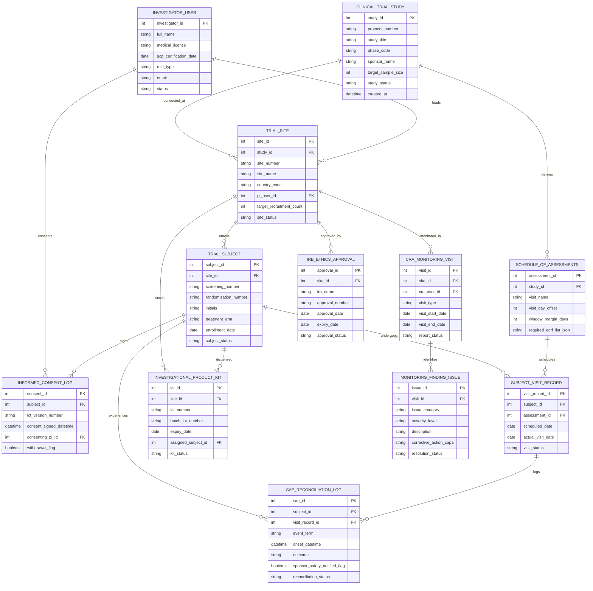

# Conceptual ERD — Clinical Trial Management System

## Mermaid Code

## Entity Description Table | Bảng mô tả Entity

| # | Entity Name | Vietnamese Name | Description | Key Attributes | Main Relationships |
|---|-------------|-----------------|-------------|----------------|-------------------|
| 1 | CLINICAL_TRIAL_STUDY | Nghiên cứu Lâm sàng Master | Master clinical trial study record storing protocol number, study title, Phase (I-IV), sponsor name, target sample size, and status. | study_id, protocol_number, study_title, phase_code, sponsor_name, target_sample_size, study_status | Has many TRIAL_SITE and SCHEDULE_OF_ASSESSMENTS entities. |
| 2 | TRIAL_SITE | Trung tâm Nghiên cứu (Site) | Accredited hospital trial site entry tracking site number, name, country, lead PI ID, recruitment target, and site status. | site_id, study_id, site_number, site_name, country_code, pi_user_id, site_status | Belongs to CLINICAL_TRIAL_STUDY; Has many TRIAL_SUBJECT, INVESTIGATIONAL_PRODUCT_KIT, CRA_MONITORING_VISIT, etc. |
| 3 | INVESTIGATOR_USER | Bác sĩ Nghiên cứu (PI/Sub-I) | Clinical investigator user record storing full name, medical license number, GCP certification date, role, and status. | investigator_id, full_name, medical_license, gcp_certification_date, role_type, email | Has many TRIAL_SITE and INFORMED_CONSENT_LOG entities. |
| 4 | TRIAL_SUBJECT | Bệnh nhân Nghiên cứu (Subject) | Trial participant subject record tracking screening number, randomization number, treatment arm, enrollment date, and status. | subject_id, site_id, screening_number, randomization_number, initials, treatment_arm, subject_status | Belongs to TRIAL_SITE; Has many INFORMED_CONSENT_LOG, SUBJECT_VISIT_RECORD, SAE_RECONCILIATION_LOG, etc. |
| 5 | INFORMED_CONSENT_LOG | Nhật ký Đồng ý Tham gia (ICF) | Electronic Informed Consent Form (eICF) log storing ICF version number, signed timestamp, consenting PI ID, and withdrawal status. | consent_id, subject_id, icf_version_number, consent_signed_datetime, consenting_pi_id, withdrawal_flag | Belongs to TRIAL_SUBJECT and INVESTIGATOR_USER. |
| 6 | SCHEDULE_OF_ASSESSMENTS | Lịch Danh mục Đánh giá (SoA) | Master protocol schedule of assessments matrix defining visit names, visit day offsets, window margin days, and required eCRFs. | assessment_id, study_id, visit_name, visit_day_offset, window_margin_days, required_ecrf_list_json | Belongs to CLINICAL_TRIAL_STUDY; Has many SUBJECT_VISIT_RECORD entities. |
| 7 | SUBJECT_VISIT_RECORD | Nhật ký Viếng thăm Bệnh nhân | Individual subject visit execution record tracking scheduled date, actual visit date, visit window compliance, and visit status. | visit_record_id, subject_id, assessment_id, scheduled_date, actual_visit_date, visit_status | Belongs to TRIAL_SUBJECT and SCHEDULE_OF_ASSESSMENTS; Has many SAE_RECONCILIATION_LOG entities. |
| 8 | INVESTIGATIONAL_PRODUCT_KIT | Hộp Thuốc Nghiên cứu (IP) | Investigational product (IP) drug kit record tracking kit number, lot number, expiration date, assigned subject ID, and kit status. | kit_id, site_id, kit_number, batch_lot_number, expiry_date, assigned_subject_id, kit_status | Belongs to TRIAL_SITE and TRIAL_SUBJECT. |
| 9 | CRA_MONITORING_VISIT | Chuyến Giám sát CRA | Clinical Research Associate site monitoring visit record (PSV, SIV, IMV, COV) tracking monitor ID, visit dates, and report status. | visit_id, site_id, cra_user_id, visit_type, visit_start_date, visit_end_date, report_status | Belongs to TRIAL_SITE; Has many MONITORING_FINDING_ISSUE entities. |
| 10 | MONITORING_FINDING_ISSUE | Phán quyết & Lỗi Giám sát | Monitoring finding and query issue record tracking issue category (SDV, GCP, IP), severity, description, CAPA, and resolution status. | issue_id, visit_id, issue_category, severity_level, description, corrective_action_capa, resolution_status | Belongs to CRA_MONITORING_VISIT. |
| 11 | SAE_RECONCILIATION_LOG | Đối chiếu Biến cố Nghiêm trọng | Serious Adverse Event (SAE) reconciliation record storing event term, onset timestamp, outcome, 24h notification flag, and status. | sae_id, subject_id, visit_record_id, event_term, onset_datetime, outcome, reconciliation_status | Belongs to TRIAL_SUBJECT and SUBJECT_VISIT_RECORD. |
| 12 | IRB_ETHICS_APPROVAL | Phê duyệt Hội đồng Đạo đức | Institutional Review Board / Ethics Committee approval record tracking IRB name, approval number, approval/expiry dates, and status. | approval_id, site_id, irb_name, approval_number, approval_date, expiry_date, approval_status | Belongs to TRIAL_SITE. |

## Relationship Description | Mô tả Quan hệ

| # | From Entity | Cardinality | To Entity | Relationship Label | Business Explanation |
|---|-------------|-------------|-----------|-------------------|----------------------|
| 1 | CLINICAL_TRIAL_STUDY | one-to-many | TRIAL_SITE | conducted_at | One clinical trial study is conducted across multiple accredited trial sites. |
| 2 | CLINICAL_TRIAL_STUDY | one-to-many | SCHEDULE_OF_ASSESSMENTS | defines | One clinical trial study defines master protocol Schedule of Assessments (SoA) visits. |
| 3 | TRIAL_SITE | one-to-many | TRIAL_SUBJECT | enrolls | One trial site enrolls multiple trial subject participants. |
| 4 | TRIAL_SITE | one-to-many | INVESTIGATIONAL_PRODUCT_KIT | stocks | One trial site stocks investigational product (IP) drug kits in its site pharmacy. |
| 5 | TRIAL_SITE | one-to-many | CRA_MONITORING_VISIT | monitored_in | One trial site is monitored in multiple CRA site monitoring visits (SIV, IMV, COV). |
| 6 | TRIAL_SITE | one-to-many | IRB_ETHICS_APPROVAL | approved_by | One trial site is approved by Institutional Review Board (IRB) / Ethics Committee entities. |
| 7 | INVESTIGATOR_USER | one-to-many | TRIAL_SITE | leads | One Principal Investigator (PI) user leads clinical research execution at trial sites. |
| 8 | INVESTIGATOR_USER | one-to-many | INFORMED_CONSENT_LOG | consents | One PI user conducts and witnesses informed consent discussions with trial participants. |
| 9 | TRIAL_SUBJECT | one-to-many | INFORMED_CONSENT_LOG | signs | One trial subject signs electronic Informed Consent Forms (eICF) and amendments. |
| 10 | TRIAL_SUBJECT | one-to-many | SUBJECT_VISIT_RECORD | undergoes | One trial subject undergoes scheduled protocol visit assessments. |
| 11 | TRIAL_SUBJECT | one-to-many | INVESTIGATIONAL_PRODUCT_KIT | dispensed | One trial subject is dispensed randomized double-blind IP drug kits. |
| 12 | TRIAL_SUBJECT | one-to-many | SAE_RECONCILIATION_LOG | experiences | One trial subject can experience Serious Adverse Events (SAE) requiring reconciliation. |
| 13 | SCHEDULE_OF_ASSESSMENTS | one-to-many | SUBJECT_VISIT_RECORD | schedules | One protocol assessment master entry schedules individual subject visit execution records. |
| 14 | SUBJECT_VISIT_RECORD | one-to-many | SAE_RECONCILIATION_LOG | logs | One subject visit record logs identified Serious Adverse Event records. |
| 15 | CRA_MONITORING_VISIT | one-to-many | MONITORING_FINDING_ISSUE | identifies | One CRA monitoring visit identifies SDV discrepancies, GCP deviations, and CAPA issues. |
