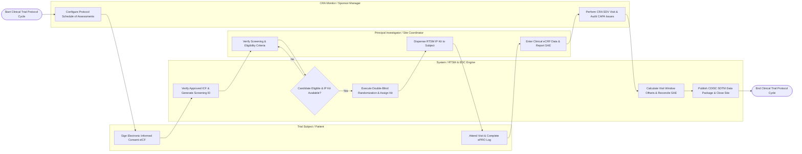

# Swimlane Diagram — Clinical Trial Management System

## Mermaid Code

## Flow Description | Mô tả luồng

| Lane | Actor / Subsystem | Role in Flow |
|------|-------------------|--------------|
| 1 | Trial Subject / Patient | Reviews trial information, signs electronic Informed Consent Forms (eICF), attends scheduled protocol visits, and logs daily electronic Patient-Reported Outcomes (ePRO). |
| 2 | Principal Investigator / Site Coordinator | Screens candidate eligibility against inclusion/exclusion rules, dispenses double-blind IP drug kits assigned by RTSM, enters eCRF clinical data, and files 24-hour SAE reports. |
| 3 | System / RTSM & EDC Engine | Verifies valid ICF signatures, executes double-blind randomization algorithms, selects matching IP drug kits, calculates visit window offsets, reconciles SAE safety records, and exports CDISC SDTM datasets. |
| 4 | CRA Monitor / Sponsor Manager | Configures trial protocols and Schedules of Assessments (SoA), approves site activations, conducts CRA site monitoring visits (SIV, IMV), performs Source Data Verification (SDV), and audits CAPA issues. |
