# Action Tree — Clinical Trial Management System

## Mermaid Code

```mermaid
graph TD
    Root["Clinical Trial Management System"]

    Root --> M1["Trial Protocol & Schedule Setup"]
    Root --> M2["Site Feasibility & Activation"]
    Root --> M3["Patient Screening & eICF"]
    Root --> M4["Randomization & IP Supply RTSM"]
    Root --> M5["CRA Site Monitoring & SDV"]
    Root --> M6["SAE Safety Reconciliation"]
    Root --> M7["Trial Financials & Milestones"]
    Root --> M8["CDISC Data & Analytics"]

    M1 --> A11["Define Master Protocol & Treatment Arms"]
    M1 --> A12["Build Schedule of Assessments SoA Matrix"]
    M1 --> A13["Configure Visit Day Offsets & Margins"]
    M1 --> A14["Publish Protocol Amendment Versions"]

    M2 --> A21["Evaluate Site Feasibility & Patient Volume"]
    M2 --> A22["Verify PI License & GCP Certification"]
    M2 --> A23["Track IRB Ethics Approval Expiration"]
    M2 --> A24["Issue Site Activation Authorization"]

    M3 --> A31["Capture Electronic Informed Consent eICF"]
    M3 --> A32["Evaluate Inclusion Exclusion Criteria"]
    M3 --> A33["Assign Sequential Screening ID"]
    M3 --> A34["Log Candidate Screen Failure Reasons"]

    M4 --> A41["Execute Double-Blind Randomization Code"]
    M4 --> A42["Assign RTSM IP Drug Kit Barcode ID"]
    M4 --> A43["Track Depot Cold-Chain Temperature Logs"]
    M4 --> A44["Process Emergency Code Unblinding Request"]

    M5 --> A51["Conduct CRA Site Initiation Visit SIV"]
    M5 --> A52["Perform Source Data Verification SDV"]
    M5 --> A53["Issue Clinical Data Query to PI"]
    M5 --> A54["Track CAPA Protocol Deviation Resolution"]

    M6 --> A61["Capture 24-Hour Urgent SAE Incident"]
    M6 --> A62["Generate CIOMS MedWatch Safety Forms"]
    M6 --> A63["Reconcile CTMS Data with PV Safety DB"]
    M6 --> A64["File Expedited 7-Day SUSAR Report"]

    M7 --> A71["Track Site Recruitment Milestone Progress"]
    M7 --> A72["Calculate Investigator Fee Disbursements"]
    M7 --> A73["Process Patient Visit Travel Stipends"]
    M7 --> A74["Reconcile CRO Vendor Contract Costs"]

    M8 --> A81["Export CDISC SDTM Data Tabulation Sets"]
    M8 --> A82["Compile CDASH Standard eCRF Datasets"]
    M8 --> A83["Render Recruitment Velocity Curves"]
    M8 --> A84["Audit 21 CFR Part 11 Electronic Trail"]
```

## Module Description | Mô tả Module

| # | Module | Description | Actions |
|---|--------|-------------|---------|
| 1 | Trial Protocol & Schedule Setup | Defines master protocol parameters, treatment arms, Schedule of Assessments (SoA) matrices, visit window margins, and protocol amendments. | Define Master Protocol & Treatment Arms, Build Schedule of Assessments SoA Matrix, Configure Visit Day Offsets & Margins, Publish Protocol Amendment Versions |
| 2 | Site Feasibility & Activation | Evaluates trial site candidate feasibility, verifies PI medical licenses and GCP certifications, tracks IRB ethics approvals, and authorizes site activation. | Evaluate Site Feasibility & Patient Volume, Verify PI License & GCP Certification, Track IRB Ethics Approval Expiration, Issue Site Activation Authorization |
| 3 | Patient Screening & eICF | Manages electronic Informed Consent Forms (eICF), evaluates inclusion/exclusion eligibility criteria, issues screening IDs, and logs screen failures. | Capture Electronic Informed Consent eICF, Evaluate Inclusion Exclusion Criteria, Assign Sequential Screening ID, Log Candidate Screen Failure Reasons |
| 4 | Randomization & IP Supply RTSM | Executes double-blind randomization algorithms, assigns IP drug kits, monitors depot cold-chain temperature logs, and processes emergency unblinding. | Execute Double-Blind Randomization Code, Assign RTSM IP Drug Kit Barcode ID, Track Depot Cold-Chain Temperature Logs, Process Emergency Code Unblinding Request |
| 5 | CRA Site Monitoring & SDV | Conducts CRA monitoring visits (SIV, IMV, COV), performs Source Data Verification (SDV), issues data queries to PIs, and tracks CAPA deviations. | Conduct CRA Site Initiation Visit SIV, Perform Source Data Verification SDV, Issue Clinical Data Query to PI, Track CAPA Protocol Deviation Resolution |
| 6 | SAE Safety Reconciliation | Captures 24-hour urgent SAE incidents, generates CIOMS/MedWatch forms, cross-reconciles CTMS with PV safety databases, and files 7-day SUSARs. | Capture 24-Hour Urgent SAE Incident, Generate CIOMS MedWatch Safety Forms, Reconcile CTMS Data with PV Safety DB, File Expedited 7-Day SUSAR Report |
| 7 | Trial Financials & Milestones | Tracks site recruitment milestone completions, calculates investigator payments, processes patient visit stipends, and reconciles CRO contract budgets. | Track Site Recruitment Milestone Progress, Calculate Investigator Fee Disbursements, Process Patient Visit Travel Stipends, Reconcile CRO Vendor Contract Costs |
| 8 | CDISC Data & Analytics | Exports CDISC SDTM and CDASH standard dataset packages, renders recruitment velocity curves, and audits 21 CFR Part 11 electronic trails. | Export CDISC SDTM Data Tabulation Sets, Compile CDASH Standard eCRF Datasets, Render Recruitment Velocity Curves, Audit 21 CFR Part 11 Electronic Trail |
