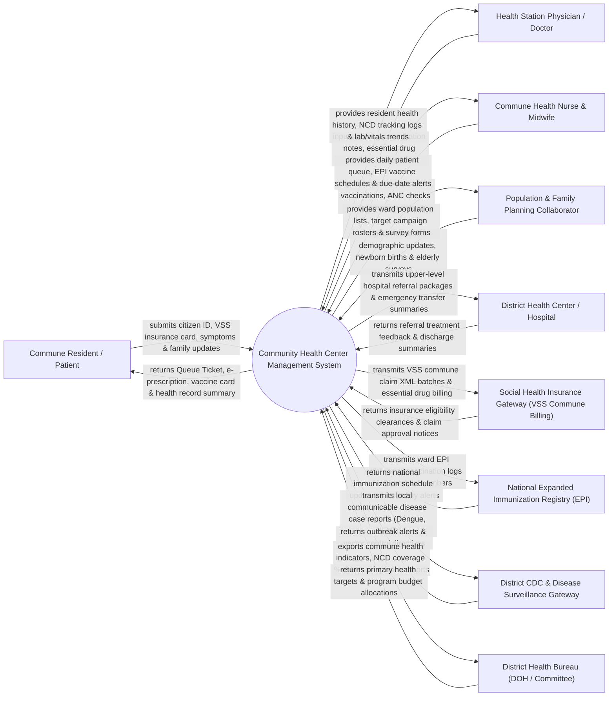

# Context Diagram — Community Health Center Management System

## Mermaid Code

## Actor & Interaction Table | Bảng Actor & Tương tác

| # | Actor | Actor Type | Data Sent TO System | Data Received FROM System | Notes |
|---|-------|------------|---------------------|---------------------------|-------|
| 1 | Commune Resident / Patient | Primary | Citizen ID (CCCD), VSS health insurance card, symptom complaints, family updates. | Consultation summary, essential drug prescriptions, child vaccine passport, referral form. | Local ward/commune resident receiving primary healthcare and preventive health services. |
| 2 | Health Station Physician / Doctor | Primary | Outpatient diagnosis (ICD-10), essential drug prescriptions, chronic NCD management notes, referrals. | Patient family health record, chronic NCD history (BP, glucose), drug inventory levels. | Medical doctor or assistant physician heading clinical care at the commune health station (Trạm Y tế). |
| 3 | Commune Health Nurse & Midwife | Primary | Baseline vital signs, EPI child vaccinations, Antenatal Care (ANC) checks, campaign logs. | Daily clinic queue, EPI vaccine due-date rosters, maternal care schedules, inventory tags. | Certified nurse/midwife administering vaccinations, prenatal care, and primary nursing care. |
| 4 | Population & Family Planning Collaborator | Primary | Household demographic updates, newborn birth notifications, elderly health survey logs. | Ward population lists, targeted campaign rosters (Vitamin A, Deworming), survey templates. | Community health worker (Cộng tác viên Dân số/Y tế thôn bản) conducting door-to-door surveys. |
| 5 | District Health Center / Hospital | Supporting System | Transfer treatment feedback, specialist consultation notes, hospital discharge summaries. | Upper-level hospital referral packages (Giấy chuyển tuyến BHYT), emergency transfer data. | Upper-level district hospital (Trung tâm Y tế / Bệnh viện Huyện) receiving transferred patients. |
| 6 | Social Health Insurance Gateway (VSS Commune Billing) | Supporting System | Primary care insurance clearances, essential drug fee caps, commune claim approvals. | VSS commune claim XML batches, itemized essential drug bills, resident copay receipts. | Vietnam Social Security (VSS) clearing primary health insurance claims for commune stations. |
| 7 | National Expanded Immunization Registry (EPI) | Supporting System | National immunization schedule updates, vaccine batch safety recalls, global vaccine codes. | Ward childhood vaccination logs (BCG, HepB, DTP, Polio, Measles), vaccine lot numbers. | National public health registry tracking childhood expanded immunization coverage. |
| 8 | District CDC & Disease Surveillance Gateway | Supporting System | Local outbreak alerts, vector fogging directives, disease reporting guidelines. | Mandatory notifiable infectious disease case reports (Dengue, Hand-Foot-Mouth Disease). | District Center for Disease Control (Trung tâm Kiểm soát Bệnh tật Huyện) monitoring epidemics. |
| 9 | District Health Bureau (DOH / Committee) | Regulatory | Primary healthcare targets, public health campaign guidelines, annual station budget allocations. | Commune health indicators, chronic NCD management coverage %, EPI vaccination completion reports. | Municipal authority supervising commune health station operations and health programs. |

## System Boundary Description | Mô tả Phạm vi Hệ thống

The **Community Health Center Management System (CHCMS)** is a primary healthcare and public health software solution engineered for commune and ward health stations (Trạm Y tế Xã/Phường), rural health posts, and local polyclinics. It manages the resident population master registry, electronic Family Health Records (Hồ sơ Sức khỏe Gia đình), primary outpatient consultations under primary Social Health Insurance (BHYT Tuyến Xã), essential drug inventory dispensing, chronic Non-Communicable Disease (NCD) management (Hypertension, Diabetes), National Expanded Immunization (EPI) tracking, maternal/child health campaigns, and upper-level hospital referrals.

**Inside System Scope:**
- Resident population master registry, household indexing, and electronic Family Health Record management.
- Primary care outpatient consultation, ICD-10 coding, and essential drug prescription (BHYT Tuyến Xã).
- Essential drug inventory management (stock levels, batch expiration, reorder thresholds).
- Chronic Non-Communicable Disease (NCD) management protocols (Hypertension, Type 2 Diabetes monitoring).
- Childhood Expanded Immunization Program (EPI) scheduling, vaccine administration, and barcode lot tracking.
- Maternal and child health tracking (Antenatal care visits, Tetanus shots, Vitamin A distribution).
- Public health campaign management (Elderly health screening, Deworming, Malnutrition checks).
- VSS commune health insurance billing (XML batch export) and upper-level hospital referral generation.

**Outside System Scope:**
- Complex tertiary inpatient surgeries or specialized intensive care (handled by District/Provincial Hospitals).
- Physical manufacturing of vaccines or pharmaceutical drugs (handled by pharmaceutical vendors).
- General municipal civil registration and birth/death legal certificate issuance (handled by Ministry of Justice).
- Commercial corporate financial general ledger accounting (handled by enterprise ERP).
